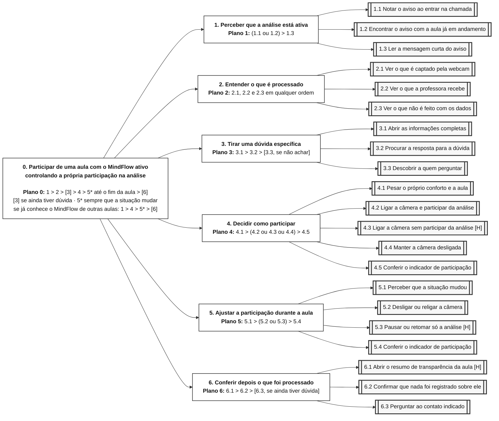
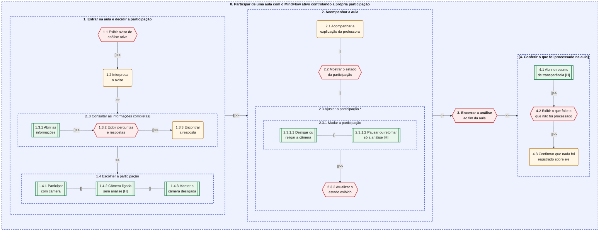

# Entrega 5 — Análise de tarefas: HTA, GOMS e CTT

**Data:** 15/10/2026  
**Status:** 🟧 em andamento  
**Responsabilidade:** cada integrante modela pelo menos 1 HTA, 1 GOMS e 1 CTT. As três técnicas podem abordar a mesma funcionalidade ou funcionalidades distintas, conforme a orientação da disciplina.

## Objetivo da atividade

Modelar tarefas importantes sob perspectivas complementares: decomposição hierárquica (HTA), estrutura de metas/métodos/operações (GOMS) e relações temporais entre tarefas (CTT). O diagrama deve ser acompanhado de interpretação textual.

## Para projetos cujo TCC não previa interface

Modele **tarefas humanas relacionadas ao uso da contribuição técnica**, e não a implementação interna do algoritmo. Exemplos de boas tarefas para análise:

- investigar uma consulta de baixo desempenho;
- configurar uma análise e selecionar parâmetros;
- submeter um dataset e verificar sua validade;
- acompanhar uma execução demorada;
- comparar dois resultados/modelos;
- interpretar uma recomendação e decidir se a aceita;
- localizar uma execução anterior usando busca/filtros;
- gerar e compartilhar um relatório;
- administrar papéis/permissões quando isso for parte do trabalho real;
- revisar um alerta e registrar uma decisão.

Um CRUD pode gerar tarefas relevantes, mas “cadastrar usuário” só merece modelagem se tiver significado no domínio (papéis, validações, riscos, permissões, dependências).

## Seleção das tarefas

| ID | Tarefa | Persona/cenário de origem | Frequência/criticidade | Autor responsável |
|---|---|---|---|---|
| T07 | Participar de uma aula com o MindFlow ativo controlando a própria participação na análise | P05 / C03 — Bruno entrando atrasado na aula de Cálculo, sem saber o que é feito com a imagem dele nem se a câmera ligada (ou desligada) pode pesar contra ele | Alta frequência (toda aula com o MindFlow ativo) / Alta criticidade | Gustavo Bertoluzzi Cardoso — 22.123.016-2 |

> Priorize tarefas necessárias para que o usuário alcance objetivos centrais. Não desperdice a modelagem em ações triviais isoladas, como “clicar em login”, se o objetivo relevante é maior. Da mesma forma, não modele o funcionamento interno do algoritmo como se fosse uma tarefa humana.

---

## HTA — T07 Participar de uma aula com o MindFlow ativo controlando a própria participação na análise

**Autor(a):** Gustavo Bertoluzzi Cardoso — 22.123.016-2

### Descrição da tarefa

A tarefa T07 é modelada pelas três técnicas desta entrega: o HTA mostra como ela se divide em subtarefas, o GOMS mostra os métodos alternativos para cumprir cada meta e o CTT mostra as relações temporais entre o que o participante faz e o que o sistema faz.

A persona de referência é **P05 — Bruno D. Roger**, aluno de graduação em disciplinas EAD. Bruno é persona secundária: não usa o Semáforo Cognitivo nem o Dashboard, mas, como registrado na Entrega 3 (contexto de uso, linha “Papéis/permissões/governança”), tem uma interação própria com o MindFlow por meio das informações de transparência e de participação. Essa é a parte da interface que responde à H03 e às RC04, RC05 e RC09 da Entrega 2.

A tarefa parte da situação do Cenário C03. Bruno entra atrasado na aula de Cálculo pelo Teams e, no meio da aula, a professora pede que mais gente ligue a câmera. Hoje ele decide no escuro, porque não sabe o que é feito com a imagem dele nem se isso pode pesar na nota de participação. Depois da aula, continua sem saber se algo pode voltar contra ele e não tem a quem perguntar (Q5).

Com o MindFlow ativo, Bruno percebe o aviso de que a aula está sendo analisada, entende o que é captado, o que a professora recebe e o que não é feito com os dados e, se ainda tiver dúvida, consulta as informações completas. Em seguida, decide como quer participar e confere o indicador. Durante a aula, pode mudar essa decisão sempre que a situação mudar (por exemplo, quando alguém entra no quarto, que ele divide com a família). Depois da aula, pode conferir o que foi processado.

A tarefa é considerada concluída quando a aula termina com Bruno tendo participado da forma que escolheu, sabendo o que aconteceu com a própria imagem.

### Diagrama



### Decomposição e planos

| ID | Objetivo/operação | Plano/ordem | Problema ou decisão de design observada |
|---|---|---|---|
| 0 | Participar de uma aula com o MindFlow ativo controlando a própria participação na análise | **1 > 2 > [3, se ainda tiver dúvida] > 4 > repetir 5 sempre que a situação mudar, até o fim da aula > [6, se quiser]**; se Bruno já conhece o MindFlow de outras aulas, **1 > 4 > 5\* > [6]** | No C03, Bruno entra atrasado e já com a aula começando. As subtarefas 1 a 4 precisam levar segundos e não podem competir com o início da explicação. O atalho do plano existe para que quem já entendeu o sistema não precise reler tudo a cada aula. |
| 1 | Perceber que a análise está ativa | **(1.1 ou 1.2) > 1.3** | Bruno nunca ouviu falar de um sistema que analisa expressão facial em aula (P05). Se ele não perceber o aviso, nenhuma das outras subtarefas acontece. |
| 1.1 | Notar o aviso ao entrar na chamada | Alternativa a 1.2, quando ele entra no horário | Existe um conflito a investigar: um aviso que bloqueia a entrada garante a leitura, mas atrasa quem já está atrasado; um aviso discreto não atrapalha, mas pode passar despercebido. |
| 1.2 | Encontrar o aviso com a aula já em andamento | Alternativa a 1.1, quando ele entra atrasado ou fecha o aviso sem ler | O aviso não pode existir só no momento da entrada. Um indicador permanente e pequeno deve levar de volta a ele a qualquer momento da aula. |
| 1.3 | Ler a mensagem curta do aviso | Após 1.1 ou 1.2 | A mensagem deve ter poucas linhas e linguagem simples, sem termos técnicos de IA (RC04). |
| 2 | Entender o que é processado | **2.1, 2.2 e 2.3 em qualquer ordem** | As três informações são independentes. Podem aparecer como três blocos curtos que Bruno lê na ordem que quiser. |
| 2.1 | Ver o que é captado pela webcam | Qualquer ordem dentro de 2 | Deve dizer que são sinais visuais processados no próprio computador dele. O processamento local também ajuda a diminuir a sensação de estar sendo vigiado (decisão de design da P05). |
| 2.2 | Ver o que a professora recebe | Qualquer ordem dentro de 2 | É a informação que responde ao medo central do Bruno no C03: a professora recebe só um resultado agregado da turma, sem apontar nenhum aluno (H03; decisão de design da P05). |
| 2.3 | Ver o que não é feito com os dados | Qualquer ordem dentro de 2 | Dizer o que **não** acontece (vídeo não é guardado, não existe avaliação individual) responde à dúvida do Bruno de forma mais direta do que só listar o que o sistema faz. Segue o padrão da página de transparência do Education Insights (Entrega 2). |
| 3 | Tirar uma dúvida específica | **3.1 > 3.2 > [3.3, se não encontrar a resposta]** | É opcional no Plano 0. Só acontece quando o resumo do aviso não bastou. |
| 3.1 | Abrir as informações completas | Primeira operação de 3 | A página completa é o equivalente, no MindFlow, da página de transparência para o aluno do Education Insights (RC04). |
| 3.2 | Procurar a resposta para a dúvida | Após 3.1 | As dúvidas do Bruno são concretas: “isso conta na nota?”, “a professora vê o meu rosto?”. As informações devem estar organizadas por perguntas com as palavras do aluno, e não por termos técnicos. |
| 3.3 | Descobrir a quem perguntar | Opcional, quando 3.2 não resolve | No C03 (Q5), não existe nenhum canal para Bruno tirar esse tipo de dúvida, e ele nunca mandou e-mail para a professora porque achou que ia parecer estranho. A página deve indicar um contato para perguntas sobre os dados. |
| 4 | Decidir como participar | **4.1 > (4.2 ou 4.3 ou 4.4) > 4.5** | A decisão é do Bruno. A interface não deve pressioná-lo para nenhuma das opções. |
| 4.1 | Pesar o próprio conforto e a aula | Primeira operação de 4 | Professor e aluno têm níveis diferentes de autoridade, e o participante pode não se sentir à vontade para recusar (Entrega 3, linha “Ambiente social/organizacional”). |
| 4.2 | Ligar a câmera e participar da análise | Alternativa | É o caminho que a professora espera, mas não deve ser apresentado como o “certo”. |
| 4.3 | Ligar a câmera sem participar da análise **[H]** | Alternativa | A forma de consentimento ou recusa ainda precisa ser investigada (Entrega 3, linha “Papéis/permissões/governança”). Se essa opção não existir, a única forma de não ser analisado é desligar a câmera, ou seja, sumir da aula. Isso reproduz exatamente o conflito do C03, em que privacidade e participação ficam presas uma à outra. |
| 4.4 | Manter a câmera desligada | Alternativa | Não deve gerar consequência individual. A contagem de participantes que contribuem para o sinal, prevista para o comunicador (decisão de design da P04), precisa continuar sendo só um número, sem dizer quem está de câmera desligada. |
| 4.5 | Conferir o indicador de participação | Última operação de 4 | Sem confirmação, Bruno não tem certeza se a escolha dele foi aplicada. O indicador deve ser pequeno e permanente e funcionar também no celular, que é um dos dispositivos que Bruno usa para assistir aula (P05). |
| 5 | Ajustar a participação durante a aula | **5.1 > (5.2 ou 5.3) > 5.4**; executada zero ou mais vezes, sempre que a situação mudar | A escolha feita em 4 não é definitiva. O controle precisa continuar disponível durante toda a aula sem tirar a atenção do Bruno da explicação. |
| 5.1 | Perceber que a situação mudou | Primeira operação de 5 | Exemplos da P05 e do C03: alguém da família entra no quarto, ou Bruno percebe que está num dia em que entendeu menos e não quer se expor. |
| 5.2 | Desligar ou religar a câmera | Alternativa a 5.3, quando ele também quer sumir (ou voltar a aparecer) para a turma | É feita na plataforma de videoconferência, fora do MindFlow. Ao religar a câmera, Bruno precisa saber se a análise volta junto ou continua como ele deixou. |
| 5.3 | Pausar ou retomar só a análise **[H]** | Alternativa a 5.2, quando ele quer continuar visível para a turma | Depende da mesma hipótese de 4.3. Sem ela, a única forma de parar de ser analisado no meio da aula é desligar a câmera. |
| 5.4 | Conferir o indicador de participação | Última operação de 5 | O estado “participando” ou “pausado” precisa ser fácil de distinguir de relance. |
| 6 | Conferir depois o que foi processado | **6.1 > 6.2 > [6.3, se ainda tiver dúvida]**; opcional no Plano 0 | Responde à última ruptura do C03: depois da aula, Bruno fica sem saber se algo pode voltar contra ele (Q5). |
| 6.1 | Abrir o resumo de transparência da aula **[H]** | Primeira operação de 6 | Proposta a validar com alunos. O resumo deve falar só do que aconteceu com os dados do próprio Bruno naquela aula, sem mostrar nenhum resultado da turma, já que o Semáforo e o Dashboard são exclusivos do comunicador (RC09). |
| 6.2 | Confirmar que nada foi registrado sobre ele | Após 6.1 | A informação que importa para o Bruno é negativa: nada foi guardado sobre ele individualmente e o vídeo não foi armazenado. |
| 6.3 | Perguntar ao contato indicado | Opcional, quando 6.2 não basta | É o mesmo contato de 3.3. Ter um canal claro evita que a dúvida fique sem resposta de uma aula para outra, como acontece hoje no C03. |

**Verificação do HTA:**

- O objetivo 0 representa uma meta do usuário? Sim. É a meta do Bruno de assistir à aula sabendo o que acontece com a imagem dele e decidindo como participa, que é a necessidade registrada na P05. Não é uma função do sistema.
- As subtarefas são necessárias e suficientes? Sim. Elas cobrem a aula inteira do ponto de vista do participante: antes de decidir (1 a 3), a decisão (4), a mudança de decisão durante a aula (5) e a confirmação depois (6). A subtarefa 3.3 e a 6 foram incluídas porque a falta de canal para tirar dúvidas é um dos problemas levantados no C03.
- Os **planos** indicam ordem, alternativa, repetição ou condição? Sim. O Plano 0 tem subtarefas opcionais (3 e 6), repetição (5) e condição (quem já conhece o sistema pula de 1 para 4). Os Planos 1, 4 e 5 têm alternativas. O Plano 2 indica ordem livre. Os Planos 3 e 6 têm operações condicionais.
- A decomposição parou em nível útil para projeto de interação? Sim. Parou em ações que viram elementos de interface (aviso, indicador, página de informações, opções de participação, controle de pausa, resumo), sem descer a cliques em telas que ainda não foram desenhadas.

---

## GOMS — T07 Participar de uma aula com o MindFlow ativo controlando a própria participação na análise

**Autor(a):** Gustavo Bertoluzzi Cardoso — 22.123.016-2

### GOAL 0: Participar de uma aula com o MindFlow ativo controlando a própria participação na análise

Esta é a mesma tarefa decomposta no HTA acima. As metas abaixo acompanham a aula do Bruno (P05) na mesma ordem: entender a análise, escolher como participar, verificar o próprio estado, mudar a participação no meio da aula e conferir depois o que foi processado. O GOMS acrescenta ao HTA os **métodos alternativos** para cumprir cada meta e as **regras de seleção** que dizem quando o Bruno usa cada um.

O modelo mostra por que a interface precisa separar duas coisas que hoje andam juntas: aparecer para a turma e ser analisado. Nas GOALs 2 e 4, se só existirem os métodos ligados à câmera, Bruno é obrigado a sumir da aula para proteger a própria imagem, o que é exatamente o conflito descrito no C03.

---

### GOAL 1: Entender o que acontece com a própria imagem nesta aula

#### METHOD 1.A: Ler o aviso ao entrar na aula

**SEL. RULE:** utilizar quando Bruno entra no horário e o aviso de análise ativa aparece na entrada da chamada.

- **OP. 1.A.1:** perceber o aviso na tela;
- **OP. 1.A.2:** ler a mensagem curta;
- **OP. 1.A.3:** ler o que é captado, o que a professora recebe e o que não é feito com os dados;
- **OP. 1.A.4:** decidir se a dúvida foi resolvida.

#### METHOD 1.B: Reabrir o aviso pelo indicador durante a aula

**SEL. RULE:** utilizar quando Bruno entra atrasado, como no C03, ou quando fechou o aviso sem ler.

- **OP. 1.B.1:** perceber o indicador de análise ativa na tela;
- **OP. 1.B.2:** clicar no indicador;
- **OP. 1.B.3:** ler a mensagem curta;
- **OP. 1.B.4:** decidir se a dúvida foi resolvida.

#### METHOD 1.C: Consultar as informações completas

**SEL. RULE:** utilizar quando o aviso resumido não respondeu a uma dúvida concreta, como “isso conta na nota?” ou “a professora vê o meu rosto?”.

- **OP. 1.C.1:** abrir as informações completas a partir do aviso;
- **OP. 1.C.2:** percorrer as perguntas com o olhar;
- **OP. 1.C.3:** escolher a pergunta mais parecida com a própria dúvida;
- **OP. 1.C.4:** ler a resposta;
- **OP. 1.C.5:** se a resposta não bastar, anotar o contato indicado para perguntas sobre os dados.

---

### GOAL 2: Escolher como participar da aula

#### METHOD 2.A: Ligar a câmera e participar da análise

**SEL. RULE:** utilizar quando Bruno está confortável com o ambiente e com a imagem dele sendo usada no resultado agregado da turma.

- **OP. 2.A.1:** clicar no botão de câmera da plataforma;
- **OP. 2.A.2:** confirmar a participação na análise;
- **OP. 2.A.3:** ler o estado “participando” no indicador.

#### METHOD 2.B: Ligar a câmera sem participar da análise **[H]**

**SEL. RULE:** utilizar quando Bruno quer aparecer para a professora e os colegas (por exemplo, porque a professora pediu câmeras ligadas), mas não quer que a imagem seja analisada. Depende de o MindFlow oferecer essa opção, o que ainda precisa ser investigado (Entrega 3, linha “Papéis/permissões/governança”).

- **OP. 2.B.1:** clicar no botão de câmera da plataforma;
- **OP. 2.B.2:** selecionar a opção de não participar da análise;
- **OP. 2.B.3:** ler o estado “não participando” no indicador.

#### METHOD 2.C: Manter a câmera desligada

**SEL. RULE:** utilizar quando Bruno não quer aparecer para a turma, como no C03, em que o quarto está bagunçado e ele não estudou a aula anterior.

- **OP. 2.C.1:** deixar a câmera desligada na plataforma;
- **OP. 2.C.2:** ler o estado “não participando” no indicador.

---

### GOAL 3: Verificar se está contribuindo para a análise agora

#### METHOD 3.A: Consultar o indicador de participação do MindFlow

**SEL. RULE:** utilizar quando o indicador está visível, ou seja, quando a janela da aula não está ocupada em tela cheia pela apresentação da professora.

- **OP. 3.A.1:** direcionar o olhar para o indicador de participação;
- **OP. 3.A.2:** ler o estado exibido;
- **OP. 3.A.3:** concluir se está contribuindo para a análise.

#### METHOD 3.B: Deduzir pelo estado da câmera

**SEL. RULE:** utilizar quando o indicador não está visível, por exemplo quando Bruno assiste pelo celular ou quando a apresentação da professora ocupa a tela inteira.

- **OP. 3.B.1:** localizar o ícone da câmera na barra da plataforma;
- **OP. 3.B.2:** verificar se a câmera está ligada;
- **OP. 3.B.3:** lembrar o que escolheu na GOAL 2;
- **OP. 3.B.4:** concluir se está contribuindo para a análise.

---

### GOAL 4: Mudar a participação no meio da aula

#### METHOD 4.A: Desligar ou religar a câmera na plataforma

**SEL. RULE:** utilizar quando Bruno também quer sumir (ou voltar a aparecer) para a turma, por exemplo quando alguém da família entra no quarto e depois sai.

- **OP. 4.A.1:** localizar o botão de câmera da plataforma;
- **OP. 4.A.2:** clicar no botão de câmera;
- **OP. 4.A.3:** perceber que o próprio vídeo sumiu ou voltou na grade;
- **OP. 4.A.4:** conferir no indicador se a análise acompanhou a mudança (repetindo a GOAL 3).

#### METHOD 4.B: Pausar ou retomar só a análise no MindFlow **[H]**

**SEL. RULE:** utilizar quando Bruno quer continuar visível para a turma, mas parar (ou voltar) a ser analisado. Depende da mesma hipótese do METHOD 2.B.

- **OP. 4.B.1:** localizar o controle de participação do MindFlow;
- **OP. 4.B.2:** selecionar pausar ou retomar;
- **OP. 4.B.3:** perceber que a câmera continuou como estava;
- **OP. 4.B.4:** ler o novo estado no indicador.

---

### GOAL 5: Conferir depois da aula o que foi processado

#### METHOD 5.A: Abrir o resumo de transparência da aula **[H]**

**SEL. RULE:** utilizar quando Bruno quer uma confirmação sobre aquela aula específica, por exemplo depois de ter participado pouco e ficar com medo de isso pesar contra ele (C03).

- **OP. 5.A.1:** abrir o resumo de transparência da aula;
- **OP. 5.A.2:** ler por quanto tempo a imagem dele contribuiu para a análise;
- **OP. 5.A.3:** ler o que não foi guardado (vídeo, resultado individual);
- **OP. 5.A.4:** concluir que nada foi registrado sobre ele individualmente.

#### METHOD 5.B: Perguntar ao contato indicado

**SEL. RULE:** utilizar quando o resumo não respondeu à dúvida ou quando Bruno quer a confirmação de uma pessoa (C03, Q5).

- **OP. 5.B.1:** localizar o contato indicado nas informações completas;
- **OP. 5.B.2:** escrever a pergunta;
- **OP. 5.B.3:** enviar a pergunta.

> Não chame qualquer passo de “método”. Em GOMS, métodos são sequências alternativas capazes de atingir uma meta; regras de seleção explicam quando escolher entre eles.

---

## CTT — T07 Participar de uma aula com o MindFlow ativo controlando a própria participação na análise

**Autor(a):** Gustavo Bertoluzzi Cardoso — 22.123.016-2

### Descrição

O CTT modela a mesma tarefa T07 do HTA e do GOMS, agora pelas relações temporais entre o que Bruno (P05) faz e o que o MindFlow faz do lado do participante. Não modela o processamento dos sinais, que é funcionamento interno do algoritmo: as tarefas de sistema aqui são apenas as que Bruno percebe, como exibir o aviso e mostrar o estado da participação.

A correspondência com o HTA é a seguinte: a tarefa 1 do CTT reúne as subtarefas 1 a 4 do HTA (perceber, entender, tirar dúvida e decidir), a tarefa 2.3 corresponde à subtarefa 5 (ajustar a participação) e a tarefa 4 corresponde à subtarefa 6 (conferir depois).

A tarefa raiz é abstrata. Primeiro, Bruno **entra na aula e decide a participação**: o sistema exibe o aviso de análise ativa, Bruno interpreta o aviso, pode consultar as informações completas (tarefa opcional) e escolhe uma das três formas de participar (escolha, `[]`). Essa escolha passa adiante para o acompanhamento da aula (`[]>>`).

Durante a aula, três coisas acontecem ao mesmo tempo (`|||`): Bruno acompanha a explicação da professora, o sistema mostra o estado da participação dele e, sempre que quiser (`*`), ele ajusta a participação, escolhendo entre mudar a câmera ou pausar e retomar só a análise. O fim da aula **desabilita** todo o acompanhamento (`[>`): quando a professora encerra a sessão, o MindFlow encerra a análise. Depois disso, Bruno pode, opcionalmente, **conferir o que foi processado na aula**.

### Diagrama



Expressão temporal equivalente ao diagrama:

```text
0     = 1 []>> (2 [> 3) >> [4]
1     = 1.1 []>> 1.2 >> [1.3] >> 1.4
1.3   = 1.3.1 []>> 1.3.2 []>> 1.3.3
1.4   = 1.4.1 [] 1.4.2 [] 1.4.3
2     = 2.1 ||| 2.2 ||| 2.3*
2.3   = 2.3.1 []>> 2.3.2
2.3.1 = 2.3.1.1 [] 2.3.1.2
4     = 4.1 []>> 4.2 []>> 4.3
```

### Legenda e relações temporais usadas

| Operador/relação | Significado no diagrama | Exemplo no modelo |
|---|---|---|
| `[]>>` (habilitação com passagem de informação) | A segunda tarefa só começa depois da primeira e usa a informação produzida por ela | Exibir aviso `[]>>` Interpretar o aviso; Entrar na aula e decidir `[]>>` Acompanhar a aula (a escolha feita define como ele participa); Mudar a participação `[]>>` Atualizar o estado exibido |
| `>>` (habilitação) | A segunda tarefa só começa depois que a primeira termina | Interpretar o aviso `>>` Consultar as informações completas `>>` Escolher a participação; Encerrar a análise `>>` Conferir o que foi processado |
| `[]` (escolha) | Apenas uma das tarefas é executada | Participar com câmera `[]` Câmera ligada sem análise `[]` Manter a câmera desligada; Desligar ou religar a câmera `[]` Pausar ou retomar só a análise |
| `\|\|\|` (concorrência) | As tarefas acontecem ao mesmo tempo, sem ordem entre elas | Acompanhar a explicação `\|\|\|` Mostrar o estado da participação `\|\|\|` Ajustar a participação |
| `[>` (desabilitação) | A segunda tarefa interrompe definitivamente a primeira | Encerrar a análise `[>` interrompe todo o acompanhamento da aula |
| `*` (repetição) | A tarefa pode ser executada várias vezes | Ajustar a participação, repetido sempre que a situação do Bruno mudar |
| `[ ]` em volta do nome (tarefa opcional) | A tarefa pode ou não ser executada | [1.3 Consultar as informações completas]; [4. Conferir o que foi processado na aula] |
| Borda tracejada azul | Tarefa abstrata | 0, 1, 1.3, 1.4, 2, 2.3, 2.3.1 e 4 |
| Laranja, cantos arredondados | Tarefa de usuário (cognitiva, sem agir sobre o sistema) | 1.2 Interpretar o aviso; 1.3.3 Encontrar a resposta; 2.1 Acompanhar a explicação; 4.3 Confirmar que nada foi registrado |
| Verde | Tarefa de interação (usuário agindo sobre o sistema) | 1.3.1 Abrir as informações; 1.4.1, 1.4.2 e 1.4.3; 2.3.1.1 e 2.3.1.2; 4.1 Abrir o resumo |
| Vermelho, hexágono | Tarefa de sistema (executada pelo MindFlow sem ação do usuário) | 1.1 Exibir aviso; 1.3.2 Exibir perguntas e respostas; 2.2 Mostrar o estado; 2.3.2 Atualizar o estado; 3. Encerrar a análise; 4.2 Exibir o que foi processado |

No diagrama, as subtarefas ficam dentro da caixa da tarefa-pai e o operador temporal aparece sobre a linha que liga duas tarefas irmãs. A concorrência `|||` em 2 mostra a principal exigência de design do lado do participante: o estado da participação precisa estar sempre disponível sem tirar a atenção do Bruno da aula, que é o objetivo dele (P05). A desabilitação `[>` em 3 deixa claro que a análise termina junto com a aula, sem continuar depois. As tarefas 1.4.2 e 2.3.1.2 estão marcadas como **[H]** porque a forma de consentimento ou recusa ainda precisa ser investigada (Entrega 3), e a tarefa 4 também é uma proposta a validar com alunos, ligada à questão Q5 do C03.

Identifique, quando aplicável, tarefas de usuário, sistema, interação e tarefas abstratas. Verifique se concorrência, escolha, habilitação, desabilitação e repetição estão representadas corretamente segundo a notação adotada em aula.

---

## Síntese da equipe

Quais problemas de interação, oportunidades e requisitos apareceram a partir das modelagens? Quais tarefas irão para o protótipo e para o teste de usabilidade?

## Checklist

- [ ] Cada integrante produziu ao menos 1 HTA, 1 GOMS e 1 CTT.
- [ ] Cada artefato identifica autor e tarefa.
- [ ] Diagramas são legíveis e possuem fonte editável quando possível.
- [ ] HTA contém planos, não apenas árvore de tópicos.
- [ ] GOMS distingue Goals, Operators, Methods e Selection Rules.
- [ ] CTT usa operadores temporais e tipos de tarefa coerentes.
- [ ] Há texto explicando cada diagrama.
- [ ] Tarefas estão ligadas a cenários/personas na rastreabilidade.
- [ ] Em TCC técnico, as tarefas descrevem o que a pessoa faz com a contribuição/resultados, não passos internos do código.
- [ ] CRUDs, relatórios, filtros e atividades administrativas foram escolhidos por relevância ao objetivo do usuário.
