# Entrega 5 — Análise de tarefas: HTA, GOMS e CTT

**Data:** {{10/09/2026}}  
**Status:** 🟨  iniciada  
**Responsabilidade:** cada integrante modela pelo menos 1 HTA, 1 GOMS e 1 CTT. As três técnicas podem abordar a mesma funcionalidade ou funcionalidades distintas, conforme a orientação da disciplina.

## Objetivo da atividade

Modelar tarefas importantes sob perspectivas complementares: decomposição hierárquica (HTA), estrutura de metas/métodos/operações (GOMS) e relações temporais entre tarefas (CTT). O diagrama deve ser acompanhado de interpretação textual.

## Para projetos cujo TCC não previa interface

Modele **tarefas humanas relacionadas ao uso da contribuição técnica**, e não a implementação interna do algoritmo. Exemplos de boas tarefas para análise:

- investigar uma consulta de baixo desempenho;
- configurar uma análise e selecionar parâmetros;
- submeter um dataset e verificar sua validade;
- acompanhar uma execução demorada;
- comparar dois resultados/modelos;
- interpretar uma recomendação e decidir se a aceita;
- localizar uma execução anterior usando busca/filtros;
- gerar e compartilhar um relatório;
- administrar papéis/permissões quando isso for parte do trabalho real;
- revisar um alerta e registrar uma decisão.

Um CRUD pode gerar tarefas relevantes, mas “cadastrar usuário” só merece modelagem se tiver significado no domínio (papéis, validações, riscos, permissões, dependências).

## Seleção das tarefas

| ID | Tarefa | Persona/cenário de origem | Frequência/criticidade | Autor responsável |
|---|---|---|---|---|
| T01 | Configurar o acompanhamento de uma aula no MindFlow AI | P01 / C01 — Docente preparando uma aula EAD síncrona | Média frequência / Alta criticidade | {{nome — matrícula}} |

> Priorize tarefas necessárias para que o usuário alcance objetivos centrais. Não desperdice a modelagem em ações triviais isoladas, como “clicar em login”, se o objetivo relevante é maior. Da mesma forma, não modele o funcionamento interno do algoritmo como se fosse uma tarefa humana.

---

## HTA — T01 Configurar o acompanhamento de uma aula no MindFlow AI

**Autor(a):** {{nome — matrícula}}

### Descrição da tarefa

A tarefa tem como objetivo preparar o MindFlow AI para acompanhar os estados dos participantes durante uma aula on-line, garantindo que a sessão, os participantes e os recursos necessários para o monitoramento estejam configurados antes do início do acompanhamento.

A tarefa se inicia quando o docente possui uma aula ou videoconferência que deseja acompanhar com o MindFlow AI. Durante a configuração, o usuário prepara a sessão, define quais participantes serão considerados no acompanhamento, verifica se a extensão e a coleta estão disponíveis e confirma se os dados estão sendo apresentados corretamente no sistema.

A tarefa é considerada concluída quando a configuração é validada e o acompanhamento está pronto para ser utilizado durante a aula. Caso algum problema seja identificado durante a verificação, o usuário deve corrigir a configuração antes de iniciar o monitoramento.

### Diagrama

```mermaid
flowchart TB

    %% =====================================================
    %% OBJETIVO PRINCIPAL
    %% =====================================================

    T0["0. Configurar o acompanhamento de uma aula<br/>no MindFlow AI<br/><b>Plano 0:</b> 1 > 2 > 3 > [4, se necessário] > 5"]

    %% =====================================================
    %% NÍVEL 1
    %% =====================================================

    T1["1. Preparar a sessão para acompanhamento<br/><b>Plano 1:</b> 1.1 > 1.2"]

    T2["2. Definir o escopo do acompanhamento<br/><b>Plano 2:</b> 2.1 > 2.2"]

    T3["3. Verificar a configuração<br/><b>Plano 3:</b> 3.1 > 3.2 > 3.3"]

    T4["4. Corrigir problemas de configuração<br/><b>Plano 4:</b> repetir as operações necessárias<br/>e retornar a 3"]

    T5[["5. Confirmar que o acompanhamento<br/>está pronto para a aula"]]

    T0 --> T1
    T0 --> T2
    T0 --> T3
    T0 --> T4
    T0 --> T5

    %% =====================================================
    %% TAREFA 1 — PREPARAR SESSÃO
    %% =====================================================

    T11[["1.1 Identificar a aula ou sessão<br/>que será acompanhada"]]

    T12[["1.2 Disponibilizar o MindFlow AI<br/>para a sessão"]]

    T1 --> T11
    T1 --> T12

    %% =====================================================
    %% TAREFA 2 — DEFINIR ESCOPO
    %% =====================================================

    T21[["2.1 Definir os participantes<br/>considerados no acompanhamento"]]

    T22[["2.2 Confirmar a exclusão do apresentador<br/>da análise dos participantes"]]

    T2 --> T21
    T2 --> T22

    %% =====================================================
    %% TAREFA 3 — VERIFICAR CONFIGURAÇÃO
    %% =====================================================

    T31[["3.1 Verificar se o recurso de<br/>acompanhamento está ativo"]]

    T32[["3.2 Verificar se os participantes<br/>estão sendo reconhecidos"]]

    T33[["3.3 Confirmar se os indicadores<br/>estão disponíveis para visualização"]]

    T3 --> T31
    T3 --> T32
    T3 --> T33

    %% =====================================================
    %% TAREFA 4 — CORREÇÕES
    %% =====================================================

    T41[["4.1 Identificar o problema<br/>encontrado na verificação"]]

    T42[["4.2 Ajustar a configuração<br/>necessária"]]

    T43[["4.3 Realizar novamente<br/>a verificação"]]

    T4 --> T41
    T4 --> T42
    T4 --> T43

    %% =====================================================
    %% ESTILOS
    %% =====================================================

    classDef objetivo fill:#ffffff,stroke:#333,stroke-width:1.5px,color:#111;
    classDef operacao fill:#f7f7f7,stroke:#333,stroke-width:2.5px,color:#111;

    class T0,T1,T2,T3,T4 objetivo;
    class T5,T11,T12,T21,T22,T31,T32,T33,T41,T42,T43 operacao;
```

### Decomposição e planos

| ID | Objetivo/operação | Plano/ordem | Problema ou decisão de design observada |
|---|---|---|---|
| 0 | Configurar o acompanhamento de uma aula no MindFlow AI | **1 > 2 > 3 > [4, se necessário] > 5** | A configuração deve ser concluída antes do início do acompanhamento, com feedback claro sobre possíveis problemas e sobre o estado final de prontidão. |
| 1 | Preparar a sessão para acompanhamento | **1.1 > 1.2** | O usuário precisa identificar corretamente qual aula será acompanhada e disponibilizar o MindFlow AI para essa sessão sem exigir uma sequência extensa de configuração. |
| 1.1 | Identificar a aula ou sessão que será acompanhada | Executar antes de 1.2 | A identificação da sessão deve ser clara para evitar que dados sejam associados à aula incorreta. |
| 1.2 | Disponibilizar o MindFlow AI para a sessão | Executar após 1.1 | O sistema deve informar de forma visível quando o recurso estiver disponível para utilização. |
| 2 | Definir o escopo do acompanhamento | **2.1 > 2.2** | Deve ficar claro quem será considerado na análise, evitando a inclusão indevida de pessoas que não fazem parte do grupo acompanhado. |
| 2.1 | Definir os participantes considerados no acompanhamento | Executar antes de 2.2 | A identificação dos participantes precisa ser compreensível e permitir verificar quem está incluído na análise. |
| 2.2 | Confirmar a exclusão do apresentador da análise dos participantes | Executar após 2.1 | O apresentador não deve interferir nos indicadores destinados à análise do grupo participante. |
| 3 | Verificar a configuração | **3.1 > 3.2 > 3.3** | O usuário precisa saber se todos os componentes necessários estão funcionando antes de considerar a configuração concluída. |
| 3.1 | Verificar se o recurso de acompanhamento está ativo | Primeira verificação | O estado ativo ou inativo do acompanhamento deve ser apresentado de forma evidente. |
| 3.2 | Verificar se os participantes estão sendo reconhecidos | Executar após 3.1 | Falhas de reconhecimento precisam ser perceptíveis para que possam ser corrigidas antes do início do acompanhamento. |
| 3.3 | Confirmar se os indicadores estão disponíveis para visualização | Executar após 3.2 | A interface deve fornecer feedback suficiente para confirmar que os dados necessários estão disponíveis. |
| 4 | Corrigir problemas de configuração | **4.1 > 4.2 > 4.3 > retornar a 3** | A correção deve permitir identificar a origem do problema e refazer apenas as etapas necessárias, evitando reiniciar toda a configuração. |
| 4.1 | Identificar o problema encontrado na verificação | Executar quando alguma verificação de 3 falhar | A mensagem apresentada deve ajudar o usuário a compreender o que precisa ser corrigido. |
| 4.2 | Ajustar a configuração necessária | Executar após 4.1 | A interface deve direcionar o usuário para o ajuste correspondente ao problema identificado. |
| 4.3 | Realizar novamente a verificação | Executar após 4.2 e retornar a 3 | Após a correção, o sistema deve permitir confirmar se o problema foi resolvido. |
| 5 | Confirmar que o acompanhamento está pronto para a aula | Executar após 3 quando todas as verificações forem concluídas com sucesso | O sistema deve apresentar uma confirmação clara de que a configuração foi concluída e o acompanhamento está pronto para uso. |

**Verificação do HTA:**

- O objetivo 0 representa uma meta do usuário?
- As subtarefas são necessárias e suficientes?
- Os **planos** indicam ordem, alternativa, repetição ou condição?
- A decomposição parou em nível útil para projeto de interação?

---

## GOMS — T01 Configurar o acompanhamento de uma aula no MindFlow AI

**Autor(a):** {{nome — matrícula}}

### GOAL 0: Configurar o acompanhamento de uma aula no MindFlow AI e deixá-lo pronto para uso

---

### GOAL 1: Preparar a sessão que será acompanhada

#### METHOD 1.A: Utilizar uma sessão já identificada pelo sistema

**SEL. RULE:** utilizar quando a aula ou sessão que será acompanhada já estiver disponível e corretamente identificada no MindFlow AI.

- **OP. 1.A.1:** examinar a sessão apresentada pelo sistema;
- **OP. 1.A.2:** verificar se a sessão corresponde à aula desejada;
- **OP. 1.A.3:** selecionar a sessão;
- **OP. 1.A.4:** confirmar a seleção.

#### METHOD 1.B: Localizar a sessão manualmente

**SEL. RULE:** utilizar quando a sessão desejada não estiver imediatamente identificada ou quando houver mais de uma sessão disponível.

- **OP. 1.B.1:** acessar as sessões disponíveis;
- **OP. 1.B.2:** examinar as informações apresentadas;
- **OP. 1.B.3:** identificar a sessão correspondente à aula;
- **OP. 1.B.4:** selecionar a sessão;
- **OP. 1.B.5:** confirmar a seleção.

---

### GOAL 2: Definir quem será considerado no acompanhamento

#### METHOD 2.A: Utilizar os participantes identificados automaticamente

**SEL. RULE:** utilizar quando os participantes reconhecidos pelo MindFlow AI correspondem corretamente às pessoas que devem ser consideradas na análise.

- **OP. 2.A.1:** examinar os participantes identificados;
- **OP. 2.A.2:** verificar se os participantes esperados estão presentes;
- **OP. 2.A.3:** verificar se o apresentador está excluído da análise;
- **OP. 2.A.4:** confirmar o conjunto de participantes.

#### METHOD 2.B: Ajustar os participantes considerados no acompanhamento

**SEL. RULE:** utilizar quando houver participantes identificados incorretamente, pessoas ausentes da análise ou necessidade de ajustar quem será considerado pelo sistema.

- **OP. 2.B.1:** examinar a lista de participantes identificados;
- **OP. 2.B.2:** identificar participantes que precisam de ajuste;
- **OP. 2.B.3:** alterar a seleção dos participantes;
- **OP. 2.B.4:** verificar se o apresentador permanece excluído;
- **OP. 2.B.5:** confirmar o conjunto atualizado.

---

### GOAL 3: Verificar se o acompanhamento está funcionando corretamente

#### METHOD 3.A: Verificar o status geral da configuração

**SEL. RULE:** utilizar quando o usuário deseja confirmar rapidamente se os principais recursos necessários para o acompanhamento estão disponíveis.

- **OP. 3.A.1:** direcionar a atenção para o status do acompanhamento;
- **OP. 3.A.2:** verificar se o acompanhamento está ativo;
- **OP. 3.A.3:** verificar se os participantes estão sendo reconhecidos;
- **OP. 3.A.4:** verificar se os indicadores estão disponíveis;
- **OP. 3.A.5:** interpretar o estado geral da configuração.

#### METHOD 3.B: Verificar individualmente os componentes da configuração

**SEL. RULE:** utilizar quando o status geral indicar alguma inconsistência ou quando for necessário identificar qual componente apresenta problema.

- **OP. 3.B.1:** verificar o estado do acompanhamento;
- **OP. 3.B.2:** verificar o reconhecimento dos participantes;
- **OP. 3.B.3:** verificar a disponibilidade dos indicadores;
- **OP. 3.B.4:** comparar os resultados das verificações;
- **OP. 3.B.5:** identificar o componente que necessita de ajuste.

---

### GOAL 4: Corrigir problemas encontrados na configuração

#### METHOD 4.A: Corrigir apenas o componente que apresentou problema

**SEL. RULE:** utilizar quando o problema estiver claramente identificado e puder ser corrigido sem alterar as demais configurações.

- **OP. 4.A.1:** identificar o componente com problema;
- **OP. 4.A.2:** acessar a configuração correspondente;
- **OP. 4.A.3:** realizar o ajuste necessário;
- **OP. 4.A.4:** repetir a verificação do componente;
- **OP. 4.A.5:** confirmar se o problema foi resolvido.

#### METHOD 4.B: Revisar a configuração do acompanhamento

**SEL. RULE:** utilizar quando houver mais de um problema, quando a causa não estiver clara ou quando a correção isolada não resolver a inconsistência.

- **OP. 4.B.1:** revisar a sessão selecionada;
- **OP. 4.B.2:** revisar os participantes considerados;
- **OP. 4.B.3:** verificar novamente o estado do acompanhamento;
- **OP. 4.B.4:** verificar a disponibilidade dos indicadores;
- **OP. 4.B.5:** identificar possíveis inconsistências;
- **OP. 4.B.6:** realizar os ajustes necessários;
- **OP. 4.B.7:** repetir a validação da configuração.

---

### GOAL 5: Confirmar que o acompanhamento está pronto para a aula

#### METHOD 5.A: Confirmar a configuração validada

**SEL. RULE:** utilizar quando todas as verificações forem concluídas sem problemas e os recursos necessários estiverem disponíveis.

- **OP. 5.A.1:** verificar o estado final da configuração;
- **OP. 5.A.2:** confirmar que o acompanhamento está ativo;
- **OP. 5.A.3:** confirmar que os participantes estão corretamente definidos;
- **OP. 5.A.4:** confirmar que os indicadores estão disponíveis;
- **OP. 5.A.5:** concluir que o acompanhamento está pronto para uso.

## CTT — T01 Configurar o acompanhamento de uma aula no MindFlow AI

**Autor(a):** {{nome — matrícula}}

### Descrição

O CTT representa a configuração do MindFlow AI antes do início do acompanhamento de uma aula. A tarefa envolve a interação do usuário com o sistema para selecionar a sessão, definir o escopo do acompanhamento e verificar se os recursos necessários estão disponíveis.

Após a configuração inicial, o sistema verifica o estado do acompanhamento e disponibiliza informações de validação. Caso algum problema seja identificado, o usuário pode realizar os ajustes necessários e repetir a verificação. A tarefa é concluída quando o acompanhamento estiver configurado e pronto para uso.

### Diagrama

### Legenda e relações temporais usadas

| Operador/relação | Significado no diagrama | Exemplo no modelo |
|---|---|---|
| Nuvem | **Tarefa abstrata.** Representa uma composição de outras tarefas e auxilia na decomposição da atividade. | **Configurar o acompanhamento da aula** e **Validar a configuração**. |
| Retângulo | **Tarefa do usuário.** Representa uma atividade realizada pelo usuário sem interação direta com o sistema naquele momento. | **Avaliar se a configuração apresentada está adequada** e **decidir se é necessário realizar ajustes**. |
| Hexágono | **Tarefa do sistema.** Representa uma atividade executada pelo sistema sem interação direta do usuário naquele momento. | **Verificar disponibilidade do acompanhamento** e **verificar reconhecimento dos participantes**. |
| Círculo | **Tarefa interativa.** Representa uma atividade que envolve interação entre usuário e sistema. | **Selecionar a sessão**, **definir participantes**, **consultar o status da configuração** e **realizar ajustes**. |
| `>>` — Habilitação | A segunda tarefa é habilitada após a conclusão da primeira. | **Selecionar a sessão** `>>` **Definir o escopo do acompanhamento** `>>` **Validar a configuração**. |
| `[ ] >>` — Habilitação com passagem de informação | A segunda tarefa é habilitada após a primeira e utiliza as informações produzidas por ela. | **Verificar o estado da configuração** `[ ] >>` **Consultar o status da configuração**. |
| `[ ]` — Escolha | Representa tarefas alternativas; ao iniciar uma delas, a outra alternativa deixa de estar habilitada naquele momento. | Após a validação, o usuário pode **confirmar a configuração** `[ ]` **corrigir a configuração**. |
| Repetição da verificação | Representa o retorno a uma tarefa anterior quando a configuração precisa ser ajustada. | Após **corrigir a configuração**, o usuário retorna à tarefa **Validar a configuração** para verificar novamente o acompanhamento. |

No modelo, não foi utilizada relação de concorrência (`|||`), pois as principais atividades de configuração dependem da conclusão das etapas anteriores. A desabilitação ocorre por meio da relação de escolha (`[ ]`): ao optar por confirmar a configuração ou realizar uma correção, a alternativa não escolhida deixa de estar ativa naquele momento.

---

## Síntese da equipe

As modelagens evidenciaram que a configuração do acompanhamento precisa apresentar feedback claro sobre o estado da sessão, os participantes considerados e a disponibilidade dos indicadores. Também foi identificada a necessidade de permitir a correção de problemas sem obrigar o usuário a reiniciar todo o processo de configuração.

Como oportunidades de design, destacam-se a apresentação clara do estado de prontidão do acompanhamento, mensagens específicas para problemas de configuração e confirmação visual dos participantes incluídos na análise.

Para o protótipo e para o teste de usabilidade, devem ser priorizadas as tarefas de **selecionar a sessão**, **definir o escopo do acompanhamento**, **verificar a configuração**, **identificar possíveis problemas**, **realizar ajustes** e **confirmar que o acompanhamento está pronto para uso**.

## Checklist

- [ ] Cada integrante produziu ao menos 1 HTA, 1 GOMS e 1 CTT.
- [ ] Cada artefato identifica autor e tarefa.
- [ ] Diagramas são legíveis e possuem fonte editável quando possível.
- [ ] HTA contém planos, não apenas árvore de tópicos.
- [ ] GOMS distingue Goals, Operators, Methods e Selection Rules.
- [ ] CTT usa operadores temporais e tipos de tarefa coerentes.
- [ ] Há texto explicando cada diagrama.
- [ ] Tarefas estão ligadas a cenários/personas na rastreabilidade.
- [ ] Em TCC técnico, as tarefas descrevem o que a pessoa faz com a contribuição/resultados, não passos internos do código.
- [ ] CRUDs, relatórios, filtros e atividades administrativas foram escolhidos por relevância ao objetivo do usuário.
