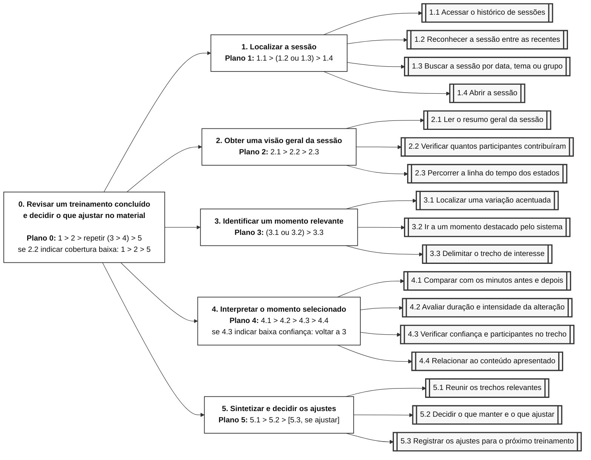
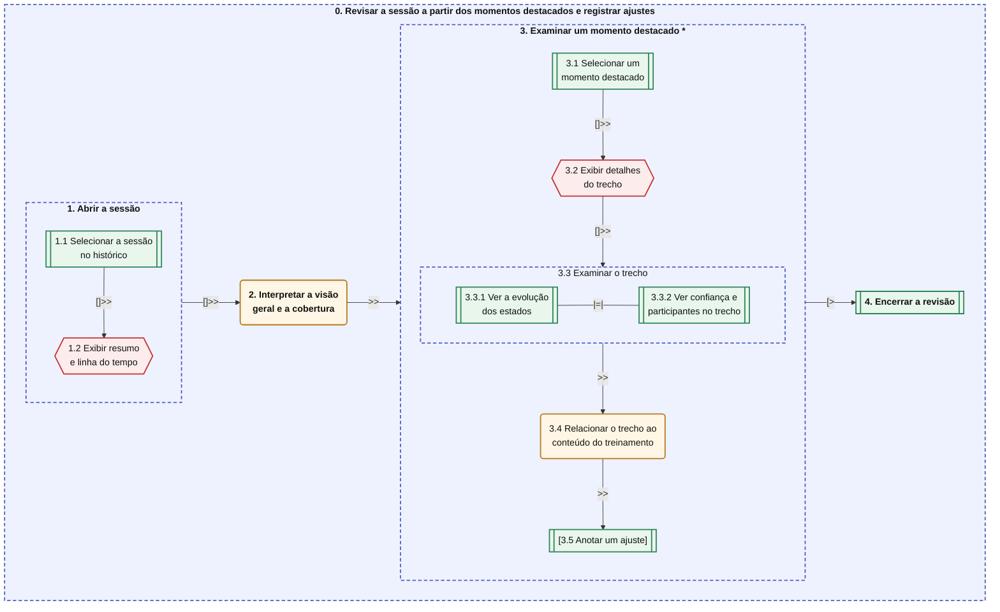

# Entrega 5 — Análise de tarefas: HTA, GOMS e CTT
 
**Data:** 15/10/2026  
**Status:** 🟧 em andamento  
**Responsabilidade:** cada integrante modela pelo menos 1 HTA, 1 GOMS e 1 CTT. As três técnicas podem abordar a mesma funcionalidade ou funcionalidades distintas, conforme a orientação da disciplina.
 
## Objetivo da atividade
 
Modelar tarefas importantes sob perspectivas complementares: decomposição hierárquica (HTA), estrutura de metas/métodos/operações (GOMS) e relações temporais entre tarefas (CTT). O diagrama deve ser acompanhado de interpretação textual.
 
## Para projetos cujo TCC não previa interface
 
Modele **tarefas humanas relacionadas ao uso da contribuição técnica**, e não a implementação interna do algoritmo. Exemplos de boas tarefas para análise:
 
- investigar uma consulta de baixo desempenho;
- configurar uma análise e selecionar parâmetros;
- submeter um dataset e verificar sua validade;
- acompanhar uma execução demorada;
- comparar dois resultados/modelos;
- interpretar uma recomendação e decidir se a aceita;
- localizar uma execução anterior usando busca/filtros;
- gerar e compartilhar um relatório;
- administrar papéis/permissões quando isso for parte do trabalho real;
- revisar um alerta e registrar uma decisão.
Um CRUD pode gerar tarefas relevantes, mas “cadastrar usuário” só merece modelagem se tiver significado no domínio (papéis, validações, riscos, permissões, dependências).
 
## Seleção das tarefas
 
| ID | Tarefa | Persona/cenário de origem | Frequência/criticidade | Autor responsável |
|---|---|---|---|---|
| T07 | Revisar um treinamento concluído para identificar os trechos em que o grupo apresentou mais dificuldade e decidir o que ajustar no material | P03 / C04 — Nathanael, após um treinamento on-line, revisando onde o grupo pode ter perdido o acompanhamento (atividade A03 da Entrega 1) | Média frequência (após cada treinamento) / Alta criticidade | Gustavo Bertoluzzi Cardoso — 22.123.016-2 |
| T08 | Verificar como o grupo reagiu a um trecho específico de um treinamento concluído | P03 / C04 — Nathanael checando um tópico que gerou dúvidas depois do treinamento (A03) | Média frequência / Média criticidade | Gustavo Bertoluzzi Cardoso — 22.123.016-2 |
| T09 | Revisar uma sessão concluída a partir dos momentos destacados e registrar os ajustes para o próximo treinamento | P03 / C04 — Nathanael usando o pós-sessão para melhorar o material dos próximos grupos (A03; jornada da Entrega 3, etapas 6 e 7) | Média frequência / Alta criticidade | Gustavo Bertoluzzi Cardoso — 22.123.016-2 |
 
> Priorize tarefas necessárias para que o usuário alcance objetivos centrais. Não desperdice a modelagem em ações triviais isoladas, como “clicar em login”, se o objetivo relevante é maior. Da mesma forma, não modele o funcionamento interno do algoritmo como se fosse uma tarefa humana.
 
---
 
## HTA — T07 Revisar um treinamento concluído para identificar os trechos em que o grupo apresentou mais dificuldade e decidir o que ajustar no material
 
**Autor(a):** Gustavo Bertoluzzi Cardoso — 22.123.016-2
 
### Descrição da tarefa
 
A tarefa modela o uso do Dashboard pós-sessão do MindFlow AI, que é o recorte secundário do projeto de IHC (Entregas 1 e 3). A persona de referência é **P03 — Nathanael Lima**, instrutor corporativo que, segundo o Cenário C04 (Entrega 4), conduz treinamentos com câmeras quase sempre desligadas e pouca interação no chat, e por isso só descobre falhas de compreensão depois que o treinamento acaba. Uma das necessidades registradas na persona é justamente identificar, depois da sessão, as partes da apresentação que precisam ser melhoradas para os próximos grupos.
 
A tarefa se inicia quando Nathanael, já com o treinamento encerrado, abre o histórico de sessões e seleciona aquela que quer revisar. Ele lê primeiro um resumo geral, verifica se havia participantes suficientes contribuindo para o sinal e percorre a linha do tempo da sessão. Em seguida, entra em um ciclo: escolhe um momento que parece relevante, compara com o que vinha antes e depois, confere se aquela leitura é confiável e tenta relacionar a alteração ao conteúdo que estava apresentando naquele horário.
 
A tarefa é considerada concluída quando Nathanael reúne os trechos que considera relevantes e decide o que manter e o que ajustar no material, registrando esses ajustes quando decide alterar algo. A decisão sobre o que mudar continua sendo dele: o MindFlow oferece estimativas, não recomendações obrigatórias.
 
### Diagrama
 

 
### Decomposição e planos
 
| ID | Objetivo/operação | Plano/ordem | Problema ou decisão de design observada |
|---|---|---|---|
| 0 | Revisar um treinamento concluído para identificar os trechos de maior dificuldade e decidir o que ajustar no material | **1 > 2 > repetir (3 > 4) até não restarem momentos a examinar ou acabar o tempo > 5**; se 2.2 indicar cobertura muito baixa, **1 > 2 > 5** | A revisão acontece no pouco tempo entre um treinamento e outro (P03; jornada da Entrega 3, etapa 6). O ciclo 3 > 4 precisa poder ser interrompido a qualquer momento sem perder o que já foi visto. |
| 1 | Localizar a sessão | **1.1 > (1.2 ou 1.3) > 1.4** | Como Nathanael aplica o mesmo treinamento para grupos diferentes, várias sessões podem ter nomes parecidos. Data e hora sozinhas não bastam para reconhecer a sessão certa. |
| 1.1 | Acessar o histórico de sessões | Primeira operação | O histórico deve abrir mostrando as sessões mais recentes, que são o caso mais comum. |
| 1.2 | Reconhecer a sessão entre as mais recentes | Alternativa a 1.3, quando o treinamento é recente | Cada sessão deve exibir tema e grupo, não só data e hora, para ser reconhecida sem precisar abri-la. |
| 1.3 | Buscar a sessão por data, tema ou grupo | Alternativa a 1.2, quando há muitas sessões ou a sessão é antiga | Busca e filtros só são necessários nesse caso. Não devem ser obrigatórios no caminho principal (Entrega 2, seção 3.1: excesso de filtros aumenta a complexidade). |
| 1.4 | Abrir a sessão | Após 1.2 ou 1.3 | O cabeçalho da sessão aberta deve confirmar tema, grupo e data para evitar que ele analise a sessão errada. |
| 2 | Obter uma visão geral da sessão | **2.1 > 2.2 > 2.3** | Resumo primeiro, detalhe depois (RC01; padrão observado no Education Insights, Entrega 2). |
| 2.1 | Ler o resumo geral da sessão | Primeira operação de 2 | O resumo deve caber em poucas linhas e usar linguagem simples, sem termos técnicos de IA (RC01; P03 tem familiaridade média a alta com tecnologia, mas outras personas não). |
| 2.2 | Verificar quantos participantes contribuíram para o sinal | Após 2.1; condição para o resto da tarefa | No contexto corporativo do C04, a câmera costuma ser opcional. Se poucos participantes contribuíram, a leitura da sessão inteira é fraca. A cobertura precisa estar visível no resumo, e não escondida em um detalhe (decisão já levantada pela P04). |
| 2.3 | Percorrer a linha do tempo dos estados | Após 2.2 | A linha do tempo é o padrão esperado para o pós-sessão (RC10; relatório minuto a minuto do Adobe Connect). Quatro linhas sobrepostas podem dificultar a leitura; é preciso testar como apresentar os estados sem sobrecarregar. |
| 3 | Identificar um momento relevante | **(3.1 ou 3.2) > 3.3** | Existem dois caminhos para chegar a um momento. Os dois devem levar ao mesmo lugar (o trecho delimitado). |
| 3.1 | Localizar na linha do tempo uma variação acentuada | Alternativa a 3.2, quando ele prefere procurar por conta própria | Busca visual é lenta e depende de o gráfico deixar as variações perceptíveis. |
| 3.2 | Ir a um momento destacado pelo sistema | Alternativa a 3.1, quando há destaques disponíveis | Destaques automáticos economizam tempo (RC03), mas podem fazer o instrutor olhar só para o que o sistema escolheu. Os destaques devem ser apresentados como sugestões, não como lista completa de problemas. |
| 3.3 | Delimitar o trecho de interesse | Após 3.1 ou 3.2 | Selecionar um intervalo exato com o mouse em um gráfico exige precisão. Janelas pré-definidas (por exemplo, alguns minutos ao redor do ponto) podem reduzir esse esforço. |
| 4 | Interpretar o momento selecionado | **4.1 > 4.2 > 4.3 > 4.4**; se 4.3 indicar baixa confiança, marcar o trecho como incerto e voltar a 3 | A interpretação é do instrutor. O sistema só oferece contexto para ela. |
| 4.1 | Comparar o trecho com os minutos anteriores e posteriores | Primeira operação de 4 | O antes e o depois precisam estar visíveis juntos, sem troca de tela, para que ele perceba se a alteração foi repentina ou gradual. |
| 4.2 | Avaliar a duração e a intensidade da alteração | Após 4.1 | Uma oscilação curta não deve ser lida como problema. A interface deve ajudar a diferenciar oscilação pontual de mudança sustentada. |
| 4.3 | Verificar a confiança e o número de participantes no trecho | Após 4.2; condiciona 4.4 | A confiança e a cobertura podem variar ao longo da sessão (câmeras ligadas e desligadas). Elas precisam aparecer no próprio trecho, e não só no resumo geral (H02; RC02). |
| 4.4 | Relacionar a alteração ao conteúdo apresentado naquele horário | Última operação de 4 | Como o MindFlow não guarda vídeo bruto (processamento local; Entrega 1, item 9.3), Nathanael precisa lembrar sozinho o que estava apresentando naquele minuto. Esse é o ponto mais frágil da tarefa: a interface precisa de alguma âncora de conteúdo (horário relativo ao início, roteiro ou marcação de tópico), a ser investigado com usuários. |
| 5 | Sintetizar e decidir os ajustes | **5.1 > 5.2 > [5.3, se decidir ajustar algo]** | A decisão de mudar o material é do instrutor (RC03). O sistema não deve sugerir automaticamente qual mudança fazer. |
| 5.1 | Reunir os trechos considerados relevantes | Primeira operação de 5 | Se os trechos vistos no ciclo 3 > 4 não ficarem guardados, ele precisa lembrar de todos de cabeça. |
| 5.2 | Decidir o que manter e o que ajustar no material | Após 5.1 | Trechos marcados como incertos em 4.3 devem continuar diferenciados dos confiáveis, para não pesarem igual na decisão. |
| 5.3 | Registrar os ajustes para o próximo treinamento | Opcional, após 5.2 | Hoje esse registro é externo (anotações próprias). Uma anotação ligada ao trecho seria útil, mas deve falar do conteúdo e do grupo, nunca de participantes individuais (H03). |
 
**Verificação do HTA:**
 
- O objetivo 0 representa uma meta do usuário? Sim. É a meta de Nathanael (P03) de melhorar o material dos próximos treinamentos, e não uma função do Dashboard. O Dashboard aparece apenas como meio.
- As subtarefas são necessárias e suficientes? Sim. Localizar, ter visão geral, escolher um momento, interpretá-lo e sintetizar cobrem a revisão do início ao fim. A verificação da cobertura (2.2) e da confiança (4.3) foi incluída porque, sem ela, a tarefa poderia terminar com uma conclusão baseada em poucos participantes.
- Os **planos** indicam ordem, alternativa, repetição ou condição? Sim. O Plano 0 tem repetição (ciclo 3 > 4) e condição (cobertura baixa leva direto a 5). Os Planos 1 e 3 têm alternativa. O Plano 4 tem condição (baixa confiança volta a 3). O Plano 5 tem uma operação opcional.
- A decomposição parou em nível útil para projeto de interação? Sim. Parou em ações que podem virar elementos de interface (buscar, ler resumo, delimitar trecho, ver confiança, registrar ajuste), sem descer a cliques ou a detalhes de tela que ainda não foram desenhados.
---
 
## GOMS — T08 Verificar como o grupo reagiu a um trecho específico de um treinamento concluído
 
**Autor(a):** Gustavo Bertoluzzi Cardoso — 22.123.016-2
 
### GOAL 0: Verificar se o grupo apresentou sinais de dificuldade em um trecho específico de um treinamento já concluído
 
Diferente da T07, aqui Nathanael (P03) já sabe qual parte quer examinar. Por exemplo: dias depois de um treinamento sobre um procedimento interno novo, ele recebe várias dúvidas por e-mail sobre esse mesmo procedimento e quer saber se o grupo já dava sinais de dificuldade na hora da explicação (situação coerente com a consequência descrita no Cenário C04). A meta é atingida quando ele conclui, com confiança suficiente, se houve ou não sinal de dificuldade naquele trecho e registra essa conclusão.
 
As regras de seleção do modelo mostram onde a interface precisa oferecer mais de um caminho: reconhecer ou buscar a sessão, chegar ao trecho pelo horário ou pelos destaques e aceitar a leitura do sistema ou cruzá-la com outra fonte.
 
---
 
### GOAL 1: Abrir a sessão do treinamento
 
#### METHOD 1.A: Abrir pelas sessões recentes
 
**SEL. RULE:** utilizar quando o treinamento foi realizado há poucos dias e aparece entre as primeiras sessões do histórico.
 
- **OP. 1.A.1:** acessar o histórico de sessões;
- **OP. 1.A.2:** ler tema, grupo e data das primeiras sessões da lista;
- **OP. 1.A.3:** reconhecer a sessão do treinamento;
- **OP. 1.A.4:** selecionar a sessão;
- **OP. 1.A.5:** conferir no cabeçalho se tema, grupo e data correspondem ao treinamento procurado.
#### METHOD 1.B: Buscar a sessão
 
**SEL. RULE:** utilizar quando o treinamento é antigo ou quando o mesmo tema foi aplicado a vários grupos, deixando várias sessões parecidas no histórico.
 
- **OP. 1.B.1:** acessar o histórico de sessões;
- **OP. 1.B.2:** digitar o tema ou o nome do grupo na busca, ou restringir o período;
- **OP. 1.B.3:** ler os resultados;
- **OP. 1.B.4:** distinguir a sessão correta pela data e pelo grupo;
- **OP. 1.B.5:** selecionar a sessão;
- **OP. 1.B.6:** conferir no cabeçalho se a sessão aberta é a correta.
---
 
### GOAL 2: Localizar o trecho do treinamento
 
#### METHOD 2.A: Localizar pelo horário
 
**SEL. RULE:** utilizar quando Nathanael lembra, mesmo que aproximadamente, em que momento do treinamento o tópico foi apresentado (por exemplo, “logo depois do intervalo”).
 
- **OP. 2.A.1:** estimar o horário do tópico a partir do próprio roteiro do treinamento;
- **OP. 2.A.2:** direcionar o olhar para o eixo de tempo da linha do tempo;
- **OP. 2.A.3:** localizar o horário estimado;
- **OP. 2.A.4:** selecionar um intervalo ao redor desse horário;
- **OP. 2.A.5:** conferir se o intervalo cobre o início e o fim do tópico.
#### METHOD 2.B: Localizar pelos momentos destacados
 
**SEL. RULE:** utilizar quando Nathanael não lembra o horário do tópico ou quando quer saber se o sistema destacou alguma alteração perto dele.
 
- **OP. 2.B.1:** abrir a lista de momentos destacados da sessão;
- **OP. 2.B.2:** ler o horário e o tipo de alteração de cada destaque;
- **OP. 2.B.3:** escolher o destaque que mais provavelmente corresponde ao tópico;
- **OP. 2.B.4:** selecionar o destaque;
- **OP. 2.B.5:** comparar o horário do destaque com o roteiro para confirmar que é o tópico procurado.
---
 
### GOAL 3: Avaliar se a leitura do trecho é confiável
 
#### METHOD 3.A: Aceitar a indicação do sistema
 
**SEL. RULE:** utilizar quando o sistema indica confiança adequada no trecho e uma parte razoável do grupo contribuiu para o sinal.
 
- **OP. 3.A.1:** localizar a indicação de confiança do trecho;
- **OP. 3.A.2:** ler quantos participantes contribuíram para o sinal naquele intervalo;
- **OP. 3.A.3:** comparar esse número com o tamanho do grupo;
- **OP. 3.A.4:** aceitar a leitura do trecho como base para a interpretação.
#### METHOD 3.B: Cruzar com outra fonte
 
**SEL. RULE:** utilizar quando a confiança indicada é baixa, quando poucos participantes estavam com a câmera ligada (situação comum em treinamentos corporativos, conforme o C04) ou quando o resultado contradiz a impressão que Nathanael teve durante o treinamento.
 
- **OP. 3.B.1:** abrir uma fonte externa ao MindFlow, como o registro do chat, as perguntas recebidas ou o formulário de avaliação do treinamento;
- **OP. 3.B.2:** procurar manifestações dos participantes sobre o tópico;
- **OP. 3.B.3:** comparar essas manifestações com o que o trecho mostra;
- **OP. 3.B.4:** decidir se a leitura do trecho se sustenta ou deve ser tratada como incerta.
---
 
### GOAL 4: Interpretar o trecho e registrar a conclusão
 
#### METHOD 4.A: Comparar com o restante da mesma sessão
 
**SEL. RULE:** utilizar quando o tópico foi apresentado pela primeira vez ou quando não existe outra sessão comparável.
 
- **OP. 4.A.1:** observar os estados nos minutos anteriores ao trecho;
- **OP. 4.A.2:** observar os estados nos minutos posteriores ao trecho;
- **OP. 4.A.3:** verificar se a alteração começa junto com o tópico e se persiste depois dele;
- **OP. 4.A.4:** concluir se houve ou não sinal de dificuldade no trecho;
- **OP. 4.A.5:** anotar a conclusão junto com o horário do trecho.
#### METHOD 4.B: Comparar com o mesmo tópico em outra sessão
 
**SEL. RULE:** utilizar quando o mesmo treinamento já foi aplicado a outros grupos e Nathanael quer saber se a dificuldade se repete ou é específica deste grupo. A comparação entre sessões ainda é uma possibilidade a investigar (Entrega 1, item 8; Entrega 2, seção 3.1; persona P03).
 
- **OP. 4.B.1:** abrir a outra sessão do mesmo treinamento (repetindo o GOAL 1);
- **OP. 4.B.2:** localizar o mesmo tópico nessa sessão (repetindo o GOAL 2);
- **OP. 4.B.3:** comparar a alteração observada nos dois trechos;
- **OP. 4.B.4:** concluir se a dificuldade é recorrente ou específica do grupo;
- **OP. 4.B.5:** anotar a conclusão indicando as duas sessões comparadas.
> Não chame qualquer passo de “método”. Em GOMS, métodos são sequências alternativas capazes de atingir uma meta; regras de seleção explicam quando escolher entre eles.
 
---
 
## CTT — T09 Revisar uma sessão concluída a partir dos momentos destacados e registrar os ajustes para o próximo treinamento
 
**Autor(a):** Gustavo Bertoluzzi Cardoso — 22.123.016-2
 
### Descrição
 
O modelo CTT mostra a revisão pós-sessão do ponto de vista das relações temporais entre o que Nathanael (P03) faz e o que o MindFlow faz. Ao contrário do HTA da T07, aqui aparecem as **tarefas de sistema**, porque a ordem entre o sistema exibir uma informação e o usuário usá-la é justamente o que interessa ao projeto de interação.
 
A tarefa raiz (**Revisar a sessão e registrar ajustes**) é abstrata e se decompõe em quatro tarefas. Primeiro, Nathanael **abre a sessão**: ele seleciona a sessão no histórico (interação) e o sistema exibe o resumo e a linha do tempo (sistema), passando essas informações adiante (`[]>>`). Com o resumo disponível, ele **interpreta a visão geral e a cobertura da sessão** (tarefa de usuário, cognitiva).
 
Depois, ele **examina momentos destacados**, tarefa repetida (`*`) quantas vezes quiser. Em cada repetição, ele seleciona um momento, o sistema exibe os detalhes do trecho e ele examina a evolução dos estados e a confiança do trecho. Essas duas consultas podem ser feitas em qualquer ordem, mas uma de cada vez (`|=|`). Em seguida, relaciona o trecho ao conteúdo do treinamento e, se quiser, **anota um ajuste** (tarefa opcional, entre colchetes).
 
A qualquer momento, **encerrar a revisão** interrompe o ciclo de exame (`[>`, desabilitação). Isso representa a restrição de tempo de Nathanael entre treinamentos: ele não precisa examinar todos os destaques para que a revisão tenha valor.
 
### Diagrama
 

 
Expressão temporal equivalente ao diagrama:
 
```text
0 = 1 []>> 2 >> (3* [> 4)
1 = 1.1 []>> 1.2
3 = 3.1 []>> 3.2 []>> 3.3 >> 3.4 >> [3.5]
3.3 = 3.3.1 |=| 3.3.2
```
 
### Legenda e relações temporais usadas
 
| Operador/relação | Significado no diagrama | Exemplo no modelo |
|---|---|---|
| `[]>>` (habilitação com passagem de informação) | A segunda tarefa só começa depois da primeira e usa a informação produzida por ela | Selecionar a sessão `[]>>` Exibir resumo e linha do tempo; Exibir resumo `[]>>` Interpretar a visão geral; Exibir detalhes do trecho `[]>>` Examinar o trecho |
| `>>` (habilitação) | A segunda tarefa só começa depois que a primeira termina, sem depender de informação passada por ela | Interpretar a visão geral `>>` Examinar um momento; Relacionar o trecho ao conteúdo `>>` Anotar um ajuste |
| `\|=\|` (independência de ordem) | As duas tarefas precisam ser feitas, em qualquer ordem, mas uma de cada vez | Ver a evolução dos estados `\|=\|` Ver confiança e participantes no trecho |
| `[>` (desabilitação) | A segunda tarefa interrompe definitivamente a primeira | Encerrar a revisão `[>` interrompe o exame de momentos destacados |
| `*` (repetição) | A tarefa pode ser executada várias vezes | Examinar um momento destacado, repetido para cada destaque que Nathanael quiser ver |
| `[ ]` em volta do nome (tarefa opcional) | A tarefa pode ou não ser executada | [3.5 Anotar um ajuste], feita só quando ele decide mudar algo no material |
| Borda tracejada azul | Tarefa abstrata | 0, 1. Abrir a sessão, 3. Examinar um momento destacado, 3.3 Examinar o trecho |
| Laranja, cantos arredondados | Tarefa de usuário (cognitiva, sem agir sobre o sistema) | 2. Interpretar a visão geral e a cobertura; 3.4 Relacionar o trecho ao conteúdo |
| Verde | Tarefa de interação (usuário agindo sobre o sistema) | 1.1 Selecionar a sessão; 3.1 Selecionar um momento; 3.3.1 e 3.3.2; 3.5 Anotar; 4. Encerrar |
| Vermelho, hexágono | Tarefa de sistema (executada pelo MindFlow sem ação do usuário) | 1.2 Exibir resumo e linha do tempo; 3.2 Exibir detalhes do trecho |
 
No diagrama, as subtarefas ficam dentro da caixa da tarefa-pai e o operador temporal aparece sobre a linha que liga duas tarefas irmãs. O operador `|=|` foi usado em 3.3, e não a concorrência `|||`, porque ler a evolução e ler a confiança são duas leituras que disputam a mesma atenção visual: Nathanael faz as duas, mas uma de cada vez. Isso indica ao projeto que as duas informações precisam estar próximas na tela do trecho. A desabilitação `[>` em 4 deixa explícito que a revisão pode ser encerrada no meio do ciclo, então os ajustes anotados em 3.5 precisam ser salvos no momento em que são feitos, e não apenas no final.
 
Identifique, quando aplicável, tarefas de usuário, sistema, interação e tarefas abstratas. Verifique se concorrência, escolha, habilitação, desabilitação e repetição estão representadas corretamente segundo a notação adotada em aula.
 
---
 
## Síntese da equipe
 
Quais problemas de interação, oportunidades e requisitos apareceram a partir das modelagens? Quais tarefas irão para o protótipo e para o teste de usabilidade?
 
## Checklist
 
- [ ] Cada integrante produziu ao menos 1 HTA, 1 GOMS e 1 CTT.
- [ ] Cada artefato identifica autor e tarefa.
- [ ] Diagramas são legíveis e possuem fonte editável quando possível.
- [ ] HTA contém planos, não apenas árvore de tópicos.
- [ ] GOMS distingue Goals, Operators, Methods e Selection Rules.
- [ ] CTT usa operadores temporais e tipos de tarefa coerentes.
- [ ] Há texto explicando cada diagrama.
- [ ] Tarefas estão ligadas a cenários/personas na rastreabilidade.
- [ ] Em TCC técnico, as tarefas descrevem o que a pessoa faz com a contribuição/resultados, não passos internos do código.
- [ ] CRUDs, relatórios, filtros e atividades administrativas foram escolhidos por relevância ao objetivo do usuário.
 
