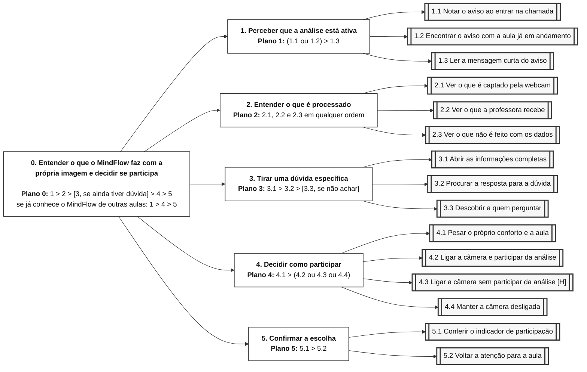
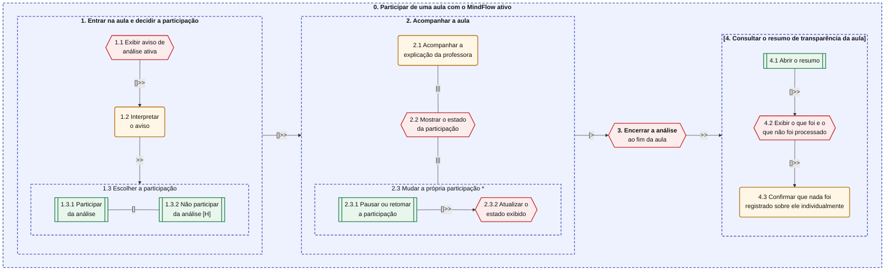

# Entrega 5 — Análise de tarefas: HTA, GOMS e CTT

**Data:** 15/10/2026  
**Status:** 🟧 em andamento  
**Responsabilidade:** cada integrante modela pelo menos 1 HTA, 1 GOMS e 1 CTT. As três técnicas podem abordar a mesma funcionalidade ou funcionalidades distintas, conforme a orientação da disciplina.

## Objetivo da atividade

Modelar tarefas importantes sob perspectivas complementares: decomposição hierárquica (HTA), estrutura de metas/métodos/operações (GOMS) e relações temporais entre tarefas (CTT). O diagrama deve ser acompanhado de interpretação textual.

## Para projetos cujo TCC não previa interface

Modele **tarefas humanas relacionadas ao uso da contribuição técnica**, e não a implementação interna do algoritmo. Exemplos de boas tarefas para análise:

- investigar uma consulta de baixo desempenho;
- configurar uma análise e selecionar parâmetros;
- submeter um dataset e verificar sua validade;
- acompanhar uma execução demorada;
- comparar dois resultados/modelos;
- interpretar uma recomendação e decidir se a aceita;
- localizar uma execução anterior usando busca/filtros;
- gerar e compartilhar um relatório;
- administrar papéis/permissões quando isso for parte do trabalho real;
- revisar um alerta e registrar uma decisão.

Um CRUD pode gerar tarefas relevantes, mas “cadastrar usuário” só merece modelagem se tiver significado no domínio (papéis, validações, riscos, permissões, dependências).

## Seleção das tarefas

| ID | Tarefa | Persona/cenário de origem | Frequência/criticidade | Autor responsável |
|---|---|---|---|---|
| T07 | Entender o que o MindFlow faz com a própria imagem ao entrar em uma aula e decidir se participa da análise | P05 / C03 — Bruno entrando atrasado na aula de Cálculo, sem saber se a câmera ligada pode pesar contra ele | Baixa frequência (sobretudo nas primeiras aulas com o MindFlow) / Alta criticidade | Gustavo Bertoluzzi Cardoso — 22.123.016-2 |
| T08 | Interromper e retomar a própria contribuição para a análise durante a aula | P05 / C03 — Bruno querendo parar de ser analisado sem precisar sumir da chamada | Média frequência / Média criticidade | Gustavo Bertoluzzi Cardoso — 22.123.016-2 |
| T09 | Acompanhar uma aula com o MindFlow ativo mantendo o controle sobre a própria participação e conferir depois o que foi processado | P05 / C03 — Bruno do início ao fim da aula, incluindo a dúvida que hoje fica sem resposta depois dela (Q5) | Alta frequência (toda aula com o MindFlow) / Média criticidade | Gustavo Bertoluzzi Cardoso — 22.123.016-2 |

> Priorize tarefas necessárias para que o usuário alcance objetivos centrais. Não desperdice a modelagem em ações triviais isoladas, como “clicar em login”, se o objetivo relevante é maior. Da mesma forma, não modele o funcionamento interno do algoritmo como se fosse uma tarefa humana.

---

## HTA — T07 Entender o que o MindFlow faz com a própria imagem ao entrar em uma aula e decidir se participa da análise

**Autor(a):** Gustavo Bertoluzzi Cardoso — 22.123.016-2

### Descrição da tarefa

A tarefa modela o primeiro contato do participante com o MindFlow AI. A persona de referência é **P05 — Bruno D. Roger**, aluno de graduação em disciplinas EAD. Bruno é persona secundária: não usa o Semáforo Cognitivo nem o Dashboard, mas, como registrado na Entrega 3 (contexto de uso, linha “Papéis/permissões/governança”), tem uma interação própria com o sistema por meio das informações de transparência e de participação. Essa é a parte da interface que responde à H03 e às RC04 e RC09 da Entrega 2.

A tarefa parte da situação do Cenário C03: Bruno entra atrasado na aula de Cálculo pelo Teams e, no meio da aula, a professora pede que mais gente ligue a câmera. Hoje ele decide no escuro, porque não sabe o que é feito com a imagem dele nem se isso pode pesar na nota de participação. Com o MindFlow ativo, ele percebe o aviso de que a aula está sendo analisada, entende o que é captado, o que a professora recebe e o que não é feito com os dados e, se ainda tiver dúvida, consulta as informações completas. Depois disso, decide como quer participar e confere se o sistema registrou a escolha.

A tarefa é considerada concluída quando Bruno escolheu, de forma informada, como participar da aula (com ou sem câmera, participando ou não da análise) e voltou a atenção para a explicação da professora.

### Diagrama



### Decomposição e planos

| ID | Objetivo/operação | Plano/ordem | Problema ou decisão de design observada |
|---|---|---|---|
| 0 | Entender o que o MindFlow faz com a própria imagem e decidir se participa da análise | **1 > 2 > [3, se ainda tiver dúvida] > 4 > 5**; se Bruno já conhece o MindFlow de outras aulas, **1 > 4 > 5** | No C03, Bruno entra atrasado e já com a aula começando. A tarefa inteira precisa levar segundos e não pode competir com o início da explicação. O atalho do plano existe para que quem já entendeu o sistema não precise reler tudo a cada aula. |
| 1 | Perceber que a análise está ativa | **(1.1 ou 1.2) > 1.3** | Bruno nunca ouviu falar de um sistema que analisa expressão facial em aula (P05). Se ele não perceber o aviso, nenhuma das outras subtarefas acontece. |
| 1.1 | Notar o aviso ao entrar na chamada | Alternativa a 1.2, quando ele entra no horário | Existe um conflito a investigar: um aviso que bloqueia a entrada garante a leitura, mas atrasa quem já está atrasado; um aviso discreto não atrapalha, mas pode passar despercebido. |
| 1.2 | Encontrar o aviso com a aula já em andamento | Alternativa a 1.1, quando ele entra atrasado ou fecha o aviso sem ler | O aviso não pode existir só no momento da entrada. Um indicador permanente e pequeno deve levar de volta a ele a qualquer momento da aula. |
| 1.3 | Ler a mensagem curta do aviso | Após 1.1 ou 1.2 | A mensagem deve ter poucas linhas e linguagem simples, sem termos técnicos de IA (RC04). |
| 2 | Entender o que é processado | **2.1, 2.2 e 2.3 em qualquer ordem** | As três informações são independentes. Podem aparecer como três blocos curtos que Bruno lê na ordem que quiser. |
| 2.1 | Ver o que é captado pela webcam | Qualquer ordem dentro de 2 | Deve dizer que são sinais visuais processados no próprio computador dele. O processamento local também ajuda a diminuir a sensação de estar sendo vigiado (decisão de design da P05). |
| 2.2 | Ver o que a professora recebe | Qualquer ordem dentro de 2 | É a informação que responde ao medo central do Bruno no C03: a professora recebe só um resultado agregado da turma, sem apontar nenhum aluno (H03; decisão de design da P05). |
| 2.3 | Ver o que não é feito com os dados | Qualquer ordem dentro de 2 | Dizer o que **não** acontece (vídeo não é guardado, não existe avaliação individual) responde à dúvida do Bruno de forma mais direta do que só listar o que o sistema faz. Segue o padrão da página de transparência do Education Insights (Entrega 2). |
| 3 | Tirar uma dúvida específica | **3.1 > 3.2 > [3.3, se não encontrar a resposta]** | É opcional no Plano 0. Só acontece quando o resumo do aviso não bastou. |
| 3.1 | Abrir as informações completas | Primeira operação de 3 | A página completa é o equivalente, no MindFlow, da página de transparência para o aluno do Education Insights (RC04). |
| 3.2 | Procurar a resposta para a dúvida | Após 3.1 | As dúvidas do Bruno são concretas: “isso conta na nota?”, “a professora vê o meu rosto?”. As informações devem estar organizadas por perguntas com as palavras do aluno, e não por termos técnicos. |
| 3.3 | Descobrir a quem perguntar | Opcional, quando 3.2 não resolve | No C03 (Q5), não existe nenhum canal para Bruno tirar esse tipo de dúvida, e ele nunca mandou e-mail para a professora porque achou que ia parecer estranho. A página deve indicar um contato para perguntas sobre os dados. |
| 4 | Decidir como participar | **4.1 > (4.2 ou 4.3 ou 4.4)** | A decisão é do Bruno. A interface não deve pressioná-lo para nenhuma das opções. |
| 4.1 | Pesar o próprio conforto e a aula | Primeira operação de 4 | Professor e aluno têm níveis diferentes de autoridade, e o participante pode não se sentir à vontade para recusar (Entrega 3, linha “Ambiente social/organizacional”). |
| 4.2 | Ligar a câmera e participar da análise | Alternativa | É o caminho que a professora espera, mas não deve ser apresentado como o “certo”. |
| 4.3 | Ligar a câmera sem participar da análise **[H]** | Alternativa | A forma de consentimento ou recusa ainda precisa ser investigada (Entrega 3, linha “Papéis/permissões/governança”). Se essa opção não existir, a única forma de não ser analisado é desligar a câmera, ou seja, sumir da aula. Isso reproduz exatamente o conflito do C03, em que privacidade e participação ficam presas uma à outra. |
| 4.4 | Manter a câmera desligada | Alternativa | Não deve gerar consequência individual. A contagem de participantes que contribuem para o sinal, prevista para o comunicador (decisão de design da P04), precisa continuar sendo só um número, sem dizer quem está de câmera desligada. |
| 5 | Confirmar a escolha | **5.1 > 5.2** | Sem confirmação, Bruno não tem certeza se a escolha dele foi aplicada. |
| 5.1 | Conferir o indicador de participação | Primeira operação de 5 | O indicador deve ser pequeno e permanente, e precisa funcionar também no celular, que é um dos dispositivos que Bruno usa para assistir aula (P05). |
| 5.2 | Voltar a atenção para a aula | Última operação | O objetivo do Bruno é aprender o conteúdo (P05). Depois da escolha, a interface de transparência deve sair do caminho. |

**Verificação do HTA:**

- O objetivo 0 representa uma meta do usuário? Sim. É a meta do Bruno de participar da aula sabendo o que acontece com a imagem dele, que é a necessidade registrada na P05. Não é uma função do sistema.
- As subtarefas são necessárias e suficientes? Sim. Perceber o aviso, entender o processamento, tirar dúvida, decidir e confirmar cobrem a tarefa do início ao fim. A subtarefa 3.3 foi incluída porque a falta de canal para perguntar é um dos problemas levantados no C03.
- Os **planos** indicam ordem, alternativa, repetição ou condição? Sim. O Plano 0 tem uma subtarefa opcional e uma condição (quem já conhece o sistema pula para 4). Os Planos 1 e 4 têm alternativas. O Plano 2 indica ordem livre. O Plano 3 tem uma operação condicional.
- A decomposição parou em nível útil para projeto de interação? Sim. Parou em ações que viram elementos de interface (aviso, indicador, página de informações, opções de participação), sem descer a cliques em telas que ainda não foram desenhadas.

---

## GOMS — T08 Interromper e retomar a própria contribuição para a análise durante a aula

**Autor(a):** Gustavo Bertoluzzi Cardoso — 22.123.016-2

### GOAL 0: Parar de contribuir para a análise em um momento da aula e voltar a contribuir quando quiser

Bruno (P05) já está na aula com a câmera ligada e participando da análise, mas algo muda no meio dela. Por exemplo, alguém da família entra no quarto, que ele divide com outras pessoas (P05), ou ele percebe que está num dia em que não entendeu o conteúdo e não quer se expor (C03, Q1). A meta é atingida quando ele para de contribuir para a análise, confirma que parou e, mais tarde, volta a contribuir se quiser.

O modelo mostra por que a interface precisa separar duas coisas que hoje andam juntas: aparecer para a turma e ser analisado. Se o único método disponível para parar de contribuir for desligar a câmera, Bruno é obrigado a sumir da aula para proteger a própria imagem, o que é exatamente o conflito descrito no C03.

---

### GOAL 1: Verificar se está contribuindo para a análise agora

#### METHOD 1.A: Consultar o indicador de participação do MindFlow

**SEL. RULE:** utilizar quando o indicador está visível, ou seja, quando a janela da aula não está ocupada em tela cheia pela apresentação da professora.

- **OP. 1.A.1:** direcionar o olhar para o indicador de participação;
- **OP. 1.A.2:** ler o estado exibido (participando ou pausado);
- **OP. 1.A.3:** concluir se está contribuindo para a análise.

#### METHOD 1.B: Deduzir pelo estado da câmera

**SEL. RULE:** utilizar quando o indicador não está visível, por exemplo quando Bruno assiste pelo celular ou quando a apresentação da professora ocupa a tela inteira.

- **OP. 1.B.1:** localizar o ícone da câmera na barra da plataforma;
- **OP. 1.B.2:** verificar se a câmera está ligada;
- **OP. 1.B.3:** lembrar se escolheu participar da análise ao entrar na aula;
- **OP. 1.B.4:** concluir se está contribuindo para a análise.

---

### GOAL 2: Parar de contribuir para a análise

#### METHOD 2.A: Desligar a câmera na plataforma

**SEL. RULE:** utilizar quando Bruno também não quer aparecer para a professora e os colegas, por exemplo quando alguém entrou no quarto.

- **OP. 2.A.1:** localizar o botão de câmera da plataforma;
- **OP. 2.A.2:** clicar no botão de câmera;
- **OP. 2.A.3:** perceber que o próprio vídeo sumiu da grade.

#### METHOD 2.B: Pausar a participação no MindFlow **[H]**

**SEL. RULE:** utilizar quando Bruno quer continuar visível para a turma (por exemplo, porque a professora pediu câmeras ligadas) mas não quer que a imagem seja analisada naquele momento. Depende de o MindFlow oferecer essa opção, o que ainda precisa ser investigado (Entrega 3, linha “Papéis/permissões/governança”).

- **OP. 2.B.1:** localizar o controle de participação do MindFlow;
- **OP. 2.B.2:** selecionar a opção de pausar a participação;
- **OP. 2.B.3:** perceber que a câmera continua ligada.

---

### GOAL 3: Confirmar que parou de contribuir

#### METHOD 3.A: Conferir o indicador do MindFlow

**SEL. RULE:** utilizar quando parou pelo METHOD 2.B, ou quando o indicador está visível.

- **OP. 3.A.1:** direcionar o olhar para o indicador de participação;
- **OP. 3.A.2:** ler o estado “pausado”;
- **OP. 3.A.3:** concluir que a imagem não está sendo analisada.

#### METHOD 3.B: Conferir a câmera desligada na plataforma

**SEL. RULE:** utilizar quando parou pelo METHOD 2.A e o indicador do MindFlow não está visível.

- **OP. 3.B.1:** localizar o ícone da câmera na barra da plataforma;
- **OP. 3.B.2:** verificar que a câmera aparece como desligada;
- **OP. 3.B.3:** concluir que a imagem não está sendo captada.

---

### GOAL 4: Voltar a contribuir para a análise

#### METHOD 4.A: Religar a câmera na plataforma

**SEL. RULE:** utilizar quando parou pelo METHOD 2.A e a situação que o fez desligar a câmera já passou.

- **OP. 4.A.1:** localizar o botão de câmera da plataforma;
- **OP. 4.A.2:** clicar no botão de câmera;
- **OP. 4.A.3:** perceber que o próprio vídeo voltou a aparecer;
- **OP. 4.A.4:** conferir no indicador se a participação na análise voltou junto com a câmera.

#### METHOD 4.B: Retomar a participação no MindFlow **[H]**

**SEL. RULE:** utilizar quando parou pelo METHOD 2.B.

- **OP. 4.B.1:** localizar o controle de participação do MindFlow;
- **OP. 4.B.2:** selecionar a opção de retomar a participação;
- **OP. 4.B.3:** ler o estado “participando” no indicador.

> Não chame qualquer passo de “método”. Em GOMS, métodos são sequências alternativas capazes de atingir uma meta; regras de seleção explicam quando escolher entre eles.

---

## CTT — T09 Acompanhar uma aula com o MindFlow ativo mantendo o controle sobre a própria participação e conferir depois o que foi processado

**Autor(a):** Gustavo Bertoluzzi Cardoso — 22.123.016-2

### Descrição

O modelo CTT acompanha Bruno (P05) da entrada na aula até o momento depois dela, e mostra as relações temporais entre o que ele faz e o que o MindFlow faz do lado do participante. Não modela o processamento dos sinais, que é funcionamento interno do algoritmo: as tarefas de sistema aqui são apenas as que Bruno percebe, como exibir o aviso e mostrar o estado da participação.

A tarefa raiz (**Participar de uma aula com o MindFlow ativo**) é abstrata. Primeiro, Bruno **entra na aula e decide a participação**: o sistema exibe o aviso de análise ativa, Bruno interpreta o aviso e escolhe entre participar ou não participar da análise (escolha, `[]`). Essa escolha passa adiante para o acompanhamento da aula (`[]>>`).

Durante a aula, três coisas acontecem ao mesmo tempo (`|||`): Bruno acompanha a explicação da professora, o sistema mostra o estado da participação dele e, sempre que quiser, ele muda a própria participação (`*`), pausando ou retomando, com o sistema atualizando o estado exibido. O fim da aula **desabilita** todo o acompanhamento (`[>`): quando a professora encerra a sessão, o MindFlow encerra a análise.

Depois disso, Bruno pode, opcionalmente, **consultar o resumo de transparência da aula**, que mostra o que foi e o que não foi processado. Essa tarefa responde à última ruptura do C03: hoje, depois da aula, Bruno fica sem saber se algo pode voltar contra ele e não tem a quem perguntar (Q5).

### Diagrama



Expressão temporal equivalente ao diagrama:

```text
0   = 1 []>> (2 [> 3) >> [4]
1   = 1.1 []>> 1.2 >> 1.3
1.3 = 1.3.1 [] 1.3.2
2   = 2.1 ||| 2.2 ||| 2.3*
2.3 = 2.3.1 []>> 2.3.2
4   = 4.1 []>> 4.2 []>> 4.3
```

### Legenda e relações temporais usadas

| Operador/relação | Significado no diagrama | Exemplo no modelo |
|---|---|---|
| `[]>>` (habilitação com passagem de informação) | A segunda tarefa só começa depois da primeira e usa a informação produzida por ela | Exibir aviso `[]>>` Interpretar o aviso; Entrar na aula e decidir `[]>>` Acompanhar a aula (a escolha feita define se ele participa); Pausar ou retomar `[]>>` Atualizar o estado exibido |
| `>>` (habilitação) | A segunda tarefa só começa depois que a primeira termina | Interpretar o aviso `>>` Escolher a participação; Encerrar a análise `>>` Consultar o resumo |
| `[]` (escolha) | Apenas uma das tarefas é executada | Participar da análise `[]` Não participar da análise |
| `\|\|\|` (concorrência) | As tarefas acontecem ao mesmo tempo, sem ordem entre elas | Acompanhar a explicação `\|\|\|` Mostrar o estado da participação `\|\|\|` Mudar a própria participação |
| `[>` (desabilitação) | A segunda tarefa interrompe definitivamente a primeira | Encerrar a análise `[>` interrompe todo o acompanhamento da aula |
| `*` (repetição) | A tarefa pode ser executada várias vezes | Mudar a própria participação, repetido sempre que Bruno quiser pausar ou retomar |
| `[ ]` em volta do nome (tarefa opcional) | A tarefa pode ou não ser executada | [4. Consultar o resumo de transparência da aula] |
| Borda tracejada azul | Tarefa abstrata | 0, 1, 1.3, 2, 2.3 e 4 |
| Laranja, cantos arredondados | Tarefa de usuário (cognitiva, sem agir sobre o sistema) | 1.2 Interpretar o aviso; 2.1 Acompanhar a explicação; 4.3 Confirmar que nada foi registrado sobre ele |
| Verde | Tarefa de interação (usuário agindo sobre o sistema) | 1.3.1 e 1.3.2; 2.3.1 Pausar ou retomar; 4.1 Abrir o resumo |
| Vermelho, hexágono | Tarefa de sistema (executada pelo MindFlow sem ação do usuário) | 1.1 Exibir aviso; 2.2 Mostrar o estado; 2.3.2 Atualizar o estado; 3. Encerrar a análise; 4.2 Exibir o que foi processado |

No diagrama, as subtarefas ficam dentro da caixa da tarefa-pai e o operador temporal aparece sobre a linha que liga duas tarefas irmãs. A concorrência `|||` em 2 mostra a principal exigência de design do lado do participante: o estado da participação precisa estar sempre disponível sem tirar a atenção do Bruno da aula, que é o objetivo dele (P05). A desabilitação `[>` em 3 deixa claro que a análise termina junto com a aula, sem continuar depois. A opção 1.3.2 está marcada como **[H]** porque a forma de consentimento ou recusa ainda precisa ser investigada (Entrega 3), e a tarefa 4 também é uma proposta a validar com alunos, ligada à questão Q5 do C03.

Identifique, quando aplicável, tarefas de usuário, sistema, interação e tarefas abstratas. Verifique se concorrência, escolha, habilitação, desabilitação e repetição estão representadas corretamente segundo a notação adotada em aula.

---

## Síntese da equipe

Quais problemas de interação, oportunidades e requisitos apareceram a partir das modelagens? Quais tarefas irão para o protótipo e para o teste de usabilidade?

## Checklist

- [ ] Cada integrante produziu ao menos 1 HTA, 1 GOMS e 1 CTT.
- [ ] Cada artefato identifica autor e tarefa.
- [ ] Diagramas são legíveis e possuem fonte editável quando possível.
- [ ] HTA contém planos, não apenas árvore de tópicos.
- [ ] GOMS distingue Goals, Operators, Methods e Selection Rules.
- [ ] CTT usa operadores temporais e tipos de tarefa coerentes.
- [ ] Há texto explicando cada diagrama.
- [ ] Tarefas estão ligadas a cenários/personas na rastreabilidade.
- [ ] Em TCC técnico, as tarefas descrevem o que a pessoa faz com a contribuição/resultados, não passos internos do código.
- [ ] CRUDs, relatórios, filtros e atividades administrativas foram escolhidos por relevância ao objetivo do usuário.
