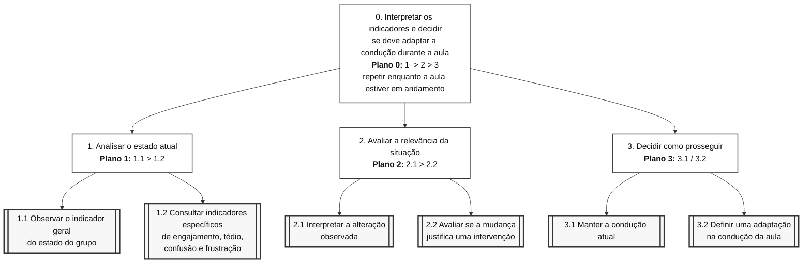
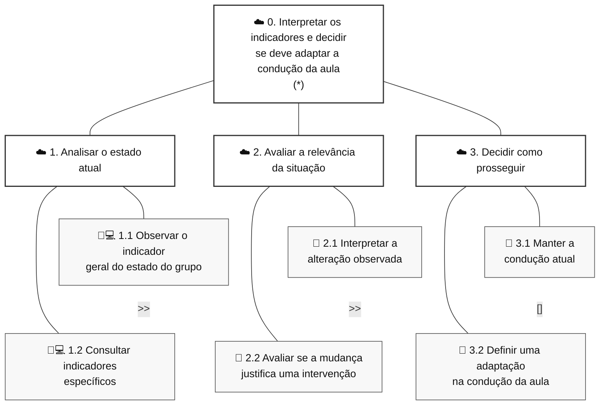

# Entrega 5 — Análise de tarefas: HTA, GOMS e CTT

**Data:** {{dd/mm/aaaa}}  
**Status:** ⬜ não iniciada  
**Responsabilidade:** cada integrante modela pelo menos 1 HTA, 1 GOMS e 1 CTT. As três técnicas podem abordar a mesma funcionalidade ou funcionalidades distintas, conforme a orientação da disciplina.

## Objetivo da atividade

Modelar tarefas importantes sob perspectivas complementares: decomposição hierárquica (HTA), estrutura de metas/métodos/operações (GOMS) e relações temporais entre tarefas (CTT). O diagrama deve ser acompanhado de interpretação textual.

## Para projetos cujo TCC não previa interface

Modele **tarefas humanas relacionadas ao uso da contribuição técnica**, e não a implementação interna do algoritmo. Exemplos de boas tarefas para análise:

- investigar uma consulta de baixo desempenho;
- configurar uma análise e selecionar parâmetros;
- submeter um dataset e verificar sua validade;
- acompanhar uma execução demorada;
- comparar dois resultados/modelos;
- interpretar uma recomendação e decidir se a aceita;
- localizar uma execução anterior usando busca/filtros;
- gerar e compartilhar um relatório;
- administrar papéis/permissões quando isso for parte do trabalho real;
- revisar um alerta e registrar uma decisão.

Um CRUD pode gerar tarefas relevantes, mas “cadastrar usuário” só merece modelagem se tiver significado no domínio (papéis, validações, riscos, permissões, dependências).

## Seleção das tarefas

| ID | Tarefa | Persona/cenário de origem | Frequência/criticidade | Autor responsável |
|---|---|---|---|---|
| T01 | Acompanhar e interpretar o estado dos participantes durante uma aula on-line | P01 / C01 — Docente em uma aula EAD síncrona | Alta frequência / Alta criticidade | {{nome — matrícula}} |
| T02 | Interpretar os indicadores do MindFlow AI e decidir se deve adaptar a condução durante a aula  | P01 / C01 — Docente em uma aula EAD síncrona | Alta frequência / Alta criticidade | {{nome — matrícula}} |
| T03 | Conduzir a aula enquanto acompanha e responde aos estados dos participantes | P01 / C01 — Docente em uma aula EAD síncrona | Alta frequência / Alta criticidade | {{nome — matrícula}} |

> Priorize tarefas necessárias para que o usuário alcance objetivos centrais. Não desperdice a modelagem em ações triviais isoladas, como “clicar em login”, se o objetivo relevante é maior. Da mesma forma, não modele o funcionamento interno do algoritmo como se fosse uma tarefa humana.

---

# HTA — T02 Interpretar os indicadores do MindFlow AI e decidir se deve adaptar a condução durante a aula

**Autor(a):** Rafael Dias — 22.222.039-4

## Descrição da tarefa

A tarefa tem como objetivo permitir que o docente interprete os indicadores apresentados pelo MindFlow AI durante uma aula on-line e utilize essas informações como apoio para decidir se deve manter ou adaptar a condução da aula.

A tarefa se inicia quando o MindFlow AI apresenta os estados dos participantes no dashboard. O docente consulta o estado atual, compara os indicadores quando necessário, analisa sua evolução ao longo do tempo e avalia se a alteração observada é suficientemente relevante para justificar alguma mudança na aula.

A tarefa é concluída quando o docente decide manter a condução atual ou realizar uma adaptação. Esse processo pode se repetir diversas vezes durante a aula conforme novos estados são apresentados pelo sistema.

## Diagrama

## Decomposição e planos

| ID | Objetivo/operação | Plano/ordem | Problema ou decisão de design observada |
|---|---|---|---|
| **0** | Interpretar os indicadores do MindFlow AI e decidir se deve adaptar a condução durante a aula | **1 > 2 > 3**, repetindo enquanto a aula estiver em andamento. | O processo precisa ser rápido para não desviar excessivamente a atenção do docente durante a aula. |
| **1** | Analisar o estado atual | **1.1 > 1.2** | Os indicadores devem permitir que o docente compreenda rapidamente o estado dos participantes. |
| 1.1 | Observar o indicador geral do estado do grupo | Primeira operação. | O estado predominante deve ser facilmente identificado e não depender exclusivamente de cores. |
| 1.2 | Consultar indicadores específicos de engajamento, tédio, confusão e frustração | Executar após 1.1. | A apresentação simultânea de vários indicadores pode aumentar a carga cognitiva durante a aula. |
| **2** | Avaliar a relevância da situação | **2.1 > 2.2** | Os indicadores devem funcionar como apoio à decisão, sem representar conclusões absolutas sobre os participantes. |
| 2.1 | Interpretar a alteração observada | Primeira operação da avaliação. | O docente precisa relacionar os indicadores ao contexto da aula, evitando interpretações baseadas apenas em oscilações pontuais. |
| 2.2 | Avaliar se a mudança justifica uma intervenção | Executar após 2.1. | A decisão sobre a necessidade de intervenção deve permanecer sob responsabilidade do docente. |
| **3** | Decidir como prosseguir | **3.1 / 3.2**, conforme a avaliação realizada em 2.2. | A interface deve apoiar a decisão sem impor automaticamente uma ação pedagógica. |
| 3.1 | Manter a condução atual | Executar quando a situação não justificar uma adaptação. | Pequenas oscilações nos indicadores podem não exigir alterações na condução da aula. |
| 3.2 | Definir uma adaptação na condução da aula | Executar quando a situação justificar uma intervenção. | A adaptação escolhida depende do contexto da aula e dos estados observados. |

**Verificação do HTA:**

- O objetivo 0 representa uma meta do usuário?
- As subtarefas são necessárias e suficientes?
- Os **planos** indicam ordem, alternativa, repetição ou condição?
- A decomposição parou em nível útil para projeto de interação?

---

# GOMS — T02: Interpretar os indicadores do MindFlow AI e decidir se deve adaptar a condução durante a aula

**Autor(a):** Rafael Dias — 22.222.039-4

## GOAL 0: Interpretar os indicadores do MindFlow AI e decidir se deve adaptar a condução durante a aula

**METHOD 0.A:** Analisar o estado atual dos participantes, avaliar a relevância da situação e decidir como prosseguir.

- **OP. 0.A.1:** analisar o estado atual dos participantes (GOAL 1);
- **OP. 0.A.2:** avaliar a relevância da situação (GOAL 2);
- **OP. 0.A.3:** decidir como prosseguir com a aula (GOAL 3);
- **OP. 0.A.4:** repetir o processo enquanto a aula estiver em andamento.

---

## GOAL 1: Analisar o estado atual dos participantes

### GOAL 1.A: Observar o indicador geral do estado do grupo

- **OP. 1.A.1:** direcionar a atenção para o indicador geral;
- **OP. 1.A.2:** observar o estado predominante apresentado;
- **OP. 1.A.3:** verificar o valor associado ao estado;
- **OP. 1.A.4:** interpretar a informação apresentada.

### GOAL 1.B: Consultar os indicadores específicos

- **OP. 1.B.1:** direcionar a atenção para os indicadores específicos;
- **OP. 1.B.2:** observar os valores de engajamento, tédio, confusão e frustração;
- **OP. 1.B.3:** comparar os valores apresentados;
- **OP. 1.B.4:** identificar os estados mais relevantes naquele momento.

---

## GOAL 2: Avaliar a relevância da situação

### GOAL 2.A: Interpretar a alteração observada

- **OP. 2.A.1:** identificar os estados que merecem atenção;
- **OP. 2.A.2:** relacionar os indicadores ao conteúdo ou à atividade em andamento;
- **OP. 2.A.3:** interpretar o significado dos estados observados no contexto da aula.

### GOAL 2.B: Avaliar a necessidade de intervenção

- **OP. 2.B.1:** considerar a relevância dos indicadores observados;
- **OP. 2.B.2:** avaliar se os estados identificados podem comprometer o andamento da aula;
- **OP. 2.B.3:** determinar se a situação justifica uma intervenção pedagógica.

---

## GOAL 3: Decidir como prosseguir com a aula

### METHOD 3.A: Manter a condução atual

**SEL. RULE:** utilizar quando os indicadores não demonstrarem uma situação que justifique adaptação da aula.

- **OP. 3.A.1:** decidir manter a estratégia pedagógica atual;
- **OP. 3.A.2:** continuar a condução da aula sem alterações;
- **OP. 3.A.3:** acompanhar os próximos indicadores apresentados pelo sistema.

### METHOD 3.B: Definir uma adaptação na condução da aula

**SEL. RULE:** utilizar quando os indicadores e o contexto da aula demonstrarem necessidade de intervenção.

- **OP. 3.B.1:** identificar o estado que motivou a necessidade de adaptação;
- **OP. 3.B.2:** considerar possíveis mudanças na estratégia pedagógica;
- **OP. 3.B.3:** selecionar a adaptação mais adequada ao contexto;
- **OP. 3.B.4:** aplicar a adaptação durante a aula;
- **OP. 3.B.5:** acompanhar os próximos indicadores para observar a resposta dos participantes.

---

## Síntese do modelo GOMS

* **Goal principal:** interpretar os indicadores do MindFlow AI e decidir como prosseguir com a aula.
* **Goals secundários:** compreender o estado atual, identificar mudanças relevantes, interpretar a situação e definir como continuar.
* **Methods:** consultar indicador geral, consultar indicadores específicos, comparar valores no tempo, manter a condução ou adaptar a aula.
* **Operators:** observar, acessar, identificar, comparar, interpretar, relacionar informações, decidir e selecionar uma ação.
* **Selection Rules:** determinam qual método é utilizado de acordo com a quantidade de informação necessária, a existência de mudanças nos indicadores e a interpretação do docente.

> Não chame qualquer passo de “método”. Em GOMS, métodos são sequências alternativas capazes de atingir uma meta; regras de seleção explicam quando escolher entre eles.

---

# CTT — T02: Interpretar os indicadores do MindFlow AI

**Autor(a):** Rafael Dias — 22.222.039-4

## Diagrama CTT

## Relações temporais do CTT

| Tarefas | Operador | Relação |
|---|---|---|
| 1, 2 e 3 | `>>` | Execução sequencial |
| 1.1 e 1.2 | `>>` | Observar antes de consultar os detalhes |
| 2.1 e 2.2 | `>>` | Interpretar antes de avaliar a intervenção |
| 3.1 e 3.2 | `[]` | Escolha entre manter ou adaptar |
| 0 | `*` | Repetição enquanto a aula estiver em andamento |

### Legenda

- ☁️ **Abstrata:** tarefa que agrupa outras tarefas.
- 👤 **Usuário:** atividade cognitiva ou decisão realizada pelo docente.
- 👤💻 **Interação:** atividade do docente envolvendo a interface do MindFlow AI.

**Observação:** o Mermaid permite reproduzir visualmente a hierarquia, mas não é um editor CTT formal. As ligações verticais indicam decomposição, enquanto os operadores temporais aparecem entre as tarefas irmãs. A relação temporal do objetivo principal é `(1 >> 2 >> 3)*`, e a escolha final é `3.1 [] 3.2`.

---

## Síntese da equipe

Quais problemas de interação, oportunidades e requisitos apareceram a partir das modelagens? Quais tarefas irão para o protótipo e para o teste de usabilidade?

## Checklist

- [ ] Cada integrante produziu ao menos 1 HTA, 1 GOMS e 1 CTT.
- [ ] Cada artefato identifica autor e tarefa.
- [ ] Diagramas são legíveis e possuem fonte editável quando possível.
- [ ] HTA contém planos, não apenas árvore de tópicos.
- [ ] GOMS distingue Goals, Operators, Methods e Selection Rules.
- [ ] CTT usa operadores temporais e tipos de tarefa coerentes.
- [ ] Há texto explicando cada diagrama.
- [ ] Tarefas estão ligadas a cenários/personas na rastreabilidade.
- [ ] Em TCC técnico, as tarefas descrevem o que a pessoa faz com a contribuição/resultados, não passos internos do código.
- [ ] CRUDs, relatórios, filtros e atividades administrativas foram escolhidos por relevância ao objetivo do usuário.
