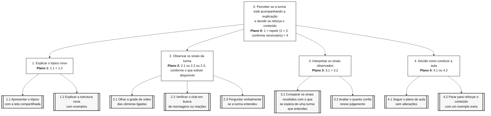
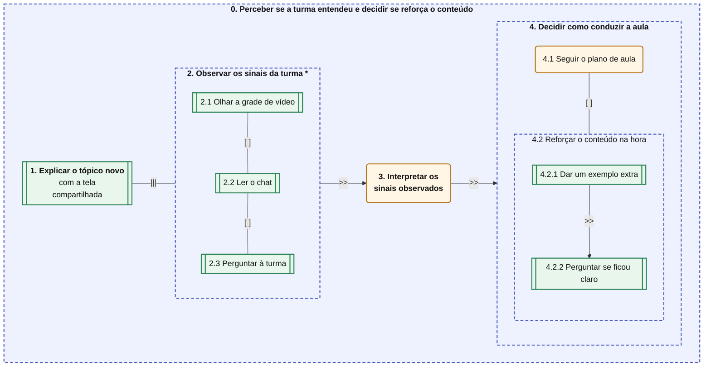

# Entrega 5 — Análise de tarefas: HTA, GOMS e CTT

**Data:** 14/10/2026  
**Status:** 🟧 em andamento  
**Responsabilidade:** cada integrante modela pelo menos 1 HTA, 1 GOMS e 1 CTT. As três técnicas podem abordar a mesma funcionalidade ou funcionalidades distintas, conforme a orientação da disciplina.

## Objetivo da atividade

Modelar tarefas importantes sob perspectivas complementares: decomposição hierárquica (HTA), estrutura de metas/métodos/operações (GOMS) e relações temporais entre tarefas (CTT). O diagrama deve ser acompanhado de interpretação textual.

## Para projetos cujo TCC não previa interface

Modele **tarefas humanas relacionadas ao uso da contribuição técnica**, e não a implementação interna do algoritmo. Exemplos de boas tarefas para análise:

- investigar uma consulta de baixo desempenho;
- configurar uma análise e selecionar parâmetros;
- submeter um dataset e verificar sua validade;
- acompanhar uma execução demorada;
- comparar dois resultados/modelos;
- interpretar uma recomendação e decidir se a aceita;
- localizar uma execução anterior usando busca/filtros;
- gerar e compartilhar um relatório;
- administrar papéis/permissões quando isso for parte do trabalho real;
- revisar um alerta e registrar uma decisão.

Um CRUD pode gerar tarefas relevantes, mas “cadastrar usuário” só merece modelagem se tiver significado no domínio (papéis, validações, riscos, permissões, dependências).

## Seleção das tarefas

| ID | Tarefa | Persona/cenário de origem | Frequência/criticidade | Autor responsável |
|---|---|---|---|---|
| T04 | Perceber, durante a aula, se a turma está acompanhando uma explicação nova e decidir se reforça o conteúdo | P02 / C05 — professora de inglês explicando uma estrutura gramatical nova para uma turma pequena | Alta frequência / Alta criticidade | Isabella Vieira Silva Rosseto — 22.222.036-0 |
| T05 | Interpretar os sinais de compreensão da turma durante a aula e decidir como conduzir o restante da explicação | P02 / C05 — professora de inglês avaliando, ainda na aula, se a turma entendeu o conteúdo | Alta frequência / Alta criticidade | Isabella Vieira Silva Rosseto — 22.222.036-0 |
| T06 | Conduzir uma explicação nova enquanto observa os sinais da turma e reage a eles | P02 / C05 — professora de inglês que explica, observa e decide ao mesmo tempo | Alta frequência / Alta criticidade | Isabella Vieira Silva Rosseto — 22.222.036-0 |

> Priorize tarefas necessárias para que o usuário alcance objetivos centrais. Não desperdice a modelagem em ações triviais isoladas, como “clicar em login”, se o objetivo relevante é maior. Da mesma forma, não modele o funcionamento interno do algoritmo como se fosse uma tarefa humana.

---

## HTA — T04 Perceber, durante a aula, se a turma está acompanhando uma explicação nova e decidir se reforça o conteúdo

**Autor(a):** Isabella Vieira Silva Rosseto — 22.222.036-0

### Descrição da tarefa

A tarefa tem como objetivo permitir que a professora perceba, durante a própria aula, se a turma está acompanhando uma explicação nova e decida, ainda em tempo real, se reforça o conteúdo antes de seguir para o próximo tópico. É a tarefa que, no Cenário C05 (Entrega 4), Camila não consegue realizar bem: ela só descobre a dificuldade da turma na aula seguinte, ao corrigir o exercício de casa.

A tarefa se inicia quando a professora começa a explicar um tópico novo, com a tela compartilhada e a grade de vídeo reduzida num canto da tela. Enquanto explica, ela busca sinais de compreensão: observa as câmeras ligadas, verifica o chat ou pergunta diretamente se a turma entendeu.

Com base nesses sinais, a professora interpreta se o silêncio e as respostas recebidas indicam compreensão ou dúvida, avaliando também o quanto confia nesse julgamento, que hoje é informal. Em seguida, decide se segue o plano de aula ou se interrompe a sequência para reforçar o conteúdo com um exemplo extra.

A tarefa é considerada concluída quando a professora toma a decisão (seguir ou reforçar) e retoma a condução da aula a partir dela.

### Diagrama

### Decomposição e planos

| ID | Objetivo/operação | Plano/ordem | Problema ou decisão de design observada |
|---|---|---|---|
| 0 | Perceber se a turma está acompanhando a explicação e decidir se reforça o conteúdo | 1 > repetir (2 > 3, conforme necessário) > 4 | A tarefa depende de sinais fracos (silêncio, câmeras desligadas); hoje não existe nenhum indicador estruturado, só a leitura informal da professora |
| 1 | Explicar o tópico novo | 1.1 > 1.2 | Enquanto explica com a tela compartilhada, a professora já está com a atenção ocupada, o que reduz a atenção disponível para observar a turma |
| 2 | Observar os sinais da turma | 2.1 ou 2.2 ou 2.3, conforme o que estiver disponível | Os três canais (câmera, chat, pergunta verbal) competem com a explicação e nenhum é confiável sozinho: a grade fica reduzida na tela compartilhada e o “sim” verbal costuma ser pouco convicto |
| 3 | Interpretar os sinais observados | 3.1 > 3.2 | Não há nenhum indicador de confiança nesse julgamento; ele é puramente subjetivo (relacionado à hipótese H02) |
| 4 | Decidir como conduzir a aula | 4.1 ou 4.2 | Parar para reforçar (4.2) gasta tempo de aula, então só acontece quando a professora tem bastante certeza, o que favorece seguir em frente por excesso de cautela |

**Verificação do HTA:**

- O objetivo 0 representa uma meta do usuário? Sim. É o objetivo de Camila (persona P02, Cenário C05), e não uma função do sistema.
- As subtarefas são necessárias e suficientes? Sim. Explicar, observar, interpretar e decidir cobrem o ciclo completo descrito no cenário.
- Os **planos** indicam ordem, alternativa, repetição ou condição? Sim. O Plano 0 usa ordem e repetição, e os Planos 2 e 4 usam alternativa (“ou”).
- A decomposição parou em nível útil para projeto de interação? Sim. Parou em ações observáveis (olhar a grade, verificar o chat, perguntar), sem descer a detalhes de tela.

---

## GOMS — T05 Interpretar os sinais de compreensão da turma durante a aula e decidir como conduzir o restante da explicação

**Autor(a):** Isabella Vieira Silva Rosseto — 22.222.036-0

## GOMS — Perceber a compreensão da turma e decidir se reforça o conteúdo

### GOAL 0: Perceber, durante a aula, se a turma está compreendendo uma explicação nova e decidir se reforça o conteúdo

O objetivo principal é, ainda durante a aula, formar um julgamento sobre a compreensão da turma a partir dos sinais disponíveis e decidir se a explicação segue conforme o plano ou se precisa ser reforçada antes de avançar.

---

### GOAL 1: Obter sinais sobre a reação da turma

#### METHOD 1.A: Observar a grade de vídeo

**SEL. RULE:** utilizar quando parte da turma estiver com a câmera ligada e a explicação permitir desviar rapidamente o olhar.

- **OP. 1.A.1:** direcionar o olhar para a grade de vídeo reduzida;
- **OP. 1.A.2:** identificar os alunos com câmera ligada;
- **OP. 1.A.3:** observar as expressões visíveis nas miniaturas;
- **OP. 1.A.4:** retornar a atenção ao conteúdo compartilhado.

#### METHOD 1.B: Perguntar diretamente à turma

**SEL. RULE:** utilizar quando as câmeras estiverem desligadas ou quando a grade de vídeo não permitir concluir se a turma acompanhou.

- **OP. 1.B.1:** interromper brevemente a explicação;
- **OP. 1.B.2:** perguntar à turma se entenderam;
- **OP. 1.B.3:** aguardar as respostas;
- **OP. 1.B.4:** avaliar o tom e a convicção das respostas recebidas.

---

### GOAL 2: Interpretar os sinais obtidos

#### METHOD 2.A: Interpretar com base nos sinais já recebidos

**SEL. RULE:** utilizar quando os sinais do Goal 1 forem consistentes entre si (por exemplo, respostas rápidas e convictas, ou expressões claramente atentas).

- **OP. 2.A.1:** comparar os sinais com o que se espera de uma turma que entendeu;
- **OP. 2.A.2:** avaliar o quanto confia nesse julgamento;
- **OP. 2.A.3:** concluir se há ou não indício de dúvida.

#### METHOD 2.B: Buscar uma confirmação adicional antes de concluir

**SEL. RULE:** utilizar quando os sinais forem ambíguos (por exemplo, silêncio prolongado ou um “sim” pouco convicto).

- **OP. 2.B.1:** escolher um aluno ou um exemplo para testar a compreensão;
- **OP. 2.B.2:** pedir que o aluno explique ou aplique a estrutura com as próprias palavras;
- **OP. 2.B.3:** avaliar se a resposta indica compreensão;
- **OP. 2.B.4:** concluir se há ou não indício de dúvida.

---

### GOAL 3: Decidir como conduzir o restante da aula

#### METHOD 3.A: Seguir o plano de aula

**SEL. RULE:** utilizar quando a interpretação do Goal 2 indicar que a turma acompanhou o conteúdo.

- **OP. 3.A.1:** concluir a explicação do tópico atual;
- **OP. 3.A.2:** passar para o próximo tópico previsto no plano.

#### METHOD 3.B: Reforçar o conteúdo na hora

**SEL. RULE:** utilizar quando a interpretação do Goal 2 indicar possível dúvida da turma.

- **OP. 3.B.1:** interromper a sequência prevista;
- **OP. 3.B.2:** apresentar um exemplo adicional da estrutura;
- **OP. 3.B.3:** perguntar novamente se ficou claro;
- **OP. 3.B.4:** retomar o plano de aula a partir desse ponto.

> Não chame qualquer passo de “método”. Em GOMS, métodos são sequências alternativas capazes de atingir uma meta; regras de seleção explicam quando escolher entre eles.

---

## CTT — T06 Conduzir uma explicação nova enquanto observa os sinais da turma e reage a eles

**Autor(a):** Isabella Vieira Silva Rosseto — 22.222.036-0

### Descrição

O modelo CTT representa a mesma situação sob a perspectiva das relações temporais entre as tarefas. A tarefa raiz (**Perceber se a turma entendeu e decidir se reforça o conteúdo**) é abstrata e se decompõe em quatro tarefas: **Explicar o tópico novo** (interação, com a tela compartilhada), **Observar os sinais da turma** (abstrata), **Interpretar os sinais observados** (tarefa de usuário, puramente cognitiva) e **Decidir como conduzir a aula** (abstrata).

Explicar e observar acontecem ao mesmo tempo, e não uma depois da outra (concorrência): a professora observa a turma enquanto fala. A observação é repetida durante a explicação e, para cada rodada, a professora escolhe um canal: olhar a grade de vídeo, ler o chat ou perguntar à turma. Só depois de observar é que ela consegue interpretar os sinais (habilitação), e só depois de interpretar consegue decidir.

A decisão é uma escolha entre seguir o plano de aula e reforçar o conteúdo. Reforçar se decompõe em duas tarefas de interação em sequência: dar um exemplo extra e, depois dele, perguntar se ficou claro.

### Diagrama

### Legenda e relações temporais usadas

| Operador/relação | Significado no diagrama | Exemplo no modelo |
|---|---|---|
| `\|\|\|` (concorrência) | As tarefas acontecem ao mesmo tempo, sem ordem fixa entre si | Explicar o tópico novo e Observar os sinais da turma |
| `>>` (habilitação) | A segunda tarefa só começa depois que a primeira termina | Observar → Interpretar → Decidir; Dar um exemplo extra → Perguntar se ficou claro |
| `[]` (escolha) | Apenas uma das alternativas é executada a cada vez | Olhar a grade de vídeo, Ler o chat ou Perguntar à turma; Seguir o plano ou Reforçar o conteúdo |
| `*` (repetição) | A tarefa é repetida enquanto for necessária | Observar os sinais da turma durante toda a explicação |

No diagrama, as tarefas abstratas têm borda tracejada, as de usuário são laranja e as de interação são verdes; as subtarefas ficam dentro da caixa da tarefa-pai e o operador temporal aparece sobre a linha que liga duas tarefas irmãs. As tarefas de **usuário** (Interpretar os sinais, Seguir o plano) são ações cognitivas ou de decisão da professora, sem interação direta com a videochamada. Tarefas de **interação** (explicar com a tela compartilhada, olhar a grade, ler o chat, perguntar) são ações da professora sobre a videochamada. Tarefas **abstratas** agrupam subtarefas. Não há tarefas de sistema porque esta modelagem descreve a prática atual, sem antecipar a solução.

---

## Síntese da equipe

Quais problemas de interação, oportunidades e requisitos apareceram a partir das modelagens? Quais tarefas irão para o protótipo e para o teste de usabilidade?

## Checklist

- [ ] Cada integrante produziu ao menos 1 HTA, 1 GOMS e 1 CTT.
- [ ] Cada artefato identifica autor e tarefa.
- [ ] Diagramas são legíveis e possuem fonte editável quando possível.
- [ ] HTA contém planos, não apenas árvore de tópicos.
- [ ] GOMS distingue Goals, Operators, Methods e Selection Rules.
- [ ] CTT usa operadores temporais e tipos de tarefa coerentes.
- [ ] Há texto explicando cada diagrama.
- [ ] Tarefas estão ligadas a cenários/personas na rastreabilidade.
- [ ] Em TCC técnico, as tarefas descrevem o que a pessoa faz com a contribuição/resultados, não passos internos do código.
- [ ] CRUDs, relatórios, filtros e atividades administrativas foram escolhidos por relevância ao objetivo do usuário.
