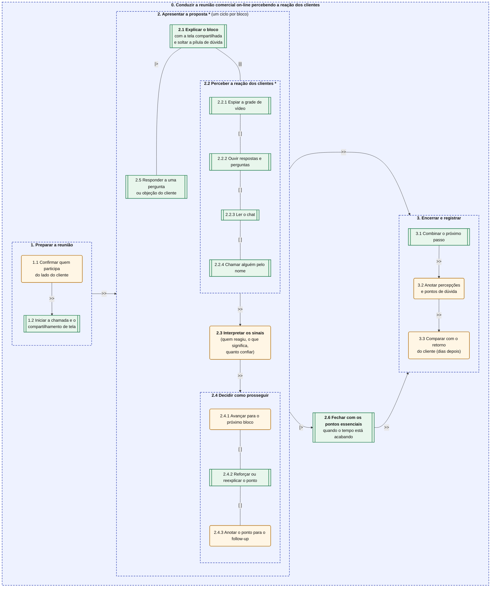

```mermaid
flowchart TB

    T0["0. Revisar uma sessão concluída para identificar<br/>momentos relevantes e avaliar a apresentação<br/><b>Plano 0:</b> 1 > 2 > repetir (3 > 4, conforme necessário) > 5"]

    T1["1. Localizar a sessão desejada<br/><b>Plano 1:</b> 1.1 > 1.2 > 1.3"]
    T2["2. Obter uma visão geral da sessão<br/><b>Plano 2:</b> 2.1 > 2.2"]
    T3["3. Identificar momentos relevantes<br/><b>Plano 3:</b> 3.1 > 3.2 > 3.3"]
    T4["4. Interpretar o momento selecionado<br/><b>Plano 4:</b> 4.1 > 4.2 > 4.3"]
    T5["5. Sintetizar os principais achados<br/><b>Plano 5:</b> 5.1 > 5.2"]

    T0 --> T1
    T0 --> T2
    T0 --> T3
    T0 --> T4
    T0 --> T5

    T11[["1.1 Acessar o histórico<br/>de sessões"]]
    T12[["1.2 Identificar a sessão desejada<br/>diretamente ou utilizando filtros"]]
    T13[["1.3 Selecionar a sessão<br/>para análise"]]

    T1 --> T11
    T1 --> T12
    T1 --> T13

    T21[["2.1 Examinar os indicadores gerais<br/>da sessão"]]
    T22[["2.2 Examinar o gráfico de evolução<br/>dos estados ao longo do tempo"]]

    T2 --> T21
    T2 --> T22

    T31[["3.1 Localizar variações relevantes<br/>nos indicadores"]]
    T32[["3.2 Selecionar um intervalo<br/>de interesse"]]
    T33[["3.3 Examinar os valores detalhados<br/>do período selecionado"]]

    T3 --> T31
    T3 --> T32
    T3 --> T33

    T41[["4.1 Comparar o período selecionado<br/>com momentos anteriores e posteriores"]]
    T42[["4.2 Avaliar a duração e intensidade<br/>da alteração observada"]]
    T43[["4.3 Relacionar a alteração ao momento<br/>correspondente da apresentação"]]

    T4 --> T41
    T4 --> T42
    T4 --> T43

    T51[["5.1 Identificar padrões ou momentos<br/>que merecem atenção"]]
    T52[["5.2 Considerar possíveis ajustes<br/>para apresentações futuras"]]

    T5 --> T51
    T5 --> T52

    classDef objetivo fill:#ffffff,stroke:#333,stroke-width:1.5px,color:#111;
    classDef operacao fill:#f7f7f7,stroke:#333,stroke-width:2.5px,color:#111;

    class T0,T1,T2,T3,T4,T5 objetivo;
    class T11,T12,T13,T21,T22,T31,T32,T33,T41,T42,T43,T51,T52 operacao;
```

# Entrega 5 — Análise de tarefas: HTA, GOMS e CTT

**Data:** {{dd/mm/aaaa}}  
**Status:** ⬜ não iniciada  
**Responsabilidade:** cada integrante modela pelo menos 1 HTA, 1 GOMS e 1 CTT. As três técnicas podem abordar a mesma funcionalidade ou funcionalidades distintas, conforme a orientação da disciplina.

## Objetivo da atividade

Modelar tarefas importantes sob perspectivas complementares: decomposição hierárquica (HTA), estrutura de metas/métodos/operações (GOMS) e relações temporais entre tarefas (CTT). O diagrama deve ser acompanhado de interpretação textual.

## Para projetos cujo TCC não previa interface

Modele **tarefas humanas relacionadas ao uso da contribuição técnica**, e não a implementação interna do algoritmo. Exemplos de boas tarefas para análise:

- investigar uma consulta de baixo desempenho;
- configurar uma análise e selecionar parâmetros;
- submeter um dataset e verificar sua validade;
- acompanhar uma execução demorada;
- comparar dois resultados/modelos;
- interpretar uma recomendação e decidir se a aceita;
- localizar uma execução anterior usando busca/filtros;
- gerar e compartilhar um relatório;
- administrar papéis/permissões quando isso for parte do trabalho real;
- revisar um alerta e registrar uma decisão.

Um CRUD pode gerar tarefas relevantes, mas “cadastrar usuário” só merece modelagem se tiver significado no domínio (papéis, validações, riscos, permissões, dependências).

## Seleção das tarefas

| ID | Tarefa | Persona/cenário de origem | Frequência/criticidade | Autor responsável |
|---|---|---|---|---|
| T01 | Revisar uma sessão concluída para identificar momentos relevantes e avaliar a apresentação | P01 / C01 — docente revisando uma aula on-line já finalizada | Média frequência / Alta criticidade | {{nome — matrícula}} |
| T02 | Identificar e interpretar momentos relevantes nos indicadores de uma sessão concluída | P01 / C01 — docente analisando os resultados de uma aula on-line após seu término | Média frequência / Alta criticidade | {{nome — matrícula}} |
| T03 | Analisar uma sessão concluída enquanto consulta, compara e interpreta diferentes informações da apresentação | P01 / C01 — docente revisando indicadores e registros de uma aula on-line já realizada | Média frequência / Alta criticidade | {{nome — matrícula}} |
| T10 | Conduzir a apresentação comercial percebendo a reação dos clientes e decidindo se avança, reforça ou reexplica um ponto da proposta | P04 / C01 — Manoel apresentando uma proposta pelo Teams com a tela compartilhada, sem conseguir ver nem ouvir todos os clientes | Alta frequência (toda reunião comercial) / Alta criticidade | Matheus Ferreira de Freitas — 22.125.085-5 |
| T11 | Verificar, logo após uma pílula de dúvida, se o cliente compreendeu e se interessou, e decidir como prosseguir | P04 / C01 — Manoel decidindo em poucos segundos, com sinais incompletos, se continua ou reforça o ponto | Alta frequência (várias vezes por reunião) / Alta criticidade | Matheus Ferreira de Freitas — 22.125.085-5 |
| T12 | Conduzir a reunião comercial on-line percebendo a reação dos clientes e reagindo aos eventos da reunião (perguntas, objeções, fim do tempo) | P04 / C01 — Manoel do preparo da reunião até a comparação das anotações com o retorno do cliente no follow-up | Alta frequência / Média-alta criticidade | Matheus Ferreira de Freitas — 22.125.085-5 |

> Priorize tarefas necessárias para que o usuário alcance objetivos centrais. Não desperdice a modelagem em ações triviais isoladas, como “clicar em login”, se o objetivo relevante é maior. Da mesma forma, não modele o funcionamento interno do algoritmo como se fosse uma tarefa humana.

---

## HTA — T01 Revisar uma sessão concluída para identificar momentos relevantes e avaliar a apresentação

**Autor(a):** {{nome — matrícula}}

### Descrição da tarefa

A tarefa tem como objetivo permitir que o usuário revise uma sessão já concluída no MindFlow AI para identificar momentos relevantes no comportamento dos participantes e avaliar como os indicadores evoluíram ao longo da apresentação.

A tarefa se inicia quando o usuário acessa o histórico de sessões e seleciona uma aula ou apresentação já finalizada. A partir disso, ele consulta os indicadores gerais, analisa o gráfico de evolução temporal e localiza períodos que apresentaram mudanças significativas, como variações de engajamento, tédio, confusão ou frustração.

Durante a análise, o usuário pode selecionar diferentes momentos da sessão, comparar períodos anteriores e posteriores e relacionar as alterações observadas ao conteúdo ou à condução da apresentação.

A tarefa é considerada concluída quando o usuário identifica os principais momentos e padrões da sessão e reúne informações suficientes para avaliar possíveis aspectos a manter ou ajustar em apresentações futuras.

### Diagrama

### Decomposição e planos

| ID | Objetivo/operação | Plano/ordem | Problema ou decisão de design observada |
|---|---|---|---|
| 0 | {{objetivo principal}} | {{1 }} 2 > 3 / 1 ou 2 etc.> | {{...}} |

**Verificação do HTA:**

- O objetivo 0 representa uma meta do usuário?
- As subtarefas são necessárias e suficientes?
- Os **planos** indicam ordem, alternativa, repetição ou condição?
- A decomposição parou em nível útil para projeto de interação?

---

## GOMS — T02 Revisar uma sessão encerrada para identificar momentos relevantes e avaliar a condução da apresentação

**Autor(a):** {{nome — matrícula}}

## GOMS — Revisar uma sessão concluída e identificar momentos relevantes

### GOAL 0: Revisar uma sessão concluída para identificar momentos relevantes no comportamento dos participantes

O objetivo principal é analisar os dados de uma aula ou apresentação já finalizada, identificando períodos de maior ou menor engajamento e alterações nos estados apresentados pelo MindFlow AI.

---

### GOAL 1: Localizar a sessão que deseja analisar

#### METHOD 1.A: Selecionar uma sessão recente no histórico

**SEL. RULE:** utilizar quando a sessão desejada estiver facilmente identificável entre as sessões recentes apresentadas pelo sistema.

- **OP. 1.A.1:** acessar o histórico de sessões;
- **OP. 1.A.2:** examinar as sessões apresentadas;
- **OP. 1.A.3:** identificar a sessão desejada;
- **OP. 1.A.4:** selecionar a sessão;
- **OP. 1.A.5:** verificar se os dados correspondem à sessão escolhida.

#### METHOD 1.B: Localizar a sessão utilizando filtros

**SEL. RULE:** utilizar quando houver muitas sessões registradas ou quando a sessão desejada não estiver imediatamente visível no histórico.

- **OP. 1.B.1:** acessar os filtros disponíveis;
- **OP. 1.B.2:** definir os critérios de busca;
- **OP. 1.B.3:** aplicar os filtros;
- **OP. 1.B.4:** examinar os resultados;
- **OP. 1.B.5:** identificar a sessão desejada;
- **OP. 1.B.6:** selecionar a sessão.

---

### GOAL 2: Identificar momentos relevantes da sessão

#### METHOD 2.A: Analisar o gráfico de evolução temporal

**SEL. RULE:** utilizar quando o usuário deseja obter uma visão geral das variações dos estados ao longo de toda a sessão.

- **OP. 2.A.1:** direcionar a atenção para o gráfico temporal;
- **OP. 2.A.2:** identificar as linhas correspondentes aos diferentes estados;
- **OP. 2.A.3:** observar aumentos e reduções ao longo do tempo;
- **OP. 2.A.4:** localizar períodos com variações mais acentuadas;
- **OP. 2.A.5:** identificar o intervalo de tempo correspondente;
- **OP. 2.A.6:** selecionar um período para análise mais detalhada.

#### METHOD 2.B: Analisar os registros detalhados da sessão

**SEL. RULE:** utilizar quando for necessário examinar valores específicos de um determinado momento ou confirmar uma alteração percebida no gráfico.

- **OP. 2.B.1:** acessar os registros detalhados;
- **OP. 2.B.2:** localizar o intervalo de tempo desejado;
- **OP. 2.B.3:** examinar os valores de engajamento, tédio, confusão e frustração;
- **OP. 2.B.4:** comparar os valores apresentados;
- **OP. 2.B.5:** identificar quais estados tiveram maior variação;
- **OP. 2.B.6:** determinar se o momento merece análise adicional.

---

### GOAL 3: Compreender a evolução dos estados em um período selecionado

#### METHOD 3.A: Comparar o momento selecionado com os períodos anteriores

**SEL. RULE:** utilizar quando o usuário deseja compreender se a alteração ocorreu de forma repentina ou gradual.

- **OP. 3.A.1:** identificar o momento de interesse;
- **OP. 3.A.2:** observar os períodos imediatamente anteriores;
- **OP. 3.A.3:** comparar os valores dos estados;
- **OP. 3.A.4:** identificar o início da alteração;
- **OP. 3.A.5:** avaliar se a mudança ocorreu de forma gradual ou abrupta.

#### METHOD 3.B: Comparar o momento selecionado com os períodos posteriores

**SEL. RULE:** utilizar quando o usuário deseja compreender a duração da alteração e verificar se os indicadores retornaram ao comportamento anterior.

- **OP. 3.B.1:** identificar o momento de interesse;
- **OP. 3.B.2:** observar os períodos posteriores;
- **OP. 3.B.3:** comparar os valores apresentados;
- **OP. 3.B.4:** verificar por quanto tempo a alteração permaneceu;
- **OP. 3.B.5:** identificar se os estados retornaram aos valores anteriores.

---

### GOAL 4: Identificar padrões relevantes na sessão

#### METHOD 4.A: Avaliar períodos de maior engajamento

**SEL. RULE:** utilizar quando o usuário deseja identificar momentos em que os participantes apresentaram maior nível de engajamento.

- **OP. 4.A.1:** localizar os maiores valores de engajamento;
- **OP. 4.A.2:** identificar os intervalos correspondentes;
- **OP. 4.A.3:** comparar esses períodos com o restante da sessão;
- **OP. 4.A.4:** identificar possíveis recorrências;
- **OP. 4.A.5:** registrar mentalmente ou externamente os momentos considerados relevantes.

#### METHOD 4.B: Avaliar períodos de queda de engajamento ou aumento de outros estados

**SEL. RULE:** utilizar quando o usuário deseja identificar momentos que podem indicar dificuldade de acompanhamento, perda de atenção ou necessidade de revisão.

- **OP. 4.B.1:** localizar períodos de redução do engajamento;
- **OP. 4.B.2:** verificar os valores de tédio, confusão e frustração no mesmo período;
- **OP. 4.B.3:** comparar os estados apresentados;
- **OP. 4.B.4:** identificar alterações recorrentes;
- **OP. 4.B.5:** selecionar os períodos considerados mais relevantes.

---

### GOAL 5: Avaliar possíveis ajustes para apresentações futuras

#### METHOD 5.A: Manter estratégias associadas a períodos de resposta positiva

**SEL. RULE:** utilizar quando a análise indicar períodos consistentes de maior engajamento ou redução de estados indesejados.

- **OP. 5.A.1:** revisar os períodos identificados;
- **OP. 5.A.2:** reconhecer características relevantes desses momentos;
- **OP. 5.A.3:** avaliar quais estratégias podem ser mantidas;
- **OP. 5.A.4:** considerar sua aplicação em apresentações futuras.

#### METHOD 5.B: Revisar estratégias associadas a períodos de resposta negativa

**SEL. RULE:** utilizar quando forem identificados períodos recorrentes de queda de engajamento ou aumento de tédio, confusão ou frustração.

- **OP. 5.B.1:** revisar os períodos identificados;
- **OP. 5.B.2:** observar quais estados apresentaram maior alteração;
- **OP. 5.B.3:** avaliar possíveis causas relacionadas à condução da apresentação;
- **OP. 5.B.4:** identificar aspectos que podem ser revistos;
- **OP. 5.B.5:** considerar possíveis ajustes para apresentações futuras.

> Não chame qualquer passo de “método”. Em GOMS, métodos são sequências alternativas capazes de atingir uma meta; regras de seleção explicam quando escolher entre eles.

---

## CTT — T03 {{nome da tarefa}}

**Autor(a):** {{nome — matrícula}}

### Descrição

{{...}}

### Diagrama

### Legenda e relações temporais usadas

| Operador/relação | Significado no diagrama | Exemplo no modelo |
|---|---|---|
| {{...}} | {{...}} | {{...}} |

Identifique, quando aplicável, tarefas de usuário, sistema, interação e tarefas abstratas. Verifique se concorrência, escolha, habilitação, desabilitação e repetição estão representadas corretamente segundo a notação adotada em aula.

---

## HTA — T10 Conduzir a apresentação comercial percebendo a reação dos clientes e decidindo como prosseguir

**Autor(a):** Matheus Ferreira de Freitas — RA 22.125.085-5

### Descrição da tarefa

A tarefa representa o que Manoel (persona P04, Cenário C01) faz hoje em uma reunião comercial por videoconferência: apresentar a proposta com a tela compartilhada e, ao mesmo tempo, perceber como os clientes estão reagindo para decidir se avança, reforça ou reexplica um ponto. É a tarefa que, no Cenário C01, ele não consegue realizar bem: nem todos os clientes aparecem ou respondem, o silêncio é ambíguo e a objeção costuma ser descoberta só no follow-up.

A tarefa começa antes da reunião, quando Manoel confirma quem participa do lado do cliente e define a pauta, incluindo os pontos em que pretende checar a reação com uma pergunta curta (a "pílula de dúvida"). Durante a reunião, para cada bloco da proposta, ele explica o ponto, solta a pílula de dúvida e tenta perceber a reação pelos canais disponíveis: a grade reduzida de vídeo, as respostas e perguntas em voz, o chat e, quando ninguém responde, uma pergunta dirigida a alguém pelo nome.

Com base nesses sinais, Manoel interpreta quem reagiu e o que a reação significa, julga o quanto confia nessa leitura e decide entre avançar, reforçar o ponto ou anotá-lo para retomar no follow-up. Esse ciclo se repete a cada bloco. A tarefa termina depois da reunião, quando ele combina o próximo passo, registra as percepções e, dias depois, compara as anotações com o retorno do cliente.

A modelagem descreve a prática atual, sem o MindFlow. Os passos de planejamento (4 e 5) e de avaliação (4.3 e 6.3) foram mantidos explícitos porque são justamente os pontos em que hoje a tarefa falha, conforme o refinamento do Cenário C01.

### Diagrama

```mermaid
flowchart TB

    T0["0. Conduzir a apresentação comercial percebendo a reação<br/>dos clientes e decidindo como prosseguir<br/><b>Plano 0:</b> 1 > repetir (2 > 3 > 4 > 5) para cada bloco da proposta > 6"]

    T1["1. Preparar a reunião<br/><b>Plano 1:</b> 1.1 > 1.2 > 1.3"]
    T2["2. Apresentar um bloco da proposta<br/><b>Plano 2:</b> 2.1 > 2.2"]
    T3["3. Perceber a reação dos clientes<br/><b>Plano 3:</b> 3.1 e 3.2 ao mesmo tempo; 3.3 se houver movimento no chat;<br/>3.4 só se 3.1 a 3.3 não trouxerem resposta"]
    T4["4. Interpretar os sinais obtidos<br/><b>Plano 4:</b> 4.1 > 4.2 > 4.3"]
    T5["5. Decidir como prosseguir<br/><b>Plano 5:</b> 5.1 ou 5.2 ou 5.3, conforme 4.3 e o tempo restante"]
    T6["6. Encerrar e registrar a reunião<br/><b>Plano 6:</b> 6.1 > 6.2 > 6.3 (6.3 dias depois)"]

    T0 --> T1
    T0 --> T2
    T0 --> T3
    T0 --> T4
    T0 --> T5
    T0 --> T6

    T11[["1.1 Confirmar quem participa<br/>do lado do cliente"]]
    T12[["1.2 Definir a pauta e os pontos em que<br/>vai checar a reação (pílulas de dúvida)"]]
    T13[["1.3 Abrir a reunião e iniciar<br/>o compartilhamento de tela"]]

    T1 --> T11
    T1 --> T12
    T1 --> T13

    T21[["2.1 Explicar o ponto<br/>com a tela compartilhada"]]
    T22[["2.2 Soltar a pílula de dúvida<br/>ao final do bloco"]]

    T2 --> T21
    T2 --> T22

    T31[["3.1 Espiar a grade reduzida<br/>de vídeo"]]
    T32[["3.2 Ouvir respostas<br/>e perguntas"]]
    T33[["3.3 Verificar o chat"]]
    T34[["3.4 Chamar alguém pelo nome<br/>quando ninguém responde"]]

    T3 --> T31
    T3 --> T32
    T3 --> T33
    T3 --> T34

    T41[["4.1 Identificar quem reagiu<br/>e qual é o papel dessa pessoa"]]
    T42[["4.2 Comparar os sinais com o que<br/>se espera de um cliente que entendeu"]]
    T43[["4.3 Julgar o quanto confia<br/>nessa leitura"]]

    T4 --> T41
    T4 --> T42
    T4 --> T43

    T51[["5.1 Avançar para o<br/>próximo bloco"]]
    T52[["5.2 Reforçar ou reexplicar<br/>o ponto"]]
    T53[["5.3 Anotar o ponto para o<br/>follow-up e avançar"]]

    T5 --> T51
    T5 --> T52
    T5 --> T53

    T61[["6.1 Combinar o próximo passo<br/>com o cliente"]]
    T62[["6.2 Anotar percepções e<br/>pontos de dúvida"]]
    T63[["6.3 Comparar as anotações com<br/>o retorno do cliente"]]

    T6 --> T61
    T6 --> T62
    T6 --> T63

    classDef objetivo fill:#ffffff,stroke:#333,stroke-width:1.5px,color:#111;
    classDef operacao fill:#f7f7f7,stroke:#333,stroke-width:2.5px,color:#111;

    class T0,T1,T2,T3,T4,T5,T6 objetivo;
    class T11,T12,T13,T21,T22,T31,T32,T33,T34,T41,T42,T43,T51,T52,T53,T61,T62,T63 operacao;
```

Versão renderizada: [`hta_t10.png`](../assets/05_tarefas/hta_t10.png) / [`hta_t10.svg`](../assets/05_tarefas/hta_t10.svg). Fonte editável: [`hta_t10.mmd`](../assets/05_tarefas/hta_t10.mmd).

*Figura T10 — HTA da tarefa "conduzir a apresentação comercial percebendo a reação dos clientes e decidindo como prosseguir". Fonte: elaboração do autor a partir do Cenário C01.*

### Decomposição e planos

| ID | Objetivo/operação | Plano/ordem | Problema ou decisão de design observada |
|---|---|---|---|
| 0 | Conduzir a apresentação comercial percebendo a reação dos clientes e decidindo como prosseguir | 1 > repetir (2 > 3 > 4 > 5) para cada bloco da proposta > 6 | Entrada: proposta preparada e reunião agendada pelo cliente. Realimentação: hoje a confirmação de que a proposta foi compreendida só chega no follow-up, dias depois. O ciclo 2 a 5 acontece sob tempo definido pelo cliente, com a atenção dividida entre tela compartilhada, clientes e cronograma |
| 1 | Preparar a reunião | 1.1 > 1.2 > 1.3 | Manoel já planeja onde vai checar a reação (1.2). Isso mostra que a verificação de compreensão é parte do método de venda dele, não uma novidade a ser introduzida |
| 2 | Apresentar um bloco da proposta | 2.1 > 2.2 | Enquanto explica com a tela compartilhada, a grade de vídeo fica reduzida e parte da atenção já está ocupada, o que limita o que sobra para observar o grupo |
| 3 | Perceber a reação dos clientes | 3.1 e 3.2 ao mesmo tempo; 3.3 se houver movimento no chat; 3.4 só se 3.1 a 3.3 não trouxerem resposta | Nenhum canal é confiável sozinho: a grade mostra só quem está com a câmera ligada, o silêncio é ambíguo e chamar alguém pelo nome (3.4) tem custo social com um cliente externo. Problema: quando ninguém responde, Manoel fica sem informação justamente no momento em que precisa decidir |
| 4 | Interpretar os sinais obtidos | 4.1 > 4.2 > 4.3 | Quem reagiu importa tanto quanto o que foi dito (4.1): o decisor calado pesa mais que o técnico que respondeu. O julgamento de confiança (4.3) hoje é subjetivo e sem apoio, o que se relaciona à hipótese H02 (quanto confiar em um sinal incompleto) |
| 5 | Decidir como prosseguir | 5.1 ou 5.2 ou 5.3, conforme 4.3 e o tempo restante | Reforçar (5.2) consome tempo que o cliente controla; por isso, diante de dúvida, a tendência é avançar (5.1) ou adiar (5.3). Esse viés para seguir em frente explica a objeção descoberta tarde demais no Cenário C01 |
| 6 | Encerrar e registrar a reunião | 6.1 > 6.2 > 6.3 (6.3 dias depois) | A avaliação do que funcionou (6.3) só acontece dias depois, comparando anotações pessoais com o e-mail do cliente. Esse intervalo é a ruptura central da tarefa e se liga à necessidade R03 (revisar depois o que aconteceu) |

**Verificação do HTA:**

- O objetivo 0 representa uma meta do usuário? Sim. É o objetivo de Manoel (persona P04, Cenário C01): fechar a venda conduzindo bem a reunião, e não uma função de sistema.
- As subtarefas são necessárias e suficientes? Sim. Preparar, apresentar, perceber, interpretar, decidir e registrar cobrem o ciclo completo narrado no cenário, do antes ao depois da reunião.
- Os **planos** indicam ordem, alternativa, repetição ou condição? Sim. O Plano 0 usa ordem e repetição por bloco; o Plano 3 usa simultaneidade e condição; o Plano 5 usa alternativa condicionada ao julgamento de confiança e ao tempo.
- A decomposição parou em nível útil para projeto de interação? Sim. Parou em operações observáveis ou decisões identificáveis (espiar a grade, chamar pelo nome, julgar a confiança, anotar para o follow-up), sem descer a cliques ou telas.

---

## GOMS — T11 Verificar, após uma pílula de dúvida, se o cliente compreendeu e se interessou, e decidir como prosseguir

**Autor(a):** Matheus Ferreira de Freitas — RA 22.125.085-5

O modelo detalha o trecho mais crítico do HTA T10 (objetivos 3, 4 e 5): o momento, logo após a pergunta curta, em que Manoel precisa obter sinais do cliente, interpretá-los e decidir, em poucos segundos e sem interromper demais a reunião. Os métodos descrevem alternativas que ele usa hoje; as regras de seleção explicam quando cada uma é escolhida. Como se trata da prática atual, os operadores são ações de Manoel sobre a videochamada e operações mentais, sem nenhuma tela nova.

### GOAL 0: Verificar, após uma pílula de dúvida, se o cliente compreendeu e se interessou pelo ponto apresentado, e decidir como prosseguir

---

### GOAL 1: Obter sinais da reação do cliente

#### METHOD 1.A: Ouvir a resposta verbal

**SEL. RULE:** utilizar sempre como primeira tentativa; é suficiente quando alguém responde à pergunta em poucos segundos.

- **OP. 1.A.1:** fazer a pergunta curta ("esse ponto ficou claro?", "faz sentido para a operação de vocês?");
- **OP. 1.A.2:** aguardar dois ou três segundos em silêncio;
- **OP. 1.A.3:** ouvir a resposta e o tom em que foi dada;
- **OP. 1.A.4:** notar quem respondeu.

#### METHOD 1.B: Espiar a grade reduzida de vídeo

**SEL. RULE:** utilizar quando ninguém responde em voz e há câmeras ligadas visíveis na grade reduzida.

- **OP. 1.B.1:** desviar o olhar da apresentação para a grade de vídeo;
- **OP. 1.B.2:** identificar quais clientes estão com a câmera ligada;
- **OP. 1.B.3:** observar expressões e acenos nas miniaturas;
- **OP. 1.B.4:** voltar a atenção ao material compartilhado.

#### METHOD 1.C: Verificar o chat

**SEL. RULE:** utilizar quando aparece uma notificação do chat ou quando aquele cliente costuma escrever em vez de falar.

- **OP. 1.C.1:** abrir ou olhar o painel do chat;
- **OP. 1.C.2:** ler as mensagens recentes;
- **OP. 1.C.3:** identificar se há pergunta, concordância ou objeção escrita;
- **OP. 1.C.4:** voltar a atenção ao material compartilhado.

#### METHOD 1.D: Dirigir a pergunta a alguém pelo nome

**SEL. RULE:** utilizar quando o silêncio persiste após 1.A a 1.C, o ponto é importante para a venda e Manoel conhece o nome e o papel dos participantes.

- **OP. 1.D.1:** escolher a pessoa cuja reação mais importa (em geral o decisor ou o responsável técnico);
- **OP. 1.D.2:** fazer a pergunta dirigida, com cuidado para não soar como cobrança;
- **OP. 1.D.3:** aguardar a resposta;
- **OP. 1.D.4:** notar o conteúdo e o tom da resposta.

---

### GOAL 2: Interpretar os sinais obtidos

#### METHOD 2.A: Concluir a partir de sinais consistentes

**SEL. RULE:** utilizar quando os sinais do Goal 1 convergem (resposta clara em voz, acenos visíveis, mensagem de concordância no chat).

- **OP. 2.A.1:** comparar os sinais com o que se espera de um cliente que entendeu e se interessou;
- **OP. 2.A.2:** concluir se há ou não indício de dúvida ou de desinteresse;
- **OP. 2.A.3:** registrar mentalmente a leitura como confiável.

#### METHOD 2.B: Ponderar sinais contraditórios ou ausentes

**SEL. RULE:** utilizar quando alguns clientes reagem e outros ficam em silêncio, ou quando ninguém responde por nenhum canal.

- **OP. 2.B.1:** identificar quem reagiu e qual é o papel dessa pessoa na decisão de compra;
- **OP. 2.B.2:** avaliar a importância do ponto em questão para a proposta;
- **OP. 2.B.3:** estimar o quanto confia na leitura feita com informação incompleta;
- **OP. 2.B.4:** concluir provisoriamente, marcando o ponto como incerto.

---

### GOAL 3: Decidir como prosseguir

#### METHOD 3.A: Avançar para o próximo bloco

**SEL. RULE:** utilizar quando a interpretação do Goal 2 indica compreensão e interesse, ou quando o ponto é secundário e o tempo está curto.

- **OP. 3.A.1:** encerrar o bloco atual;
- **OP. 3.A.2:** passar ao próximo bloco previsto na pauta.

#### METHOD 3.B: Reforçar ou reexplicar o ponto

**SEL. RULE:** utilizar quando há indício de dúvida em um ponto central da proposta e ainda existe tempo na reunião.

- **OP. 3.B.1:** escolher um exemplo, um benefício ou um caso de uso ligado à operação do cliente;
- **OP. 3.B.2:** reexplicar o ponto a partir desse exemplo;
- **OP. 3.B.3:** soltar uma nova pílula de dúvida (retorna ao Goal 1).

#### METHOD 3.C: Anotar o ponto para o follow-up e avançar

**SEL. RULE:** utilizar quando há indício de dúvida, mas o tempo está curto ou insistir poderia constranger o cliente.

- **OP. 3.C.1:** anotar o ponto e, se possível, quem pareceu em dúvida;
- **OP. 3.C.2:** avisar ao cliente que retomará o ponto por e-mail ou na próxima conversa;
- **OP. 3.C.3:** passar ao próximo bloco.

> Não chame qualquer passo de “método”. Em GOMS, métodos são sequências alternativas capazes de atingir uma meta; regras de seleção explicam quando escolher entre eles.

### Síntese do modelo GOMS

- O custo da tarefa está concentrado no Goal 1: os métodos 1.B e 1.D exigem desviar a atenção do material compartilhado ou interromper o ritmo da reunião, e por isso são evitados. Isso explica por que Manoel tantas vezes decide com informação incompleta.
- O ponto de erro está no método 2.B: com sinais contraditórios ou ausentes, a leitura depende de quem reagiu e de uma estimativa subjetiva de confiança. É aqui que a falta de reação vira "concordância" no Cenário C01.
- As regras de seleção do Goal 3 mostram que a decisão não depende só da interpretação, mas também do tempo restante e do custo social de insistir. Qualquer apoio futuro à decisão precisa respeitar esses critérios, em vez de prescrever uma ação.
- O modelo não inclui o MindFlow. Ele registra como a tarefa é feita hoje e onde estão as lacunas (relacionadas a H01 e H02) que as próximas entregas vão investigar.

---

## CTT — T12 Conduzir a reunião comercial on-line percebendo a reação dos clientes e reagindo aos eventos da reunião

**Autor(a):** Matheus Ferreira de Freitas — RA 22.125.085-5

### Descrição

O modelo CTT representa a mesma situação do HTA T10 sob a perspectiva das relações temporais. A tarefa raiz (**Conduzir a reunião comercial on-line percebendo a reação dos clientes**) é abstrata e se decompõe em três tarefas: **Preparar a reunião**, **Apresentar a proposta** e **Encerrar e registrar**, em sequência (habilitação).

Dentro de **Apresentar a proposta**, que se repete a cada bloco, explicar o bloco e perceber a reação dos clientes acontecem ao mesmo tempo (concorrência): Manoel observa o grupo enquanto fala. A percepção também é repetida e, a cada rodada, ele escolhe um canal: espiar a grade de vídeo, ouvir respostas e perguntas, ler o chat ou chamar alguém pelo nome. Só depois de perceber é que consegue interpretar os sinais (habilitação), e só depois de interpretar consegue decidir entre avançar, reforçar o ponto ou anotá-lo para o follow-up (escolha).

Dois eventos externos foram modelados explicitamente, porque aparecem nas questões de refinamento Q6 do Cenário C01: uma pergunta ou objeção do cliente **suspende** a explicação, que é retomada do ponto em que parou (suspensão/retomada); e o aviso de que o tempo está acabando **desativa** o restante da apresentação, levando Manoel a fechar com os pontos essenciais (desativação). Depois da reunião, combinar o próximo passo, anotar as percepções e, dias depois, compará-las com o retorno do cliente acontecem em sequência.

### Diagrama

Versão renderizada: [`ctt_t12.png`](../assets/05_tarefas/ctt_t12.png) / [`ctt_t12.svg`](../assets/05_tarefas/ctt_t12.svg). Fonte editável: [`ctt_t12.mmd`](../assets/05_tarefas/ctt_t12.mmd).

*Figura T12 — CTT da tarefa "conduzir a reunião comercial on-line percebendo a reação dos clientes e reagindo aos eventos da reunião". Fonte: elaboração do autor a partir do Cenário C01.*

### Legenda e relações temporais usadas

| Operador/relação | Significado no diagrama | Exemplo no modelo |
|---|---|---|
| `>>` (habilitação) | A segunda tarefa só começa depois que a primeira termina | Preparar → Apresentar → Encerrar; Perceber → Interpretar → Decidir; Combinar o próximo passo → Anotar → Comparar |
| `\|\|\|` (concorrência) | As tarefas acontecem ao mesmo tempo, sem ordem fixa entre si | Explicar o bloco e Perceber a reação dos clientes |
| `[]` (escolha) | Apenas uma das alternativas é executada a cada vez | Espiar a grade, Ouvir respostas, Ler o chat ou Chamar alguém pelo nome; Avançar, Reforçar ou Anotar para o follow-up |
| `*` (repetição) | A tarefa é repetida enquanto for necessária | Apresentar a proposta (um ciclo por bloco); Perceber a reação dos clientes durante a explicação |
| `\|>` (suspensão/retomada) | A primeira tarefa é interrompida pela segunda e retomada do ponto em que parou | Explicar o bloco é suspenso por Responder a uma pergunta ou objeção do cliente |
| `[>` (desativação) | A primeira tarefa é interrompida definitivamente pela segunda | Apresentar a proposta é desativada por Fechar com os pontos essenciais quando o tempo está acabando |

No diagrama, as tarefas abstratas têm borda tracejada, as de usuário são laranja e as de interação são verdes; as subtarefas ficam dentro da caixa da tarefa-pai e o operador temporal aparece sobre a linha que liga duas tarefas irmãs. As tarefas de **usuário** (Confirmar quem participa, Interpretar os sinais, Avançar, Anotar, Comparar com o retorno) são ações cognitivas ou de decisão de Manoel, sem interação direta com a videochamada. As tarefas de **interação** (compartilhar a tela, explicar, espiar a grade, ler o chat, chamar pelo nome, reforçar o ponto, responder ao cliente, combinar o próximo passo) são ações de Manoel sobre a videochamada e com os clientes. Tarefas **abstratas** agrupam subtarefas. Não há tarefas de sistema porque esta modelagem descreve a prática atual, sem antecipar a solução.

### Síntese das três modelagens (T10, T11 e T12)

- As três técnicas convergem no mesmo ponto crítico: o intervalo entre perceber, interpretar e decidir acontece com a tela compartilhada, sob tempo controlado pelo cliente e com sinais incompletos. É o trecho em que a tarefa humana hoje falha (Cenário C01).
- O planejamento de Manoel (critérios de decisão: quem reagiu, importância do ponto, tempo restante, custo de constranger o cliente) e a avaliação (confiança na leitura; comparação tardia com o follow-up) ficaram explícitos nos três modelos, como solicitado no feedback da Entrega 4.
- Para o protótipo e o teste de usabilidade, as tarefas candidatas deste recorte são: perceber a reação do grupo durante o compartilhamento de tela (T10/T12, objetivo 3 e tarefa 2.2) e decidir se reforça ou segue (T11, Goal 3). A revisão posterior com o retorno do cliente (6.3 e 3.3) liga este recorte à necessidade R03 e ao Dashboard pós-sessão.
- Permanece em aberto se o recorte comercial B2B compartilha as mesmas tarefas que os contextos de ensino e treinamento (dúvidas ?02 e ?03 da Entrega 1); a comparação entre os modelos dos cinco integrantes, na síntese da equipe, é o lugar para essa decisão.

---

## Síntese da equipe

Quais problemas de interação, oportunidades e requisitos apareceram a partir das modelagens? Quais tarefas irão para o protótipo e para o teste de usabilidade?

## Checklist

- [ ] Cada integrante produziu ao menos 1 HTA, 1 GOMS e 1 CTT.
- [ ] Cada artefato identifica autor e tarefa.
- [ ] Diagramas são legíveis e possuem fonte editável quando possível.
- [ ] HTA contém planos, não apenas árvore de tópicos.
- [ ] GOMS distingue Goals, Operators, Methods e Selection Rules.
- [ ] CTT usa operadores temporais e tipos de tarefa coerentes.
- [ ] Há texto explicando cada diagrama.
- [ ] Tarefas estão ligadas a cenários/personas na rastreabilidade.
- [ ] Em TCC técnico, as tarefas descrevem o que a pessoa faz com a contribuição/resultados, não passos internos do código.
- [ ] CRUDs, relatórios, filtros e atividades administrativas foram escolhidos por relevância ao objetivo do usuário.
