# Entrega 5 — Análise de tarefas: HTA, GOMS e CTT

**Data:** {{10/09/2026}}  
**Status:** 🟨  iniciada  
**Responsabilidade:** cada integrante modela pelo menos 1 HTA, 1 GOMS e 1 CTT. As três técnicas podem abordar a mesma funcionalidade ou funcionalidades distintas, conforme a orientação da disciplina.

## Objetivo da atividade

Modelar tarefas importantes sob perspectivas complementares: decomposição hierárquica (HTA), estrutura de metas/métodos/operações (GOMS) e relações temporais entre tarefas (CTT). O diagrama deve ser acompanhado de interpretação textual.

## Para projetos cujo TCC não previa interface

Modele **tarefas humanas relacionadas ao uso da contribuição técnica**, e não a implementação interna do algoritmo. Exemplos de boas tarefas para análise:

- investigar uma consulta de baixo desempenho;
- configurar uma análise e selecionar parâmetros;
- submeter um dataset e verificar sua validade;
- acompanhar uma execução demorada;
- comparar dois resultados/modelos;
- interpretar uma recomendação e decidir se a aceita;
- localizar uma execução anterior usando busca/filtros;
- gerar e compartilhar um relatório;
- administrar papéis/permissões quando isso for parte do trabalho real;
- revisar um alerta e registrar uma decisão.

Um CRUD pode gerar tarefas relevantes, mas “cadastrar usuário” só merece modelagem se tiver significado no domínio (papéis, validações, riscos, permissões, dependências).

## Seleção das tarefas

| ID | Tarefa | Persona/cenário de origem | Frequência/criticidade | Autor responsável |
|---|---|---|---|---|
| T01 | Configurar o acompanhamento de uma aula no MindFlow AI | P01 / C01 — Docente preparando uma aula EAD síncrona | Média frequência / Alta criticidade | {{nome — matrícula}} |

> Priorize tarefas necessárias para que o usuário alcance objetivos centrais. Não desperdice a modelagem em ações triviais isoladas, como “clicar em login”, se o objetivo relevante é maior. Da mesma forma, não modele o funcionamento interno do algoritmo como se fosse uma tarefa humana.

---

## HTA — T01 Configurar o acompanhamento de uma aula no MindFlow AI

**Autor(a):** {{nome — matrícula}}

### Descrição da tarefa

A tarefa consiste em personalizar a visualização dos resultados de uma aula já concluída no MindFlow AI, permitindo que o usuário organize os indicadores e gráficos de acordo com suas necessidades de análise.

Após o encerramento da videoconferência, o usuário acessa a página "Minhas Reuniões", localiza a aula desejada e seleciona a opção "Ver Resumo". Na tela de resumo, examina os indicadores disponíveis, como engajamento, tédio, confusão e frustração, e identifica quais informações deseja destacar ou reorganizar.

Caso a visualização atual não atenda às suas necessidades, o usuário acessa a opção "Nova Visualização", que permite personalizar a apresentação dos resultados. Durante essa etapa, pode escolher os indicadores e organizar os elementos do dashboard conforme suas preferências.

A tarefa é concluída quando o usuário finaliza a personalização e verifica se a visualização resultante apresenta as informações necessárias de maneira clara e organizada, facilitando a interpretação dos resultados da aula.

### Diagrama

```mermaid
flowchart TB

    T0["0. Personalizar a visualização dos resultados de uma aula concluída<br/><b>Plano 0:</b> 1 > 2 > 3 > 4 > 5"]

    T1["1. Localizar a aula concluída<br/><b>Plano 1:</b> 1.1 > 1.2 > 1.3"]
    T2["2. Consultar o resumo da aula<br/><b>Plano 2:</b> 2.1 > 2.2"]
    T3["3. Definir as necessidades de personalização<br/><b>Plano 3:</b> 3.1 > 3.2"]
    T4["4. Personalizar a visualização<br/><b>Plano 4:</b> 4.1 > 4.2 > 4.3"]
    T5["5. Finalizar e avaliar a visualização<br/><b>Plano 5:</b> 5.1 > 5.2; se necessário, retornar a 4"]

    T0 --> T1
    T0 --> T2
    T0 --> T3
    T0 --> T4
    T0 --> T5

    T11[["1.1 Acessar Minhas Reuniões"]]
    T12[["1.2 Identificar a aula desejada"]]
    T13[["1.3 Selecionar Ver Resumo"]]

    T1 --> T11
    T1 --> T12
    T1 --> T13

    T21[["2.1 Examinar os indicadores disponíveis"]]
    T22[["2.2 Examinar os gráficos apresentados"]]

    T2 --> T21
    T2 --> T22

    T31[["3.1 Identificar informações relevantes para análise"]]
    T32[["3.2 Decidir quais elementos deseja modificar"]]

    T3 --> T31
    T3 --> T32

    T41[["4.1 Selecionar Nova Visualização"]]
    T42[["4.2 Escolher os indicadores e gráficos desejados"]]
    T43[["4.3 Organizar os elementos da visualização"]]

    T4 --> T41
    T4 --> T42
    T4 --> T43

    T51[["5.1 Concluir a edição da visualização"]]
    T52[["5.2 Verificar se a organização atende às necessidades"]]

    T5 --> T51
    T5 --> T52

    classDef objetivo fill:#ffffff,stroke:#333,stroke-width:1.5px,color:#111;
    classDef operacao fill:#f7f7f7,stroke:#333,stroke-width:2.5px,color:#111;

    class T0,T1,T2,T3,T4,T5 objetivo;
    class T11,T12,T13,T21,T22,T31,T32,T41,T42,T43,T51,T52 operacao;
```

### Decomposição e planos

| ID | Objetivo/operação | Plano/ordem | Problema ou decisão de design observada |
|---|---|---|---|
| 0 | Personalizar a visualização dos resultados de uma aula concluída | 1 > 2 > 3 > 4 > 5. Se necessário, repetir 4 e 5. | O usuário precisa adaptar a apresentação dos resultados conforme suas necessidades de análise. |
| 1 | Localizar a aula concluída | 1.1 > 1.2 > 1.3 | É necessário facilitar a localização da reunião desejada. |
| 1.1 | Acessar o histórico de reuniões | Operação inicial. | O histórico deve permitir acesso às reuniões realizadas. |
| 1.2 | Identificar a aula desejada | Após 1.1. | As reuniões precisam apresentar informações que facilitem sua identificação. |
| 1.3 | Selecionar a aula para análise | Após 1.2. | O acesso ao resumo da reunião deve ser facilmente identificado. |
| 2 | Consultar o resumo da aula | 2.1 > 2.2 | O usuário precisa compreender os resultados antes de personalizá-los. |
| 2.1 | Examinar os indicadores disponíveis | Operação inicial do objetivo 2. | Os indicadores devem apresentar informações claras sobre seu significado. |
| 2.2 | Examinar os gráficos apresentados | Após 2.1. | Os gráficos devem facilitar a interpretação das informações. |
| 3 | Definir as necessidades de personalização | 3.1 > 3.2 | O usuário precisa identificar quais informações deseja priorizar. |
| 3.1 | Identificar informações relevantes | Operação inicial do objetivo 3. | É importante facilitar a identificação dos indicadores relevantes. |
| 3.2 | Decidir quais elementos deseja modificar | Após 3.1. | As possibilidades de personalização devem estar evidentes. |
| 4 | Personalizar a visualização | 4.1 > 4.2 > 4.3 | O sistema deve permitir que o usuário organize os resultados conforme suas preferências. |
| 4.1 | Acessar a opção de personalização | Operação inicial do objetivo 4. | A funcionalidade de personalização deve ser facilmente localizada. |
| 4.2 | Selecionar os indicadores e gráficos desejados | Após 4.1. | As opções disponíveis precisam ser compreensíveis. |
| 4.3 | Organizar os elementos selecionados | Após 4.2. | O usuário deve conseguir ajustar a apresentação das informações. |
| 5 | Finalizar e avaliar a visualização | 5.1 > 5.2. Se necessário, retornar ao objetivo 4. | O usuário precisa verificar se a personalização atende às suas necessidades. |
| 5.1 | Concluir a personalização | Operação inicial do objetivo 5. | Deve existir uma forma clara de finalizar as alterações. |
| 5.2 | Avaliar a visualização resultante | Após 5.1. | O usuário deve conseguir identificar se precisa realizar novos ajustes. |

**Verificação do HTA:**

- O objetivo 0 representa uma meta do usuário?
- As subtarefas são necessárias e suficientes?
- Os **planos** indicam ordem, alternativa, repetição ou condição?
- A decomposição parou em nível útil para projeto de interação?

---

## GOMS — T02 Personalizar a visualização dos resultados de uma aula concluída no MindFlow AI

**Autor(a):** {{nome — matrícula}}

### GOAL 0: Personalizar a visualização dos resultados de uma aula concluída no MindFlow AI

---

### GOAL 1: Localizar a aula que deseja analisar

#### METHOD 1.A: Selecionar uma reunião identificada diretamente

**SEL. RULE:** utilizar quando o usuário identifica facilmente a aula desejada na lista de reuniões.

- **OP. 1.A.1:** acessar a seção "Minhas Reuniões";
- **OP. 1.A.2:** identificar a reunião desejada;
- **OP. 1.A.3:** selecionar a opção "Ver Resumo";
- **OP. 1.A.4:** visualizar os resultados da reunião.

#### METHOD 1.B: Procurar uma reunião entre as sessões anteriores

**SEL. RULE:** utilizar quando a reunião desejada não é identificada imediatamente na lista.

- **OP. 1.B.1:** acessar a seção "Minhas Reuniões";
- **OP. 1.B.2:** percorrer a lista de reuniões disponíveis;
- **OP. 1.B.3:** examinar as informações de identificação das reuniões;
- **OP. 1.B.4:** localizar a reunião desejada;
- **OP. 1.B.5:** selecionar a opção "Ver Resumo".

---

### GOAL 2: Identificar as necessidades de personalização

#### METHOD 2.A: Avaliar os indicadores apresentados

**SEL. RULE:** utilizar quando o usuário deseja verificar se os indicadores disponíveis atendem às suas necessidades de análise.

- **OP. 2.A.1:** examinar os indicadores exibidos no resumo;
- **OP. 2.A.2:** identificar os estados cognitivos apresentados;
- **OP. 2.A.3:** avaliar a relevância dos indicadores para a análise;
- **OP. 2.A.4:** identificar quais informações deseja manter ou modificar.

#### METHOD 2.B: Avaliar a organização dos gráficos e indicadores

**SEL. RULE:** utilizar quando os indicadores apresentados são relevantes, mas sua disposição visual não atende às preferências do usuário.

- **OP. 2.B.1:** observar a disposição dos elementos no resumo;
- **OP. 2.B.2:** identificar os gráficos e indicadores mais importantes;
- **OP. 2.B.3:** avaliar se a organização facilita a interpretação;
- **OP. 2.B.4:** definir quais elementos deseja reorganizar.

---

### GOAL 3: Acessar e utilizar a personalização da visualização

#### METHOD 3.A: Personalizar os indicadores exibidos

**SEL. RULE:** utilizar quando o usuário deseja modificar quais indicadores ou gráficos serão apresentados na visualização.

- **OP. 3.A.1:** localizar a opção "Nova Visualização";
- **OP. 3.A.2:** acessar a interface de personalização;
- **OP. 3.A.3:** examinar os indicadores e gráficos disponíveis;
- **OP. 3.A.4:** selecionar os elementos desejados;
- **OP. 3.A.5:** organizar os elementos selecionados.

#### METHOD 3.B: Reorganizar os elementos da visualização

**SEL. RULE:** utilizar quando o usuário deseja manter os indicadores disponíveis, mas modificar sua organização no dashboard.

- **OP. 3.B.1:** localizar a opção "Nova Visualização";
- **OP. 3.B.2:** acessar a interface de personalização;
- **OP. 3.B.3:** identificar os elementos que deseja reorganizar;
- **OP. 3.B.4:** modificar a disposição dos gráficos e indicadores;
- **OP. 3.B.5:** verificar a nova organização dos elementos.

---

### GOAL 4: Avaliar o resultado da personalização

#### METHOD 4.A: Validar a visualização personalizada

**SEL. RULE:** utilizar quando a organização dos indicadores e gráficos atende às necessidades de análise do usuário.

- **OP. 4.A.1:** examinar a visualização personalizada;
- **OP. 4.A.2:** verificar a presença dos indicadores desejados;
- **OP. 4.A.3:** avaliar a clareza e a organização das informações;
- **OP. 4.A.4:** concluir a personalização.

#### METHOD 4.B: Revisar a personalização realizada

**SEL. RULE:** utilizar quando a visualização não apresenta as informações desejadas ou sua organização ainda não está adequada.

- **OP. 4.B.1:** examinar a visualização personalizada;
- **OP. 4.B.2:** identificar os elementos que precisam de ajustes;
- **OP. 4.B.3:** retornar às opções de personalização;
- **OP. 4.B.4:** modificar os indicadores ou a organização dos elementos;
- **OP. 4.B.5:** avaliar novamente a visualização resultante.

---

## CTT — T01 Configurar o acompanhamento de uma aula no MindFlow AI

**Autor(a):** {{nome — matrícula}}

### Descrição

O modelo CTT representa a personalização dos resultados de uma aula concluída no MindFlow AI, considerando a sequência das tarefas e suas relações temporais.

O usuário acessa "Minhas Reuniões", seleciona a aula desejada e consulta seu resumo. Em seguida, identifica as informações que deseja modificar e utiliza a opção "Nova Visualização" para selecionar indicadores e reorganizar os gráficos.

Após finalizar a edição, verifica se a visualização atende às suas necessidades. Caso contrário, pode retornar à personalização e realizar novos ajustes.

### Diagrama

)

### Legenda e relações temporais usadas

| Operador/relação | Significado no diagrama | Exemplo no modelo |
|---|---|---|
| Nuvem | Tarefa abstrata. Representa uma composição de outras tarefas e auxilia na decomposição da atividade. | Localizar a aula concluída, Avaliar o resumo, Personalizar a visualização e Conferir o resultado. |
| Retângulo | Tarefa do usuário. Representa uma atividade realizada pelo usuário sem interação direta com o sistema naquele momento. | Identificar a aula desejada, Definir elementos a modificar e Verificar se a visualização atende às necessidades. |
| Hexágono | Tarefa do sistema. Representa uma atividade executada automaticamente pelo sistema. | Exibir o resumo da aula, Mostrar opções de personalização e Exibir a visualização personalizada. |
| Círculo | Tarefa interativa. Representa uma atividade que envolve interação entre usuário e sistema. | Selecionar Ver Resumo, Acessar Nova Visualização, Selecionar indicadores e Reorganizar elementos. |
| `>>` — Habilitação | A segunda tarefa é habilitada após a conclusão da primeira. | Localizar a aula → Avaliar o resumo → Personalizar a visualização → Conferir o resultado. |
| `[ ] >>` — Habilitação com passagem de informação | A segunda tarefa é habilitada após a primeira e utiliza as informações produzidas por ela. | Selecionar Ver Resumo → Sistema exibir o resumo da aula. |
| `[ ]` — Escolha | Representa tarefas alternativas; ao iniciar uma delas, a outra deixa de estar habilitada naquele momento. | Selecionar indicadores e gráficos ou reorganizar elementos no dashboard. |
| Repetição da verificação | Representa o retorno a uma tarefa anterior quando a configuração precisa ser ajustada. | Caso a visualização não atenda às necessidades, o usuário retorna à personalização e realiza novos ajustes. |

---

## Síntese da equipe

As modelagens evidenciaram que a configuração do acompanhamento precisa apresentar feedback claro sobre o estado da sessão, os participantes considerados e a disponibilidade dos indicadores. Também foi identificada a necessidade de permitir a correção de problemas sem obrigar o usuário a reiniciar todo o processo de configuração.

Como oportunidades de design, destacam-se a apresentação clara do estado de prontidão do acompanhamento, mensagens específicas para problemas de configuração e confirmação visual dos participantes incluídos na análise.

Para o protótipo e para o teste de usabilidade, devem ser priorizadas as tarefas de **selecionar a sessão**, **definir o escopo do acompanhamento**, **verificar a configuração**, **identificar possíveis problemas**, **realizar ajustes** e **confirmar que o acompanhamento está pronto para uso**.

## Checklist

- [ ] Cada integrante produziu ao menos 1 HTA, 1 GOMS e 1 CTT.
- [ ] Cada artefato identifica autor e tarefa.
- [ ] Diagramas são legíveis e possuem fonte editável quando possível.
- [ ] HTA contém planos, não apenas árvore de tópicos.
- [ ] GOMS distingue Goals, Operators, Methods e Selection Rules.
- [ ] CTT usa operadores temporais e tipos de tarefa coerentes.
- [ ] Há texto explicando cada diagrama.
- [ ] Tarefas estão ligadas a cenários/personas na rastreabilidade.
- [ ] Em TCC técnico, as tarefas descrevem o que a pessoa faz com a contribuição/resultados, não passos internos do código.
- [ ] CRUDs, relatórios, filtros e atividades administrativas foram escolhidos por relevância ao objetivo do usuário.
