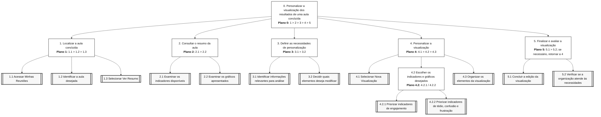
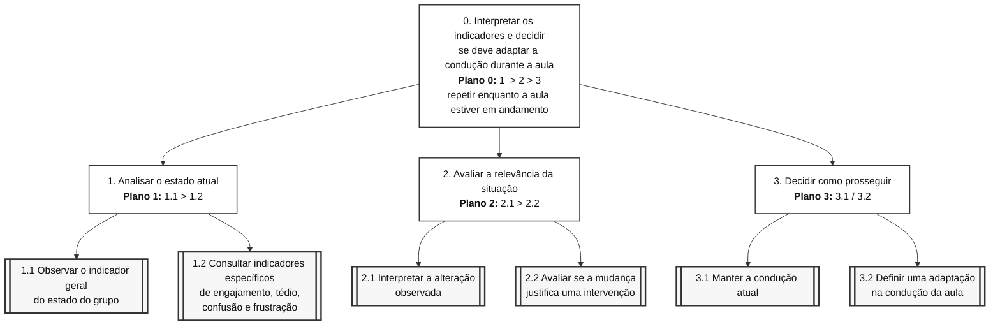
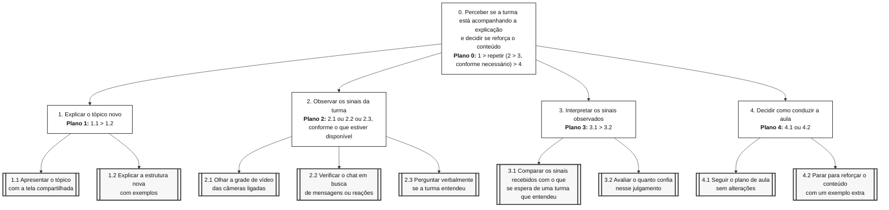
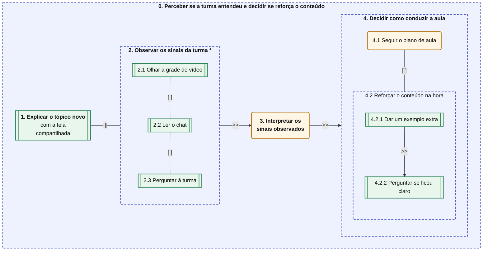
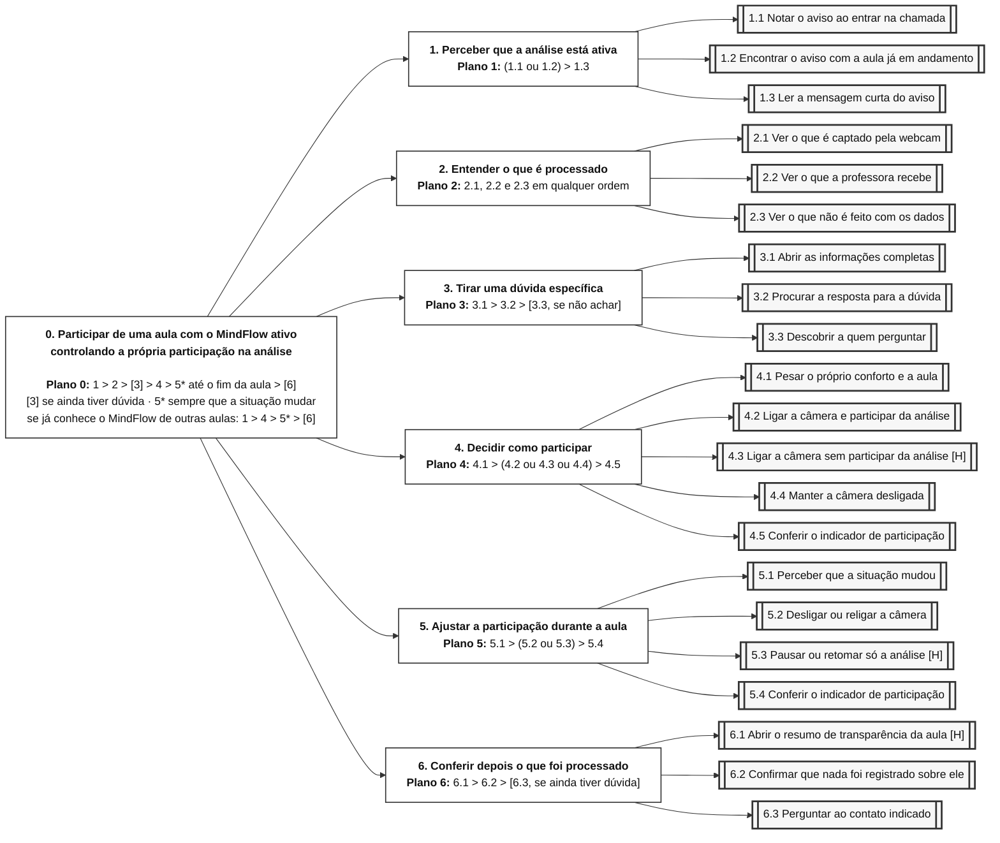
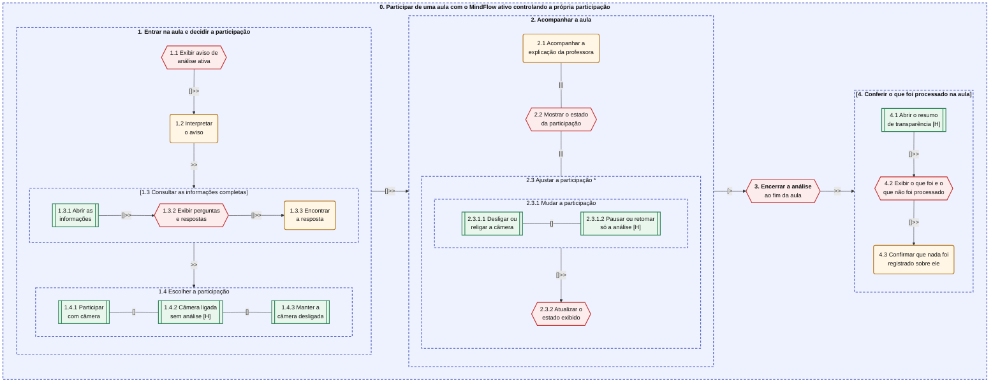
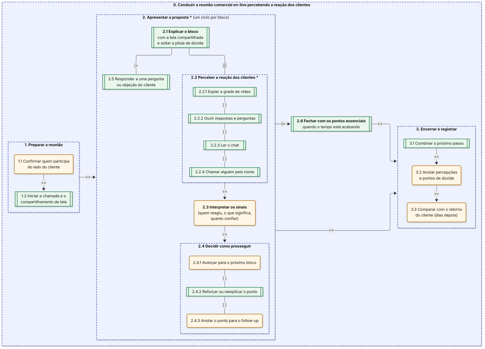

# Entrega 5 — Análise de tarefas: HTA, GOMS e CTT

**Data:** 30/10/2026  
**Status:** 🟨 em andamento  
**Responsabilidade:** cada integrante modela pelo menos 1 HTA, 1 GOMS e 1 CTT. As três técnicas podem abordar a mesma funcionalidade ou funcionalidades distintas, conforme a orientação da disciplina.

## Objetivo da atividade

Modelar tarefas importantes sob perspectivas complementares: decomposição hierárquica (HTA), estrutura de metas/métodos/operações (GOMS) e relações temporais entre tarefas (CTT). O diagrama deve ser acompanhado de interpretação textual.

## Para projetos cujo TCC não previa interface

Modele **tarefas humanas relacionadas ao uso da contribuição técnica**, e não a implementação interna do algoritmo. Exemplos de boas tarefas para análise:

- investigar uma consulta de baixo desempenho;
- configurar uma análise e selecionar parâmetros;
- submeter um dataset e verificar sua validade;
- acompanhar uma execução demorada;
- comparar dois resultados/modelos;
- interpretar uma recomendação e decidir se a aceita;
- localizar uma execução anterior usando busca/filtros;
- gerar e compartilhar um relatório;
- administrar papéis/permissões quando isso for parte do trabalho real;
- revisar um alerta e registrar uma decisão.

Um CRUD pode gerar tarefas relevantes, mas “cadastrar usuário” só merece modelagem se tiver significado no domínio (papéis, validações, riscos, permissões, dependências).

## Seleção das tarefas

| ID | Tarefa | Persona/cenário de origem | Frequência/criticidade | Autor responsável |
|---|---|---|---|---|
| T01 | Revisar uma sessão concluída para identificar momentos relevantes e avaliar a apresentação | P01 / C01 — docente revisando uma aula on-line já finalizada | Média frequência / Alta criticidade | Kayky Pires de Paula - 22.222.040-2 |
| T02 | Identificar e interpretar momentos relevantes nos indicadores de uma sessão concluída | P01 / C01 — docente analisando os resultados de uma aula on-line após seu término | Média frequência / Alta criticidade | Rafael Dias Silva Costa - 22.222.039-4 |
| T03 | Analisar uma sessão concluída enquanto consulta, compara e interpreta diferentes informações da apresentação | P01 / C01 — docente revisando indicadores e registros de uma aula on-line já realizada | Média frequência / Alta criticidade | {{nome — matrícula}} |
| T04 | Perceber, durante a aula, se a turma está acompanhando uma explicação nova e decidir se reforça o conteúdo | P02 / C05 — professora de inglês explicando uma estrutura gramatical nova para uma turma pequena | Alta frequência / Alta criticidade | Isabella Vieira Silva Rosseto — 22.222.036-0 |
| T07 | Participar de uma aula com o MindFlow ativo controlando a própria participação na análise | P05 / C03 — Bruno entrando atrasado na aula de Cálculo, sem saber o que é feito com a imagem dele nem se a câmera ligada (ou desligada) pode pesar contra ele | Alta frequência (toda aula com o MindFlow ativo) / Alta criticidade | Gustavo Bertoluzzi Cardoso — 22.123.016-2 |
| T10 | Conduzir a apresentação comercial percebendo a reação dos clientes e decidindo se avança, reforça ou reexplica um ponto da proposta | P04 / C01 — Manoel apresentando uma proposta pelo Teams com a tela compartilhada, sem conseguir ver nem ouvir todos os clientes | Alta frequência (toda reunião comercial) / Alta criticidade | Matheus Ferreira de Freitas — 22.125.085-5 |
| T11 | Verificar, logo após uma pílula de dúvida, se o cliente compreendeu e se interessou, e decidir como prosseguir | P04 / C01 — Manoel decidindo em poucos segundos, com sinais incompletos, se continua ou reforça o ponto | Alta frequência (várias vezes por reunião) / Alta criticidade | Matheus Ferreira de Freitas — 22.125.085-5 |
| T12 | Conduzir a reunião comercial on-line percebendo a reação dos clientes e reagindo aos eventos da reunião (perguntas, objeções, fim do tempo) | P04 / C01 — Manoel do preparo da reunião até a comparação das anotações com o retorno do cliente no follow-up | Alta frequência / Média-alta criticidade | Matheus Ferreira de Freitas — 22.125.085-5 |

> Priorize tarefas necessárias para que o usuário alcance objetivos centrais. Não desperdice a modelagem em ações triviais isoladas, como “clicar em login”, se o objetivo relevante é maior. Da mesma forma, não modele o funcionamento interno do algoritmo como se fosse uma tarefa humana.

---

## HTA — T01 Configurar o acompanhamento de uma aula concluída no MindFlow AI

**Autor(a):** {{Kayky Pires - 22.222.040-2}}

### Descrição da tarefa

A tarefa consiste em personalizar a visualização dos resultados de uma aula já concluída no MindFlow AI, permitindo que o usuário organize os indicadores e gráficos de acordo com suas necessidades de análise.

Após o encerramento da videoconferência, o usuário acessa a página "Minhas Reuniões", localiza a aula desejada e seleciona a opção "Ver Resumo". Na tela de resumo, examina os indicadores disponíveis, como engajamento, tédio, confusão e frustração, e identifica quais informações deseja destacar ou reorganizar.

Caso a visualização atual não atenda às suas necessidades, o usuário acessa a opção "Nova Visualização", que permite personalizar a apresentação dos resultados. Durante essa etapa, pode escolher os indicadores e organizar os elementos do dashboard conforme suas preferências.

A tarefa é concluída quando o usuário finaliza a personalização e verifica se a visualização resultante apresenta as informações necessárias de maneira clara e organizada, facilitando a interpretação dos resultados da aula.


### Diagrama



### Decomposição e planos

| ID | Objetivo/operação | Plano/ordem | Problema ou decisão de design observada |
|---|---|---|---|
| 0 | Personalizar a visualização dos resultados de uma aula concluída | 1 > 2 > 3 > 4 > 5. Se necessário, repetir 4 e 5. | O usuário precisa adaptar a apresentação dos resultados conforme suas necessidades de análise. |
| 1 | Localizar a aula concluída | 1.1 > 1.2 > 1.3 | É necessário facilitar a localização da reunião desejada. |
| 1.1 | Acessar o histórico de reuniões | Operação inicial. | O histórico deve permitir acesso às reuniões realizadas. |
| 1.2 | Identificar a aula desejada | Após 1.1. | As reuniões precisam apresentar informações que facilitem sua identificação. |
| 1.3 | Selecionar a aula para análise | Após 1.2. | O acesso ao resumo da reunião deve ser facilmente identificado. |
| 2 | Consultar o resumo da aula | 2.1 > 2.2 | O usuário precisa compreender os resultados antes de personalizá-los. |
| 2.1 | Examinar os indicadores disponíveis | Operação inicial do objetivo 2. | Os indicadores devem apresentar informações claras sobre seu significado. |
| 2.2 | Examinar os gráficos apresentados | Após 2.1. | Os gráficos devem facilitar a interpretação das informações. |
| 3 | Definir as necessidades de personalização | 3.1 > 3.2 | O usuário precisa identificar quais informações deseja priorizar. |
| 3.1 | Identificar informações relevantes | Operação inicial do objetivo 3. | É importante facilitar a identificação dos indicadores relevantes. |
| 3.2 | Decidir quais elementos deseja modificar | Após 3.1. | As possibilidades de personalização devem estar evidentes. |
| 4 | Personalizar a visualização | 4.1 > 4.2 > 4.3 | O sistema deve permitir que o usuário organize os resultados conforme suas preferências. |
| 4.1 | Acessar a opção de personalização | Operação inicial do objetivo 4. | A funcionalidade de personalização deve ser facilmente localizada. |
| 4.2 | Escolher os indicadores e gráficos desejados | 4.2.1 OU 4.2.2, conforme o objetivo da análise. | Permitir que o usuário priorize diferentes estados cognitivos conforme suas necessidades. |
| 4.2.1 | Priorizar indicadores de engajamento | Quando o usuário deseja analisar principalmente o nível de engajamento dos participantes. | Destacar informações relacionadas ao engajamento durante a aula. |
| 4.2.2 | Priorizar indicadores de tédio, confusão e frustração | Quando o usuário deseja identificar momentos de possível dificuldade ou desinteresse. | Destacar informações que auxiliem na identificação de períodos que merecem atenção. |
| 4.3 | Organizar os elementos selecionados | Após 4.2. | O usuário deve conseguir ajustar a apresentação das informações. |
| 5 | Finalizar e avaliar a visualização | 5.1 > 5.2. Se necessário, retornar ao objetivo 4. | O usuário precisa verificar se a personalização atende às suas necessidades. |
| 5.1 | Concluir a personalização | Operação inicial do objetivo 5. | Deve existir uma forma clara de finalizar as alterações. |
| 5.2 | Avaliar a visualização resultante | Após 5.1. | O usuário deve conseguir identificar se precisa realizar novos ajustes. |

**Verificação do HTA:**

- **O objetivo 0 representa uma meta do usuário?** Sim. Personalizar a apresentação dos resultados conforme as necessidades de análise.
- **As subtarefas são necessárias e suficientes?** Sim. Abrangem localização, consulta, definição de prioridades, personalização e avaliação.
- **Os planos indicam ordem, alternativa, repetição ou condição?** Sim. Há execução sequencial, escolha alternativa na tarefa 4.2 e possibilidade de repetir a personalização.
- **A decomposição parou em nível útil para projeto de interação?** Sim. As operações representam ações e decisões relevantes do usuário.


---

## GOMS — T02 Configurar o acompanhamento de uma aula concluída no MindFlow AI

**Autor(a):** {{Kayky Pires - 22.222.040-2}}

### GOAL 0: Personalizar a visualização dos resultados de uma aula concluída no MindFlow AI

---

### GOAL 1: Localizar a aula que deseja analisar

#### METHOD 1.A: Selecionar uma reunião identificada diretamente

**SEL. RULE:** utilizar quando o usuário identifica facilmente a aula desejada na lista de reuniões.

- **OP. 1.A.1:** acessar a seção "Minhas Reuniões";
- **OP. 1.A.2:** identificar a reunião desejada;
- **OP. 1.A.3:** selecionar a opção "Ver Resumo";
- **OP. 1.A.4:** visualizar os resultados da reunião.

#### METHOD 1.B: Procurar uma reunião entre as sessões anteriores

**SEL. RULE:** utilizar quando a reunião desejada não é identificada imediatamente na lista.

- **OP. 1.B.1:** acessar a seção "Minhas Reuniões";
- **OP. 1.B.2:** percorrer a lista de reuniões disponíveis;
- **OP. 1.B.3:** examinar as informações de identificação das reuniões;
- **OP. 1.B.4:** localizar a reunião desejada;
- **OP. 1.B.5:** selecionar a opção "Ver Resumo".
- **OP. 1.B.5:** conferir se pagina "resumo" foi carregada.

---

### GOAL 2: Identificar as necessidades de personalização
- **OP. 2.1:** examinar os indicadores exibidos no resumo;
- **OP. 2.2:** identificar os estados cognitivos apresentados;
- **OP. 2.3:** avaliar a relevância dos indicadores para a análise;
- **OP. 2.4:** identificar quais informações deseja manter ou modificar.
---


### GOAL 3: Selecionar os indicadores para personalizar a visualização

#### METHOD 3.A: Priorizar indicadores de engajamento

**SEL. RULE:** utilizar quando o usuário deseja analisar principalmente o nível de engajamento dos participantes durante a aula.

- **OP. 3.A.1:** acessar a opção "Nova Visualização";
- **OP. 3.A.2:** examinar os indicadores disponíveis;
- **OP. 3.A.3:** selecionar os indicadores de engajamento;
- **OP. 3.A.4:** organizar os gráficos selecionados;
- **OP. 3.A.5:** confirmar a personalização.
- **OP. 3.A.6:** analisar personalização.

#### METHOD 3.B: Priorizar indicadores de tédio, confusão e frustração

**SEL. RULE:** utilizar quando o usuário deseja identificar momentos de dificuldade, desinteresse ou frustração dos participantes.

- **OP. 3.B.1:** acessar a opção "Nova Visualização";
- **OP. 3.B.2:** examinar os indicadores disponíveis;
- **OP. 3.B.3:** selecionar os indicadores de tédio, confusão e frustração;
- **OP. 3.B.4:** organizar os gráficos selecionados;
- **OP. 3.B.5:** confirmar a personalização.
- **OP. 3.B.6:** analisar personalização.


---

### GOAL 4: Avaliar o resultado da personalização

#### METHOD 4.A: Validar a visualização personalizada

**SEL. RULE:** utilizar quando a organização dos indicadores e gráficos atende às necessidades de análise do usuário.

- **OP. 4.A.1:** examinar a visualização personalizada;
- **OP. 4.A.2:** verificar a presença dos indicadores desejados;
- **OP. 4.A.3:** avaliar a clareza e a organização das informações;
- **OP. 4.A.4:** concluir a personalização.
- **OP. 4.A.5:** analisar personalização.

#### METHOD 4.B: Revisar a personalização realizada

**SEL. RULE:** utilizar quando a visualização não apresenta as informações desejadas ou sua organização ainda não está adequada.

- **OP. 4.B.1:** examinar a visualização personalizada;
- **OP. 4.B.2:** identificar os elementos que precisam de ajustes;
- **OP. 4.B.3:** retornar às opções de personalização;
- **OP. 4.B.4:** modificar os indicadores ou a organização dos elementos;
- **OP. 4.B.5:** avaliar novamente a visualização resultante.

---

## CTT — T01 Configurar o acompanhamento de uma aula no MindFlow AI

**Autor(a):** {{Kayky Pires - 22.222.040-2}}


### Descrição

O modelo CTT representa a personalização dos resultados de uma aula concluída no MindFlow AI, considerando a sequência das tarefas e suas relações temporais.

O usuário acessa "Minhas Reuniões", seleciona a aula desejada e consulta seu resumo. Em seguida, identifica as informações que deseja modificar e utiliza a opção "Nova Visualização" para selecionar indicadores e reorganizar os gráficos.

Após finalizar a edição, verifica se a visualização atende às suas necessidades. Caso contrário, pode retornar à personalização e realizar novos ajustes.

### Diagrama

[https://github.com/IsaRosseto/IHC_MindFlowAI/blob/main/assets/05_tarefas/ctt.png](https://github.com/IsaRosseto/IHC_MindFlowAI/blob/main/assets/05_tarefas/CTT%20Diagrama.png)

### Legenda e relações temporais usadas

| Operador/relação | Significado no diagrama | Exemplo no modelo |
|---|---|---|
| Nuvem | Tarefa abstrata. Reúne subtarefas de diferentes categorias. | Localizar e abrir o resumo da aula; Personalizar e avaliar. |
| Pessoa | Tarefa do usuário. Representa uma atividade cognitiva, como examinar informações, avaliar ou decidir. | IIdentificar a aula desejada; Definir necessidades; Analisar a visualização resultante. |
| Computador | Tarefa do sistema. Representa uma atividade executada automaticamente pelo sistema. | ECarregar as reuniões; Exibir o resumo da aula; Atualizar o dashboard. |
| Pessoa e computador | TTarefa de interação. Representa uma ação do usuário na interface. | Selecionar Ver Resumo; Selecionar indicadores e gráficos desejados; Organizar elementos; Confirmar alterações. |
| `>>` — Habilitação | A segunda tarefa é habilitada após a conclusão da primeira. | Localizar a aula → Avaliar o resumo → Personalizar a visualização → Conferir o resultado. |
| `[ ] >>` — Habilitação com passagem de informação | A segunda tarefa é habilitada após a primeira e utiliza as informações produzidas por ela. | Selecionar Ver Resumo → Sistema exibir o resumo da aula. |
| `[ ]` — Escolha | Representa tarefas alternativas; ao iniciar uma delas, a outra deixa de estar habilitada naquele momento. | Selecionar indicadores e gráficos ou reorganizar elementos no dashboard. |
| Repetição da verificação | Representa o retorno a uma tarefa anterior quando a configuração precisa ser ajustada. | Caso a visualização não atenda às necessidades, o usuário retorna à personalização e realiza novos ajustes. |

---

# HTA — T02 Interpretar os indicadores do MindFlow AI e decidir se deve adaptar a condução durante a aula

**Autor(a):** Rafael Dias — 22.222.039-4

## Descrição da tarefa

A tarefa tem como objetivo permitir que o docente interprete os indicadores apresentados pelo MindFlow AI durante uma aula on-line e utilize essas informações como apoio para decidir se deve manter ou adaptar a condução da aula.

A tarefa se inicia quando o MindFlow AI apresenta os estados dos participantes no dashboard. O docente consulta o estado atual, compara os indicadores quando necessário, analisa sua evolução ao longo do tempo e avalia se a alteração observada é suficientemente relevante para justificar alguma mudança na aula.

A tarefa é concluída quando o docente decide manter a condução atual ou realizar uma adaptação. Esse processo pode se repetir diversas vezes durante a aula conforme novos estados são apresentados pelo sistema.

## Diagrama



## Decomposição e planos

| ID | Objetivo/operação | Plano/ordem | Problema ou decisão de design observada |
|---|---|---|---|
| **0** | Interpretar os indicadores do MindFlow AI e decidir se deve adaptar a condução durante a aula | **1 > 2 > 3**, repetindo enquanto a aula estiver em andamento. | O processo precisa ser rápido para não desviar excessivamente a atenção do docente durante a aula. |
| **1** | Analisar o estado atual | **1.1 > 1.2** | Os indicadores devem permitir que o docente compreenda rapidamente o estado dos participantes. |
| 1.1 | Observar o indicador geral do estado do grupo | Primeira operação. | O estado predominante deve ser facilmente identificado e não depender exclusivamente de cores. |
| 1.2 | Consultar indicadores específicos de engajamento, tédio, confusão e frustração | Executar após 1.1. | A apresentação simultânea de vários indicadores pode aumentar a carga cognitiva durante a aula. |
| **2** | Avaliar a relevância da situação | **2.1 > 2.2** | Os indicadores devem funcionar como apoio à decisão, sem representar conclusões absolutas sobre os participantes. |
| 2.1 | Interpretar a alteração observada | Primeira operação da avaliação. | O docente precisa relacionar os indicadores ao contexto da aula, evitando interpretações baseadas apenas em oscilações pontuais. |
| 2.2 | Avaliar se a mudança justifica uma intervenção | Executar após 2.1. | A decisão sobre a necessidade de intervenção deve permanecer sob responsabilidade do docente. |
| **3** | Decidir como prosseguir | **3.1 / 3.2**, conforme a avaliação realizada em 2.2. | A interface deve apoiar a decisão sem impor automaticamente uma ação pedagógica. |
| 3.1 | Manter a condução atual | Executar quando a situação não justificar uma adaptação. | Pequenas oscilações nos indicadores podem não exigir alterações na condução da aula. |
| 3.2 | Definir uma adaptação na condução da aula | Executar quando a situação justificar uma intervenção. | A adaptação escolhida depende do contexto da aula e dos estados observados. |

**Verificação do HTA:**

- O objetivo 0 representa uma meta do usuário?
- As subtarefas são necessárias e suficientes?
- Os **planos** indicam ordem, alternativa, repetição ou condição?
- A decomposição parou em nível útil para projeto de interação?

---


# GOMS — T02: Interpretar os indicadores do MindFlow AI e decidir se deve adaptar a condução durante a aula

**Autor(a):** Rafael Dias — 22.222.039-4

## GOAL 0: Interpretar os indicadores do MindFlow AI e decidir se deve adaptar a condução durante a aula

**METHOD 0.A:** Analisar o estado atual dos participantes, avaliar a relevância da situação e decidir como prosseguir.

- **OP. 0.A.1:** analisar o estado atual dos participantes (GOAL 1);
- **OP. 0.A.2:** avaliar a relevância da situação (GOAL 2);
- **OP. 0.A.3:** decidir como prosseguir com a aula (GOAL 3);
- **OP. 0.A.4:** repetir o processo enquanto a aula estiver em andamento.

---

## GOAL 1: Analisar o estado atual dos participantes

### GOAL 1.A: Observar o indicador geral do estado do grupo

- **OP. 1.A.1:** direcionar a atenção para o indicador geral;
- **OP. 1.A.2:** observar o estado predominante apresentado;
- **OP. 1.A.3:** verificar o valor associado ao estado;
- **OP. 1.A.4:** interpretar a informação apresentada.

### GOAL 1.B: Consultar os indicadores específicos

- **OP. 1.B.1:** direcionar a atenção para os indicadores específicos;
- **OP. 1.B.2:** observar os valores de engajamento, tédio, confusão e frustração;
- **OP. 1.B.3:** comparar os valores apresentados;
- **OP. 1.B.4:** identificar os estados mais relevantes naquele momento.

---

## GOAL 2: Avaliar a relevância da situação

### GOAL 2.A: Interpretar a alteração observada

- **OP. 2.A.1:** identificar os estados que merecem atenção;
- **OP. 2.A.2:** relacionar os indicadores ao conteúdo ou à atividade em andamento;
- **OP. 2.A.3:** interpretar o significado dos estados observados no contexto da aula.

### GOAL 2.B: Avaliar a necessidade de intervenção

- **OP. 2.B.1:** considerar a relevância dos indicadores observados;
- **OP. 2.B.2:** avaliar se os estados identificados podem comprometer o andamento da aula;
- **OP. 2.B.3:** determinar se a situação justifica uma intervenção pedagógica.

---

## GOAL 3: Decidir como prosseguir com a aula

### METHOD 3.A: Manter a condução atual

**SEL. RULE:** utilizar quando os indicadores não demonstrarem uma situação que justifique adaptação da aula.

- **OP. 3.A.1:** decidir manter a estratégia pedagógica atual;
- **OP. 3.A.2:** continuar a condução da aula sem alterações;
- **OP. 3.A.3:** acompanhar os próximos indicadores apresentados pelo sistema.

### METHOD 3.B: Definir uma adaptação na condução da aula

**SEL. RULE:** utilizar quando os indicadores e o contexto da aula demonstrarem necessidade de intervenção.

- **OP. 3.B.1:** identificar o estado que motivou a necessidade de adaptação;
- **OP. 3.B.2:** considerar possíveis mudanças na estratégia pedagógica;
- **OP. 3.B.3:** selecionar a adaptação mais adequada ao contexto;
- **OP. 3.B.4:** aplicar a adaptação durante a aula;
- **OP. 3.B.5:** acompanhar os próximos indicadores para observar a resposta dos participantes.

---

## Síntese do modelo GOMS

* **Goal principal:** interpretar os indicadores do MindFlow AI e decidir como prosseguir com a aula.
* **Goals secundários:** compreender o estado atual, identificar mudanças relevantes, interpretar a situação e definir como continuar.
* **Methods:** consultar indicador geral, consultar indicadores específicos, comparar valores no tempo, manter a condução ou adaptar a aula.
* **Operators:** observar, acessar, identificar, comparar, interpretar, relacionar informações, decidir e selecionar uma ação.
* **Selection Rules:** determinam qual método é utilizado de acordo com a quantidade de informação necessária, a existência de mudanças nos indicadores e a interpretação do docente.

> Não chame qualquer passo de “método”. Em GOMS, métodos são sequências alternativas capazes de atingir uma meta; regras de seleção explicam quando escolher entre eles.

---

# CTT — T02: Interpretar os indicadores do MindFlow AI

**Autor(a):** Rafael Dias — 22.222.039-4

## Diagrama CTT

[https://github.com/IsaRosseto/IHC_MindFlowAI/blob/main/assets/05_tarefas/ctt.png](https://github.com/IsaRosseto/IHC_MindFlowAI/blob/main/assets/05_tarefas/CTT%20Diagrama.png)

### Legenda e relações temporais usadas

| Operador/relação | Significado no diagrama | Exemplo no modelo |
|---|---|---|
| Nuvem | Tarefa abstrata. Reúne subtarefas de diferentes categorias. | Localizar e abrir o resumo da aula; Personalizar e avaliar. |
| Pessoa | Tarefa do usuário. Representa uma atividade cognitiva, como examinar informações, avaliar ou decidir. | IIdentificar a aula desejada; Definir necessidades; Analisar a visualização resultante. |
| Computador | Tarefa do sistema. Representa uma atividade executada automaticamente pelo sistema. | ECarregar as reuniões; Exibir o resumo da aula; Atualizar o dashboard. |
| Pessoa e computador | TTarefa de interação. Representa uma ação do usuário na interface. | Selecionar Ver Resumo; Selecionar indicadores e gráficos desejados; Organizar elementos; Confirmar alterações. |
| `>>` — Habilitação | A segunda tarefa é habilitada após a conclusão da primeira. | Localizar a aula → Avaliar o resumo → Personalizar a visualização → Conferir o resultado. |
| `[ ] >>` — Habilitação com passagem de informação | A segunda tarefa é habilitada após a primeira e utiliza as informações produzidas por ela. | Selecionar Ver Resumo → Sistema exibir o resumo da aula. |
| `[ ]` — Escolha | Representa tarefas alternativas; ao iniciar uma delas, a outra deixa de estar habilitada naquele momento. | Selecionar indicadores e gráficos ou reorganizar elementos no dashboard. |
| Repetição da verificação | Representa o retorno a uma tarefa anterior quando a configuração precisa ser ajustada. | Caso a visualização não atenda às necessidades, o usuário retorna à personalização e realiza novos ajustes. |

---
## HTA — T04 Perceber, durante a aula, se a turma está acompanhando uma explicação nova e decidir se reforça o conteúdo

**Autor(a):** Isabella Vieira Silva Rosseto — 22.222.036-0

### Descrição da tarefa

A tarefa tem como objetivo permitir que a professora perceba, durante a própria aula, se a turma está acompanhando uma explicação nova e decida, ainda em tempo real, se reforça o conteúdo antes de seguir para o próximo tópico. É a tarefa que, no Cenário C05 (Entrega 4), Camila não consegue realizar bem: ela só descobre a dificuldade da turma na aula seguinte, ao corrigir o exercício de casa.

A tarefa se inicia quando a professora começa a explicar um tópico novo, com a tela compartilhada e a grade de vídeo reduzida num canto da tela. Enquanto explica, ela busca sinais de compreensão: observa as câmeras ligadas, verifica o chat ou pergunta diretamente se a turma entendeu.

Com base nesses sinais, a professora interpreta se o silêncio e as respostas recebidas indicam compreensão ou dúvida, avaliando também o quanto confia nesse julgamento, que hoje é informal. Em seguida, decide se segue o plano de aula ou se interrompe a sequência para reforçar o conteúdo com um exemplo extra.

A tarefa é considerada concluída quando a professora toma a decisão (seguir ou reforçar) e retoma a condução da aula a partir dela.

### Diagrama



### Decomposição e planos

| ID | Objetivo/operação | Plano/ordem | Problema ou decisão de design observada |
|---|---|---|---|
| 0 | Perceber se a turma está acompanhando a explicação e decidir se reforça o conteúdo | 1 > repetir (2 > 3, conforme necessário) > 4 | A tarefa depende de sinais fracos (silêncio, câmeras desligadas); hoje não existe nenhum indicador estruturado, só a leitura informal da professora |
| 1 | Explicar o tópico novo | 1.1 > 1.2 | Enquanto explica com a tela compartilhada, a professora já está com a atenção ocupada, o que reduz a atenção disponível para observar a turma |
| 2 | Observar os sinais da turma | 2.1 ou 2.2 ou 2.3, conforme o que estiver disponível | Os três canais (câmera, chat, pergunta verbal) competem com a explicação e nenhum é confiável sozinho: a grade fica reduzida na tela compartilhada e o “sim” verbal costuma ser pouco convicto |
| 3 | Interpretar os sinais observados | 3.1 > 3.2 | Não há nenhum indicador de confiança nesse julgamento; ele é puramente subjetivo (relacionado à hipótese H02) |
| 4 | Decidir como conduzir a aula | 4.1 ou 4.2 | Parar para reforçar (4.2) gasta tempo de aula, então só acontece quando a professora tem bastante certeza, o que favorece seguir em frente por excesso de cautela |

**Verificação do HTA:**

- O objetivo 0 representa uma meta do usuário? Sim. É o objetivo de Camila (persona P02, Cenário C05), e não uma função do sistema.
- As subtarefas são necessárias e suficientes? Sim. Explicar, observar, interpretar e decidir cobrem o ciclo completo descrito no cenário.
- Os **planos** indicam ordem, alternativa, repetição ou condição? Sim. O Plano 0 usa ordem e repetição, e os Planos 2 e 4 usam alternativa (“ou”).
- A decomposição parou em nível útil para projeto de interação? Sim. Parou em ações observáveis (olhar a grade, verificar o chat, perguntar), sem descer a detalhes de tela.

---

## GOMS — T04 Perceber, durante a aula, se a turma está acompanhando uma explicação nova e decidir se reforça o conteúdo

**Autor(a):** Isabella Vieira Silva Rosseto — 22.222.036-0

## GOMS — Perceber a compreensão da turma e decidir se reforça o conteúdo

### GOAL 0: Perceber, durante a aula, se a turma está compreendendo uma explicação nova e decidir se reforça o conteúdo

O objetivo principal é, ainda durante a aula, formar um julgamento sobre a compreensão da turma a partir dos sinais disponíveis e decidir se a explicação segue conforme o plano ou se precisa ser reforçada antes de avançar.

---

### GOAL 1: Obter sinais sobre a reação da turma

#### METHOD 1.A: Observar a grade de vídeo

**SEL. RULE:** utilizar quando parte da turma estiver com a câmera ligada e a explicação permitir desviar rapidamente o olhar.

- **OP. 1.A.1:** direcionar o olhar para a grade de vídeo reduzida;
- **OP. 1.A.2:** identificar os alunos com câmera ligada;
- **OP. 1.A.3:** observar as expressões visíveis nas miniaturas;
- **OP. 1.A.4:** retornar a atenção ao conteúdo compartilhado.

#### METHOD 1.B: Perguntar diretamente à turma

**SEL. RULE:** utilizar quando as câmeras estiverem desligadas ou quando a grade de vídeo não permitir concluir se a turma acompanhou.

- **OP. 1.B.1:** interromper brevemente a explicação;
- **OP. 1.B.2:** perguntar à turma se entenderam;
- **OP. 1.B.3:** aguardar as respostas;
- **OP. 1.B.4:** avaliar o tom e a convicção das respostas recebidas.

---

### GOAL 2: Interpretar os sinais obtidos

#### METHOD 2.A: Interpretar com base nos sinais já recebidos

**SEL. RULE:** utilizar quando os sinais do Goal 1 forem consistentes entre si (por exemplo, respostas rápidas e convictas, ou expressões claramente atentas).

- **OP. 2.A.1:** comparar os sinais com o que se espera de uma turma que entendeu;
- **OP. 2.A.2:** avaliar o quanto confia nesse julgamento;
- **OP. 2.A.3:** concluir se há ou não indício de dúvida.

#### METHOD 2.B: Buscar uma confirmação adicional antes de concluir

**SEL. RULE:** utilizar quando os sinais forem ambíguos (por exemplo, silêncio prolongado ou um “sim” pouco convicto).

- **OP. 2.B.1:** escolher um aluno ou um exemplo para testar a compreensão;
- **OP. 2.B.2:** pedir que o aluno explique ou aplique a estrutura com as próprias palavras;
- **OP. 2.B.3:** avaliar se a resposta indica compreensão;
- **OP. 2.B.4:** concluir se há ou não indício de dúvida.

---

### GOAL 3: Decidir como conduzir o restante da aula

#### METHOD 3.A: Seguir o plano de aula

**SEL. RULE:** utilizar quando a interpretação do Goal 2 indicar que a turma acompanhou o conteúdo.

- **OP. 3.A.1:** concluir a explicação do tópico atual;
- **OP. 3.A.2:** passar para o próximo tópico previsto no plano.

#### METHOD 3.B: Reforçar o conteúdo na hora

**SEL. RULE:** utilizar quando a interpretação do Goal 2 indicar possível dúvida da turma.

- **OP. 3.B.1:** interromper a sequência prevista;
- **OP. 3.B.2:** apresentar um exemplo adicional da estrutura;
- **OP. 3.B.3:** perguntar novamente se ficou claro;
- **OP. 3.B.4:** retomar o plano de aula a partir desse ponto.

> Não chame qualquer passo de “método”. Em GOMS, métodos são sequências alternativas capazes de atingir uma meta; regras de seleção explicam quando escolher entre eles.

---

## CTT — T04 Perceber, durante a aula, se a turma está acompanhando uma explicação nova e decidir se reforça o conteúdo

**Autor(a):** Isabella Vieira Silva Rosseto — 22.222.036-0

### Descrição

O modelo CTT representa a mesma situação sob a perspectiva das relações temporais entre as tarefas. A tarefa raiz (**Perceber se a turma entendeu e decidir se reforça o conteúdo**) é abstrata e se decompõe em quatro tarefas: **Explicar o tópico novo** (interação, com a tela compartilhada), **Observar os sinais da turma** (abstrata), **Interpretar os sinais observados** (tarefa de usuário, puramente cognitiva) e **Decidir como conduzir a aula** (abstrata).

Explicar e observar acontecem ao mesmo tempo, e não uma depois da outra (concorrência): a professora observa a turma enquanto fala. A observação é repetida durante a explicação e, para cada rodada, a professora escolhe um canal: olhar a grade de vídeo, ler o chat ou perguntar à turma. Só depois de observar é que ela consegue interpretar os sinais (habilitação), e só depois de interpretar consegue decidir.

A decisão é uma escolha entre seguir o plano de aula e reforçar o conteúdo. Reforçar se decompõe em duas tarefas de interação em sequência: dar um exemplo extra e, depois dele, perguntar se ficou claro.

### Diagrama



### Legenda e relações temporais usadas

| Operador/relação | Significado no diagrama | Exemplo no modelo |
|---|---|---|
| `\|\|\|` (concorrência) | As tarefas acontecem ao mesmo tempo, sem ordem fixa entre si | Explicar o tópico novo e Observar os sinais da turma |
| `>>` (habilitação) | A segunda tarefa só começa depois que a primeira termina | Observar → Interpretar → Decidir; Dar um exemplo extra → Perguntar se ficou claro |
| `[]` (escolha) | Apenas uma das alternativas é executada a cada vez | Olhar a grade de vídeo, Ler o chat ou Perguntar à turma; Seguir o plano ou Reforçar o conteúdo |
| `*` (repetição) | A tarefa é repetida enquanto for necessária | Observar os sinais da turma durante toda a explicação |

No diagrama, as tarefas abstratas têm borda tracejada, as de usuário são laranja e as de interação são verdes; as subtarefas ficam dentro da caixa da tarefa-pai e o operador temporal aparece sobre a linha que liga duas tarefas irmãs. As tarefas de **usuário** (Interpretar os sinais, Seguir o plano) são ações cognitivas ou de decisão da professora, sem interação direta com a videochamada. Tarefas de **interação** (explicar com a tela compartilhada, olhar a grade, ler o chat, perguntar) são ações da professora sobre a videochamada. Tarefas **abstratas** agrupam subtarefas. Não há tarefas de sistema porque esta modelagem descreve a prática atual, sem antecipar a solução.

---

## HTA — T07 Participar de uma aula com o MindFlow ativo controlando a própria participação na análise

**Autor(a):** Gustavo Bertoluzzi Cardoso — 22.123.016-2

### Descrição da tarefa

A tarefa T07 é modelada pelas três técnicas desta entrega: o HTA mostra como ela se divide em subtarefas, o GOMS mostra os métodos alternativos para cumprir cada meta e o CTT mostra as relações temporais entre o que o participante faz e o que o sistema faz.

A persona de referência é **P05 — Bruno D. Roger**, aluno de graduação em disciplinas EAD. Bruno é persona secundária: não usa o Semáforo Cognitivo nem o Dashboard, mas, como registrado na Entrega 3 (contexto de uso, linha “Papéis/permissões/governança”), tem uma interação própria com o MindFlow por meio das informações de transparência e de participação. Essa é a parte da interface que responde à H03 e às RC04, RC05 e RC09 da Entrega 2.

A tarefa parte da situação do Cenário C03. Bruno entra atrasado na aula de Cálculo pelo Teams e, no meio da aula, a professora pede que mais gente ligue a câmera. Hoje ele decide no escuro, porque não sabe o que é feito com a imagem dele nem se isso pode pesar na nota de participação. Depois da aula, continua sem saber se algo pode voltar contra ele e não tem a quem perguntar (Q5).

Com o MindFlow ativo, Bruno percebe o aviso de que a aula está sendo analisada, entende o que é captado, o que a professora recebe e o que não é feito com os dados e, se ainda tiver dúvida, consulta as informações completas. Em seguida, decide como quer participar e confere o indicador. Durante a aula, pode mudar essa decisão sempre que a situação mudar (por exemplo, quando alguém entra no quarto, que ele divide com a família). Depois da aula, pode conferir o que foi processado.

A tarefa é considerada concluída quando a aula termina com Bruno tendo participado da forma que escolheu, sabendo o que aconteceu com a própria imagem.

### Diagrama



### Decomposição e planos

| ID | Objetivo/operação | Plano/ordem | Problema ou decisão de design observada |
|---|---|---|---|
| 0 | Participar de uma aula com o MindFlow ativo controlando a própria participação na análise | **1 > 2 > [3, se ainda tiver dúvida] > 4 > repetir 5 sempre que a situação mudar, até o fim da aula > [6, se quiser]**; se Bruno já conhece o MindFlow de outras aulas, **1 > 4 > 5\* > [6]** | No C03, Bruno entra atrasado e já com a aula começando. As subtarefas 1 a 4 precisam levar segundos e não podem competir com o início da explicação. O atalho do plano existe para que quem já entendeu o sistema não precise reler tudo a cada aula. |
| 1 | Perceber que a análise está ativa | **(1.1 ou 1.2) > 1.3** | Bruno nunca ouviu falar de um sistema que analisa expressão facial em aula (P05). Se ele não perceber o aviso, nenhuma das outras subtarefas acontece. |
| 1.1 | Notar o aviso ao entrar na chamada | Alternativa a 1.2, quando ele entra no horário | Existe um conflito a investigar: um aviso que bloqueia a entrada garante a leitura, mas atrasa quem já está atrasado; um aviso discreto não atrapalha, mas pode passar despercebido. |
| 1.2 | Encontrar o aviso com a aula já em andamento | Alternativa a 1.1, quando ele entra atrasado ou fecha o aviso sem ler | O aviso não pode existir só no momento da entrada. Um indicador permanente e pequeno deve levar de volta a ele a qualquer momento da aula. |
| 1.3 | Ler a mensagem curta do aviso | Após 1.1 ou 1.2 | A mensagem deve ter poucas linhas e linguagem simples, sem termos técnicos de IA (RC04). |
| 2 | Entender o que é processado | **2.1, 2.2 e 2.3 em qualquer ordem** | As três informações são independentes. Podem aparecer como três blocos curtos que Bruno lê na ordem que quiser. |
| 2.1 | Ver o que é captado pela webcam | Qualquer ordem dentro de 2 | Deve dizer que são sinais visuais processados no próprio computador dele. O processamento local também ajuda a diminuir a sensação de estar sendo vigiado (decisão de design da P05). |
| 2.2 | Ver o que a professora recebe | Qualquer ordem dentro de 2 | É a informação que responde ao medo central do Bruno no C03: a professora recebe só um resultado agregado da turma, sem apontar nenhum aluno (H03; decisão de design da P05). |
| 2.3 | Ver o que não é feito com os dados | Qualquer ordem dentro de 2 | Dizer o que **não** acontece (vídeo não é guardado, não existe avaliação individual) responde à dúvida do Bruno de forma mais direta do que só listar o que o sistema faz. Segue o padrão da página de transparência do Education Insights (Entrega 2). |
| 3 | Tirar uma dúvida específica | **3.1 > 3.2 > [3.3, se não encontrar a resposta]** | É opcional no Plano 0. Só acontece quando o resumo do aviso não bastou. |
| 3.1 | Abrir as informações completas | Primeira operação de 3 | A página completa é o equivalente, no MindFlow, da página de transparência para o aluno do Education Insights (RC04). |
| 3.2 | Procurar a resposta para a dúvida | Após 3.1 | As dúvidas do Bruno são concretas: “isso conta na nota?”, “a professora vê o meu rosto?”. As informações devem estar organizadas por perguntas com as palavras do aluno, e não por termos técnicos. |
| 3.3 | Descobrir a quem perguntar | Opcional, quando 3.2 não resolve | No C03 (Q5), não existe nenhum canal para Bruno tirar esse tipo de dúvida, e ele nunca mandou e-mail para a professora porque achou que ia parecer estranho. A página deve indicar um contato para perguntas sobre os dados. |
| 4 | Decidir como participar | **4.1 > (4.2 ou 4.3 ou 4.4) > 4.5** | A decisão é do Bruno. A interface não deve pressioná-lo para nenhuma das opções. |
| 4.1 | Pesar o próprio conforto e a aula | Primeira operação de 4 | Professor e aluno têm níveis diferentes de autoridade, e o participante pode não se sentir à vontade para recusar (Entrega 3, linha “Ambiente social/organizacional”). |
| 4.2 | Ligar a câmera e participar da análise | Alternativa | É o caminho que a professora espera, mas não deve ser apresentado como o “certo”. |
| 4.3 | Ligar a câmera sem participar da análise **[H]** | Alternativa | A forma de consentimento ou recusa ainda precisa ser investigada (Entrega 3, linha “Papéis/permissões/governança”). Se essa opção não existir, a única forma de não ser analisado é desligar a câmera, ou seja, sumir da aula. Isso reproduz exatamente o conflito do C03, em que privacidade e participação ficam presas uma à outra. |
| 4.4 | Manter a câmera desligada | Alternativa | Não deve gerar consequência individual. A contagem de participantes que contribuem para o sinal, prevista para o comunicador (decisão de design da P04), precisa continuar sendo só um número, sem dizer quem está de câmera desligada. |
| 4.5 | Conferir o indicador de participação | Última operação de 4 | Sem confirmação, Bruno não tem certeza se a escolha dele foi aplicada. O indicador deve ser pequeno e permanente e funcionar também no celular, que é um dos dispositivos que Bruno usa para assistir aula (P05). |
| 5 | Ajustar a participação durante a aula | **5.1 > (5.2 ou 5.3) > 5.4**; executada zero ou mais vezes, sempre que a situação mudar | A escolha feita em 4 não é definitiva. O controle precisa continuar disponível durante toda a aula sem tirar a atenção do Bruno da explicação. |
| 5.1 | Perceber que a situação mudou | Primeira operação de 5 | Exemplos da P05 e do C03: alguém da família entra no quarto, ou Bruno percebe que está num dia em que entendeu menos e não quer se expor. |
| 5.2 | Desligar ou religar a câmera | Alternativa a 5.3, quando ele também quer sumir (ou voltar a aparecer) para a turma | É feita na plataforma de videoconferência, fora do MindFlow. Ao religar a câmera, Bruno precisa saber se a análise volta junto ou continua como ele deixou. |
| 5.3 | Pausar ou retomar só a análise **[H]** | Alternativa a 5.2, quando ele quer continuar visível para a turma | Depende da mesma hipótese de 4.3. Sem ela, a única forma de parar de ser analisado no meio da aula é desligar a câmera. |
| 5.4 | Conferir o indicador de participação | Última operação de 5 | O estado “participando” ou “pausado” precisa ser fácil de distinguir de relance. |
| 6 | Conferir depois o que foi processado | **6.1 > 6.2 > [6.3, se ainda tiver dúvida]**; opcional no Plano 0 | Responde à última ruptura do C03: depois da aula, Bruno fica sem saber se algo pode voltar contra ele (Q5). |
| 6.1 | Abrir o resumo de transparência da aula **[H]** | Primeira operação de 6 | Proposta a validar com alunos. O resumo deve falar só do que aconteceu com os dados do próprio Bruno naquela aula, sem mostrar nenhum resultado da turma, já que o Semáforo e o Dashboard são exclusivos do comunicador (RC09). |
| 6.2 | Confirmar que nada foi registrado sobre ele | Após 6.1 | A informação que importa para o Bruno é negativa: nada foi guardado sobre ele individualmente e o vídeo não foi armazenado. |
| 6.3 | Perguntar ao contato indicado | Opcional, quando 6.2 não basta | É o mesmo contato de 3.3. Ter um canal claro evita que a dúvida fique sem resposta de uma aula para outra, como acontece hoje no C03. |

**Verificação do HTA:**

- O objetivo 0 representa uma meta do usuário? Sim. É a meta do Bruno de assistir à aula sabendo o que acontece com a imagem dele e decidindo como participa, que é a necessidade registrada na P05. Não é uma função do sistema.
- As subtarefas são necessárias e suficientes? Sim. Elas cobrem a aula inteira do ponto de vista do participante: antes de decidir (1 a 3), a decisão (4), a mudança de decisão durante a aula (5) e a confirmação depois (6). A subtarefa 3.3 e a 6 foram incluídas porque a falta de canal para tirar dúvidas é um dos problemas levantados no C03.
- Os **planos** indicam ordem, alternativa, repetição ou condição? Sim. O Plano 0 tem subtarefas opcionais (3 e 6), repetição (5) e condição (quem já conhece o sistema pula de 1 para 4). Os Planos 1, 4 e 5 têm alternativas. O Plano 2 indica ordem livre. Os Planos 3 e 6 têm operações condicionais.
- A decomposição parou em nível útil para projeto de interação? Sim. Parou em ações que viram elementos de interface (aviso, indicador, página de informações, opções de participação, controle de pausa, resumo), sem descer a cliques em telas que ainda não foram desenhadas.

---

## GOMS — T07 Participar de uma aula com o MindFlow ativo controlando a própria participação na análise

**Autor(a):** Gustavo Bertoluzzi Cardoso — 22.123.016-2

### GOAL 0: Participar de uma aula com o MindFlow ativo controlando a própria participação na análise

Esta é a mesma tarefa decomposta no HTA acima. As metas abaixo acompanham a aula do Bruno (P05) na mesma ordem: entender a análise, escolher como participar, verificar o próprio estado, mudar a participação no meio da aula e conferir depois o que foi processado. O GOMS acrescenta ao HTA os **métodos alternativos** para cumprir cada meta e as **regras de seleção** que dizem quando o Bruno usa cada um.

O modelo mostra por que a interface precisa separar duas coisas que hoje andam juntas: aparecer para a turma e ser analisado. Nas GOALs 2 e 4, se só existirem os métodos ligados à câmera, Bruno é obrigado a sumir da aula para proteger a própria imagem, o que é exatamente o conflito descrito no C03.

---

### GOAL 1: Entender o que acontece com a própria imagem nesta aula

#### METHOD 1.A: Ler o aviso ao entrar na aula

**SEL. RULE:** utilizar quando Bruno entra no horário e o aviso de análise ativa aparece na entrada da chamada.

- **OP. 1.A.1:** perceber o aviso na tela;
- **OP. 1.A.2:** ler a mensagem curta;
- **OP. 1.A.3:** ler o que é captado, o que a professora recebe e o que não é feito com os dados;
- **OP. 1.A.4:** decidir se a dúvida foi resolvida.

#### METHOD 1.B: Reabrir o aviso pelo indicador durante a aula

**SEL. RULE:** utilizar quando Bruno entra atrasado, como no C03, ou quando fechou o aviso sem ler.

- **OP. 1.B.1:** perceber o indicador de análise ativa na tela;
- **OP. 1.B.2:** clicar no indicador;
- **OP. 1.B.3:** ler a mensagem curta;
- **OP. 1.B.4:** decidir se a dúvida foi resolvida.

#### METHOD 1.C: Consultar as informações completas

**SEL. RULE:** utilizar quando o aviso resumido não respondeu a uma dúvida concreta, como “isso conta na nota?” ou “a professora vê o meu rosto?”.

- **OP. 1.C.1:** abrir as informações completas a partir do aviso;
- **OP. 1.C.2:** percorrer as perguntas com o olhar;
- **OP. 1.C.3:** escolher a pergunta mais parecida com a própria dúvida;
- **OP. 1.C.4:** ler a resposta;
- **OP. 1.C.5:** se a resposta não bastar, anotar o contato indicado para perguntas sobre os dados.

---

### GOAL 2: Escolher como participar da aula

#### METHOD 2.A: Ligar a câmera e participar da análise

**SEL. RULE:** utilizar quando Bruno está confortável com o ambiente e com a imagem dele sendo usada no resultado agregado da turma.

- **OP. 2.A.1:** clicar no botão de câmera da plataforma;
- **OP. 2.A.2:** confirmar a participação na análise;
- **OP. 2.A.3:** ler o estado “participando” no indicador.

#### METHOD 2.B: Ligar a câmera sem participar da análise **[H]**

**SEL. RULE:** utilizar quando Bruno quer aparecer para a professora e os colegas (por exemplo, porque a professora pediu câmeras ligadas), mas não quer que a imagem seja analisada. Depende de o MindFlow oferecer essa opção, o que ainda precisa ser investigado (Entrega 3, linha “Papéis/permissões/governança”).

- **OP. 2.B.1:** clicar no botão de câmera da plataforma;
- **OP. 2.B.2:** selecionar a opção de não participar da análise;
- **OP. 2.B.3:** ler o estado “não participando” no indicador.

#### METHOD 2.C: Manter a câmera desligada

**SEL. RULE:** utilizar quando Bruno não quer aparecer para a turma, como no C03, em que o quarto está bagunçado e ele não estudou a aula anterior.

- **OP. 2.C.1:** deixar a câmera desligada na plataforma;
- **OP. 2.C.2:** ler o estado “não participando” no indicador.

---

### GOAL 3: Verificar se está contribuindo para a análise agora

#### METHOD 3.A: Consultar o indicador de participação do MindFlow

**SEL. RULE:** utilizar quando o indicador está visível, ou seja, quando a janela da aula não está ocupada em tela cheia pela apresentação da professora.

- **OP. 3.A.1:** direcionar o olhar para o indicador de participação;
- **OP. 3.A.2:** ler o estado exibido;
- **OP. 3.A.3:** concluir se está contribuindo para a análise.

#### METHOD 3.B: Deduzir pelo estado da câmera

**SEL. RULE:** utilizar quando o indicador não está visível, por exemplo quando Bruno assiste pelo celular ou quando a apresentação da professora ocupa a tela inteira.

- **OP. 3.B.1:** localizar o ícone da câmera na barra da plataforma;
- **OP. 3.B.2:** verificar se a câmera está ligada;
- **OP. 3.B.3:** lembrar o que escolheu na GOAL 2;
- **OP. 3.B.4:** concluir se está contribuindo para a análise.

---

### GOAL 4: Mudar a participação no meio da aula

#### METHOD 4.A: Desligar ou religar a câmera na plataforma

**SEL. RULE:** utilizar quando Bruno também quer sumir (ou voltar a aparecer) para a turma, por exemplo quando alguém da família entra no quarto e depois sai.

- **OP. 4.A.1:** localizar o botão de câmera da plataforma;
- **OP. 4.A.2:** clicar no botão de câmera;
- **OP. 4.A.3:** perceber que o próprio vídeo sumiu ou voltou na grade;
- **OP. 4.A.4:** conferir no indicador se a análise acompanhou a mudança (repetindo a GOAL 3).

#### METHOD 4.B: Pausar ou retomar só a análise no MindFlow **[H]**

**SEL. RULE:** utilizar quando Bruno quer continuar visível para a turma, mas parar (ou voltar) a ser analisado. Depende da mesma hipótese do METHOD 2.B.

- **OP. 4.B.1:** localizar o controle de participação do MindFlow;
- **OP. 4.B.2:** selecionar pausar ou retomar;
- **OP. 4.B.3:** perceber que a câmera continuou como estava;
- **OP. 4.B.4:** ler o novo estado no indicador.

---

### GOAL 5: Conferir depois da aula o que foi processado

#### METHOD 5.A: Abrir o resumo de transparência da aula **[H]**

**SEL. RULE:** utilizar quando Bruno quer uma confirmação sobre aquela aula específica, por exemplo depois de ter participado pouco e ficar com medo de isso pesar contra ele (C03).

- **OP. 5.A.1:** abrir o resumo de transparência da aula;
- **OP. 5.A.2:** ler por quanto tempo a imagem dele contribuiu para a análise;
- **OP. 5.A.3:** ler o que não foi guardado (vídeo, resultado individual);
- **OP. 5.A.4:** concluir que nada foi registrado sobre ele individualmente.

#### METHOD 5.B: Perguntar ao contato indicado

**SEL. RULE:** utilizar quando o resumo não respondeu à dúvida ou quando Bruno quer a confirmação de uma pessoa (C03, Q5).

- **OP. 5.B.1:** localizar o contato indicado nas informações completas;
- **OP. 5.B.2:** escrever a pergunta;
- **OP. 5.B.3:** enviar a pergunta.

> Não chame qualquer passo de “método”. Em GOMS, métodos são sequências alternativas capazes de atingir uma meta; regras de seleção explicam quando escolher entre eles.

---

## CTT — T07 Participar de uma aula com o MindFlow ativo controlando a própria participação na análise

**Autor(a):** Gustavo Bertoluzzi Cardoso — 22.123.016-2

### Descrição

O CTT modela a mesma tarefa T07 do HTA e do GOMS, agora pelas relações temporais entre o que Bruno (P05) faz e o que o MindFlow faz do lado do participante. Não modela o processamento dos sinais, que é funcionamento interno do algoritmo: as tarefas de sistema aqui são apenas as que Bruno percebe, como exibir o aviso e mostrar o estado da participação.

A correspondência com o HTA é a seguinte: a tarefa 1 do CTT reúne as subtarefas 1 a 4 do HTA (perceber, entender, tirar dúvida e decidir), a tarefa 2.3 corresponde à subtarefa 5 (ajustar a participação) e a tarefa 4 corresponde à subtarefa 6 (conferir depois).

A tarefa raiz é abstrata. Primeiro, Bruno **entra na aula e decide a participação**: o sistema exibe o aviso de análise ativa, Bruno interpreta o aviso, pode consultar as informações completas (tarefa opcional) e escolhe uma das três formas de participar (escolha, `[]`). Essa escolha passa adiante para o acompanhamento da aula (`[]>>`).

Durante a aula, três coisas acontecem ao mesmo tempo (`|||`): Bruno acompanha a explicação da professora, o sistema mostra o estado da participação dele e, sempre que quiser (`*`), ele ajusta a participação, escolhendo entre mudar a câmera ou pausar e retomar só a análise. O fim da aula **desabilita** todo o acompanhamento (`[>`): quando a professora encerra a sessão, o MindFlow encerra a análise. Depois disso, Bruno pode, opcionalmente, **conferir o que foi processado na aula**.

### Diagrama



Expressão temporal equivalente ao diagrama:

```text
0     = 1 []>> (2 [> 3) >> [4]
1     = 1.1 []>> 1.2 >> [1.3] >> 1.4
1.3   = 1.3.1 []>> 1.3.2 []>> 1.3.3
1.4   = 1.4.1 [] 1.4.2 [] 1.4.3
2     = 2.1 ||| 2.2 ||| 2.3*
2.3   = 2.3.1 []>> 2.3.2
2.3.1 = 2.3.1.1 [] 2.3.1.2
4     = 4.1 []>> 4.2 []>> 4.3
```

### Legenda e relações temporais usadas

| Operador/relação | Significado no diagrama | Exemplo no modelo |
|---|---|---|
| `[]>>` (habilitação com passagem de informação) | A segunda tarefa só começa depois da primeira e usa a informação produzida por ela | Exibir aviso `[]>>` Interpretar o aviso; Entrar na aula e decidir `[]>>` Acompanhar a aula (a escolha feita define como ele participa); Mudar a participação `[]>>` Atualizar o estado exibido |
| `>>` (habilitação) | A segunda tarefa só começa depois que a primeira termina | Interpretar o aviso `>>` Consultar as informações completas `>>` Escolher a participação; Encerrar a análise `>>` Conferir o que foi processado |
| `[]` (escolha) | Apenas uma das tarefas é executada | Participar com câmera `[]` Câmera ligada sem análise `[]` Manter a câmera desligada; Desligar ou religar a câmera `[]` Pausar ou retomar só a análise |
| `\|\|\|` (concorrência) | As tarefas acontecem ao mesmo tempo, sem ordem entre elas | Acompanhar a explicação `\|\|\|` Mostrar o estado da participação `\|\|\|` Ajustar a participação |
| `[>` (desabilitação) | A segunda tarefa interrompe definitivamente a primeira | Encerrar a análise `[>` interrompe todo o acompanhamento da aula |
| `*` (repetição) | A tarefa pode ser executada várias vezes | Ajustar a participação, repetido sempre que a situação do Bruno mudar |
| `[ ]` em volta do nome (tarefa opcional) | A tarefa pode ou não ser executada | [1.3 Consultar as informações completas]; [4. Conferir o que foi processado na aula] |
| Borda tracejada azul | Tarefa abstrata | 0, 1, 1.3, 1.4, 2, 2.3, 2.3.1 e 4 |
| Laranja, cantos arredondados | Tarefa de usuário (cognitiva, sem agir sobre o sistema) | 1.2 Interpretar o aviso; 1.3.3 Encontrar a resposta; 2.1 Acompanhar a explicação; 4.3 Confirmar que nada foi registrado |
| Verde | Tarefa de interação (usuário agindo sobre o sistema) | 1.3.1 Abrir as informações; 1.4.1, 1.4.2 e 1.4.3; 2.3.1.1 e 2.3.1.2; 4.1 Abrir o resumo |
| Vermelho, hexágono | Tarefa de sistema (executada pelo MindFlow sem ação do usuário) | 1.1 Exibir aviso; 1.3.2 Exibir perguntas e respostas; 2.2 Mostrar o estado; 2.3.2 Atualizar o estado; 3. Encerrar a análise; 4.2 Exibir o que foi processado |

No diagrama, as subtarefas ficam dentro da caixa da tarefa-pai e o operador temporal aparece sobre a linha que liga duas tarefas irmãs. A concorrência `|||` em 2 mostra a principal exigência de design do lado do participante: o estado da participação precisa estar sempre disponível sem tirar a atenção do Bruno da aula, que é o objetivo dele (P05). A desabilitação `[>` em 3 deixa claro que a análise termina junto com a aula, sem continuar depois. As tarefas 1.4.2 e 2.3.1.2 estão marcadas como **[H]** porque a forma de consentimento ou recusa ainda precisa ser investigada (Entrega 3), e a tarefa 4 também é uma proposta a validar com alunos, ligada à questão Q5 do C03.

Identifique, quando aplicável, tarefas de usuário, sistema, interação e tarefas abstratas. Verifique se concorrência, escolha, habilitação, desabilitação e repetição estão representadas corretamente segundo a notação adotada em aula.

---

## HTA — T10 Conduzir a apresentação comercial percebendo a reação dos clientes e decidindo como prosseguir

**Autor(a):** Matheus Ferreira de Freitas — RA 22.125.085-5

### Descrição da tarefa

A tarefa representa o que Manoel (persona P04, Cenário C01) faz hoje em uma reunião comercial por videoconferência: apresentar a proposta com a tela compartilhada e, ao mesmo tempo, perceber como os clientes estão reagindo para decidir se avança, reforça ou reexplica um ponto. É a tarefa que, no Cenário C01, ele não consegue realizar bem: nem todos os clientes aparecem ou respondem, o silêncio é ambíguo e a objeção costuma ser descoberta só no follow-up.

A tarefa começa antes da reunião, quando Manoel confirma quem participa do lado do cliente e define a pauta, incluindo os pontos em que pretende checar a reação com uma pergunta curta (a "pílula de dúvida"). Durante a reunião, para cada bloco da proposta, ele explica o ponto, solta a pílula de dúvida e tenta perceber a reação pelos canais disponíveis: a grade reduzida de vídeo, as respostas e perguntas em voz, o chat e, quando ninguém responde, uma pergunta dirigida a alguém pelo nome.

Com base nesses sinais, Manoel interpreta quem reagiu e o que a reação significa, julga o quanto confia nessa leitura e decide entre avançar, reforçar o ponto ou anotá-lo para retomar no follow-up. Esse ciclo se repete a cada bloco. A tarefa termina depois da reunião, quando ele combina o próximo passo, registra as percepções e, dias depois, compara as anotações com o retorno do cliente.

A modelagem descreve a prática atual, sem o MindFlow. Os passos de planejamento (4 e 5) e de avaliação (4.3 e 6.3) foram mantidos explícitos porque são justamente os pontos em que hoje a tarefa falha, conforme o refinamento do Cenário C01.

### Diagrama



```mermaid
flowchart TB

    T0["0. Conduzir a apresentação comercial percebendo a reação<br/>dos clientes e decidindo como prosseguir<br/><b>Plano 0:</b> 1 > repetir (2 > 3 > 4 > 5) para cada bloco da proposta > 6"]

    T1["1. Preparar a reunião<br/><b>Plano 1:</b> 1.1 > 1.2 > 1.3"]
    T2["2. Apresentar um bloco da proposta<br/><b>Plano 2:</b> 2.1 > 2.2"]
    T3["3. Perceber a reação dos clientes<br/><b>Plano 3:</b> 3.1 e 3.2 ao mesmo tempo; 3.3 se houver movimento no chat;<br/>3.4 só se 3.1 a 3.3 não trouxerem resposta"]
    T4["4. Interpretar os sinais obtidos<br/><b>Plano 4:</b> 4.1 > 4.2 > 4.3"]
    T5["5. Decidir como prosseguir<br/><b>Plano 5:</b> 5.1 ou 5.2 ou 5.3, conforme 4.3 e o tempo restante"]
    T6["6. Encerrar e registrar a reunião<br/><b>Plano 6:</b> 6.1 > 6.2 > 6.3 (6.3 dias depois)"]

    T0 --> T1
    T0 --> T2
    T0 --> T3
    T0 --> T4
    T0 --> T5
    T0 --> T6

    T11[["1.1 Confirmar quem participa<br/>do lado do cliente"]]
    T12[["1.2 Definir a pauta e os pontos em que<br/>vai checar a reação (pílulas de dúvida)"]]
    T13[["1.3 Abrir a reunião e iniciar<br/>o compartilhamento de tela"]]

    T1 --> T11
    T1 --> T12
    T1 --> T13

    T21[["2.1 Explicar o ponto<br/>com a tela compartilhada"]]
    T22[["2.2 Soltar a pílula de dúvida<br/>ao final do bloco"]]

    T2 --> T21
    T2 --> T22

    T31[["3.1 Espiar a grade reduzida<br/>de vídeo"]]
    T32[["3.2 Ouvir respostas<br/>e perguntas"]]
    T33[["3.3 Verificar o chat"]]
    T34[["3.4 Chamar alguém pelo nome<br/>quando ninguém responde"]]

    T3 --> T31
    T3 --> T32
    T3 --> T33
    T3 --> T34

    T41[["4.1 Identificar quem reagiu<br/>e qual é o papel dessa pessoa"]]
    T42[["4.2 Comparar os sinais com o que<br/>se espera de um cliente que entendeu"]]
    T43[["4.3 Julgar o quanto confia<br/>nessa leitura"]]

    T4 --> T41
    T4 --> T42
    T4 --> T43

    T51[["5.1 Avançar para o<br/>próximo bloco"]]
    T52[["5.2 Reforçar ou reexplicar<br/>o ponto"]]
    T53[["5.3 Anotar o ponto para o<br/>follow-up e avançar"]]

    T5 --> T51
    T5 --> T52
    T5 --> T53

    T61[["6.1 Combinar o próximo passo<br/>com o cliente"]]
    T62[["6.2 Anotar percepções e<br/>pontos de dúvida"]]
    T63[["6.3 Comparar as anotações com<br/>o retorno do cliente"]]

    T6 --> T61
    T6 --> T62
    T6 --> T63

    classDef objetivo fill:#ffffff,stroke:#333,stroke-width:1.5px,color:#111;
    classDef operacao fill:#f7f7f7,stroke:#333,stroke-width:2.5px,color:#111;

    class T0,T1,T2,T3,T4,T5,T6 objetivo;
    class T11,T12,T13,T21,T22,T31,T32,T33,T34,T41,T42,T43,T51,T52,T53,T61,T62,T63 operacao;
```

Versão renderizada: [`hta_t10.png`](../assets/05_tarefas/hta_t10.png) / [`hta_t10.svg`](../assets/05_tarefas/hta_t10.svg). Fonte editável: [`hta_t10.mmd`](../assets/05_tarefas/hta_t10.mmd).

*Figura T10 — HTA da tarefa "conduzir a apresentação comercial percebendo a reação dos clientes e decidindo como prosseguir". Fonte: elaboração do autor a partir do Cenário C01.*

### Decomposição e planos

| ID | Objetivo/operação | Plano/ordem | Problema ou decisão de design observada |
|---|---|---|---|
| 0 | Conduzir a apresentação comercial percebendo a reação dos clientes e decidindo como prosseguir | 1 > repetir (2 > 3 > 4 > 5) para cada bloco da proposta > 6 | Entrada: proposta preparada e reunião agendada pelo cliente. Realimentação: hoje a confirmação de que a proposta foi compreendida só chega no follow-up, dias depois. O ciclo 2 a 5 acontece sob tempo definido pelo cliente, com a atenção dividida entre tela compartilhada, clientes e cronograma |
| 1 | Preparar a reunião | 1.1 > 1.2 > 1.3 | Manoel já planeja onde vai checar a reação (1.2). Isso mostra que a verificação de compreensão é parte do método de venda dele, não uma novidade a ser introduzida |
| 1.1 | Confirmar quem participa do lado do cliente | Operação inicial de 1 | Saber quem é o decisor, o responsável técnico e o comprador muda quem Manoel vai observar com mais atenção durante a reunião (ligado à questão Q2 do C01) |
| 1.2 | Definir a pauta e os pontos em que vai checar a reação (pílulas de dúvida) | Após 1.1 | As pílulas de dúvida são planejadas, não improvisadas: é o momento em que Manoel decide onde vai precisar de retorno do cliente |
| 1.3 | Abrir a reunião e iniciar o compartilhamento de tela | Após 1.2 | A partir daqui a grade de vídeo fica reduzida; é a condição que limita todo o ciclo seguinte |
| 2 | Apresentar um bloco da proposta | 2.1 > 2.2 | Enquanto explica com a tela compartilhada, a grade de vídeo fica reduzida e parte da atenção já está ocupada, o que limita o que sobra para observar o grupo |
| 2.1 | Explicar o ponto com a tela compartilhada | Operação inicial de 2 | Atenção dividida entre falar, controlar o material e acompanhar o tempo |
| 2.2 | Soltar a pílula de dúvida ao final do bloco | Após 2.1 | Pergunta curta, planejada em 1.2, que dispara o ciclo de percepção (3); o silêncio que pode vir depois dela é o núcleo do problema do C01 |
| 3 | Perceber a reação dos clientes | 3.1 e 3.2 ao mesmo tempo; 3.3 se houver movimento no chat; 3.4 só se 3.1 a 3.3 não trouxerem resposta | Nenhum canal é confiável sozinho: a grade mostra só quem está com a câmera ligada, o silêncio é ambíguo e chamar alguém pelo nome (3.4) tem custo social com um cliente externo. Problema: quando ninguém responde, Manoel fica sem informação justamente no momento em que precisa decidir |
| 3.1 | Espiar a grade reduzida de vídeo | Ao mesmo tempo que 3.2 | Só mostra quem está com a câmera ligada, em miniatura; exige desviar o olhar do material |
| 3.2 | Ouvir respostas e perguntas | Ao mesmo tempo que 3.1 | Canal mais confiável quando alguém responde, mas o silêncio é ambíguo |
| 3.3 | Verificar o chat | Se houver movimento no chat | Pode trazer concordância ou objeção escrita; costuma passar despercebido durante a fala |
| 3.4 | Chamar alguém pelo nome quando ninguém responde | Só se 3.1 a 3.3 não trouxerem resposta | Tem custo social com cliente externo; por isso é a última alternativa (regras de seleção do GOMS T11) |
| 4 | Interpretar os sinais obtidos | 4.1 > 4.2 > 4.3 | Quem reagiu importa tanto quanto o que foi dito (4.1): o decisor calado pesa mais que o técnico que respondeu. O julgamento de confiança (4.3) hoje é subjetivo e sem apoio, o que se relaciona à hipótese H02 (quanto confiar em um sinal incompleto) |
| 4.1 | Identificar quem reagiu e qual é o papel dessa pessoa | Operação inicial de 4 | O peso do sinal depende de quem o emitiu; hoje essa ponderação é feita de cabeça |
| 4.2 | Comparar os sinais com o que se espera de um cliente que entendeu | Após 4.1 | Comparação informal, sem registro; sinais contraditórios ficam sem critério claro |
| 4.3 | Julgar o quanto confia nessa leitura | Após 4.2 | Julgamento subjetivo de confiança, sem apoio; relaciona-se à hipótese H02 |
| 5 | Decidir como prosseguir | 5.1 ou 5.2 ou 5.3, conforme 4.3 e o tempo restante | Reforçar (5.2) consome tempo que o cliente controla; por isso, diante de dúvida, a tendência é avançar (5.1) ou adiar (5.3). Esse viés para seguir em frente explica a objeção descoberta tarde demais no Cenário C01 |
| 5.1 | Avançar para o próximo bloco | Alternativa de 5, quando 4.3 indica confiança ou o tempo está curto | Escolha mais frequente; é onde a dúvida não percebida se acumula |
| 5.2 | Reforçar ou reexplicar o ponto | Alternativa de 5, quando há indício de dúvida em ponto central e há tempo | Consome tempo controlado pelo cliente; após reforçar, Manoel volta a 2.2 |
| 5.3 | Anotar o ponto para o follow-up e avançar | Alternativa de 5, quando há dúvida mas o tempo está curto ou insistir constrangeria | Adia a verificação para dias depois; depende de anotação feita durante a fala |
| 6 | Encerrar e registrar a reunião | 6.1 > 6.2 > 6.3 (6.3 dias depois) | A avaliação do que funcionou (6.3) só acontece dias depois, comparando anotações pessoais com o e-mail do cliente. Esse intervalo é a ruptura central da tarefa e se liga à necessidade R03 (revisar depois o que aconteceu) |
| 6.1 | Combinar o próximo passo com o cliente | Operação inicial de 6 | Fechamento da reunião; define quando haverá nova oportunidade de esclarecer dúvidas |
| 6.2 | Anotar percepções e pontos de dúvida | Após 6.1 | Registro pessoal, feito de memória logo após a reunião; é a única base para o follow-up |
| 6.3 | Comparar as anotações com o retorno do cliente | Dias depois, quando chega o e-mail de resposta | Única avaliação efetiva da tarefa hoje; o intervalo de dias é a ruptura central do C01 e liga este recorte a R03 |

**Verificação do HTA:**

- O objetivo 0 representa uma meta do usuário? Sim. É o objetivo de Manoel (persona P04, Cenário C01): fechar a venda conduzindo bem a reunião, e não uma função de sistema.
- As subtarefas são necessárias e suficientes? Sim. Preparar, apresentar, perceber, interpretar, decidir e registrar cobrem o ciclo completo narrado no cenário, do antes ao depois da reunião.
- Os **planos** indicam ordem, alternativa, repetição ou condição? Sim. O Plano 0 usa ordem e repetição por bloco; o Plano 3 usa simultaneidade e condição; o Plano 5 usa alternativa condicionada ao julgamento de confiança e ao tempo.
- A decomposição parou em nível útil para projeto de interação? Sim. Parou em operações observáveis ou decisões identificáveis (espiar a grade, chamar pelo nome, julgar a confiança, anotar para o follow-up), sem descer a cliques ou telas.

---

## GOMS — T11 Verificar, após uma pílula de dúvida, se o cliente compreendeu e se interessou, e decidir como prosseguir

**Autor(a):** Matheus Ferreira de Freitas — RA 22.125.085-5

O modelo detalha o trecho mais crítico do HTA T10 (objetivos 3, 4 e 5): o momento, logo após a pergunta curta, em que Manoel precisa obter sinais do cliente, interpretá-los e decidir, em poucos segundos e sem interromper demais a reunião. Os métodos descrevem alternativas que ele usa hoje; as regras de seleção explicam quando cada uma é escolhida. Como se trata da prática atual, os operadores são ações de Manoel sobre a videochamada e operações mentais, sem nenhuma tela nova.

### GOAL 0: Verificar, após uma pílula de dúvida, se o cliente compreendeu e se interessou pelo ponto apresentado, e decidir como prosseguir

---

### GOAL 1: Obter sinais da reação do cliente

#### METHOD 1.A: Ouvir a resposta verbal

**SEL. RULE:** utilizar sempre como primeira tentativa; é suficiente quando alguém responde à pergunta em poucos segundos.

- **OP. 1.A.1:** fazer a pergunta curta ("esse ponto ficou claro?", "faz sentido para a operação de vocês?");
- **OP. 1.A.2:** aguardar dois ou três segundos em silêncio;
- **OP. 1.A.3:** ouvir a resposta e o tom em que foi dada;
- **OP. 1.A.4:** notar quem respondeu.

#### METHOD 1.B: Espiar a grade reduzida de vídeo

**SEL. RULE:** utilizar quando ninguém responde em voz e há câmeras ligadas visíveis na grade reduzida.

- **OP. 1.B.1:** desviar o olhar da apresentação para a grade de vídeo;
- **OP. 1.B.2:** identificar quais clientes estão com a câmera ligada;
- **OP. 1.B.3:** observar expressões e acenos nas miniaturas;
- **OP. 1.B.4:** voltar a atenção ao material compartilhado.

#### METHOD 1.C: Verificar o chat

**SEL. RULE:** utilizar quando aparece uma notificação do chat ou quando aquele cliente costuma escrever em vez de falar.

- **OP. 1.C.1:** abrir ou olhar o painel do chat;
- **OP. 1.C.2:** ler as mensagens recentes;
- **OP. 1.C.3:** identificar se há pergunta, concordância ou objeção escrita;
- **OP. 1.C.4:** voltar a atenção ao material compartilhado.

#### METHOD 1.D: Dirigir a pergunta a alguém pelo nome

**SEL. RULE:** utilizar quando o silêncio persiste após 1.A a 1.C, o ponto é importante para a venda e Manoel conhece o nome e o papel dos participantes.

- **OP. 1.D.1:** escolher a pessoa cuja reação mais importa (em geral o decisor ou o responsável técnico);
- **OP. 1.D.2:** fazer a pergunta dirigida, com cuidado para não soar como cobrança;
- **OP. 1.D.3:** aguardar a resposta;
- **OP. 1.D.4:** notar o conteúdo e o tom da resposta.

---

### GOAL 2: Interpretar os sinais obtidos

#### METHOD 2.A: Concluir a partir de sinais consistentes

**SEL. RULE:** utilizar quando os sinais do Goal 1 convergem (resposta clara em voz, acenos visíveis, mensagem de concordância no chat).

- **OP. 2.A.1:** comparar os sinais com o que se espera de um cliente que entendeu e se interessou;
- **OP. 2.A.2:** concluir se há ou não indício de dúvida ou de desinteresse;
- **OP. 2.A.3:** registrar mentalmente a leitura como confiável.

#### METHOD 2.B: Ponderar sinais contraditórios ou ausentes

**SEL. RULE:** utilizar quando alguns clientes reagem e outros ficam em silêncio, ou quando ninguém responde por nenhum canal.

- **OP. 2.B.1:** identificar quem reagiu e qual é o papel dessa pessoa na decisão de compra;
- **OP. 2.B.2:** avaliar a importância do ponto em questão para a proposta;
- **OP. 2.B.3:** estimar o quanto confia na leitura feita com informação incompleta;
- **OP. 2.B.4:** concluir provisoriamente, marcando o ponto como incerto.

---

### GOAL 3: Decidir como prosseguir

#### METHOD 3.A: Avançar para o próximo bloco

**SEL. RULE:** utilizar quando a interpretação do Goal 2 indica compreensão e interesse, ou quando o ponto é secundário e o tempo está curto.

- **OP. 3.A.1:** encerrar o bloco atual;
- **OP. 3.A.2:** passar ao próximo bloco previsto na pauta.

#### METHOD 3.B: Reforçar ou reexplicar o ponto

**SEL. RULE:** utilizar quando há indício de dúvida em um ponto central da proposta e ainda existe tempo na reunião.

- **OP. 3.B.1:** escolher um exemplo, um benefício ou um caso de uso ligado à operação do cliente;
- **OP. 3.B.2:** reexplicar o ponto a partir desse exemplo;
- **OP. 3.B.3:** soltar uma nova pílula de dúvida (retorna ao Goal 1).

#### METHOD 3.C: Anotar o ponto para o follow-up e avançar

**SEL. RULE:** utilizar quando há indício de dúvida, mas o tempo está curto ou insistir poderia constranger o cliente.

- **OP. 3.C.1:** anotar o ponto e, se possível, quem pareceu em dúvida;
- **OP. 3.C.2:** avisar ao cliente que retomará o ponto por e-mail ou na próxima conversa;
- **OP. 3.C.3:** passar ao próximo bloco.

> Não chame qualquer passo de “método”. Em GOMS, métodos são sequências alternativas capazes de atingir uma meta; regras de seleção explicam quando escolher entre eles.

### Síntese do modelo GOMS

- O custo da tarefa está concentrado no Goal 1: os métodos 1.B e 1.D exigem desviar a atenção do material compartilhado ou interromper o ritmo da reunião, e por isso são evitados. Isso explica por que Manoel tantas vezes decide com informação incompleta.
- O ponto de erro está no método 2.B: com sinais contraditórios ou ausentes, a leitura depende de quem reagiu e de uma estimativa subjetiva de confiança. É aqui que a falta de reação vira "concordância" no Cenário C01.
- As regras de seleção do Goal 3 mostram que a decisão não depende só da interpretação, mas também do tempo restante e do custo social de insistir. Qualquer apoio futuro à decisão precisa respeitar esses critérios, em vez de prescrever uma ação.
- O modelo não inclui o MindFlow. Ele registra como a tarefa é feita hoje e onde estão as lacunas (relacionadas a H01 e H02) que as próximas entregas vão investigar.

---

## CTT — T12 Conduzir a reunião comercial on-line percebendo a reação dos clientes e reagindo aos eventos da reunião

**Autor(a):** Matheus Ferreira de Freitas — RA 22.125.085-5

### Descrição

O modelo CTT representa a mesma situação do HTA T10 sob a perspectiva das relações temporais, na notação ConcurTaskTrees vista em aula (nuvem para tarefa abstrata, pessoa para tarefa do usuário, pessoa e computador para tarefa de interação, operadores entre tarefas irmãs). A tarefa raiz (**0. Conduzir a reunião comercial on-line percebendo a reação dos clientes**) é abstrata e se decompõe em quatro tarefas: **1. Preparar a reunião**, **2. Apresentar um bloco da proposta**, que se repete a cada bloco, **3. Fechar com os pontos essenciais quando o tempo está acabando** e **4. Encerrar e registrar a reunião**. A leitura é 1 >> (2* [> 3) >> 4: a preparação habilita a apresentação; o ciclo de blocos é desativado pelo fechamento quando o tempo acaba; só depois Manoel encerra e registra.

Dentro de cada bloco, **2.1 Explicar o bloco observando a reação** é uma tarefa abstrata em que explicar e soltar a pílula de dúvida (2.1.1) acontece ao mesmo tempo que perceber a reação dos clientes (2.1.2), que se repete e, a cada rodada, é uma escolha entre espiar a grade de vídeo, ouvir respostas e perguntas, ler o chat ou chamar alguém pelo nome. Uma pergunta ou objeção do cliente (2.2) suspende a explicação, que é retomada do ponto em que parou. Só depois de perceber é que Manoel consegue interpretar os sinais e decidir quanto confiar neles (2.3), e só depois de interpretar consegue decidir como prosseguir (2.4): avançar, reforçar o ponto ou anotá-lo para o follow-up.

Depois da reunião, combinar o próximo passo (4.1), anotar as percepções (4.2) e compará-las com o retorno do cliente, dias depois (4.3), acontecem em sequência. Não há tarefas de sistema porque o modelo descreve a prática atual, sem o MindFlow; os dois eventos externos do Cenário C01 (pergunta ou objeção do cliente e fim do tempo) aparecem como as tarefas 2.2 e 3, ligadas pelos operadores de suspensão/retomada e desativação.

### Diagrama



*Figura T12 — CTT da tarefa "conduzir a reunião comercial on-line percebendo a reação dos clientes e reagindo aos eventos da reunião", na notação ConcurTaskTrees. Fonte editável em SVG: [`ctt_t12.svg`](../assets/05_tarefas/ctt_t12.svg). Elaboração do autor a partir do Cenário C01, do HTA T10 e do GOMS T11.*

### Legenda e relações temporais usadas

| Operador/relação | Significado no diagrama | Exemplo no modelo |
|---|---|---|
| Nuvem | Tarefa abstrata. Reúne subtarefas de diferentes categorias. | Conduzir a reunião; Preparar a reunião; Apresentar um bloco da proposta; Explicar o bloco observando a reação; Perceber a reação dos clientes; Decidir como prosseguir; Encerrar e registrar. |
| Pessoa | Tarefa do usuário. Representa uma atividade cognitiva, como examinar informações, avaliar ou decidir. | Confirmar quem participa do lado do cliente; Interpretar os sinais e quanto confiar neles; Avançar para o próximo bloco; Anotar o ponto para o follow-up; Anotar percepções; Comparar com o retorno do cliente. |
| Pessoa e computador | Tarefa de interação. Representa uma ação de Manoel na videochamada, com os clientes. | Iniciar a chamada e o compartilhamento de tela; Explicar o bloco e soltar a pílula de dúvida; Espiar a grade de vídeo; Ler o chat; Chamar alguém pelo nome; Responder a pergunta ou objeção; Reforçar ou reexplicar o ponto; Fechar com os pontos essenciais; Combinar o próximo passo. |
| Computador | Tarefa do sistema. Não ocorre neste modelo, porque ele descreve a prática atual, sem o MindFlow. | Nenhum. |
| `>>` — Habilitação | A segunda tarefa é habilitada após a conclusão da primeira. | Preparar a reunião → Apresentar a proposta; Responder ao cliente → Interpretar os sinais → Decidir como prosseguir; Combinar o próximo passo → Anotar percepções → Comparar com o retorno do cliente. |
| `[ ]` — Escolha | Tarefas alternativas; ao iniciar uma delas, a outra deixa de estar habilitada naquele momento. | Espiar a grade de vídeo, Ouvir respostas e perguntas, Ler o chat ou Chamar alguém pelo nome; Avançar, Reforçar ou Anotar para o follow-up. |
| `\|\|\|` — Concorrência | As tarefas podem ser realizadas em qualquer ordem ou ao mesmo tempo. | Explicar o bloco e soltar a pílula de dúvida ao mesmo tempo que Perceber a reação dos clientes. |
| `\|>` — Suspensão/retomada | A primeira tarefa é interrompida pela segunda e retomada do ponto em que parou quando a segunda termina. | Explicar o bloco observando a reação é suspenso por Responder a pergunta ou objeção do cliente. |
| `[>` — Desativação | A primeira tarefa é interrompida definitivamente pela segunda. | O ciclo Apresentar um bloco da proposta é desativado por Fechar com os pontos essenciais quando o tempo está acabando. |
| `*` — Repetição | A tarefa é repetida enquanto for necessária. | Apresentar um bloco da proposta (um ciclo por bloco); Perceber a reação dos clientes (várias rodadas durante a explicação). |
| Regra de conclusão | Condição para a tarefa raiz ser considerada concluída. | A reunião termina quando Encerrar e registrar (4) é concluída; a comparação com o retorno do cliente (4.3) acontece dias depois. |

A legenda do diagrama também apresenta os operadores `[ ]>>`, `|[ ]|` e `|=|`, que não foram usados neste modelo: não há tarefa de sistema que receba informação do usuário, e as tarefas concorrentes (explicar e perceber) não trocam informação entre si nem precisam terminar uma antes da outra.

### Síntese das três modelagens (T10, T11 e T12)

- As três técnicas convergem no mesmo ponto crítico: o intervalo entre perceber, interpretar e decidir acontece com a tela compartilhada, sob tempo controlado pelo cliente e com sinais incompletos. É o trecho em que a tarefa humana hoje falha (Cenário C01).
- O planejamento de Manoel (critérios de decisão: quem reagiu, importância do ponto, tempo restante, custo de constranger o cliente) e a avaliação (confiança na leitura; comparação tardia com o follow-up) ficaram explícitos nos três modelos, como solicitado no feedback da Entrega 4.
- Para o protótipo e o teste de usabilidade, as tarefas candidatas deste recorte são: perceber a reação do grupo durante o compartilhamento de tela (T10, objetivo 3; T12, tarefa 2.1.2) e decidir se reforça ou segue (T11, Goal 3; T12, tarefa 2.4). A revisão posterior com o retorno do cliente (T10, operação 6.3; T12, tarefa 4.3) liga este recorte à necessidade R03 e ao Dashboard pós-sessão.
- Permanece em aberto se o recorte comercial B2B compartilha as mesmas tarefas que os contextos de ensino e treinamento (dúvidas ?02 e ?03 da Entrega 1); a comparação entre os modelos dos cinco integrantes, na síntese da equipe, é o lugar para essa decisão.

---

## Síntese da equipe

Quais problemas de interação, oportunidades e requisitos apareceram a partir das modelagens? Quais tarefas irão para o protótipo e para o teste de usabilidade?

## Checklist

- [x] Cada integrante produziu ao menos 1 HTA, 1 GOMS e 1 CTT.
- [x] Cada artefato identifica autor e tarefa.
- [x] Diagramas são legíveis e possuem fonte editável quando possível.
- [x] HTA contém planos, não apenas árvore de tópicos.
- [x] GOMS distingue Goals, Operators, Methods e Selection Rules.
- [x] CTT usa operadores temporais e tipos de tarefa coerentes.
- [x] Há texto explicando cada diagrama.
- [ ] Tarefas estão ligadas a cenários/personas na rastreabilidade (até agora apenas T10 a T12; as demais tarefas ainda precisam ser registradas na matriz).
- [x] Em TCC técnico, as tarefas descrevem o que a pessoa faz com a contribuição/resultados, não passos internos do código.
- [x] CRUDs, relatórios, filtros e atividades administrativas foram escolhidos por relevância ao objetivo do usuário.
