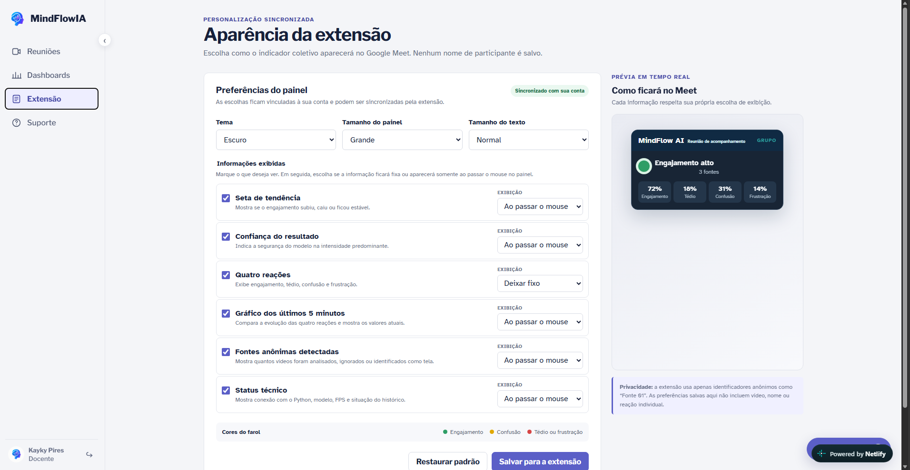

# Entrega 6 — Prototipação em papel

**Data:** {{18/10/2026}}  
**Status:** 🟩 Concluida
**Responsabilidade:** 1 solução integrada por equipe

## Objetivo da atividade

Externalizar rapidamente ideias de interação em baixa fidelidade para explorar alternativas antes de investir em detalhes visuais. O valor da atividade está no **ciclo construir → simular → observar → revisar**, não na beleza do desenho.

## 1. Escopo do protótipo

**Personas:** P01 – Karol Schrödinger, professora de ensino a distância, e P02 – Camila Duarte, professora de inglês em turmas pequenas.

**Cenários/tarefas cobertos:** o protótipo explora principalmente T01, relacionada à consulta e à personalização dos resultados de uma aula concluída. Esse recorte está associado à necessidade de revisão pós-aula derivada de C02, da persona P01. C05, da persona P02, também orienta a exploração da apresentação dos resultados.

As tarefas de acompanhamento durante a sessão, como T02, T03 e T05, ainda não possuem um fluxo completo representado. A configuração da extensão não substitui a prototipação do uso do indicador durante a videoconferência. T04, relacionada à participação e à transparência da análise, também não está coberta.

**Objetivos principais:**

- Explorar a localização de reuniões concluídas e o acesso aos seus resumos.
- Investigar a compreensão dos indicadores e gráficos apresentados.
- Experimentar alternativas de personalização das visualizações, cuja necessidade permanece como hipótese em investigação (H06).
- Explorar o acesso à ajuda e às explicações sobre os indicadores.

O acompanhamento em tempo real permanece como recorte principal do projeto, mas sua representação neste protótipo ainda é uma pendência.

## 1.1 Possíveis famílias de interface

Foram exploradas as seguintes famílias de interface:

- **Histórico:** localização de reuniões concluídas e acesso aos respectivos resumos.
- **Relatório/resultados:** apresentação dos indicadores e gráficos de uma reunião.
- **Dashboard:** visualização dos resultados de uma reunião e de informações consolidadas.
- **Configuração/personalização:** exploração da organização dos indicadores e das configurações da extensão.

A V0 contempla uma aba de suporte. Na V1, foi acrescentado um botão flutuante de ajuda, conforme os registros da seção 5.

As interfaces de alertas durante a sessão e de participação na análise permanecem pendentes de prototipação.

## 2. Fluxos escolhidos

| Fluxo | Tarefa/objetivo | Por que foi priorizado |
|---|---|---|
| PF01 | Acompanhar os indicadores durante uma videoconferência. | Corresponde ao recorte central do projeto, mas ainda não está representado como fluxo completo. A tela de configuração da extensão oferece apenas cobertura preparatória. |
| PF02 | Localizar uma reunião concluída e consultar seus resultados. | Permite explorar o acesso ao resumo e a compreensão das informações apresentadas, apoiando a revisão pós-aula. |
| PF03 | Personalizar a apresentação dos indicadores e gráficos. | Permite investigar a hipótese H06. A existência dessa possibilidade no protótipo não confirma sua necessidade nem sua percepção como diferencial pelos usuários. |
| PF04 | Consultar o suporte e esclarecer o significado dos indicadores. | O participante relatou falta de explicação em alguns cards e sugeriu tornar a ajuda acessível nas diferentes telas. |

## 3. Telas e estados

As sete telas apresentadas nesta seção correspondem à V0 do protótipo, utilizada na exploração formativa com a participante. Essa versão permite consultar reuniões, visualizar resultados, personalizar dashboards, configurar a extensão e acessar o suporte. As alterações realizadas posteriormente estão descritas na seção 5.

| Tela | Nome | Descrição | Controles e navegação |
|---|---|---|---|
| P01 | Home / Minhas Reuniões | Tela inicial que apresenta as reuniões do usuário e permite acessar os resultados de cada sessão. | Ao clicar em **Ver Resumo**, o usuário é direcionado para a tela P02. |
| P02 | Resumo da Reunião | Apresenta os resultados de uma reunião específica, incluindo gráficos e indicadores dos estados cognitivos dos participantes. | O botão **Nova Visualização** direciona o usuário para a tela P03. |
| P03 | Editar Resumo | Permite personalizar a visualização dos resultados de uma reunião específica, organizando as informações conforme as preferências do usuário. | O usuário pode realizar alterações na visualização e retornar ao resumo da reunião (P02). |
| P04 | Dashboard Geral | Apresenta uma visão consolidada dos indicadores e resultados das reuniões, permitindo acompanhar informações gerais. | O botão **Nova Visualização** direciona o usuário para a tela P05. |
| P05 | Edição do Dashboard Geral | Permite personalizar o Dashboard Geral, modificando a organização e a apresentação dos indicadores e gráficos. | O usuário pode realizar alterações e retornar ao Dashboard Geral (P04). |
| P06 | Editar Extensão | Permite acessar e modificar as configurações da extensão do MindFlow AI, adequando seu funcionamento às preferências do usuário. | Controles de configuração da extensão e navegação para as demais telas. |
| P07 | Suporte | Disponibiliza informações e orientações para auxiliar o usuário na utilização da plataforma. | Acesso às informações de ajuda e retorno às demais telas do sistema. |

### 3.1 Fluxos principais de navegação

**Fluxo 1 – Visualização e personalização do resumo de uma reunião**

P01 (Minhas Reuniões) → **Ver Resumo** → P02 (Resumo da Reunião) → **Nova Visualização** → P03 (Editar Resumo) → Retorno à P02.

**Fluxo 2 – Visualização e personalização do Dashboard Geral**

P04 (Dashboard Geral) → **Nova Visualização** → P05 (Edição do Dashboard Geral) → Retorno à P04.

**Fluxo 3 – Configuração da extensão**

P06 (Editar Extensão) → Acesso às opções de configuração → Alteração das preferências da extensão.

**Fluxo 4 – Acesso ao suporte**

P07 (Suporte) → Consulta às orientações e informações de ajuda → Retorno à navegação principal.

---

#### P01 – Home / Minhas Reuniões

Tela inicial do sistema, na qual o usuário visualiza suas reuniões e pode acessar os resultados de cada sessão por meio do botão **Ver Resumo**.

*Figura 1 – Tela Home / Minhas Reuniões.*

#### P02 – Resumo da Reunião

Apresenta os indicadores e gráficos referentes a uma reunião específica, permitindo analisar os resultados e acessar a personalização por meio do botão **Nova Visualização**.

*Figura 2 – Tela Resumo da Reunião.*

#### P03 – Editar Resumo

Permite personalizar a apresentação das informações de uma reunião, oferecendo ao usuário maior controle sobre a organização dos indicadores e gráficos.

*Figura 3 – Tela de Edição do Resumo.*

#### P04 – Dashboard Geral

Apresenta uma visão consolidada dos resultados e indicadores das reuniões, facilitando o acompanhamento geral das informações.

*Figura 4 – Tela Dashboard Geral.*

#### P05 – Edição do Dashboard Geral

Permite modificar a organização e a apresentação dos indicadores do Dashboard Geral, explorando a personalização como uma alternativa de design cuja necessidade permanece em investigação (H06).

*Figura 5 – Tela de Edição do Dashboard Geral.*

#### P06 – Editar Extensão

Disponibiliza as opções de configuração e personalização da extensão utilizada pelo MindFlow AI durante as videoconferências.

*Figura 6 – Tela de Edição da Extensão.*

#### P07 – Suporte

Apresenta informações de ajuda e orientações para auxiliar o usuário na utilização da plataforma e no esclarecimento de dúvidas.

*Figura 7 – Tela de Suporte.*
## 4. Simulação / walkthrough

A sessão formativa foi realizada presencialmente na faculdade com Beatriz Manaia, colega da equipe que não participou da elaboração das telas. Sua participação foi utilizada para identificar dúvidas e oportunidades de melhoria, sem substituir a avaliação posterior com os participantes finais do projeto. Data da entrevista 14/10.

Inicialmente, a equipe apresentou a finalidade do MindFlow AI e seu objetivo. Em seguida, a participante explorou livremente a interface. Durante a navegação, fez perguntas sobre a finalidade de elementos e funcionalidades, e a equipe respondeu às dúvidas conforme surgiam.

A sessão teve caráter exploratório, sem um roteiro estruturado de tarefas descrito no registro disponível. Não foram registrados o percurso completo, os tempos de execução ou as conclusões de tarefas sem ajuda. Também não foi detalhado o mecanismo utilizado para representar as transições de tela e as respostas do sistema.
Os achados abaixo correspondem aos comentários relatados e às dúvidas surgidas durante a exploração. As explicações fornecidas pela equipe devem ser consideradas na interpretação dos resultados, pois a compreensão após uma explicação não demonstra que a interface era compreensível de forma independente.

| Observação | Tela/ação | Evidência | Consequência para o design |
|---|---|---|---|
| A interface foi percebida como visualmente uniforme. | Cards dos dashboards e apresentação geral | A participante relatou pouca variedade de cores e uso de tons muito semelhantes. | Revisar a diferenciação e a hierarquia visual dos componentes, considerando cores, contraste e organização. |
| Algumas funções principais estavam pouco evidentes. | Acesso às ações nos dashboards | A participante relatou que determinados botões estavam escondidos ou pouco destacados. | Reorganizar os controles e destacar as ações necessárias para consultar e personalizar os resultados. |
| O significado de alguns cards não estava suficientemente explicado. | Leitura dos indicadores e exploração das funcionalidades | A participante perguntou sobre a finalidade de elementos da interface, e a equipe precisou explicar seus significados. | Acrescentar explicações nos cards e no suporte, reduzindo a dependência de orientação da equipe. |
| A ajuda poderia estar disponível durante a navegação. | Aba Suporte e demais telas | A participante sugeriu disponibilizar ajuda em formato de pop-up nas diferentes abas. | Permitir a consulta ao suporte sem abandonar a tela atual. |
| A possibilidade de personalizar os dashboards não estava suficientemente visível. | Acesso à edição das visualizações | A participante sugeriu destacar a possibilidade de modificar a apresentação dos dashboards conforme suas preferências. | Evidenciar os controles de personalização. Essa sugestão não confirma, por si só, a necessidade da funcionalidade ou a hipótese H06. |
| Faltava um recurso para registrar observações sobre as reuniões. | Revisão dos resultados após a aula | Foi sugerida a possibilidade de registrar anotações para evitar o esquecimento de acontecimentos relevantes. | Incluir anotações na revisão pós-aula, associadas à análise dos resultados. |
| A avaliação geral da proposta foi positiva. | Exploração geral da interface | A participante relatou ter gostado do sistema, apesar das sugestões de melhoria. | Preservar os elementos aproveitáveis e revisar os pontos identificados, sem interpretar a satisfação geral como comprovação de usabilidade. |

## 5. Alterações após a simulação

Após a exploração formativa com Beatriz Manaia, a equipe revisou o protótipo com base nas dúvidas e sugestões relatadas. As telas da seção 3 correspondem à versão avaliada (V0), enquanto os registros apresentados abaixo mostram a versão revisada (V1).

As alterações buscaram facilitar a compreensão das informações, destacar as ações disponíveis e oferecer ajuda durante a navegação. Seus efeitos ainda precisam ser verificados em uma nova avaliação com usuários.

| Antes | Problema | Depois | Justificativa |
|---|---|---|---|
| Os cards utilizavam cores muito semelhantes. | A participante percebeu pouca diferenciação visual entre os componentes. | As cores dos cards foram revisadas, diferenciando melhor os indicadores dentro do tema visual escolhido. | Explorar uma hierarquia visual mais clara. A adequação das cores e do contraste ainda deve ser avaliada. |
| Algumas funções principais estavam pouco destacadas. | A participante relatou dificuldade para perceber determinadas ações disponíveis. | A disposição e o destaque dos botões foram reformulados, incluindo o botão “Personalizar agora”. | Facilitar a localização das funcionalidades relacionadas à organização das visualizações. |
| O acesso à ajuda estava concentrado na aba Suporte. | A participante sugeriu consultar orientações durante a navegação, sem abandonar a tela atual. | Foi acrescentado um botão flutuante de ajuda, disponível durante a navegação. | Tornar o acesso ao suporte mais perceptível e próximo do contexto de utilização. |
| Alguns cards não explicavam suficientemente o significado das informações apresentadas. | A participante precisou perguntar à equipe sobre a finalidade de elementos da interface. | Foram acrescentados ícones informativos e explicações exibidas ao passar o mouse sobre os cards. | Apoiar a interpretação dos indicadores e reduzir a dependência de explicações externas. |
| A possibilidade de personalizar os dashboards estava pouco evidente. | A participante sugeriu destacar a funcionalidade de modificar a apresentação dos resultados. | Foi incluída uma área de destaque com orientação sobre a personalização e acesso direto ao botão “Personalizar agora”. | Comunicar as possibilidades de edição da interface. A necessidade da personalização permanece como hipótese em investigação (H06). |
| Não havia possibilidade de registrar anotações após a aula. | Faltava um recurso para registrar acontecimentos relevantes e consultá-los durante a revisão. | Foi acrescentada a possibilidade de inserir anotações após a aula, no contexto da análise do gráfico temporal. | Apoiar a memória do docente e a contextualização dos resultados. Esse recurso foi informado pela equipe, mas não está ilustrado nos prints apresentados nesta seção. |

**V1 — Dashboard Geral: diferenciação visual e destaque da personalização**

A visualização revisada apresenta cores distintas nos cards e uma área de destaque para a personalização, com orientação sobre sua finalidade e acesso direto à edição.

*Figura 8 — P04 na V1: cores dos cards revisadas e botão “Personalizar agora” em destaque. A V0 correspondente está apresentada na seção 3.*

**V1 — Acesso à ajuda durante a navegação**

O botão flutuante “Ajuda” oferece um ponto de acesso ao suporte na própria tela. O registro demonstra a presença do controle; o conteúdo da ajuda não está aberto neste print.

*Figura 9 — P01 na V1: botão de ajuda disponível no canto inferior direito durante a navegação.*

**V1 — Explicações dos cards**

O registro apresenta a explicação aberta do card “Mudanças para revisar”, demonstrando como o usuário pode consultar informações complementares sobre o indicador.

*Figura 10 — P04 na V1: explicação contextual exibida junto ao card, sem necessidade de sair do dashboard.*

## Checklist

- [ ] O protótipo cobre tarefas relevantes da Entrega 5 — cobre T01 e T02 (pós-sessão e personalização); T03/T05 (indicador durante a sessão) aparecem só na configuração da extensão e T04 (participante) ainda não tem tela.
- [x] Cada tela/estado pode ser justificado por uma tarefa, decisão ou informação necessária (T01 e T02; Suporte justificado pelo walkthrough).
- [x] O projeto não criou dashboard/CRUD/login apenas para parecer “completo” — os dashboards estão ligados a T01/T02 e à necessidade R03; a personalização segue como hipótese (H06).
- [x] Telas/estados estão numerados e navegáveis na documentação (P01–P07 e fluxos 1 a 4).
- [x] Há pelo menos uma simulação/walkthrough documentado (seção 4).
- [x] Críticas não foram apenas listadas: geraram decisão de revisão (seção 5).
- [ ] O protótipo continua em baixa fidelidade — as telas apresentadas são digitais e com acabamento visual próximo do final; a equipe deve registrar esse desvio ou anexar os esboços em papel usados antes.
