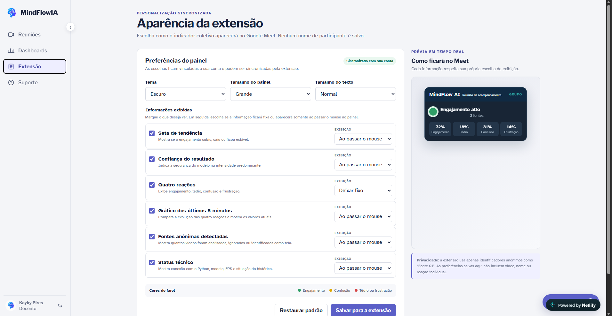

# Entrega 6 — Prototipação em papel

**Data:** {{dd/mm/aaaa}}  
**Status:** ⬜ não iniciada  
**Responsabilidade:** 1 solução integrada por equipe

## Objetivo da atividade

Externalizar rapidamente ideias de interação em baixa fidelidade para explorar alternativas antes de investir em detalhes visuais. O valor da atividade está no **ciclo construir → simular → observar → revisar**, não na beleza do desenho.

## 1. Escopo do protótipo

**Personas:** P01 – Karol Schrödinger (professora de ensino a distância) e P02 – Camila Duarte (professora de inglês em turmas pequenas), considerando também os demais perfis de comunicadores identificados no projeto.

**Cenários/tarefas cobertos:** C02 (dificuldade de Karol em acompanhar a compreensão dos alunos), C05 (dificuldade de Camila em identificar problemas de compreensão durante a aula) e T01, T02 e T03 da Entrega 5, relacionadas à revisão e interpretação de sessões concluídas. O protótipo também explora a personalização dos dashboards.

**Objetivos principais:**

- Permitir o acompanhamento dos estados cognitivos dos participantes durante videoconferências.
- Apresentar informações de engajamento, tédio, confusão e frustração por meio de indicadores e gráficos de fácil interpretação.
- Permitir que o usuário personalize o dashboard, escolhendo como deseja visualizar as informações.
- Facilitar a navegação e a compreensão dos indicadores, com botões visíveis, explicações nos cards e suporte contextual.
- Apoiar a análise de sessões anteriores para auxiliar na tomada de decisões e no aprimoramento de futuras apresentações.

## 1.1 Possíveis famílias de interface

Para o MindFlow AI, foram priorizadas as seguintes famílias de interface:

- **Dashboard:** visualização dos indicadores cognitivos em tempo real e análise dos resultados das sessões.
- **Configuração/personalização:** possibilidade de modificar a organização dos dashboards conforme as preferências e necessidades do usuário, principal diferencial da plataforma.
- **Relatório/resultados:** apresentação de gráficos, resumos e indicadores para facilitar a interpretação dos dados coletados.
- **Histórico:** consulta de sessões anteriores para identificar padrões e acompanhar mudanças nos indicadores.
- **Alertas/ocorrências:** apresentação discreta de mudanças relevantes nos estados cognitivos durante as sessões.

Além dessas famílias, o protótipo considera a **ajuda contextual**, com acesso ao suporte nas diferentes abas e explicações sobre o significado dos cards e indicadores.

## 2. Fluxos escolhidos

| Fluxo | Tarefa/objetivo | Por que foi priorizado |
|---|---|---|
| PF01 | Acompanhar os indicadores cognitivos durante uma videoconferência. | É uma das funcionalidades centrais do MindFlow AI e permite ao comunicador identificar possíveis mudanças no estado do público durante a apresentação. |
| PF02 | Consultar o dashboard e interpretar os resultados de sessões anteriores. | Permite analisar gráficos e indicadores para compreender o comportamento geral do grupo e apoiar decisões futuras. |
| PF03 | Personalizar o dashboard, escolhendo e organizando os cards e as informações exibidas. | A personalização é um diferencial importante do projeto. Durante o teste, identificou-se a necessidade de tornar essa funcionalidade mais evidente para o usuário. |
| PF04 | Acessar o suporte contextual e compreender o significado dos indicadores. | O participante do teste relatou dificuldade para localizar alguns botões e entender determinados cards, indicando a necessidade de explicações e ajuda mais acessíveis. |

## 3. Telas e estados

O protótipo do MindFlow AI é composto por sete telas principais, que permitem ao usuário consultar reuniões, visualizar resultados, personalizar dashboards, configurar a extensão e acessar o suporte.

| Tela | Nome | Descrição | Controles e navegação |
|---|---|---|---|
| P01 | Home / Minhas Reuniões | Tela inicial que apresenta as reuniões do usuário e permite acessar os resultados de cada sessão. | Ao clicar em **Ver Resumo**, o usuário é direcionado para a tela P02. |
| P02 | Resumo da Reunião | Apresenta os resultados de uma reunião específica, incluindo gráficos e indicadores dos estados cognitivos dos participantes. | O botão **Nova Visualização** direciona o usuário para a tela P03. |
| P03 | Editar Resumo | Permite personalizar a visualização dos resultados de uma reunião específica, organizando as informações conforme as preferências do usuário. | O usuário pode realizar alterações na visualização e retornar ao resumo da reunião (P02). |
| P04 | Dashboard Geral | Apresenta uma visão consolidada dos indicadores e resultados das reuniões, permitindo acompanhar informações gerais. | O botão **Nova Visualização** direciona o usuário para a tela P05. |
| P05 | Edição do Dashboard Geral | Permite personalizar o Dashboard Geral, modificando a organização e a apresentação dos indicadores e gráficos. | O usuário pode realizar alterações e retornar ao Dashboard Geral (P04). |
| P06 | Editar Extensão | Permite acessar e modificar as configurações da extensão do MindFlow AI, adequando seu funcionamento às preferências do usuário. | Controles de configuração da extensão e navegação para as demais telas. |
| P07 | Suporte | Disponibiliza informações e orientações para auxiliar o usuário na utilização da plataforma. | Acesso às informações de ajuda e retorno às demais telas do sistema. |

### 3.1 Fluxos principais de navegação

**Fluxo 1 – Visualização e personalização do resumo de uma reunião**

P01 (Minhas Reuniões) → **Ver Resumo** → P02 (Resumo da Reunião) → **Nova Visualização** → P03 (Editar Resumo) → Retorno à P02.

**Fluxo 2 – Visualização e personalização do Dashboard Geral**

P04 (Dashboard Geral) → **Nova Visualização** → P05 (Edição do Dashboard Geral) → Retorno à P04.

**Fluxo 3 – Configuração da extensão**

P06 (Editar Extensão) → Acesso às opções de configuração → Alteração das preferências da extensão.

**Fluxo 4 – Acesso ao suporte**

P07 (Suporte) → Consulta às orientações e informações de ajuda → Retorno à navegação principal.

---

#### P01 – Home / Minhas Reuniões

Tela inicial do sistema, na qual o usuário visualiza suas reuniões e pode acessar os resultados de cada sessão por meio do botão **Ver Resumo**.

*Figura 1 – Tela Home / Minhas Reuniões.*

#### P02 – Resumo da Reunião

Apresenta os indicadores e gráficos referentes a uma reunião específica, permitindo analisar os resultados e acessar a personalização por meio do botão **Nova Visualização**.

*Figura 2 – Tela Resumo da Reunião.*

#### P03 – Editar Resumo

Permite personalizar a apresentação das informações de uma reunião, oferecendo ao usuário maior controle sobre a organização dos indicadores e gráficos.

*Figura 3 – Tela de Edição do Resumo.*

#### P04 – Dashboard Geral

Apresenta uma visão consolidada dos resultados e indicadores das reuniões, facilitando o acompanhamento geral das informações.

*Figura 4 – Tela Dashboard Geral.*

#### P05 – Edição do Dashboard Geral

Permite modificar a organização e a apresentação dos indicadores do Dashboard Geral, destacando a personalização como um dos principais diferenciais do MindFlow AI.

*Figura 5 – Tela de Edição do Dashboard Geral.*

#### P06 – Editar Extensão

Disponibiliza as opções de configuração e personalização da extensão utilizada pelo MindFlow AI durante as videoconferências.

*Figura 6 – Tela de Edição da Extensão.*

#### P07 – Suporte

Apresenta informações de ajuda e orientações para auxiliar o usuário na utilização da plataforma e no esclarecimento de dúvidas.

*Figura 7 – Tela de Suporte.*
## 4. Simulação / walkthrough

Realize uma simulação com uma pessoa que não participou da elaboração dessas telas. Um colega pode ser usado **para essa iteração formativa**, mas isso não substitui os participantes finais da Entrega 14.

| Observação | Tela/ação | Evidência | Consequência para o design |
|---|---|---|---|
| O usuário considerou a interface visualmente muito uniforme, com pouca variedade de cores. | Todas as telas | Durante a avaliação, relatou que a interface utilizava predominantemente a mesma paleta de cores. | Introduzir maior variedade de cores, mantendo a identidade visual e utilizando contrastes para diferenciar informações e funcionalidades. |
| Alguns botões não estavam suficientemente visíveis, dificultando a identificação de determinadas funcionalidades. | Dashboard Geral e Dashboard de cada aula | O participante relatou que alguns botões ficavam escondidos ou pouco destacados na interface. | Melhorar o posicionamento, o contraste e a identificação dos botões, facilitando a navegação. |
| Alguns cards apresentavam informações sem explicações suficientes sobre seus significados. | Dashboard Geral e Dashboard de cada aula | O usuário apontou dificuldade para compreender o significado de determinados indicadores apresentados nos cards. | Adicionar descrições, ícones informativos ou tooltips explicativos para facilitar a interpretação dos dados. |
| A possibilidade de personalização dos dashboards não estava suficientemente destacada. | Edição de Dashboards | O participante sugeriu evidenciar melhor a funcionalidade de modificar os dashboards conforme as preferências do usuário. | Dar maior destaque às opções de personalização, utilizando botões e orientações que comuniquem claramente esse diferencial. |
| O acesso ao suporte poderia ser mais prático e estar disponível durante a navegação. | Aba Suporte e demais telas | O usuário sugeriu que o suporte permanecesse acessível em todas as abas por meio de um botão ou pop-up de ajuda. | Implementar um recurso de ajuda contextual acessível nas diferentes telas, permitindo esclarecer dúvidas sem interromper a navegação. |
| A navegação pelas opções de configuração e personalização pode se beneficiar de maior clareza visual. | Configurações | O feedback geral sobre botões pouco visíveis indicou a necessidade de revisar a identificação dos controles também nessa tela. | Revisar a hierarquia visual e a identificação das opções de configuração, tornando as ações mais fáceis de localizar. |
| A interface de edição da extensão também deve seguir os ajustes de clareza e consistência visual identificados na avaliação. | Edição da Extensão | A tela foi incluída no percurso de avaliação, sem registro de uma crítica específica sobre suas funcionalidades. | Aplicar os ajustes gerais de visibilidade dos controles, contraste e padronização visual, mantendo consistência com as demais telas. |
| Apesar dos pontos de melhoria, o usuário demonstrou satisfação geral com a proposta do sistema. | Todas as telas | Ao final da simulação, o participante apresentou uma avaliação geral positiva do protótipo. | Manter a estrutura e as funcionalidades principais, priorizando melhorias de usabilidade, comunicação visual e acessibilidade das informações. |

## 5. Alterações após a simulação

| Antes | Problema | Depois | Justificativa |
|---|---|---|---|
| Alguns cards apresentavam indicadores sem explicações complementares. | O usuário tinha dificuldade para compreender o significado de determinadas informações. | Foram adicionadas informações complementares na aba Suporte e resumos explicativos exibidos ao passar o mouse sobre os cards. | Facilitar a interpretação dos indicadores e permitir que o usuário compreenda as informações sem precisar sair do dashboard. |
| A interface utilizava cores muito semelhantes em seus componentes. | A pouca variedade de cores dificultava a diferenciação visual das informações. | Foram adicionadas cores aos cards, mantendo a paleta original definida como tema da plataforma. | Melhorar a hierarquia visual e a identificação dos indicadores sem comprometer a identidade visual do MindFlow AI. |
| Algumas funcionalidades estavam pouco visíveis ou escondidas na interface. | O usuário apresentava dificuldade para localizar determinados botões e identificar as ações disponíveis. | Os botões foram reformulados para destacar as principais funcionalidades e facilitar sua identificação. | Tornar a navegação mais intuitiva, reduzir o esforço de procura e facilitar o acesso às funções do sistema. |
| O gráfico de evolução temporal apresentava apenas os indicadores da reunião. | Não havia possibilidade de registrar observações sobre acontecimentos importantes durante a sessão. | Foi adicionada a funcionalidade de inserir anotações no gráfico de tempo. | Permitir que o usuário registre acontecimentos relevantes e relacione suas observações às mudanças dos indicadores, facilitando análises posteriores. |
| A personalização dos dashboards não estava suficientemente destacada. | O usuário não identificava facilmente a possibilidade de modificar as visualizações, que representa um dos principais diferenciais da plataforma. | Os controles de personalização foram reformulados para tornar as opções de edição e criação de novas visualizações mais evidentes. | Evidenciar o diferencial do MindFlow AI e facilitar a criação de dashboards adaptados às necessidades de cada usuário. |

## Checklist

- [ ] O protótipo cobre tarefas relevantes da Entrega 5.
- [ ] Cada tela/estado pode ser justificado por uma tarefa, decisão ou informação necessária.
- [ ] O projeto não criou dashboard/CRUD/login apenas para parecer “completo”.
- [ ] Telas/estados estão numerados e navegáveis na documentação.
- [ ] Há pelo menos uma simulação/walkthrough documentado.
- [ ] Críticas não foram apenas listadas: geraram decisão de revisão.
- [ ] O protótipo continua em baixa fidelidade; detalhes visuais não mascaram problemas de fluxo.
