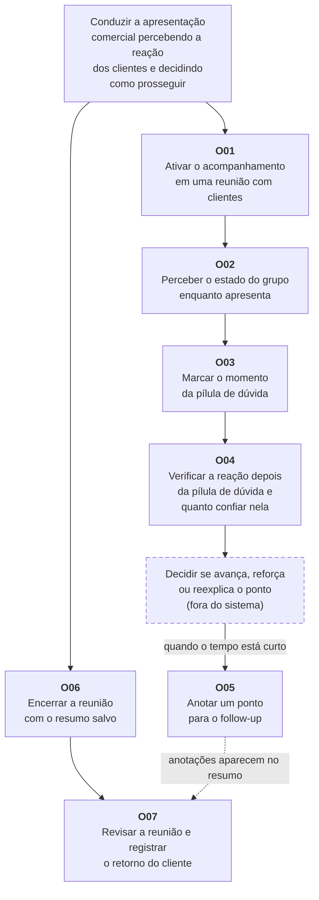

# Entrega 9 — Modelo conceitual e design centrado na comunicação

**Data:** {{dd/mm/aaaa}}  
**Status:** 🟨 em andamento  
**Responsabilidade:** soluções individuais, com consolidação da equipe para mapa de objetivos e esquema de signos.

## Objetivo da atividade

Passar do cenário de problema para uma concepção da interação, explicitando objetivos, tópicos de conversa, falas e signos que a interface deverá comunicar/manipular.

## Transformando resultados técnicos em conceitos compreensíveis

Em TCCs algorítmicos ou orientados a dados, esta entrega deve evitar que a interface exponha apenas estruturas internas do código. Identifique os **conceitos e signos que fazem sentido para o usuário**.

Exemplos:

- `query plan`, custo estimado, recomendação e impacto para um DBA;
- modelo, dataset, versão, execução e métrica para engenheiro de IA;
- período, indicador, grupo, tendência e filtro para gestor/analista;
- alerta, severidade, evidência, responsável e status para analista de segurança.

Se um termo técnico for necessário, modele como será comunicado, explicado e relacionado à tarefa.

Dashboards, relatórios, filtros e CRUDs devem aparecer no modelo conceitual por meio dos **objetivos, signos e conversas** que justificam sua existência.

## 1. Cenários de interação

Para cada cenário de problema, produza uma versão em que a solução já pode ser descrita. **Destaque claramente o texto alterado** em relação ao cenário original.

### CI01 — Manoel percebe a reação dos clientes durante a apresentação comercial e decide como prosseguir

**Autor(a):** Matheus Ferreira de Freitas — 22.125.085-5  
**Origem:** cenário problema C01 — Dificuldade em interpretar a reação do cliente durante uma apresentação comercial on-line (versão refinada da Entrega 4), tarefa T05 (Entrega 5) e persona P04 — Manoel Gomes

> Os trechos marcados com **[ACRÉSCIMO: ...]** e **[ALTERADO: ...]** mostram o que mudou em relação ao cenário problema C01; o restante do texto foi mantido. A interação descrita é uma proposta de design: a utilidade de um sinal durante a reunião (H01), a forma de comunicar a confiança (H02), o aviso a clientes de outra empresa (H03) e o uso em grupos pequenos (H05) continuam como hipóteses, a verificar com o diário de reuniões I05 (Entrega 7).

Durante uma reunião comercial pelo Microsoft Teams, Manoel apresenta uma proposta para um grupo de clientes enquanto compartilha sua tela. **[ACRÉSCIMO: Antes de iniciar o compartilhamento, Manoel ativa o acompanhamento da reunião na extensão do MindFlow e informa que os participantes são de outra empresa. A extensão gera o aviso padrão, com o que é e o que não é processado e como não participar, que Manoel envia no chat da reunião com um clique; a estimativa só começa depois do aviso. O painel mostra que 3 dos 4 clientes estão com a câmera ligada e contribuindo para a estimativa.]** Ao mesmo tempo, tenta acompanhar as reações dos participantes para entender se eles estão compreendendo e demonstrando interesse no que está sendo apresentado. **[ALTERADO: Ao lado da grade de vídeo reduzida fica o Semáforo Cognitivo, um indicador pequeno que permanece visível durante o compartilhamento e mostra, com cor, ícone e rótulo, o estado predominante do grupo ("acompanhando", no verde), a confiança da estimativa e há quanto tempo ela foi atualizada. Ele mostra o grupo, nunca a reação de um cliente específico.]**

Como a tela compartilhada reduz a visualização dos participantes, Manoel nem sempre consegue observar todos os clientes. Para tentar confirmar a compreensão, ele faz perguntas curtas, como "esse ponto ficou claro?" ou "faz sentido para a operação de vocês?". **[ACRÉSCIMO: Ao soltar a pílula de dúvida sobre as condições comerciais, Manoel marca o momento na extensão, com o rótulo "condições comerciais", para saber depois como o grupo reagiu naquele trecho.]** Porém, nem todos respondem, e o silêncio pode significar compreensão, dúvida, desinteresse ou até uma objeção não verbalizada. **[ACRÉSCIMO: Poucos segundos depois, o Semáforo indica uma mudança de estado: de "acompanhando" para "possível confusão", em amarelo, com confiança média e a observação "3 de 4 contribuindo". Ao passar o mouse sobre o indicador, Manoel vê desde quando a mudança começou e que a estimativa considera só os clientes com câmera ligada. O sistema não diz quem está confuso nem o que fazer.]**

Com pouco tempo disponível e sem querer constranger os clientes com perguntas repetidas, Manoel precisa decidir se continua a apresentação, explica novamente algum ponto ou muda seu discurso com base em sinais incompletos. **[ALTERADO: Agora o silêncio e o sinal apontam na mesma direção. A decisão continua sendo dele: como o ponto é central para a proposta e ainda há tempo, ele reexplica as condições com um exemplo ligado à operação do cliente e faz uma nova pílula de dúvida; o responsável técnico responde, e o indicador volta a "acompanhando". Quando o decisor faz uma pergunta inesperada, Manoel dispensa o aviso e responde; o Semáforo continua mostrando apenas o estado atual. Se o tempo estivesse curto, ele anotaria no momento marcado "retomar no follow-up" e seguiria para o próximo bloco.]**

Em alguns casos, ele interpreta a falta de reação como concordância e só descobre posteriormente, durante o follow-up ou após a recusa da proposta, que determinados pontos não haviam sido compreendidos ou aceitos pelo cliente. **[ALTERADO: Ao encerrar a chamada, a extensão avisa que o resumo da reunião foi salvo. Logo depois, Manoel abre o resumo no Dashboard, vê a linha do tempo da reunião com os momentos marcados e o estado do grupo em cada trecho, e anota suas percepções nos pontos em que ficou em dúvida. Dias depois, quando chega o e-mail do cliente, ele registra em cada momento marcado se o retorno confirmou a leitura feita na reunião. A comparação, que antes dependia da memória, fica registrada junto da reunião.]**

**[ACRÉSCIMO — ruptura considerada: em outra reunião, só um dos três clientes liga a câmera. Ao ativar o acompanhamento, a extensão informa que não há participantes suficientes para estimar o estado do grupo sem expor uma pessoa e explica o motivo. Manoel segue a apresentação sem o acompanhamento, conduzindo como fazia antes, e ainda pode marcar momentos e anotar no resumo.]**

### Diferenças relevantes

| Alteração | Por que foi necessária | Evidência/artefato que justifica |
|---|---|---|
| Ativar o acompanhamento informando que os participantes são de outra empresa, com o aviso enviado no chat antes da primeira estimativa | Clientes externos não têm a extensão nem a página de transparência da aula; o aviso precisa chegar pelo canal da reunião e antes do processamento | H03; RC04 e RC09; F08; T04 (aviso ao participante); A05 e I05 (consentimento com participantes externos) |
| Semáforo Cognitivo visível ao lado da grade reduzida, com cor, ícone e rótulo, mostrando só o grupo | Na T05, perceber a reação acontece ao mesmo tempo que explicar (CTT 2.1.1 `\|\|\|` 2.1.2); a grade reduzida só mostra quem tem câmera ligada; R04 impede mostrar reação individual | T05 (HTA 3.1, CTT 2.1); R01, R02, R04; RC08; F01 |
| Marcar o momento ao soltar a pílula de dúvida | As pílulas de dúvida são planejadas (T05, operação 1.2) e são o ponto em que Manoel mais precisa da reação; marcar liga a reação ao trecho da proposta | T05 (HTA 1.2 e 2.2); C01 (Q1: trechos de preço e condições); RC10 |
| Mudança de estado com confiança, participantes contribuindo e desde quando | Manoel precisa julgar quanto confiar na leitura (T05, operação 4.3), etapa que hoje não tem apoio | T05 (HTA 4.3, CTT 2.3); H02; RC02; F04 |
| O sistema não diz quem está confuso nem o que fazer; a decisão continua de Manoel | A reação que importa pode ser a do decisor (C01, Q2), mas o agregado não identifica pessoas; o sistema indica sem prescrever | RC03; R04; C01 (Q2 e Q4); T05 (objetivo 5) |
| Aviso dispensado quando um cliente pergunta; o indicador mostra só o estado atual | Perguntas inesperadas e objeções competem com a observação (C01, Q6); avisos antigos não devem se acumular | C01 (Q6); T05 (CTT 2.2 `\|>`); RC06 |
| Anotar "retomar no follow-up" no momento marcado | É a alternativa 5.3 da T05, hoje feita de memória ou em papel | T05 (HTA 5.3 e 6.2); C01 (Q4) |
| Resumo salvo ao encerrar, com linha do tempo, momentos marcados, percepções e retorno do cliente no mesmo lugar | A avaliação do que funcionou só acontece dias depois (T05, operação 6.3) e depende de comparar anotações com o e-mail do cliente (C01, Q7) | T05 (HTA 6.2 e 6.3); C01 (Q7); R03 e R05; F02 e F03; RC10 |
| Ruptura: participantes insuficientes | Em grupos de 2 a 6 clientes, o agregado pode expor uma pessoa ou não ter base | H05; R04; A05 (dado sobre papéis e tamanho do grupo) |

## 2. Design centrado na comunicação

**Nome do cenário:** CI01 — Manoel percebe a reação dos clientes durante a apresentação comercial e decide como prosseguir

| Tópico > subtópico | Falas e signos envolvidos | Intenção/efeito esperado |
|---|---|---|
| **O01 Ativar o acompanhamento em uma reunião com clientes** | `U: quero acompanhar esta reunião; os participantes são de outra empresa` / `D: aviso pronto para enviar no chat; a estimativa começa depois do aviso` / `D: acompanhamento ativo; 3 de 4 participantes contribuindo`. Signos: acompanhamento da reunião, aviso aos participantes, participantes contribuindo. | Manoel só passa a receber estimativas depois de os clientes serem avisados e sabe, antes de começar, se o sinal terá base. |
| > Não há participantes suficientes | `D: não há câmeras ligadas suficientes para estimar o estado do grupo sem expor uma pessoa (mínimo: 3)` / `U: continuar sem acompanhamento` ou `U: tentar novamente`. Signos: mínimo de participantes. | Evitar um sinal sem base, explicar o motivo e não bloquear a reunião. |
| **O02 Perceber o estado do grupo enquanto apresenta** | `D: o grupo parece estar acompanhando` (verde, ícone e rótulo) / `D: confiança alta; 3 de 4 contribuindo; atualizado há 15 s`. Signos: estado predominante, confiança da estimativa, participantes contribuindo, atualizado há. | Leitura de relance, sem tirar a atenção da tela compartilhada nem interromper a fala. |
| **O03 Marcar o momento da pílula de dúvida** | `U: marcar este momento: "condições comerciais"` / `D: momento marcado aos 12 min`. Signos: momento marcado. | Ligar a reação do grupo ao trecho da proposta, para a decisão na hora e para a revisão depois. |
| **O04 Verificar a reação depois da pílula de dúvida** | `D: o estado mudou de "acompanhando" para "possível confusão" há 20 s` / `U: o que mudou?` / `D: desde a pergunta sobre condições comerciais; confiança média; 3 de 4 contribuindo`. Signos: mudança de estado, confiança da estimativa, participantes contribuindo. | Chamar a atenção para o trecho sem dizer quem está em dúvida nem o que fazer (RC03, R04). |
| > Entender o significado e a confiança | `U: o que significa "possível confusão"?` / `D: parte do grupo mostra sinais associados a dificuldade; é uma estimativa do grupo, não de cada pessoa, e pode errar` / `D: a confiança está média porque um dos quatro está sem câmera`. Signos: estado predominante, qualidade do sinal. | Evitar confiança excessiva na estimativa (H02) e deixar claro que ninguém é avaliado individualmente (H03). |
| > Dispensar o aviso | `U: entendi, pode esconder` / `D: aviso dispensado; o indicador segue mostrando o estado atual`. Signos: mudança de estado. | Não acumular avisos quando um cliente pergunta ou o tempo aperta (RC06). |
| **O05 Anotar um ponto para o follow-up** | `U: anotar neste momento: "retomar no follow-up"` / `D: anotação salva no momento marcado`. Signos: anotação, momento marcado. | Registrar a dúvida sem interromper a reunião, no lugar da memória ou do papel (T05, operação 5.3). |
| **O06 Encerrar a reunião com o resumo salvo** | `U: encerrar a reunião` / `D: resumo salvo; disponível no Dashboard`. Signos: resumo da reunião. | Garantir que a reunião possa ser revisada depois. |
| > Falha ao salvar | `D: não foi possível salvar o resumo agora; os dados continuam no seu computador` / `U: tentar novamente` ou `U: tentar mais tarde`. Signos: resumo da reunião. | Recuperar de uma falha sem perder a reunião. |
| **O07 Revisar a reunião e registrar o retorno do cliente** | `U: abrir o resumo da reunião` / `D: linha do tempo com os momentos marcados e o estado do grupo em cada trecho` / `U: anotar minha percepção neste momento` / dias depois: `U: registrar o retorno do cliente neste momento: "em parte"` / `D: retorno registrado ao lado da leitura feita na reunião`. Signos: resumo da reunião, momento marcado, anotação, retorno do cliente. | Comparar, no mesmo lugar, a leitura feita na reunião com o que o cliente respondeu (T05, operação 6.3; C01, Q7). |

**Convenção:** `U` = usuário; `D` = preposto do designer/sistema, conforme a abordagem de Engenharia Semiótica adotada na disciplina.

Decidir se avança, reforça ou reexplica um ponto **não é um tópico de conversa com o sistema**: é uma decisão de Manoel, tomada fora da interface. O sistema oferece o sinal, a confiança e a explicação para apoiar essa decisão, sem prescrever a ação (RC03).

## 3. Mapa de objetivos

Cada integrante apresenta seu mapa e a equipe cria um **mapa consolidado**, eliminando duplicidades e resolvendo conflitos de nomenclatura.

### Mapa individual — CI01 (Matheus)

*A caixa tracejada é um objetivo de Manoel que acontece fora do sistema: a decisão de avançar, reforçar ou reexplicar continua sendo dele (RC03).*

### Dicionário de objetivos

| ID | Objetivo | Persona(s) | Cenário(s) | Prioridade |
|---|---|---|---|---|
| O01 | Ativar o acompanhamento em uma reunião com participantes de outra empresa, com o aviso enviado antes da primeira estimativa | P04 (também P01, P02 e P03) | CI01 | alta |
| O02 | Perceber o estado do grupo de clientes enquanto apresenta com a tela compartilhada | P04 (também P01, P02 e P03) | CI01 | alta |
| O03 | Marcar o momento da pílula de dúvida, ligando a reação ao trecho da proposta | P04 | CI01 | alta |
| O04 | Verificar a reação do grupo depois da pílula de dúvida e quanto confiar nela | P04 | CI01 | alta |
| O05 | Anotar um ponto para retomar no follow-up, sem interromper a reunião | P04 | CI01 | média |
| O06 | Encerrar a reunião com o resumo salvo | P04 | CI01 | média |
| O07 | Revisar a reunião e registrar, no momento marcado, se o retorno do cliente confirmou a leitura feita na reunião | P04 | CI01 | média |

Os IDs O01 a O07 vêm da CI01. Na consolidação, a equipe junta os objetivos iguais dos outros cenários (ativar o acompanhamento, perceber o estado do grupo e encerrar com o resumo salvo também aparecem para Karol, Camila e Nathanael) e mantém um único ID para cada objetivo.

## 4. Esquema conceitual de signos

Consolide as informações em **uma tabela única**.

| Grupo | Signo | Origem | Observações/semântica | Tipo de conteúdo | Restrição | Valor padrão | Prevenção | Recuperação |
|---|---|---|---|---|---|---|---|---|
| Acompanhamento | acompanhamento da reunião | sistema | Indica se a estimativa está ativa, pausada ou desligada na reunião atual. Em reunião com participantes de outra empresa, só fica ativa depois do aviso. | estado: ativo / pausado / desligado | só o comunicador altera; não ativa antes do aviso | desligado | PE: exigir o envio do aviso antes de ativar | RE: pausar ou desligar a qualquer momento (RC07) |
| Acompanhamento | aviso aos participantes | sistema | Texto padrão com o que é e o que não é processado e como não participar. Em reunião com clientes de outra empresa, é enviado no chat da reunião com o link da página de transparência (ligação com T04). | texto + registro do envio (hora) | obrigatório antes da primeira estimativa | — | PE: a estimativa não começa sem o aviso | — |
| Acompanhamento | participantes contribuindo | sistema | Quantos participantes com câmera ligada entram na estimativa, sobre o total da chamada ("3 de 4"), sem identificar quem. | número inteiro "n de N" | n ≤ N; sem nomes | — | PP: mostrar junto do estado para o comunicador avaliar a base do sinal | — |
| Acompanhamento | mínimo de participantes | domínio | Menor número de câmeras para estimar o grupo sem expor uma pessoa. Em reunião comercial o grupo costuma ter de 2 a 6 pessoas (H05). | número inteiro | valor a definir com a coleta da Entrega 7 (I05) | 3 (provisório) | PE: não mostrar estado abaixo do mínimo | RE: explicar o motivo e permitir continuar sem acompanhamento |
| Estado do grupo | estado predominante | sistema | Estimativa agregada do grupo: acompanhando, possível tédio, possível confusão, possível frustração, sem estimativa. | lista fixa de estados, com cor + ícone + rótulo | nunca só cor (RC08); sempre do grupo, nunca de um cliente (R04) | sem estimativa | PP: usar "possível" para marcar a estimativa; explicação do significado sob demanda | — |
| Estado do grupo | confiança da estimativa | sistema | Quanto a estimativa é confiável no momento, considerando participantes contribuindo e qualidade do sinal (H02). | faixa: alta / média / baixa | não usar percentual durante a reunião | — | PP: explicar por que está média ou baixa | — |
| Estado do grupo | atualizado há | sistema | Tempo desde a última atualização da estimativa. | segundos/minutos | — | — | PP: destacar quando a estimativa estiver desatualizada | — |
| Estado do grupo | mudança de estado | sistema | Aviso discreto quando o estado predominante muda por tempo suficiente, com o estado anterior, desde quando e o momento marcado mais próximo (o trecho da proposta). | estado anterior → estado atual + desde quando + trecho | um aviso por vez (RC06); nunca sugere ação ao comunicador (RC03) | — | PP: não sugerir ação | RE: dispensar o aviso |
| Estado do grupo | qualidade do sinal | sistema | Motivo de uma estimativa fraca: câmeras desligadas, iluminação, conexão. | texto curto | — | — | — | RE: orientar a continuar a reunião normalmente |
| Linha do tempo | momento marcado | usuário | Ponto da reunião marcado por Manoel ao soltar uma pílula de dúvida, com rótulo opcional (trecho da proposta, como "condições comerciais"). | minuto da reunião + rótulo | dentro da duração da reunião | rótulo vazio | — | RE: editar ou desmarcar no resumo |
| Linha do tempo | anotação | usuário | Texto curto ligado a um momento marcado: "retomar no follow-up" durante a reunião, percepções logo depois dela. | texto | ligada a um momento marcado | vazio | — | RE: editar ou apagar no resumo |
| Linha do tempo | retorno do cliente | usuário | Registrado dias depois no momento marcado: se o retorno do cliente confirmou a leitura feita na reunião. | confirmou / em parte / não / sem retorno | só em momento marcado | sem retorno | PP: mostrar lado a lado com o estado e a anotação do mesmo momento | RE: alterar quando chegar um novo retorno |
| Linha do tempo | resumo da reunião | sistema | Registro agregado salvo ao encerrar: data, duração, linha do tempo do estado do grupo, momentos marcados, anotações e retornos do cliente; aberto depois no Dashboard. | registro com data, duração e linha do tempo | sem imagem e sem dado individual | — | PE: salvar no computador antes de sincronizar | RE: tentar novamente ou mais tarde |

### Regras para os signos

- Use o vocabulário do domínio do usuário.
- Evite duplicar o mesmo conceito com nomes diferentes.
- Diferencie informação fornecida pelo usuário, produzida pelo sistema e derivada do domínio.
- Registre prevenção e recuperação apenas quando fizer sentido; explique as siglas usadas.

**Siglas:** PE = prevenção de erro (impede a situação); PP = prevenção passiva (explica para evitar interpretação errada); RE = recuperação de erro. O símbolo `—` indica que não há valor padrão fixo.

## Síntese

Quais objetivos/tópicos/signos deverão necessariamente aparecer nos diagramas MoLIC?

**Contribuição da CI01 (Matheus):** os objetivos O01 a O07, os tópicos da tabela da seção 2 e os signos dos grupos "Acompanhamento", "Estado do grupo" e "Linha do tempo" devem aparecer no diagrama MoLIC da CI01 (Entrega 10). Os pontos que não podem faltar são:

- o **aviso aos participantes de outra empresa** antes da primeira estimativa, com a ruptura de **participantes insuficientes** e a saída para continuar sem acompanhamento;
- o **momento marcado** na pílula de dúvida, ligado à **mudança de estado** que vem em seguida, com a confiança e uma cena para entender o significado do estado;
- a decisão de avançar, reforçar ou reexplicar como algo **fora do sistema**, sem uma fala do sistema que diga a Manoel o que fazer;
- a **anotação** "retomar no follow-up" feita sem sair da apresentação;
- o **resumo da reunião** com o **retorno do cliente** registrado no mesmo momento marcado, e a **falha ao salvar** com recuperação.

## Checklist

- [ ] Cenários de interação mostram alterações em relação aos cenários de problema.
- [ ] Cada solução individual identifica autor e cenário de origem.
- [ ] Tópicos/falas/signos são coerentes com objetivos do usuário.
- [ ] Mapas individuais foram consolidados.
- [ ] O esquema de signos está em uma tabela única e sem duplicações conceituais.
- [ ] Nomes de objetivos/signos serão reutilizados na Entrega 10.
- [ ] Em TCC técnico, signos representam conceitos do domínio compreensíveis ao usuário, não apenas variáveis/estruturas internas.
- [ ] Padrões como dashboard, relatório, filtros, administração e CRUD possuem objetivos e signos correspondentes.
- [ ] A interface comunica não só o resultado técnico, mas também seu significado para a tarefa.
