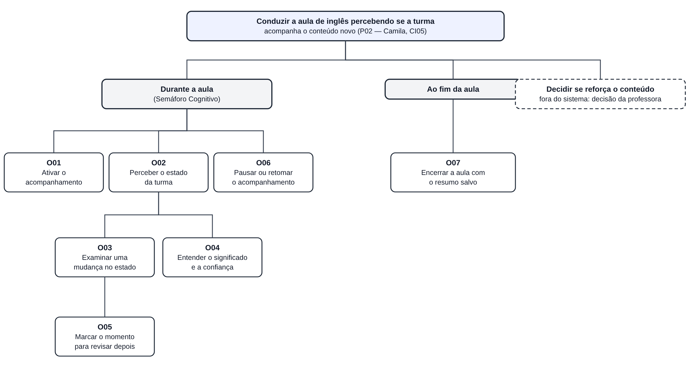

# Entrega 9 — Modelo conceitual e design centrado na comunicação

**Data:** {{dd/mm/aaaa}}  
**Status:** 🟨 em andamento  
**Responsabilidade:** soluções individuais, com consolidação da equipe para mapa de objetivos e esquema de signos.

## Objetivo da atividade

Passar do cenário de problema para uma concepção da interação, explicitando objetivos, tópicos de conversa, falas e signos que a interface deverá comunicar/manipular.

## Transformando resultados técnicos em conceitos compreensíveis

Em TCCs algorítmicos ou orientados a dados, esta entrega deve evitar que a interface exponha apenas estruturas internas do código. Identifique os **conceitos e signos que fazem sentido para o usuário**.

Exemplos:

- `query plan`, custo estimado, recomendação e impacto para um DBA;
- modelo, dataset, versão, execução e métrica para engenheiro de IA;
- período, indicador, grupo, tendência e filtro para gestor/analista;
- alerta, severidade, evidência, responsável e status para analista de segurança.

Se um termo técnico for necessário, modele como será comunicado, explicado e relacionado à tarefa.

Dashboards, relatórios, filtros e CRUDs devem aparecer no modelo conceitual por meio dos **objetivos, signos e conversas** que justificam sua existência.

## 1. Cenários de interação

Para cada cenário de problema, produza uma versão em que a solução já pode ser descrita. **Destaque claramente o texto alterado** em relação ao cenário original.

### CI05 — Camila percebe, ainda na aula, que a turma pode não ter acompanhado a estrutura nova

**Autor(a):** Isabella Vieira Silva Rosseto — 22.222.036-0  
**Origem:** cenário problema C05 (versão refinada da Entrega 4), tarefa T03 (Entrega 5) e persona P02  
**Objetivos:** O01 a O07 (dicionário na seção 3)

> Os trechos marcados com **[ALTERADO]** ou **[NOVO]** mostram o que mudou em relação ao cenário problema C05. O restante do texto foi mantido. A interação descrita é uma proposta de design: a utilidade do indicador (H01), a forma de mostrar a confiança (H02), o aviso aos alunos (H03) e o uso em turma pequena (H05) continuam como hipóteses a validar com os instrumentos da Entrega 7.

Camila dá aula particular de inglês para uma turma de oito alunos, pelo Google Meet. **[NOVO: Antes de começar, ela ativa o acompanhamento da turma pela extensão do MindFlow. A extensão mostra que 4 de 8 alunos estão com a câmera ligada e contribuindo para a estimativa, e os alunos recebem na chamada o aviso de que o acompanhamento está ativo, com o que é e o que não é processado.]** Na metade da aula, ela compartilha a tela com um exercício de conversação e, ao mesmo tempo, tenta acompanhar a grade de vídeo reduzida que fica num cantinho da tela. **[ALTERADO: Ao lado da grade, fica o Semáforo Cognitivo, um indicador pequeno que continua visível durante o compartilhamento. Ele mostra o estado predominante da turma com cor, ícone e rótulo ("acompanhando", no verde), a confiança da estimativa e há quanto tempo foi atualizado.]** Metade da turma está com a câmera desligada.

Ela introduz uma estrutura gramatical nova, um pouco mais complexa que o normal. Nota um silêncio maior que o de costume, mas não sabe se é porque estão concentrados ouvindo ou porque não entenderam. **[NOVO: Poucos minutos depois, o indicador muda para "possível confusão", em amarelo, com confiança média e a observação "4 de 8 contribuindo". Camila passa o mouse sobre o indicador e vê desde quando a mudança aconteceu e que a estimativa considera só os alunos com câmera ligada.]** Pergunta "entenderam?" e alguns alunos respondem "sim" rapidamente, sem muita convicção. **[ALTERADO: Antes, a falta de tempo e de outro sinal a levava a seguir em frente. Agora, o indicador e o "sim" pouco convicto apontam na mesma direção. Ela não segue automaticamente o que o sistema mostra: usa o exemplo de reserva que tinha preparado e pede que um aluno forme uma frase com a estrutura. A resposta confirma a dúvida, e ela reforça o conteúdo por mais cinco minutos.]** **[NOVO: Antes de retomar o plano, ela clica em "marcar este momento" para registrar o trecho na linha do tempo da aula e dispensa o aviso. O indicador volta a "acompanhando" alguns minutos depois.]** Como o tempo de aula é curto e o plano prevê ainda mais dois tópicos, ela segue em frente **[ALTERADO: com um dos tópicos encurtado, e não mais sem saber se a turma tinha acompanhado]**.

**[ALTERADO: Ao encerrar a chamada, a extensão avisa que o resumo da aula foi salvo no Dashboard. Na aula seguinte]**, ao corrigir o exercício de casa, ela **[ALTERADO: confere se a turma ainda erra os exemplos com a estrutura nova e compara com o momento que tinha marcado]**. **[ALTERADO: Em vez de gastar parte da aula seguinte revisando um conteúdo que já devia ter sido reforçado, ela usa poucos minutos para retomar só o que ainda apareceu nos erros.]**

**[NOVO — ruptura considerada: em outra aula, só dois alunos ligam a câmera. Ao ativar o acompanhamento, a extensão informa que não há participantes suficientes para estimar o estado da turma e explica o motivo. Camila escolhe continuar a aula sem o acompanhamento, conduzindo como fazia antes.]**

### Diferenças relevantes

| Alteração | Por que foi necessária | Evidência/artefato que justifica |
|---|---|---|
| Ativar o acompanhamento antes da aula, vendo quantos alunos contribuem | Camila precisa saber se o indicador terá base antes de confiar nele; os alunos precisam ser avisados | RC07 (controle de ativação), H03, H05; T04 (aviso ao participante) |
| Indicador visível durante o compartilhamento de tela, com cor, ícone e rótulo | Na T03, observar a turma concorre com explicar (`\|\|\|` no CTT); a grade reduzida não basta | T03 (CTT tarefa 2), RC08 (não depender só da cor), F01 |
| Mudança de estado com confiança e número de participantes | A professora precisa avaliar quanto confiar no sinal, etapa que hoje não tem apoio | T03 (HTA 3.2, CTT 3.2), H02, RC02, F04 |
| Camila confirma a dúvida por conta própria antes de reforçar | O sistema indica que algo merece atenção, mas não decide a ação | RC03; T03 (decisão é tarefa do usuário); C05 (Q4, Q5) |
| Marcar o momento da aula | Ligar o que aconteceu durante a aula à revisão posterior, sem exigir anotação manual | Jornada de Camila, etapa 8 (Entrega 3); R03; RC10 |
| Resumo salvo ao encerrar | Permite comparar a percepção da aula com o exercício corrigido depois | C05 (Q7), R03, F02/F03 |
| Ruptura: poucos alunos com câmera | Em turma pequena, o agregado pode não ter base ou expor alunos | H05; contexto de uso (Entrega 3) |
| Aviso que some depois de dispensado e indicador que volta ao estado atual | Não acumular alertas antigos na tela | RC06 |

> Os demais integrantes acrescentam aqui seus cenários de interação (CI01 a CI04), cada um a partir do seu cenário problema.

## 2. Design centrado na comunicação

**Nome do cenário:** CI05 — Camila percebe, ainda na aula, que a turma pode não ter acompanhado a estrutura nova

| Tópico > subtópico | Falas e signos envolvidos | Intenção/efeito esperado |
|---|---|---|
| **O01 Ativar o acompanhamento da turma** | `U: quero acompanhar a turma nesta aula` / `D: o acompanhamento está ativo; 4 de 8 alunos estão contribuindo` | Camila sabe, antes de começar, se o indicador terá base suficiente |
| > Avisar os participantes | `D: (para os alunos) o acompanhamento da turma está ativo; veja o que é e o que não é processado` | Os alunos não são surpreendidos; ligação com a interface do participante (T04) |
| > Não há participantes suficientes | `D: não há câmeras ligadas suficientes para estimar o estado da turma (mínimo: 3)` / `U: continuar sem acompanhamento` ou `U: tentar novamente` | Evitar um indicador sem base e explicar o motivo, sem bloquear a aula |
| **O02 Perceber o estado da turma** | `D: a turma parece estar acompanhando` (verde, ícone e rótulo) / `D: confiança alta; 4 de 8 contribuindo; atualizado há 20 s` | Leitura de relance durante a explicação, sem tirar a atenção da aula |
| **O03 Examinar uma mudança no estado** | `D: o estado mudou de "acompanhando" para "possível confusão" há 2 min` / `U: o que mudou?` | Chamar a atenção sem prescrever o que fazer (RC03) |
| > Dispensar o aviso | `U: entendi, pode esconder` / `D: aviso dispensado; o indicador continua mostrando o estado atual` | Não acumular avisos antigos (RC06) |
| **O04 Entender o significado e a confiança** | `U: o que significa "possível confusão"?` / `D: parte da turma mostra sinais associados a dificuldade; é uma estimativa do grupo, não de cada aluno, e pode errar` / `D: a confiança está média porque só metade da turma está com câmera` | Evitar confiança excessiva na estimativa (H02) e reforçar que o resultado não avalia alunos (H03) |
| **O05 Marcar o momento para revisar depois** | `U: marcar este momento` / `D: momento marcado aos 23 min na linha do tempo da aula` | Ligar a aula ao Dashboard sem anotação manual (R03) |
| **O06 Pausar ou retomar o acompanhamento** | `U: pausar o acompanhamento` / `D: acompanhamento pausado; os alunos foram avisados` / `U: retomar` | Dar controle à professora a qualquer momento (RC07) |
| **O07 Encerrar a aula com o resumo salvo** | `U: encerrar a aula` / `D: resumo salvo; disponível no Dashboard` | Garantir que a aula possa ser revisada depois |
| > Falha ao salvar | `D: não foi possível salvar o resumo agora; os dados continuam no seu computador` / `U: tentar novamente` ou `U: tentar mais tarde` | Recuperar de uma falha sem perder a aula |

**Convenção:** `U` = usuário; `D` = preposto do designer/sistema, conforme a abordagem de Engenharia Semiótica adotada na disciplina.

Decidir se reforça o conteúdo **não é um tópico de conversa com o sistema**: é uma decisão de Camila, feita fora da interface. O sistema só oferece o sinal e a explicação para apoiar essa decisão.

> Os demais integrantes acrescentam aqui a tabela do seu cenário de interação.

## 3. Mapa de objetivos

Cada integrante apresenta seu mapa e a equipe cria um **mapa consolidado**, eliminando duplicidades e resolvendo conflitos de nomenclatura. O mapa consolidado será feito pela equipe depois que todos os mapas individuais estiverem prontos.

### Mapa individual — CI05 (Isabella)

*Fonte editável: [`mapa_objetivos_ci05.svg`](../assets/09_modelo_conceitual/mapa_objetivos_ci05.svg). A caixa tracejada é um objetivo de Camila que acontece fora do sistema.*

### Dicionário de objetivos

| ID | Objetivo | Persona(s) | Cenário(s) | Prioridade |
|---|---|---|---|---|
| O01 | Ativar o acompanhamento da turma | P02 (também P01, P03, P04) | CI05 | alta |
| O02 | Perceber o estado da turma durante a explicação | P02 (também P01, P03, P04) | CI05 | alta |
| O03 | Examinar uma mudança no estado da turma | P02 | CI05 | alta |
| O04 | Entender o significado e a confiança da estimativa | P02 | CI05 | alta |
| O05 | Marcar um momento da aula para revisar depois | P02 | CI05 | média |
| O06 | Pausar ou retomar o acompanhamento | P02 | CI05 | média |
| O07 | Encerrar a aula com o resumo salvo | P02 | CI05 | média |

Os IDs O01 a O07 vêm da CI05. Na consolidação, a equipe junta os objetivos iguais dos outros cenários (por exemplo, "perceber o estado do grupo" também aparece para Karol, Nathanael e Manoel) e mantém um único ID para cada objetivo.

## 4. Esquema conceitual de signos

Consolide as informações em **uma tabela única**.

| Grupo | Signo | Origem | Observações/semântica | Tipo de conteúdo | Restrição | Valor padrão | Prevenção | Recuperação |
|---|---|---|---|---|---|---|---|---|
| Acompanhamento | acompanhamento da turma | sistema | Indica se a estimativa está ativa, pausada ou desligada na aula atual | estado: ativo / pausado / desligado | só o comunicador altera | desligado | PE: pedir confirmação ao ativar em aula com poucos alunos | RE: retomar ou desligar a qualquer momento |
| Acompanhamento | participantes contribuindo | sistema | Quantos alunos com câmera ligada entram na estimativa, sobre o total da chamada ("4 de 8") | número inteiro "n de N" | n ≤ N; sem identificar quem | — | PP: mostrar junto do estado para o comunicador avaliar a base do sinal | — |
| Acompanhamento | mínimo de participantes | domínio | Quantidade mínima de câmeras para estimar sem expor alunos (H05) | número inteiro | valor a definir com a coleta da Entrega 7 | 3 (provisório) | PE: não mostrar estado abaixo do mínimo | RE: explicar o motivo e permitir continuar sem acompanhamento |
| Estado da turma | estado predominante | sistema | Estimativa agregada do grupo: acompanhando, possível tédio, possível confusão, possível frustração, sem estimativa | lista fixa de estados, com cor + ícone + rótulo | nunca só cor (RC08); sempre do grupo, nunca de um aluno | sem estimativa | PP: usar "possível" para indicar estimativa; tooltip com o significado | — |
| Estado da turma | confiança da estimativa | sistema | Quanto a estimativa é confiável no momento, considerando participantes contribuindo e qualidade do sinal (H02) | faixa: alta / média / baixa | não usar percentual durante a aula | — | PP: explicar por que está baixa | — |
| Estado da turma | atualizado há | sistema | Tempo desde a última atualização da estimativa | segundos/minutos | — | — | PP: destacar quando a estimativa estiver desatualizada | — |
| Estado da turma | mudança de estado | sistema | Aviso discreto quando o estado predominante muda por tempo suficiente | estado anterior → estado atual + desde quando | um aviso por vez; não empilhar avisos (RC06) | — | PP: não sugerir ação ao comunicador (RC03) | RE: dispensar o aviso |
| Estado da turma | qualidade do sinal | sistema | Motivo de uma estimativa fraca: câmeras desligadas, iluminação, conexão | texto curto | — | — | — | RE: orientar a continuar a aula normalmente |
| Linha do tempo | momento marcado | usuário | Ponto da aula marcado pela professora para revisar no Dashboard | minuto da aula + rótulo opcional | dentro da duração da aula | rótulo vazio | — | RE: desmarcar no Dashboard |
| Linha do tempo | resumo da aula | sistema | Registro agregado da aula salvo ao encerrar, aberto depois no Dashboard | registro com data, duração e linha do tempo | sem imagem e sem dado individual | — | PE: salvar no computador antes de sincronizar | RE: tentar novamente ou mais tarde |
| Transparência | aviso aos participantes | sistema | Mensagem mostrada aos alunos quando o acompanhamento é ativado ou pausado (ligação com T04) | texto | obrigatório ao ativar | — | PE: não ativar sem aviso | — |

**Siglas:** PE = prevenção de erro (impede a situação); PP = prevenção passiva (explica para evitar interpretação errada); RE = recuperação de erro.

> Os demais integrantes acrescentam aqui os signos dos seus cenários; signos que representam o mesmo conceito devem ser unificados (por exemplo, "estado do grupo" e "estado predominante").

### Regras para os signos

- Use o vocabulário do domínio do usuário.
- Evite duplicar o mesmo conceito com nomes diferentes.
- Diferencie informação fornecida pelo usuário, produzida pelo sistema e derivada do domínio.
- Registre prevenção e recuperação apenas quando fizer sentido; explique as siglas usadas.

## Síntese

**Contribuição da CI05 (Isabella):** os objetivos O01 a O07, os tópicos da tabela da seção 2 e os signos do grupo "Acompanhamento", "Estado da turma", "Linha do tempo" e "Transparência" devem aparecer no MoLIC M05 (Entrega 10). Os pontos que não podem faltar são:

- a ruptura de **participantes insuficientes** ao ativar e durante a aula, com saída para continuar sem acompanhamento;
- a **confiança da estimativa** junto do estado, com uma cena para entender o significado e o motivo da confiança;
- o **acesso ubíquo** para pausar e para abrir a ajuda;
- a **falha ao salvar** o resumo, com recuperação;
- a decisão de reforçar como algo **fora do sistema**, sem uma fala do sistema que diga à professora o que fazer.

## Checklist

- [ ] Cenários de interação mostram alterações em relação aos cenários de problema.
- [ ] Cada solução individual identifica autor e cenário de origem.
- [ ] Tópicos/falas/signos são coerentes com objetivos do usuário.
- [ ] Mapas individuais foram consolidados.
- [ ] O esquema de signos está em uma tabela única e sem duplicações conceituais.
- [ ] Nomes de objetivos/signos serão reutilizados na Entrega 10.
- [ ] Em TCC técnico, signos representam conceitos do domínio compreensíveis ao usuário, não apenas variáveis/estruturas internas.
- [ ] Padrões como dashboard, relatório, filtros, administração e CRUD possuem objetivos e signos correspondentes.
- [ ] A interface comunica não só o resultado técnico, mas também seu significado para a tarefa.
