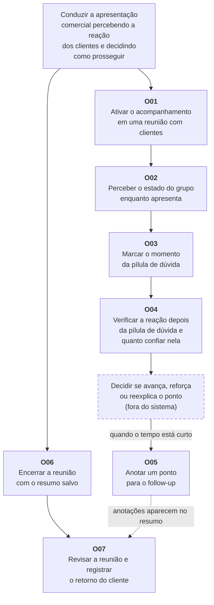
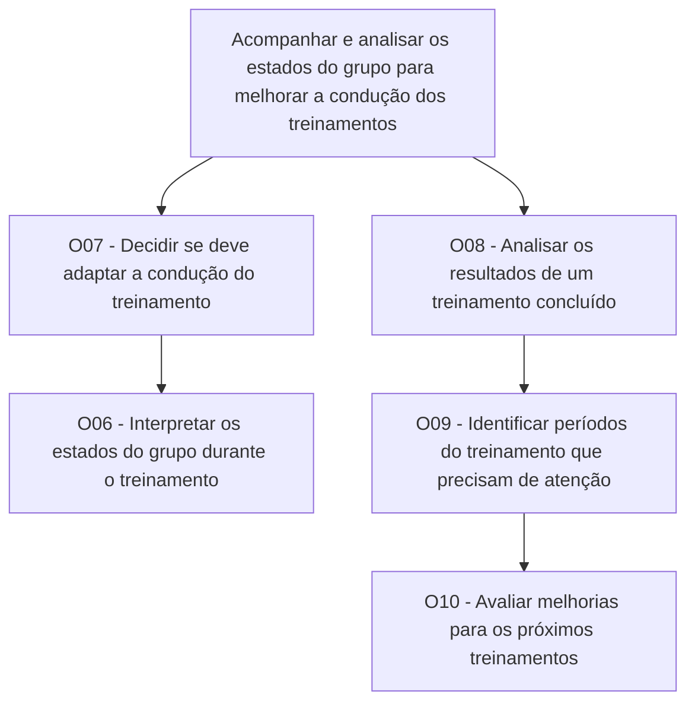
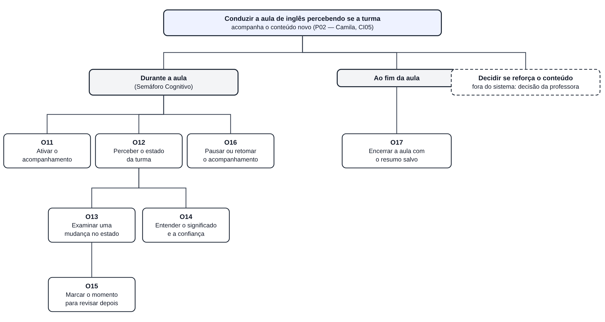

# Entrega 9 — Modelo conceitual e design centrado na comunicação

**Data:** {{dd/mm/aaaa}}  
**Status:** 🟨 em andamento  
**Responsabilidade:** soluções individuais, com consolidação da equipe para mapa de objetivos e esquema de signos.

## Objetivo da atividade

Passar do cenário de problema para uma concepção da interação, explicitando objetivos, tópicos de conversa, falas e signos que a interface deverá comunicar/manipular.

## Transformando resultados técnicos em conceitos compreensíveis

Em TCCs algorítmicos ou orientados a dados, esta entrega deve evitar que a interface exponha apenas estruturas internas do código. Identifique os **conceitos e signos que fazem sentido para o usuário**.

Exemplos:

- `query plan`, custo estimado, recomendação e impacto para um DBA;
- modelo, dataset, versão, execução e métrica para engenheiro de IA;
- período, indicador, grupo, tendência e filtro para gestor/analista;
- alerta, severidade, evidência, responsável e status para analista de segurança.

Se um termo técnico for necessário, modele como será comunicado, explicado e relacionado à tarefa.

Dashboards, relatórios, filtros e CRUDs devem aparecer no modelo conceitual por meio dos **objetivos, signos e conversas** que justificam sua existência.

## 1. Cenários de interação

Para cada cenário de problema, produza uma versão em que a solução já pode ser descrita. **Destaque claramente o texto alterado** em relação ao cenário original.

### CI01 — Manoel percebe a reação dos clientes durante a apresentação comercial e decide como prosseguir

**Autor(a):** Matheus Ferreira de Freitas — 22.125.085-5  
**Origem:** cenário problema C01 — Dificuldade em interpretar a reação do cliente durante uma apresentação comercial on-line (versão refinada da Entrega 4), tarefa T05 (Entrega 5) e persona P04 — Manoel Gomes

> Os trechos marcados com **[ACRÉSCIMO: ...]** e **[ALTERADO: ...]** mostram o que mudou em relação ao cenário problema C01; o restante do texto foi mantido. A interação descrita é uma proposta de design: a utilidade de um sinal durante a reunião (H01), a forma de comunicar a confiança (H02), o aviso a clientes de outra empresa (H03) e o uso em grupos pequenos (H05) continuam como hipóteses, a verificar com o diário de reuniões I05 (Entrega 7).

Durante uma reunião comercial pelo Microsoft Teams, Manoel apresenta uma proposta para um grupo de clientes enquanto compartilha sua tela. **[ACRÉSCIMO: Antes de iniciar o compartilhamento, Manoel ativa o acompanhamento da reunião na extensão do MindFlow e informa que os participantes são de outra empresa. A extensão gera o aviso padrão, com o que é e o que não é processado e como não participar, que Manoel envia no chat da reunião com um clique; a estimativa só começa depois do aviso. O painel mostra que 3 dos 4 clientes estão com a câmera ligada e contribuindo para a estimativa.]** Ao mesmo tempo, tenta acompanhar as reações dos participantes para entender se eles estão compreendendo e demonstrando interesse no que está sendo apresentado. **[ALTERADO: Ao lado da grade de vídeo reduzida fica o Semáforo Cognitivo, um indicador pequeno que permanece visível durante o compartilhamento e mostra, com cor, ícone e rótulo, o estado predominante do grupo ("acompanhando", no verde), a confiança da estimativa e há quanto tempo ela foi atualizada. Ele mostra o grupo, nunca a reação de um cliente específico.]**

Como a tela compartilhada reduz a visualização dos participantes, Manoel nem sempre consegue observar todos os clientes. Para tentar confirmar a compreensão, ele faz perguntas curtas, como "esse ponto ficou claro?" ou "faz sentido para a operação de vocês?". **[ACRÉSCIMO: Ao soltar a pílula de dúvida sobre as condições comerciais, Manoel marca o momento na extensão, com o rótulo "condições comerciais", para saber depois como o grupo reagiu naquele trecho.]** Porém, nem todos respondem, e o silêncio pode significar compreensão, dúvida, desinteresse ou até uma objeção não verbalizada. **[ACRÉSCIMO: Poucos segundos depois, o Semáforo indica uma mudança de estado: de "acompanhando" para "possível confusão", em amarelo, com confiança média e a observação "3 de 4 contribuindo". Ao passar o mouse sobre o indicador, Manoel vê desde quando a mudança começou e que a estimativa considera só os clientes com câmera ligada. O sistema não diz quem está confuso nem o que fazer.]**

Com pouco tempo disponível e sem querer constranger os clientes com perguntas repetidas, Manoel precisa decidir se continua a apresentação, explica novamente algum ponto ou muda seu discurso com base em sinais incompletos. **[ALTERADO: Agora o silêncio e o sinal apontam na mesma direção. A decisão continua sendo dele: como o ponto é central para a proposta e ainda há tempo, ele reexplica as condições com um exemplo ligado à operação do cliente e faz uma nova pílula de dúvida; o responsável técnico responde, e o indicador volta a "acompanhando". Quando o decisor faz uma pergunta inesperada, Manoel dispensa o aviso e responde; o Semáforo continua mostrando apenas o estado atual. Se o tempo estivesse curto, ele anotaria no momento marcado "retomar no follow-up" e seguiria para o próximo bloco.]**

Em alguns casos, ele interpreta a falta de reação como concordância e só descobre posteriormente, durante o follow-up ou após a recusa da proposta, que determinados pontos não haviam sido compreendidos ou aceitos pelo cliente. **[ALTERADO: Ao encerrar a chamada, a extensão avisa que o resumo da reunião foi salvo. Logo depois, Manoel abre o resumo no Dashboard, vê a linha do tempo da reunião com os momentos marcados e o estado do grupo em cada trecho, e anota suas percepções nos pontos em que ficou em dúvida. Dias depois, quando chega o e-mail do cliente, ele registra em cada momento marcado se o retorno confirmou a leitura feita na reunião. A comparação, que antes dependia da memória, fica registrada junto da reunião.]**

**[ACRÉSCIMO — ruptura considerada: em outra reunião, só um dos três clientes liga a câmera. Ao ativar o acompanhamento, a extensão informa que não há participantes suficientes para estimar o estado do grupo sem expor uma pessoa e explica o motivo. Manoel segue a apresentação sem o acompanhamento, conduzindo como fazia antes, e ainda pode marcar momentos e anotar no resumo.]**

### Diferenças relevantes

| Alteração | Por que foi necessária | Evidência/artefato que justifica |
|---|---|---|
| Ativar o acompanhamento informando que os participantes são de outra empresa, com o aviso enviado no chat antes da primeira estimativa | Clientes externos não têm a extensão nem a página de transparência da aula; o aviso precisa chegar pelo canal da reunião e antes do processamento | H03; RC04 e RC09; F08; T04 (aviso ao participante); A05 e I05 (consentimento com participantes externos) |
| Semáforo Cognitivo visível ao lado da grade reduzida, com cor, ícone e rótulo, mostrando só o grupo | Na T05, perceber a reação acontece ao mesmo tempo que explicar (CTT 2.1.1 `\|\|\|` 2.1.2); a grade reduzida só mostra quem tem câmera ligada; R04 impede mostrar reação individual | T05 (HTA 3.1, CTT 2.1); R01, R02, R04; RC08; F01 |
| Marcar o momento ao soltar a pílula de dúvida | As pílulas de dúvida são planejadas (T05, operação 1.2) e são o ponto em que Manoel mais precisa da reação; marcar liga a reação ao trecho da proposta | T05 (HTA 1.2 e 2.2); C01 (Q1: trechos de preço e condições); RC10 |
| Mudança de estado com confiança, participantes contribuindo e desde quando | Manoel precisa julgar quanto confiar na leitura (T05, operação 4.3), etapa que hoje não tem apoio | T05 (HTA 4.3, CTT 2.3); H02; RC02; F04 |
| O sistema não diz quem está confuso nem o que fazer; a decisão continua de Manoel | A reação que importa pode ser a do decisor (C01, Q2), mas o agregado não identifica pessoas; o sistema indica sem prescrever | RC03; R04; C01 (Q2 e Q4); T05 (objetivo 5) |
| Aviso dispensado quando um cliente pergunta; o indicador mostra só o estado atual | Perguntas inesperadas e objeções competem com a observação (C01, Q6); avisos antigos não devem se acumular | C01 (Q6); T05 (CTT 2.2 `\|>`); RC06 |
| Anotar "retomar no follow-up" no momento marcado | É a alternativa 5.3 da T05, hoje feita de memória ou em papel | T05 (HTA 5.3 e 6.2); C01 (Q4) |
| Resumo salvo ao encerrar, com linha do tempo, momentos marcados, percepções e retorno do cliente no mesmo lugar | A avaliação do que funcionou só acontece dias depois (T05, operação 6.3) e depende de comparar anotações com o e-mail do cliente (C01, Q7) | T05 (HTA 6.2 e 6.3); C01 (Q7); R03 e R05; F02 e F03; RC10 |
| Ruptura: participantes insuficientes | Em grupos de 2 a 6 clientes, o agregado pode expor uma pessoa ou não ter base | H05; R04; A05 (dado sobre papéis e tamanho do grupo) |

---

### CI04 — Acompanhar a compreensão e o engajamento dos participantes durante o treinamento on-line

**Autor(a):** Rafael Dias — 22.222.039-4  
**Origem:** cenário problema C04 — Dificuldade em identificar a compreensão e o aprendizado durante treinamento on-line.  
**Persona relacionada:** P03 — Nathanael Lima.

Nathanael, profissional de Treinamento e Desenvolvimento, conduz capacitações on-line para colaboradores de diferentes áreas e níveis de experiência. Durante o treinamento, precisa apresentar os conteúdos e, ao mesmo tempo, identificar se os participantes estão acompanhando e compreendendo as explicações.

Normalmente, utiliza as câmeras, o chat e as perguntas dos participantes para interpretar suas reações. Entretanto, em ambientes corporativos, o uso da câmera nem sempre é obrigatório e muitos participantes não interagem durante a apresentação.

Em treinamentos com grande número de participantes, essa dificuldade aumenta, pois Nathanael não consegue acompanhar individualmente todas as pessoas. Assim, sua percepção sobre o grupo pode ficar limitada aos participantes que demonstram alguma reação, dificultando a identificação de momentos de confusão, desinteresse ou perda de atenção.

**[ACRÉSCIMO: Durante o treinamento, Nathanael utiliza o MindFlow AI para consultar os indicadores de engajamento, tédio, confusão e frustração do grupo, apresentados de maneira objetiva para não interromper o ritmo da capacitação.]**

**[ACRÉSCIMO: Os indicadores são apresentados como estimativas calculadas a partir dos participantes para os quais existem dados disponíveis. O sistema informa quando não há dados suficientes e comunica que os resultados não representam uma confirmação do aprendizado ou da compreensão do conteúdo.]**

**[ALTERADO: Ao observar possíveis alterações nos indicadores, Nathanael considera também as manifestações no chat, as perguntas e as demais reações disponíveis para decidir se deve manter a explicação, reduzir o ritmo, apresentar outro exemplo ou solicitar uma interação dos participantes.]**

**[ACRÉSCIMO: Após o encerramento do treinamento, Nathanael pode acessar o resumo da sessão e consultar os indicadores registrados ao longo da apresentação, identificando períodos em que houve maior estimativa de confusão, tédio ou redução do engajamento.]**

**[ACRÉSCIMO: Com essas informações, Nathanael consegue revisar os momentos que merecem atenção e avaliar possíveis melhorias no conteúdo e na condução dos próximos treinamentos, sem utilizar os indicadores como avaliação individual dos participantes.]**

Dessa forma, Nathanael passa a contar com informações complementares às interações convencionais da videoconferência, utilizando os resultados como apoio à interpretação do comportamento do grupo e às decisões durante e após o treinamento.

### Diferenças relevantes

| Alteração | Por que foi necessária | Evidência/artefato que justifica |
|---|---|---|
| Inclusão da consulta aos indicadores durante o treinamento. | Permitir que o instrutor acompanhe possíveis sinais de engajamento e dificuldade mesmo quando existem poucas interações no chat. | C04, necessidade R01 e hipótese H01. |
| Apresentação dos indicadores como estimativas e comunicação da disponibilidade de dados. | Evitar que o instrutor interprete resultados da classificação como confirmação de compreensão ou aprendizado. | Hipótese H02 e necessidade de comunicar as limitações dos resultados técnicos. |
| Utilização dos indicadores como apoio à tomada de decisão. | Relacionar os resultados à necessidade de adaptar o ritmo, repetir explicações ou solicitar interações. | Objetivos e ações identificados no C04. |
| Consulta posterior aos resultados do treinamento. | Permitir que o instrutor identifique períodos que merecem revisão e avalie possíveis melhorias nos materiais. | Necessidades e objetivos da persona P03. |
| Apresentação de informações agregadas do grupo. | Evitar a interpretação dos resultados como avaliação individual dos colaboradores. | Decisões de design da P03 e hipótese H03. |
| Apresentação objetiva dos indicadores. | Reduzir a sobrecarga de informações durante a capacitação. | Restrições da P03 e problemas identificados no C04. |
---

### CI05 — Camila percebe, ainda na aula, que a turma pode não ter acompanhado a estrutura nova

**Autor(a):** Isabella Vieira Silva Rosseto — 22.222.036-0  
**Origem:** cenário problema C05 (versão refinada da Entrega 4), tarefa T03 (Entrega 5) e persona P02  
**Objetivos:** O11 a O17 (dicionário na seção 3)

> Os trechos marcados com **[ALTERADO]** ou **[NOVO]** mostram o que mudou em relação ao cenário problema C05. O restante do texto foi mantido. A interação descrita é uma proposta de design: a utilidade do indicador (H01), a forma de mostrar a confiança (H02), o aviso aos alunos (H03) e o uso em turma pequena (H05) continuam como hipóteses a validar com os instrumentos da Entrega 7.

Camila dá aula particular de inglês para uma turma de oito alunos, pelo Google Meet. **[NOVO: Antes de começar, ela ativa o acompanhamento da turma pela extensão do MindFlow. A extensão mostra que 4 de 8 alunos estão com a câmera ligada e contribuindo para a estimativa, e os alunos recebem na chamada o aviso de que o acompanhamento está ativo, com o que é e o que não é processado.]** Na metade da aula, ela compartilha a tela com um exercício de conversação e, ao mesmo tempo, tenta acompanhar a grade de vídeo reduzida que fica num cantinho da tela. **[ALTERADO: Ao lado da grade, fica o Semáforo Cognitivo, um indicador pequeno que continua visível durante o compartilhamento. Ele mostra o estado predominante da turma com cor, ícone e rótulo ("acompanhando", no verde), a confiança da estimativa e há quanto tempo foi atualizado.]** Metade da turma está com a câmera desligada.

Ela introduz uma estrutura gramatical nova, um pouco mais complexa que o normal. Nota um silêncio maior que o de costume, mas não sabe se é porque estão concentrados ouvindo ou porque não entenderam. **[NOVO: Poucos minutos depois, o indicador muda para "possível confusão", em amarelo, com confiança média e a observação "4 de 8 contribuindo". Camila passa o mouse sobre o indicador e vê desde quando a mudança aconteceu e que a estimativa considera só os alunos com câmera ligada.]** Pergunta "entenderam?" e alguns alunos respondem "sim" rapidamente, sem muita convicção. **[ALTERADO: Antes, a falta de tempo e de outro sinal a levava a seguir em frente. Agora, o indicador e o "sim" pouco convicto apontam na mesma direção. Ela não segue automaticamente o que o sistema mostra: usa o exemplo de reserva que tinha preparado e pede que um aluno forme uma frase com a estrutura. A resposta confirma a dúvida, e ela reforça o conteúdo por mais cinco minutos.]** **[NOVO: Antes de retomar o plano, ela clica em "marcar este momento" para registrar o trecho na linha do tempo da aula e dispensa o aviso. O indicador volta a "acompanhando" alguns minutos depois.]** Como o tempo de aula é curto e o plano prevê ainda mais dois tópicos, ela segue em frente **[ALTERADO: com um dos tópicos encurtado, e não mais sem saber se a turma tinha acompanhado]**.

**[ALTERADO: Ao encerrar a chamada, a extensão avisa que o resumo da aula foi salvo no Dashboard. Na aula seguinte]**, ao corrigir o exercício de casa, ela **[ALTERADO: confere se a turma ainda erra os exemplos com a estrutura nova e compara com o momento que tinha marcado]**. **[ALTERADO: Em vez de gastar parte da aula seguinte revisando um conteúdo que já devia ter sido reforçado, ela usa poucos minutos para retomar só o que ainda apareceu nos erros.]**

**[NOVO — ruptura considerada: em outra aula, só dois alunos ligam a câmera. Ao ativar o acompanhamento, a extensão informa que não há participantes suficientes para estimar o estado da turma e explica o motivo. Camila escolhe continuar a aula sem o acompanhamento, conduzindo como fazia antes.]**

### Diferenças relevantes

| Alteração | Por que foi necessária | Evidência/artefato que justifica |
|---|---|---|
| Ativar o acompanhamento antes da aula, vendo quantos alunos contribuem | Camila precisa saber se o indicador terá base antes de confiar nele; os alunos precisam ser avisados | RC07 (controle de ativação), H03, H05; T04 (aviso ao participante) |
| Indicador visível durante o compartilhamento de tela, com cor, ícone e rótulo | Na T03, observar a turma concorre com explicar (`\|\|\|` no CTT); a grade reduzida não basta | T03 (CTT tarefa 2), RC08 (não depender só da cor), F01 |
| Mudança de estado com confiança e número de participantes | A professora precisa avaliar quanto confiar no sinal, etapa que hoje não tem apoio | T03 (HTA 3.2, CTT 3.2), H02, RC02, F04 |
| Camila confirma a dúvida por conta própria antes de reforçar | O sistema indica que algo merece atenção, mas não decide a ação | RC03; T03 (decisão é tarefa do usuário); C05 (Q4, Q5) |
| Marcar o momento da aula | Ligar o que aconteceu durante a aula à revisão posterior, sem exigir anotação manual | Jornada de Camila, etapa 8 (Entrega 3); R03; RC10 |
| Resumo salvo ao encerrar | Permite comparar a percepção da aula com o exercício corrigido depois | C05 (Q7), R03, F02/F03 |
| Ruptura: poucos alunos com câmera | Em turma pequena, o agregado pode não ter base ou expor alunos | H05; contexto de uso (Entrega 3) |
| Aviso que some depois de dispensado e indicador que volta ao estado atual | Não acumular alertas antigos na tela | RC06 |

---

## 2. Design centrado na comunicação

**Autor(a):** Matheus Ferreira de Freitas — 22.125.085-5  
**Origem:** cenário problema C01 — Dificuldade em interpretar a reação do cliente durante uma apresentação comercial on-line (versão refinada da Entrega 4), tarefa T05 (Entrega 5) e persona P04 — Manoel Gomes

| Tópico > subtópico | Falas e signos envolvidos | Intenção/efeito esperado |
|---|---|---|
| **O01 Ativar o acompanhamento em uma reunião com clientes** | `U: quero acompanhar esta reunião; os participantes são de outra empresa` / `D: aviso pronto para enviar no chat; a estimativa começa depois do aviso` / `D: acompanhamento ativo; 3 de 4 participantes contribuindo`. Signos: acompanhamento da reunião, aviso aos participantes, participantes contribuindo. | Manoel só passa a receber estimativas depois de os clientes serem avisados e sabe, antes de começar, se o sinal terá base. |
| > Não há participantes suficientes | `D: não há câmeras ligadas suficientes para estimar o estado do grupo sem expor uma pessoa (mínimo: 3)` / `U: continuar sem acompanhamento` ou `U: tentar novamente`. Signos: mínimo de participantes. | Evitar um sinal sem base, explicar o motivo e não bloquear a reunião. |
| **O02 Perceber o estado do grupo enquanto apresenta** | `D: o grupo parece estar acompanhando` (verde, ícone e rótulo) / `D: confiança alta; 3 de 4 contribuindo; atualizado há 15 s`. Signos: estado predominante, confiança da estimativa, participantes contribuindo, atualizado há. | Leitura de relance, sem tirar a atenção da tela compartilhada nem interromper a fala. |
| **O03 Marcar o momento da pílula de dúvida** | `U: marcar este momento: "condições comerciais"` / `D: momento marcado aos 12 min`. Signos: momento marcado. | Ligar a reação do grupo ao trecho da proposta, para a decisão na hora e para a revisão depois. |
| **O04 Verificar a reação depois da pílula de dúvida** | `D: o estado mudou de "acompanhando" para "possível confusão" há 20 s` / `U: o que mudou?` / `D: desde a pergunta sobre condições comerciais; confiança média; 3 de 4 contribuindo`. Signos: mudança de estado, confiança da estimativa, participantes contribuindo. | Chamar a atenção para o trecho sem dizer quem está em dúvida nem o que fazer (RC03, R04). |
| > Entender o significado e a confiança | `U: o que significa "possível confusão"?` / `D: parte do grupo mostra sinais associados a dificuldade; é uma estimativa do grupo, não de cada pessoa, e pode errar` / `D: a confiança está média porque um dos quatro está sem câmera`. Signos: estado predominante, qualidade do sinal. | Evitar confiança excessiva na estimativa (H02) e deixar claro que ninguém é avaliado individualmente (H03). |
| > Dispensar o aviso | `U: entendi, pode esconder` / `D: aviso dispensado; o indicador segue mostrando o estado atual`. Signos: mudança de estado. | Não acumular avisos quando um cliente pergunta ou o tempo aperta (RC06). |
| **O05 Anotar um ponto para o follow-up** | `U: anotar neste momento: "retomar no follow-up"` / `D: anotação salva no momento marcado`. Signos: anotação, momento marcado. | Registrar a dúvida sem interromper a reunião, no lugar da memória ou do papel (T05, operação 5.3). |
| **O06 Encerrar a reunião com o resumo salvo** | `U: encerrar a reunião` / `D: resumo salvo; disponível no Dashboard`. Signos: resumo da reunião. | Garantir que a reunião possa ser revisada depois. |
| > Falha ao salvar | `D: não foi possível salvar o resumo agora; os dados continuam no seu computador` / `U: tentar novamente` ou `U: tentar mais tarde`. Signos: resumo da reunião. | Recuperar de uma falha sem perder a reunião. |
| **O07 Revisar a reunião e registrar o retorno do cliente** | `U: abrir o resumo da reunião` / `D: linha do tempo com os momentos marcados e o estado do grupo em cada trecho` / `U: anotar minha percepção neste momento` / dias depois: `U: registrar o retorno do cliente neste momento: "em parte"` / `D: retorno registrado ao lado da leitura feita na reunião`. Signos: resumo da reunião, momento marcado, anotação, retorno do cliente. | Comparar, no mesmo lugar, a leitura feita na reunião com o que o cliente respondeu (T05, operação 6.3; C01, Q7). |

Decidir se avança, reforça ou reexplica um ponto **não é um tópico de conversa com o sistema**: é uma decisão de Manoel, tomada fora da interface. O sistema oferece o sinal, a confiança e a explicação para apoiar essa decisão, sem prescrever a ação (RC03).

---

**Autor(a):** Rafael Dias — 22.222.039-4  
**Origem:** cenário problema C04 — Dificuldade em identificar a compreensão e o aprendizado durante treinamento on-line.  
**Persona relacionada:** P03 — Nathanael Lima.

| Tópico > subtópico | Falas e signos envolvidos | Intenção/efeito esperado |
|---|---|---|
| Acompanhar o estado do grupo durante o treinamento | `U: consultar os indicadores do grupo` / `D: apresentar as estimativas de engajamento, tédio, confusão e frustração`. Signos: indicadores cognitivos, valores dos indicadores. | Permitir que o instrutor acompanhe possíveis alterações no estado do grupo durante a apresentação. |
| > Compreender os indicadores apresentados | `U: consultar o significado dos indicadores` / `D: explicar o significado de cada estado e informar que os resultados são estimativas`. Signos: descrição dos indicadores, escala dos valores. | Evitar interpretações incorretas sobre o comportamento e a aprendizagem dos participantes. |
| > Verificar a disponibilidade dos dados | `D: informar a disponibilidade de dados para a análise do grupo`. Signos: disponibilidade de dados, estado da análise. | Permitir que o instrutor reconheça as limitações das informações apresentadas. |
| Interpretar alterações no estado do grupo | `U: observar os indicadores durante a apresentação` / `D: apresentar os valores atualizados dos estados estimados`. Signos: engajamento, tédio, confusão, frustração e período analisado. | Auxiliar na identificação de possíveis momentos de dificuldade ou perda de atenção. |
| > Decidir sobre a condução do treinamento | `U: avaliar os indicadores e decidir se deve manter ou adaptar a explicação`. Signos: indicadores apresentados e período atual. | Apoiar a decisão de repetir um conteúdo, modificar o ritmo ou solicitar uma interação, mantendo a decisão sob responsabilidade do instrutor. |
| Revisar os resultados após o treinamento | `U: consultar os treinamentos concluídos` / `D: apresentar as sessões disponíveis`. Signos: título da reunião, data do treinamento. | Permitir que Nathanael identifique o treinamento que deseja analisar. |
| > Consultar o resumo do treinamento | `U: abrir o resumo do treinamento` / `D: apresentar os resultados e indicadores registrados durante a sessão`. Signos: identificação da reunião, indicadores cognitivos e valores estimados. | Permitir a revisão dos resultados apresentados ao longo do treinamento. |
| > Identificar períodos de maior dificuldade | `U: examinar os períodos do treinamento` / `D: apresentar a variação dos indicadores ao longo da sessão`. Signos: período analisado, indicadores e valores. | Auxiliar na identificação de momentos que merecem atenção na revisão dos conteúdos. |
| > Interpretar ausência de resultados | `D: informar que não existem dados suficientes para determinado período` / `U: consultar os demais períodos disponíveis`. Signos: disponibilidade de dados, período analisado. | Evitar que a ausência de informação seja interpretada como ausência de dificuldades. |
| Avaliar melhorias para próximos treinamentos | `U: analisar os períodos identificados e decidir quais conteúdos precisam ser revisados`. Signos: período analisado, indicadores cognitivos e resultados do treinamento. | Apoiar a avaliação de melhorias na apresentação e nos materiais utilizados em futuras capacitações. |

---

**Autor(a):** Isabella Vieira Silva Rosseto — 22.222.036-0  
**Origem:** CI05 — Camila percebe, ainda na aula, que a turma pode não ter acompanhado a estrutura nova (cenário problema C05, tarefa T03).

| Tópico > subtópico | Falas e signos envolvidos | Intenção/efeito esperado |
|---|---|---|
| **O11 Ativar o acompanhamento da turma** | `U: quero acompanhar a turma nesta aula` / `D: o acompanhamento está ativo; 4 de 8 alunos estão contribuindo` | Camila sabe, antes de começar, se o indicador terá base suficiente |
| > Avisar os participantes | `D: (para os alunos) o acompanhamento da turma está ativo; veja o que é e o que não é processado` | Os alunos não são surpreendidos; ligação com a interface do participante (T04) |
| > Não há participantes suficientes | `D: não há câmeras ligadas suficientes para estimar o estado da turma (mínimo: 3)` / `U: continuar sem acompanhamento` ou `U: tentar novamente` | Evitar um indicador sem base e explicar o motivo, sem bloquear a aula |
| **O12 Perceber o estado da turma** | `D: a turma parece estar acompanhando` (verde, ícone e rótulo) / `D: confiança alta; 4 de 8 contribuindo; atualizado há 20 s` | Leitura de relance durante a explicação, sem tirar a atenção da aula |
| **O13 Examinar uma mudança no estado** | `D: o estado mudou de "acompanhando" para "possível confusão" há 2 min` / `U: o que mudou?` | Chamar a atenção sem prescrever o que fazer (RC03) |
| > Dispensar o aviso | `U: entendi, pode esconder` / `D: aviso dispensado; o indicador continua mostrando o estado atual` | Não acumular avisos antigos (RC06) |
| **O14 Entender o significado e a confiança** | `U: o que significa "possível confusão"?` / `D: parte da turma mostra sinais associados a dificuldade; é uma estimativa do grupo, não de cada aluno, e pode errar` / `D: a confiança está média porque só metade da turma está com câmera` | Evitar confiança excessiva na estimativa (H02) e reforçar que o resultado não avalia alunos (H03) |
| **O15 Marcar o momento para revisar depois** | `U: marcar este momento` / `D: momento marcado aos 23 min na linha do tempo da aula` | Ligar a aula ao Dashboard sem anotação manual (R03) |
| **O16 Pausar ou retomar o acompanhamento** | `U: pausar o acompanhamento` / `D: acompanhamento pausado; os alunos foram avisados` / `U: retomar` | Dar controle à professora a qualquer momento (RC07) |
| **O17 Encerrar a aula com o resumo salvo** | `U: encerrar a aula` / `D: resumo salvo; disponível no Dashboard` | Garantir que a aula possa ser revisada depois |
| > Falha ao salvar | `D: não foi possível salvar o resumo agora; os dados continuam no seu computador` / `U: tentar novamente` ou `U: tentar mais tarde` | Recuperar de uma falha sem perder a aula |

Decidir se reforça o conteúdo **não é um tópico de conversa com o sistema**: é uma decisão de Camila, feita fora da interface. O sistema só oferece o sinal e a explicação para apoiar essa decisão.

---

**Convenção:** `U` = usuário; `D` = preposto do designer/sistema, conforme a abordagem de Engenharia Semiótica adotada na disciplina.

## 3. Mapa de objetivos

Cada integrante apresenta seu mapa e a equipe cria um **mapa consolidado**, eliminando duplicidades e resolvendo conflitos de nomenclatura.

### Mapa individual 

**Autor(a):** Matheus Ferreira de Freitas — 22.125.085-5  
**Origem:** cenário problema C01 — Dificuldade em interpretar a reação do cliente durante uma apresentação comercial on-line (versão refinada da Entrega 4), tarefa T05 (Entrega 5) e persona P04 — Manoel Gomes

*A caixa tracejada é um objetivo de Manoel que acontece fora do sistema: a decisão de avançar, reforçar ou reexplicar continua sendo dele (RC03).*

### Dicionário de objetivos

| ID | Objetivo | Persona(s) | Cenário(s) | Prioridade |
|---|---|---|---|---|
| O01 | Ativar o acompanhamento em uma reunião com participantes de outra empresa, com o aviso enviado antes da primeira estimativa | P04 (também P01, P02 e P03) | CI01 | alta |
| O02 | Perceber o estado do grupo de clientes enquanto apresenta com a tela compartilhada | P04 (também P01, P02 e P03) | CI01 | alta |
| O03 | Marcar o momento da pílula de dúvida, ligando a reação ao trecho da proposta | P04 | CI01 | alta |
| O04 | Verificar a reação do grupo depois da pílula de dúvida e quanto confiar nela | P04 | CI01 | alta |
| O05 | Anotar um ponto para retomar no follow-up, sem interromper a reunião | P04 | CI01 | média |
| O06 | Encerrar a reunião com o resumo salvo | P04 | CI01 | média |
| O07 | Revisar a reunião e registrar, no momento marcado, se o retorno do cliente confirmou a leitura feita na reunião | P04 | CI01 | média |

---

**Autor(a):** Rafael Dias — 22.222.039-4  
**Origem:** cenário problema C04 — Dificuldade em identificar a compreensão e o aprendizado durante treinamento on-line.  
**Persona relacionada:** P03 — Nathanael Lima.

### Dicionário de objetivos

| ID | Objetivo | Persona(s) | Cenário(s) | Prioridade |
|---|---|---|---|---|
| O06 | Interpretar os estados de engajamento, tédio, confusão e frustração durante o treinamento, considerando o significado dos indicadores e a disponibilidade dos dados. | P03 — Nathanael | CI04 | Alta |
| O07 | Decidir se deve manter ou adaptar a condução do treinamento, considerando os indicadores e as demais interações dos participantes. | P03 — Nathanael | CI04 | Alta |
| O08 | Analisar os resultados de um treinamento concluído, consultando os indicadores apresentados durante a sessão. | P03 — Nathanael | CI04 | Alta |
| O09 | Identificar períodos com possíveis sinais de confusão, tédio ou redução do engajamento que merecem atenção. | P03 — Nathanael | CI04 | Alta |
| O10 | Avaliar possíveis melhorias nos conteúdos e na condução dos próximos treinamentos com base na análise dos resultados. | P03 — Nathanael | CI04 | Média |

Os objetivos O06 e O07 correspondem ao acompanhamento durante o treinamento. Os objetivos O08, O09 e O10 correspondem à análise posterior da sessão.

---

**Autor(a):** Isabella Vieira Silva Rosseto — 22.222.036-0  
**Origem:** CI05 (cenário problema C05, tarefa T03), persona P02 — Camila Duarte.

*Fonte editável: [`mapa_objetivos_ci05.svg`](https://raw.githubusercontent.com/IsaRosseto/IHC_MindFlowAI/main/assets/09_modelo_conceitual/mapa_objetivos_ci05.svg). A caixa tracejada é um objetivo de Camila que acontece fora do sistema.*

#### Dicionário de objetivos — CI05

| ID | Objetivo | Persona(s) | Cenário(s) | Prioridade |
|---|---|---|---|---|
| O11 | Ativar o acompanhamento da turma | P02 (também P01, P03, P04) | CI05 | alta |
| O12 | Perceber o estado da turma durante a explicação | P02 (também P01, P03, P04) | CI05 | alta |
| O13 | Examinar uma mudança no estado da turma | P02 | CI05 | alta |
| O14 | Entender o significado e a confiança da estimativa | P02 | CI05 | alta |
| O15 | Marcar um momento da aula para revisar depois | P02 | CI05 | média |
| O16 | Pausar ou retomar o acompanhamento | P02 | CI05 | média |
| O17 | Encerrar a aula com o resumo salvo | P02 | CI05 | média |

Os IDs O11 a O17 foram escolhidos para não repetir os IDs já usados na CI01 (O01 a O07) e na CI04 (O06 a O10). Alguns objetivos são equivalentes entre os cenários e devem virar um só na consolidação: O11 corresponde a O01 (ativar o acompanhamento), O12 a O02 e O06 (perceber/interpretar o estado do grupo), O14 a O04 (entender o significado e a confiança), O15 a O03 (marcar o momento) e O17 a O06 da CI01 (encerrar com o resumo salvo).

---

Os IDs O01 a O07 vêm da CI01. Na consolidação, a equipe junta os objetivos iguais dos outros cenários (ativar o acompanhamento, perceber o estado do grupo e encerrar com o resumo salvo também aparecem para Karol, Camila e Nathanael) e mantém um único ID para cada objetivo.

## 4. Esquema conceitual de signos

O esquema conceitual reúne os signos identificados nos cenários CI01, CI04 e CI05, considerando as necessidades das personas P04 — Manoel Gomes, P03 — Nathanael Lima e P02 — Camila Duarte.

Os signos compartilhados entre os cenários foram unificados, mantendo a mesma nomenclatura para garantir consistência nas próximas entregas.

| Grupo | Signo | Origem | Observações/semântica | Tipo de conteúdo | Restrição | Valor padrão | Prevenção | Recuperação |
|---|---|---|---|---|---|---|---|---|
| Acompanhamento | acompanhamento da reunião | sistema | Indica se a estimativa está ativa, pausada ou desligada na reunião ou treinamento atual. Em reuniões com participantes externos, só fica ativa depois do aviso. | estado: ativo / pausado / desligado | só o comunicador altera; não ativa antes do aviso obrigatório | desligado | PE: exigir o envio do aviso antes da ativação | RE: permitir pausar ou desligar a qualquer momento (RC07) |
| Acompanhamento | aviso aos participantes | sistema | Texto padrão informando o que é processado, quais informações não são coletadas e como não participar. Em reuniões com clientes externos, é enviado no chat com o link da página de transparência (T04). | texto + registro do envio (hora) | obrigatório antes da primeira estimativa | — | PE: impedir o início da estimativa antes do aviso | RE: permitir reenviar o aviso caso o envio falhe |
| Acompanhamento | participantes contribuindo | sistema | Quantidade de participantes com câmera ligada que contribuem para a estimativa em relação ao total da reunião, por exemplo, "3 de 4", sem identificar individualmente os participantes. | número inteiro "n de N" | n ≤ N; sem identificação individual | — | PP: apresentar a quantidade junto aos indicadores para contextualizar os resultados | — |
| Acompanhamento | mínimo de participantes | domínio | Quantidade mínima de participantes necessária para produzir uma estimativa agregada sem comprometer a privacidade. Aplica-se também a treinamentos com poucos participantes. | número inteiro | valor a validar na coleta da Entrega 7 (I05 e demais instrumentos pertinentes) | 3 (provisório) | PE: impedir a apresentação de estados estimados abaixo do mínimo | RE: explicar o motivo e permitir continuar sem acompanhamento |
| Estado do grupo | estado predominante | sistema | Estimativa agregada do grupo: acompanhando, possível tédio, possível confusão, possível frustração ou sem estimativa. Permite ao apresentador acompanhar possíveis mudanças durante a sessão. | lista fixa de estados, com cor + ícone + rótulo | nunca utilizar apenas cor (RC08); sempre representar o grupo, nunca um indivíduo (R04) | sem estimativa | PP: utilizar "possível" para comunicar a incerteza e oferecer explicação sob demanda | — |
| Estado do grupo | confiança da estimativa | sistema | Indica o grau de confiança da estimativa apresentada, considerando a qualidade dos dados disponíveis. Ajuda o apresentador a interpretar os resultados sem tratá-los como certezas. | faixa: alta / média / baixa | não utilizar percentual durante a reunião | — | PP: explicar os motivos de uma confiança média ou baixa | RE: permitir consultar a explicação do indicador |
| Estado do grupo | atualizado há | sistema | Tempo decorrido desde a última atualização da estimativa, permitindo identificar se o estado apresentado ainda corresponde ao momento atual. | segundos/minutos | deve corresponder à última atualização válida | — | PP: destacar quando a informação estiver desatualizada | — |
| Estado do grupo | mudança de estado | sistema | Comunica discretamente uma alteração no estado predominante do grupo, indicando o estado anterior, o atual e desde quando ocorreu. Pode ser associada ao trecho da apresentação ou treinamento. | estado anterior → estado atual + desde quando + trecho | um aviso por vez (RC06); não determinar ações ao comunicador (RC03) | — | PP: apresentar a mudança como estimativa, sem prescrever decisões | RE: permitir dispensar o aviso |
| Estado do grupo | qualidade do sinal | sistema | Explica possíveis limitações da estimativa, como câmeras desligadas, iluminação inadequada ou problemas de conexão. | texto curto | apresentar apenas informações que o sistema consegue identificar | — | PP: informar limitações que podem afetar a interpretação | RE: orientar a continuar a reunião normalmente quando não houver estimativa confiável |
| Estado do grupo | significado do indicador | domínio | Explica os estados de engajamento, tédio, confusão e frustração. Esclarece que representam estimativas afetivo-cognitivas e não comprovam diretamente a compreensão ou aprendizagem. | texto explicativo | utilizar linguagem compreensível e manter consistência com os indicadores apresentados | — | PP: disponibilizar explicações para evitar interpretações incorretas | RE: permitir consultar novamente o significado dos indicadores |
| Estado do grupo | disponibilidade de dados | sistema | Informa se existem dados suficientes para estimar o estado do grupo. Considera apenas os participantes que contribuem para a análise, sem identificá-los individualmente. | estado: disponível / insuficiente / indisponível | ausência de dados não pode ser representada como valor zero ou como ausência de dificuldade | indisponível antes da análise | PP: comunicar quando não existem dados suficientes para interpretar o grupo | RE: explicar a indisponibilidade e permitir continuar a reunião sem acompanhamento |
| Linha do tempo | momento marcado | usuário | Ponto da reunião identificado pelo apresentador para revisão posterior. Pode representar uma pílula de dúvida, um trecho da proposta ou um conteúdo importante do treinamento. | minuto da reunião + rótulo | deve estar dentro da duração da reunião | rótulo vazio | — | RE: permitir editar ou desmarcar o momento no resumo |
| Linha do tempo | anotação | usuário | Texto associado a um momento marcado, utilizado para registrar dúvidas, percepções ou assuntos que precisam ser retomados posteriormente. | texto | vinculada a um momento marcado | vazio | — | RE: permitir editar ou apagar a anotação |
| Linha do tempo | retorno do cliente | usuário | Registro posterior indicando se a resposta do cliente confirmou a interpretação realizada durante a reunião comercial. Específico da CI01. | confirmou / em parte / não / sem retorno | somente em momentos marcados | sem retorno | PP: mostrar junto ao estado e à anotação correspondente | RE: permitir atualizar o retorno registrado |
| Linha do tempo | resumo da reunião | sistema | Registro agregado da sessão concluída, contendo identificação, data, duração, indicadores ao longo do tempo, momentos marcados e anotações. Em reuniões comerciais, também pode conter retornos dos clientes. | registro com data, duração e linha do tempo | não armazenar imagens nem apresentar dados individuais | — | PE: salvar os dados localmente antes da sincronização, conforme o fluxo previsto | RE: permitir tentar salvar novamente ou posteriormente |
| Linha do tempo | período analisado | sistema | Identifica o intervalo da reunião ou treinamento ao qual os resultados correspondem. Permite relacionar os indicadores aos diferentes momentos da apresentação. | horário ou intervalo de tempo | deve corresponder aos dados efetivamente registrados na sessão | período atual durante o acompanhamento | PP: apresentar a referência temporal junto aos indicadores | RE: permitir consultar outros períodos disponíveis no resumo |
| Linha do tempo | variação dos indicadores | sistema | Representa as alterações das estimativas de engajamento, tédio, confusão e frustração ao longo da sessão. Ajuda a identificar momentos que merecem revisão após o treinamento. | série temporal ou gráfico | utilizar apenas resultados disponíveis e escalas consistentes | — | PP: identificar os indicadores e períodos apresentados e esclarecer que variações não comprovam aprendizagem | RE: informar períodos sem dados e permitir consultar os demais resultados |
| Linha do tempo | data da reunião | domínio | Identifica quando ocorreu a reunião ou treinamento, permitindo diferenciar sessões realizadas em momentos distintos. | data | deve corresponder à reunião selecionada | — | PP: apresentar junto à identificação da reunião | RE: permitir retornar à lista e selecionar outra reunião |
| Linha do tempo | título da reunião | domínio | Nome utilizado para identificar a reunião comercial ou treinamento corporativo que será analisado. | texto | deve corresponder à reunião selecionada | — | PP: apresentar junto à data para evitar confusão entre sessões semelhantes | RE: permitir retornar à lista e selecionar a reunião correta |

**Signos da CI05 (Isabella):** a CI05 usa os mesmos signos desta tabela, sem criar novos: acompanhamento, aviso aos participantes, participantes contribuindo, mínimo de participantes, estado predominante, confiança da estimativa, atualizado há, mudança de estado, qualidade do sinal, significado do indicador, momento marcado e resumo. No contexto de aula, "reunião" corresponde a "aula" e "grupo" a "turma"; o rótulo exibido muda, mas o conceito é o mesmo. A pausa do acompanhamento é um dos valores do signo "acompanhamento" (ativo, pausado ou desligado).

### Regras para os signos

- Os signos utilizam conceitos compreensíveis para as personas, como reunião, treinamento, estado do grupo, indicador, período e resumo.
- Signos compartilhados entre os cenários CI01 e CI04 foram unificados, evitando duplicações conceituais.
- Os signos `estado predominante`, `confiança da estimativa`, `participantes contribuindo` e `disponibilidade de dados` são utilizados para comunicar os resultados e suas limitações durante o acompanhamento.
- Os signos `momento marcado`, `anotação`, `período analisado` e `variação dos indicadores` permitem relacionar os resultados aos acontecimentos da reunião e apoiar a análise posterior.
- Os signos de origem **usuário** representam informações fornecidas ou registradas pelo apresentador.
- Os signos de origem **sistema** representam informações produzidas, registradas ou organizadas pelo MindFlow AI.
- Os signos de origem **domínio** representam conceitos e regras pertencentes ao contexto das reuniões e treinamentos.
- Os indicadores apresentados são estimativas de estados afetivo-cognitivos e não devem ser interpretados como comprovação de compreensão ou aprendizagem.
- As informações devem permanecer agregadas, respeitando a privacidade dos participantes e evitando a identificação individual.
- A ausência de dados deve ser diferenciada de resultados válidos, evitando interpretações equivocadas.
- O sistema deve comunicar os resultados e suas limitações, mantendo as decisões sobre a condução da reunião ou treinamento sob responsabilidade do apresentador.

**Siglas:**
- **PE:** prevenção de erro, mecanismo que impede a ocorrência de uma situação inadequada.
- **PP:** prevenção passiva, informação ou explicação que ajuda a evitar interpretações incorretas.
- **RE:** recuperação de erro, ação que permite ao usuário continuar ou corrigir uma situação problemática.
- **—:** indica que não existe valor padrão fixo ou que o campo não se aplica.
  
## Síntese

Quais objetivos/tópicos/signos deverão necessariamente aparecer nos diagramas MoLIC?

### Contribuição da CI01 — Matheus

**Contribuição da CI01 (Matheus):** os objetivos O01 a O07, os tópicos da tabela da seção 2 e os signos dos grupos "Acompanhamento", "Estado do grupo" e "Linha do tempo" devem aparecer no diagrama MoLIC da CI01 (Entrega 10). Os pontos que não podem faltar são:

- o **aviso aos participantes de outra empresa** antes da primeira estimativa, com a ruptura de **participantes insuficientes** e a saída para continuar sem acompanhamento;
- o **momento marcado** na pílula de dúvida, ligado à **mudança de estado** que vem em seguida, com a confiança e uma cena para entender o significado do estado;
- a decisão de avançar, reforçar ou reexplicar como algo **fora do sistema**, sem uma fala do sistema que diga a Manoel o que fazer;
- a **anotação** "retomar no follow-up" feita sem sair da apresentação;
- o **resumo da reunião** com o **retorno do cliente** registrado no mesmo momento marcado, e a **falha ao salvar** com recuperação.

### Contribuição da CI04 — Rafael

**Contribuição da CI04 (Rafael):** os objetivos O06 a O10 do mapa individual, os tópicos da tabela da seção 2 e os signos dos grupos "Acompanhamento", "Estado do grupo" e "Linha do tempo" devem aparecer no diagrama MoLIC da CI04 (Entrega 10). Os pontos que não podem faltar são:

- o **acompanhamento do estado do grupo durante o treinamento**, apresentando as estimativas de engajamento, tédio, confusão e frustração, junto à quantidade de **participantes contribuindo** e à **disponibilidade de dados**;
- a possibilidade de **compreender o significado dos indicadores**, consultando a **confiança da estimativa** e a **qualidade do sinal**, para evitar que Nathanael interprete os resultados como uma confirmação do aprendizado dos participantes;
- a **mudança de estado do grupo** durante a apresentação, permitindo identificar possíveis momentos de confusão, tédio ou perda de engajamento, sem interromper o ritmo do treinamento;
- a decisão de **manter ou adaptar a condução do treinamento** como uma responsabilidade de Nathanael, tomada **fora do sistema**, sem uma fala que determine se ele deve repetir o conteúdo, modificar o ritmo ou solicitar uma interação;
- o **resumo da reunião** após o encerramento do treinamento, apresentando o **período analisado** e a **variação dos indicadores** ao longo da sessão, permitindo identificar momentos que merecem revisão;
- a possibilidade de **avaliar melhorias para os próximos treinamentos**, utilizando os resultados disponíveis como apoio para revisar conteúdos e estratégias de apresentação, sem tratar as estimativas como medidas diretas de aprendizagem;
- a **ruptura de dados insuficientes ou indisponíveis**, com uma explicação clara sobre a ausência de resultados e a possibilidade de continuar o treinamento normalmente, sem depender do acompanhamento pelo sistema.

### Contribuição da CI05 — Isabella

**Contribuição da CI05 (Isabella):** os objetivos O11 a O17, os tópicos da tabela da seção 2 e os signos do grupo "Acompanhamento", "Estado da turma", "Linha do tempo" e "Transparência" devem aparecer no MoLIC M05 (Entrega 10). Os pontos que não podem faltar são:

- a ruptura de **participantes insuficientes** ao ativar e durante a aula, com saída para continuar sem acompanhamento;
- a **confiança da estimativa** junto do estado, com uma cena para entender o significado e o motivo da confiança;
- o **acesso ubíquo** para pausar e para abrir a ajuda;
- a **falha ao salvar** o resumo, com recuperação;
- a decisão de reforçar como algo **fora do sistema**, sem uma fala do sistema que diga à professora o que fazer.

## Checklist

- [ ] Cenários de interação mostram alterações em relação aos cenários de problema.
- [ ] Cada solução individual identifica autor e cenário de origem.
- [ ] Tópicos/falas/signos são coerentes com objetivos do usuário.
- [ ] Mapas individuais foram consolidados.
- [ ] O esquema de signos está em uma tabela única e sem duplicações conceituais.
- [ ] Nomes de objetivos/signos serão reutilizados na Entrega 10.
- [ ] Em TCC técnico, signos representam conceitos do domínio compreensíveis ao usuário, não apenas variáveis/estruturas internas.
- [ ] Padrões como dashboard, relatório, filtros, administração e CRUD possuem objetivos e signos correspondentes.
- [ ] A interface comunica não só o resultado técnico, mas também seu significado para a tarefa.
