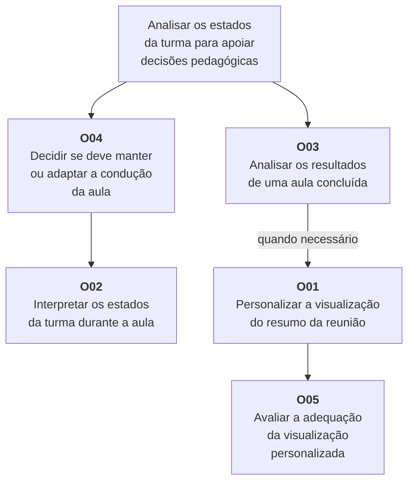

# Entrega 9 — Modelo conceitual e design centrado na comunicação

**Data:** {{dd/mm/aaaa}}  
**Status:** ⬜ não iniciada  
**Responsabilidade:** soluções individuais, com consolidação da equipe para mapa de objetivos e esquema de signos.

## Objetivo da atividade

Passar do cenário de problema para uma concepção da interação, explicitando objetivos, tópicos de conversa, falas e signos que a interface deverá comunicar/manipular.

## Transformando resultados técnicos em conceitos compreensíveis

Em TCCs algorítmicos ou orientados a dados, esta entrega deve evitar que a interface exponha apenas estruturas internas do código. Identifique os **conceitos e signos que fazem sentido para o usuário**.

Exemplos:

- `query plan`, custo estimado, recomendação e impacto para um DBA;
- modelo, dataset, versão, execução e métrica para engenheiro de IA;
- período, indicador, grupo, tendência e filtro para gestor/analista;
- alerta, severidade, evidência, responsável e status para analista de segurança.

Se um termo técnico for necessário, modele como será comunicado, explicado e relacionado à tarefa.

Dashboards, relatórios, filtros e CRUDs devem aparecer no modelo conceitual por meio dos **objetivos, signos e conversas** que justificam sua existência.

## 1. Cenários de interação

### CI01 — Acompanhar os estados da turma e revisar os resultados da aula

**Autor(a):** Kayky Pires — 22.222.040-2  
**Origem:** cenário problema C01 — Dificuldade em perceber o estado dos participantes durante uma aula on-line.

Durante uma aula por videoconferência, o professor precisa apresentar o conteúdo e, ao mesmo tempo, perceber como os alunos estão reagindo. Para isso, observa câmeras, chat, perguntas e reações da plataforma.

O professor tende a considerar principalmente a participação no chat, as perguntas realizadas e as expressões visíveis dos alunos como sinais de acompanhamento da aula.

Porém, muitos participantes permanecem em silêncio, apresentam poucas reações ou mantêm a câmera desligada. Essa dificuldade aumenta principalmente durante momentos em que o professor está explicando conteúdos mais complexos ou precisa dividir sua atenção entre apresentação, chat e participantes.

Quando os sinais são pouco claros ou contraditórios, o professor pode ter dificuldade para identificar se a turma está concentrada, desinteressada, confusa ou com dificuldade para acompanhar o conteúdo.

**[ACRÉSCIMO: O professor consulta os indicadores de engajamento, tédio, confusão e frustração apresentados pelo MindFlow AI, considerando os participantes para os quais existem dados disponíveis. Os indicadores são comunicados como estimativas que complementam os sinais observados na videoconferência.]**

Nesses momentos, o professor costuma fazer perguntas diretamente à turma, solicitar alguma interação ou repetir parte da explicação para tentar confirmar se o conteúdo foi compreendido.

Em turmas maiores, acompanhar individualmente os participantes se torna ainda mais difícil, aumentando a quantidade de informações que o professor precisa observar simultaneamente.

**[ALTERADO: Com o apoio dos indicadores e dos demais sinais observados, o professor avalia se deve continuar a explicação, reduzir o ritmo, repetir um conteúdo ou alterar a dinâmica da aula. A decisão permanece sob sua responsabilidade.]**

**[ACRÉSCIMO: Após o encerramento da aula, o professor acessa suas reuniões, identifica a aula pelo título e pela data e consulta o resumo. Examina os indicadores apresentados e identifica quais informações deseja destacar em sua análise.]**

**[ACRÉSCIMO: Para modificar a apresentação do resumo, o professor acessa a personalização, consulta os indicadores disponíveis e seleciona aqueles que deseja exibir. Ao salvar, recebe a confirmação de que a configuração foi salva e aplicada. Em seguida, confere o resumo personalizado e pode retornar à edição para realizar novos ajustes.]**

**[ACRÉSCIMO: Se cancelar a personalização, o professor retorna à consulta sem aplicar as alterações. Se ocorrer uma falha no salvamento, o sistema informa o problema e preserva as seleções para permitir uma nova tentativa.]**

### Diferenças relevantes

| Alteração | Por que foi necessária | Evidência/artefato que justifica |
|---|---|---|
| Inclusão da consulta aos indicadores durante a aula. | Descrever como a solução pode complementar os sinais utilizados pelo professor para interpretar o estado da turma. | C01 e hipótese H01, relacionada à utilidade de um indicador discreto do estado do grupo em tempo real. |
| Comunicação dos indicadores como estimativas, considerando a disponibilidade de dados. | Evitar que os resultados sejam interpretados como certezas ou como informações disponíveis para todos os participantes. | Proposta de comunicação derivada do funcionamento da classificação, a validar no protótipo. |
| Uso dos indicadores como apoio à decisão do professor. | Relacionar as informações apresentadas à necessidade de manter ou adaptar a condução da aula. | Objetivo e consequências descritos no C01. |
| Extensão do cenário para a revisão após a aula. | Contemplar a consulta e a personalização dos resultados de uma aula concluída, ampliando o contexto original do C01. | T01 — Configurar o acompanhamento de uma aula concluída no MindFlow AI. |
| Seleção dos indicadores exibidos no resumo. | Permitir que o docente adapte a visualização às suas necessidades de análise. | T01 e cena Personalizar visualização do M01. |
| Inclusão de feedback de salvamento, cancelamento e recuperação de falha. | Informar o resultado das ações e permitir que o docente ajuste ou retome a personalização. | Caminho principal e alternativas do M01. |

## 2. Design centrado na comunicação

**Nome do cenário:** CI01 — Acompanhar os estados da turma e revisar os resultados da aula.

| Tópico > subtópico | Falas e signos envolvidos | Intenção/efeito esperado |
|---|---|---|
| Acompanhar os estados da turma durante a aula | `U: consultar os indicadores da turma` / `D: apresentar estimativas dos estados cognitivos`. Signos: engajamento, tédio, confusão e frustração. | Complementar os sinais observados na videoconferência e apoiar a decisão do docente sobre a condução da aula. |
| > Compreender os indicadores | `D: explicar o significado dos indicadores e sua relação com os dados disponíveis`. Signos: significado dos estados e disponibilidade de dados. | Permitir a interpretação das informações sem apresentar as estimativas como certezas sobre os participantes. |
| Revisar os resultados após a aula | `U: consultar uma aula concluída` / `D: apresentar as reuniões disponíveis`. Signos: título e data da reunião. | Permitir que o docente identifique a aula que deseja analisar. |
| > Consultar o resumo da reunião | `U: abrir resumo da reunião` / `D: apresentar a identificação da reunião e seus indicadores`. Signos: título, data, estados cognitivos e indicadores exibidos. | Permitir que o docente examine os resultados e identifique suas necessidades de personalização. |
| > Personalizar a visualização | `U: personalizar visualização` / `D: apresentar os indicadores disponíveis` / `U: selecionar os indicadores desejados`. Signos: indicadores disponíveis e seleção de indicadores para exibição. | Adequar as informações apresentadas às necessidades de análise do docente. |
| > Salvar a personalização | `U: salvar alterações` / `D: configuração salva e aplicada`. Signos: configuração selecionada e situação do salvamento. | Confirmar que as alterações foram salvas e aplicadas ao resumo. |
| > Recuperar uma falha no salvamento | `D: não foi possível salvar; seleções preservadas` / `U: tentar salvar novamente, modificar a seleção ou cancelar`. Signos: mensagem de falha e seleção preservada. | Comunicar o problema e permitir a continuidade da tarefa sem refazer toda a seleção. |
| > Cancelar a personalização | `U: cancelar alterações` / `D: apresentar o resumo com a configuração anterior`. Signos: configuração anterior e indicadores exibidos. | Permitir o retorno à consulta sem aplicar as alterações não salvas. |
| > Conferir o resumo personalizado | `D: apresentar o resumo personalizado e a configuração aplicada`. Signos: indicadores exibidos, dados dos indicadores e seleção salva. | Permitir que o docente verifique se a visualização atende às suas necessidades. |
| > Revisar a personalização | `U: editar novamente` / `D: apresentar as opções de personalização`. Signos: indicadores disponíveis e seleção de indicadores. | Permitir novos ajustes quando o resultado ainda não atender às necessidades de análise. |

**Convenção:** `U` = usuário; `D` = preposto do designer/sistema, conforme a abordagem de Engenharia Semiótica adotada na disciplina.

## 3. Mapa de objetivos

### Dicionário de objetivos

| ID | Objetivo | Persona(s) | Cenário(s) | Prioridade |
|---|---|---|---|---|
| O01 | Personalizar a visualização do resumo da reunião, selecionando os indicadores que deseja exibir. | P01 — Karol | CI01 | Alta |
| O02 | Interpretar os estados de engajamento, tédio, confusão e frustração durante a aula, considerando o significado dos indicadores, suas escalas e a disponibilidade dos dados. | P01 — Karol | CI01 | Alta |
| O03 | Analisar os resultados de uma aula concluída, identificando as informações relevantes para sua revisão e considerando os limites das estimativas apresentadas. | P01 — Karol | CI01 | Alta |
| O04 | Decidir se deve manter ou adaptar a condução da aula, utilizando os indicadores como apoio e considerando os demais sinais observados na videoconferência. | P01 — Karol | CI01 | Alta |
| O05 | Avaliar se a seleção de indicadores foi aplicada e se a visualização personalizada apresenta as informações necessárias à análise. | P01 — Karol | CI01 | Alta |

O M01 detalha os objetivos O01 e O05 e cobre parte de O03, correspondente à consulta do resumo. Os objetivos O02 e O04 pertencem ao acompanhamento durante a aula.

Título, data, valores, escalas e disponibilidade de dados são signos necessários para alcançar esses objetivos, sendo detalhados no esquema conceitual de signos.

### Dicionário de objetivos

| ID | Objetivo | Persona(s) | Cenário(s) | Prioridade |
|---|---|---|---|---|
| O01 | Personalizar a visualização do resumo da reunião, selecionando os indicadores que deseja exibir. | P01 — Karol | CI01 | Alta |
| O02 | Interpretar os indicadores de engajamento, tédio, confusão e frustração durante a aula, considerando seu significado e os dados disponíveis. | P01 — Karol | CI01 | Alta |
| O03 | Analisar os resultados de uma aula concluída, identificando as informações relevantes para sua revisão. | P01 — Karol | CI01 | Alta |
| O04 | Decidir se deve manter ou adaptar a condução da aula, considerando os indicadores e os demais sinais observados. | P01 — Karol | CI01 | Alta |
| O05 | Avaliar se os indicadores apresentados na visualização personalizada atendem às suas necessidades de análise. | P01 — Karol | CI01 | Alta |

## 4. Esquema conceitual de signos

| Grupo | Signo | Origem | Observações/semântica | Tipo de conteúdo | Restrição | Valor padrão | Prevenção | Recuperação |
|---|---|---|---|---|---|---|---|---|
| Identificação da reunião | Título da reunião | Domínio — registro da reunião | Permite reconhecer a aula à qual os resultados pertencem. | Texto | Deve corresponder à reunião selecionada. | — | Apresentar junto à data para reduzir confusões entre reuniões semelhantes. | Retornar à lista e selecionar a reunião correta. |
| Identificação da reunião | Data da reunião | Domínio — registro da reunião | Identifica quando a aula ocorreu. | Data | Deve corresponder à reunião selecionada e utilizar formato legível. | — | Apresentar junto ao título da reunião. | Retornar à lista e selecionar a reunião correta. |
| Indicadores cognitivos | Indicador cognitivo | Domínio | Identifica um dos estados considerados: engajamento, tédio, confusão ou frustração. Seu significado deve ser explicado ao docente. | Categoria e descrição textual | Utilizar os mesmos nomes nas diferentes visualizações. | — | Explicar os termos e comunicar que os estados são estimados pelo sistema. | Permitir consultar a explicação do indicador quando houver dúvida. |
| Indicadores cognitivos | Valor do indicador | Sistema — resultado da classificação | Expressa a medida estimada para um indicador na aula analisada. Não representa, isoladamente, uma medida de aprendizagem. | Numérico, acompanhado da escala utilizada | Corresponder à reunião e ao indicador apresentados; explicitar a escala. | — | Associar o valor ao nome do indicador e evitar apresentar ausência de dados como valor zero. | Informar quando o valor não estiver disponível, sem atribuir um resultado inexistente. |
| Disponibilidade da análise | Disponibilidade de dados | Sistema | Informa se existem dados suficientes para apresentar determinado resultado. | Estado informativo | Não comunicar um estado cognitivo quando não houver dados para estimá-lo. | — | Distinguir resultado disponível de ausência de informação. | Explicar a indisponibilidade e permitir a consulta dos demais resultados disponíveis. |
| Personalização | Seleção de indicadores | Usuário; persistida pelo sistema | Define quais indicadores serão exibidos no resumo. Abrange a seleção em edição e a configuração aplicada após o salvamento. | Conjunto de opções | A seleção deve utilizar os indicadores oferecidos pelo sistema. | Seleção da configuração vigente. | Manter visíveis as opções disponíveis e aquelas selecionadas. | Permitir alterar a seleção ou cancelar a edição. Em falha de salvamento, preservar as seleções para nova tentativa. |
| Feedback da personalização | Resultado do salvamento | Sistema | Comunica se a configuração foi salva e aplicada ou se ocorreu uma falha. | Estado e mensagem textual | Confirmar o sucesso somente quando o salvamento tiver sido concluído. | — | Diferenciar claramente sucesso e falha, evitando dúvidas sobre a aplicação das alterações. | Em caso de falha, informar que as seleções foram preservadas e permitir tentar novamente, modificar a seleção ou cancelar. |

### Regras para os signos

- Os nomes utilizados correspondem ao vocabulário do docente: reunião, resumo, indicador e personalização.
- Título, data e categorias de indicadores pertencem ao domínio; a seleção é fornecida pelo usuário; valores estimados, disponibilidade e resultado do salvamento são produzidos pelo sistema.
- A seleção em edição e a configuração salva representam estados do mesmo conceito, evitando criar signos duplicados para a seleção de indicadores.
- A escala dos valores deve ser explicitada na interface. Não se pressupõe que todos os indicadores sejam apresentados em porcentagem.
- A ausência de dados deve ser diferenciada de um valor zero ou de uma estimativa de baixo engajamento.
- O símbolo `—` indica que não existe um valor padrão fixo.
- O cancelamento permanece direto, sem confirmação de descarte, conforme a versão adotada do M01.

## Síntese

Os diagramas MoLIC deverão representar os objetivos, tópicos e signos identificados no cenário de interação.

- **Objetivos:** interpretar os estados da turma durante a aula (O02), decidir se deve manter ou adaptar sua condução (O04), analisar os resultados após a aula (O03), personalizar o resumo (O01) e avaliar a adequação da visualização (O05).
- **Tópicos do acompanhamento durante a aula:** consulta aos indicadores, compreensão de seu significado e reconhecimento da disponibilidade de dados.
- **Tópicos da revisão após a aula:** consultar o resumo da reunião, personalizar a visualização e conferir o resumo personalizado.
- **Signos:** título e data da reunião, indicadores cognitivos, valores dos indicadores, disponibilidade de dados, seleção de indicadores e resultado do salvamento.
- **Falas e retornos relevantes:** abrir o resumo, personalizar a visualização, salvar alterações, comunicar sucesso ou falha, cancelar e editar novamente.
- **Recuperação de ruptura:** informar a falha no salvamento e preservar a seleção para permitir uma nova tentativa.

O M01 representa especificamente a consulta e a personalização após a aula, contribuindo para O03 e detalhando O01 e O05. Os objetivos de acompanhamento durante a aula pertencem a outro recorte de interação.

## Checklist

- [ ] Cenários de interação mostram alterações em relação aos cenários de problema.
- [ ] Cada solução individual identifica autor e cenário de origem.
- [ ] Tópicos/falas/signos são coerentes com objetivos do usuário.
- [ ] Mapas individuais foram consolidados.
- [ ] O esquema de signos está em uma tabela única e sem duplicações conceituais.
- [ ] Nomes de objetivos/signos serão reutilizados na Entrega 10.
- [ ] Em TCC técnico, signos representam conceitos do domínio compreensíveis ao usuário, não apenas variáveis/estruturas internas.
- [ ] Padrões como dashboard, relatório, filtros, administração e CRUD possuem objetivos e signos correspondentes.
- [ ] A interface comunica não só o resultado técnico, mas também seu significado para a tarefa.
