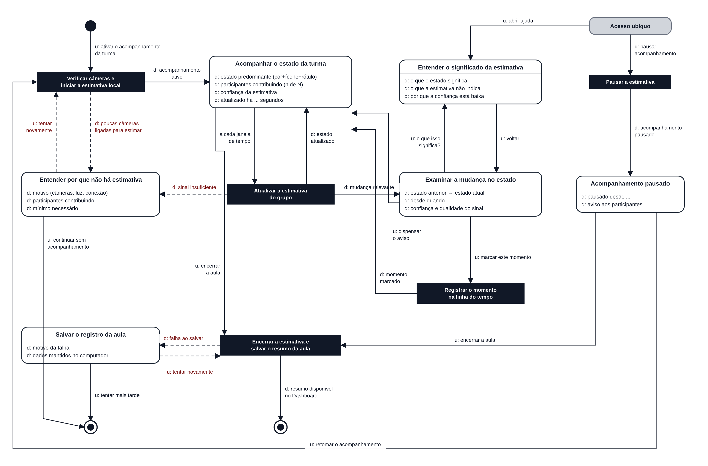

# Entrega 10 — MoLIC

**Data:** {{dd/mm/aaaa}}  
**Status:** 🟨 em andamento  
**Responsabilidade:** 1 solução completa por integrante

## Objetivo da atividade

Modelar a interação como uma **conversa entre usuário e preposto do designer**, oferecendo visão global dos caminhos que permitem ao usuário atingir seus objetivos — incluindo alternativas e rupturas relevantes. MoLIC não deve ser reduzida a um fluxograma de telas.

> Use a **notação MoLIC ensinada na disciplina**. Este template foca critérios de qualidade e não substitui a legenda/notação apresentada em aula.

## Atenção a TCCs sem interface original

O MoLIC não modela o algoritmo por dentro. Ele modela a **conversa de interação necessária para que uma pessoa use a contribuição**.

Exemplos de conversas:

- usuário escolhe dados/parâmetros → sistema valida → usuário inicia análise → sistema comunica processamento → usuário interpreta resultado;
- usuário consulta histórico → refina filtros → abre execução → compara com outra;
- administrador seleciona perfil → altera permissão → sistema comunica consequências → administrador confirma/cancela;
- analista recebe alerta → examina evidências → classifica ocorrência → registra decisão.

Modele também rupturas plausíveis: entrada inválida, falha de processamento, ausência de resultado, permissão insuficiente, filtro sem resultados, conflito de alteração, cancelamento ou necessidade de recuperação.

## M05 — Acompanhar o estado da turma durante a explicação

**Autor(a):** Isabella Vieira Silva Rosseto — 22.222.036-0  
**Cenário de interação de origem:** CI05 (Entrega 9)  
**Objetivo(s):** O01 a O07  
**Tarefa(s) relacionada(s):** T03  
**Signos relevantes:** acompanhamento da turma, participantes contribuindo, mínimo de participantes, estado predominante, confiança da estimativa, atualizado há, mudança de estado, qualidade do sinal, momento marcado, resumo da aula, aviso aos participantes

### Diagrama

**Fonte editável:** [`molic_m05.svg`](../assets/10_molic/molic_m05.svg)

| Elemento | Representação no diagrama |
|---|---|
| Ponto de abertura | círculo preenchido |
| Cena (tópico de conversa) | retângulo de cantos arredondados, com o tópico no topo e os diálogos (`d:` / `u:`) abaixo |
| Processamento do sistema | retângulo preto |
| Fala de transição | seta contínua com `u:` (fala do usuário) ou `d:` (fala do preposto do designer) |
| Ruptura e recuperação | seta tracejada |
| Acesso ubíquo | retângulo cinza, alcançável de qualquer cena |
| Ponto de encerramento | círculo com centro preenchido |

### Leitura do diagrama

O MoLIC modela a conversa entre Camila e o MindFlow durante a aula. A decisão de reforçar o conteúdo fica fora da conversa: o sistema mostra o estado e a confiança, e Camila decide sozinha o que fazer, como prevê a CI05.

#### Caminho principal

1. **Abertura → Verificar câmeras e iniciar a estimativa local:** Camila diz `u: ativar o acompanhamento da turma`. O sistema verifica quantos alunos estão com câmera ligada e inicia a estimativa no computador de cada participante.
2. **→ Acompanhar o estado da turma:** com participantes suficientes, o sistema responde `d: acompanhamento ativo`. A cena mostra o estado predominante (cor, ícone e rótulo), os participantes contribuindo, a confiança e há quanto tempo foi atualizado.
3. **Atualizar a estimativa do grupo:** a cada janela de tempo, o sistema recalcula a estimativa e volta à cena com `d: estado atualizado`.
4. **→ Examinar a mudança no estado:** quando o estado muda de forma relevante, o sistema avisa `d: mudança relevante`. A cena mostra o estado anterior e o atual, desde quando e a confiança.
5. **→ Registrar o momento na linha do tempo:** se Camila diz `u: marcar este momento`, o sistema registra o minuto da aula e responde `d: momento marcado`, voltando ao acompanhamento. Se ela diz `u: dispensar o aviso`, volta direto ao acompanhamento.
6. **→ Encerrar a estimativa e salvar o resumo da aula:** ao fim, `u: encerrar a aula` leva ao processamento que encerra a estimativa e salva o resumo. O sistema responde `d: resumo disponível no Dashboard` e a conversa termina.

Caminhos alternativos sem ruptura:

- A partir de **Examinar a mudança no estado**, `u: o que isso significa?` leva à cena **Entender o significado da estimativa**, que explica o estado, o que a estimativa não indica e por que a confiança pode estar baixa. `u: voltar` retorna à mudança.
- Pelo **acesso ubíquo**, Camila pode, de qualquer cena, `u: abrir ajuda` (mesma cena de significado) ou `u: pausar acompanhamento`. A pausa leva à cena **Acompanhamento pausado**, de onde ela pode `u: retomar o acompanhamento` (volta à verificação de câmeras) ou `u: encerrar a aula`.

#### Alternativas e rupturas

| Situação | Onde ocorre | Como o usuário percebe | Caminho de recuperação/saída |
|---|---|---|---|
| Poucas câmeras ligadas para estimar (abaixo do mínimo) | Processamento "Verificar câmeras e iniciar a estimativa local" | `d: poucas câmeras ligadas para estimar` e a cena "Entender por que não há estimativa", com o motivo, os participantes contribuindo e o mínimo necessário | `u: tentar novamente` (nova verificação) ou `u: continuar sem acompanhamento` (encerra a conversa com o MindFlow; a aula segue como antes) |
| Sinal insuficiente no meio da aula (câmeras desligadas, luz, conexão) | Processamento "Atualizar a estimativa do grupo" | `d: sinal insuficiente` e a mesma cena de explicação do motivo | As mesmas saídas: tentar novamente ou continuar sem acompanhamento |
| Estimativa que parece errada para a professora | Cena "Examinar a mudança no estado" | Confiança e qualidade do sinal exibidas junto da mudança | `u: o que isso significa?` para entender a estimativa, ou `u: dispensar o aviso` |
| Acompanhamento que atrapalha a aula | Qualquer cena | — | Acesso ubíquo: `u: pausar acompanhamento`; depois retomar ou encerrar |
| Falha ao salvar o resumo da aula | Processamento "Encerrar a estimativa e salvar o resumo da aula" | `d: falha ao salvar` e a cena "Salvar o registro da aula", com o motivo e a informação de que os dados continuam no computador | `u: tentar novamente` (volta ao processamento) ou `u: tentar mais tarde` (encerra sem perder os dados) |

### Checklist específico de modelagem

- [x] Existe **ponto de abertura** coerente com o início do objetivo (ativar o acompanhamento antes ou no início da explicação).
- [x] As **cenas de conversa** representam tópicos/assuntos, não nomes de páginas apenas.
- [x] As transições/falas deixam claro o que o usuário ou o sistema comunica.
- [x] Há **ponto(s) de encerramento** para objetivos concluídos/abandonados quando aplicável (resumo salvo; continuar sem acompanhamento ou tentar mais tarde).
- [x] Processamentos do sistema estão representados conforme a notação adotada em aula, sem “inventar” fala do usuário (a atualização periódica parte do sistema, não de uma fala de Camila).
- [x] Rupturas (breakdowns) relevantes têm feedback e caminho de recuperação, não becos sem saída.
- [x] Acessos ubíquos/atalhos só aparecem quando semanticamente justificáveis (pausar e ajuda, que Camila pode precisar em qualquer momento da aula).
- [x] O diagrama cobre caminhos alternativos importantes, e não apenas o “happy path”.
- [x] Nomes de objetivos, tópicos e signos são coerentes com a Entrega 9.
- [x] O diagrama é legível em tamanho normal no GitHub.
- [x] O MoLIC representa a conversa usuário–sistema, não o fluxo interno do algoritmo (a estimativa aparece como um único processamento, sem detalhar o modelo).
- [x] Processamento, filtros, administração, relatórios e históricos incluem retornos/rupturas quando relevantes (falha ao salvar o resumo).

> Repita M01, M02... para os demais integrantes.

## Consolidação da equipe

### Cobertura dos objetivos

| Objetivo | MoLIC que cobre | Lacunas/duplicidades | Decisão |
|---|---|---|---|
| O01 Ativar o acompanhamento da turma | M05 | Deve se repetir nos MoLICs de Karol, Nathanael e Manoel | Manter um único objetivo na consolidação |
| O02 Perceber o estado da turma | M05 | Mesmo objetivo do comunicador nos outros cenários durante a sessão | Manter um único objetivo na consolidação |
| O03 Examinar uma mudança no estado | M05 | — | Manter |
| O04 Entender o significado e a confiança | M05 | Pode se sobrepor à ajuda contextual do Dashboard (F07) | Usar o mesmo texto de explicação nos dois lugares |
| O05 Marcar um momento para revisar depois | M05 | Liga com a revisão de aula concluída (T01/T02) | Conferir no MoLIC do Dashboard se o momento marcado aparece |
| O06 Pausar ou retomar o acompanhamento | M05 | Liga com a interface do participante (T04): o aviso muda quando pausa | Conferir no MoLIC do participante |
| O07 Encerrar a aula com o resumo salvo | M05 | — | Manter |

### Preparação para o Figma

Estados necessários a partir do M05:

- extensão com o acompanhamento desligado e o botão para ativar;
- verificação de câmeras em andamento;
- aviso de "não há participantes suficientes", com motivo, número de participantes, mínimo e as opções tentar novamente / continuar sem acompanhamento;
- Semáforo Cognitivo compacto durante o compartilhamento de tela, nos estados acompanhando, possível tédio, possível confusão, possível frustração e sem estimativa (cor + ícone + rótulo), com confiança, participantes contribuindo e "atualizado há";
- aviso de mudança de estado, com estado anterior e atual, desde quando, e as ações "o que isso significa?", "marcar este momento" e "dispensar";
- explicação do significado e da confiança da estimativa;
- confirmação de "momento marcado";
- acompanhamento pausado, com retomar e encerrar;
- confirmação de resumo salvo e aviso de falha ao salvar, com tentar novamente / tentar mais tarde;
- aviso exibido aos alunos quando o acompanhamento é ativado ou pausado (ligação com o MoLIC do participante).

## Erros frequentes a evitar

- desenhar apenas caixas com nomes de telas e setas de navegação;
- não modelar falhas, cancelamento, volta ou recuperação;
- usar rótulos genéricos (“Tela 1”, “Processo 2”) sem tópico de conversa;
- criar no Figma fluxos que não existem no MoLIC;
- diagrama sem legenda/fonte editável e com texto ilegível.
