## M04 — Acompanhar os estados do grupo durante o treinamento on-line

**Autor(a):** Rafael Dias — 22.222.039-4  
**Cenário de interação de origem:** CI04 (Entrega 9)  
**Persona:** P03 — Nathanael Lima  
**Objetivo(s):** O06 a O10 (mapa individual da CI04, pendente de consolidação)  
**Tarefa(s) relacionada(s):** acompanhar o estado do grupo durante o treinamento e consultar os resultados da sessão concluída  
**Signos relevantes:** acompanhamento da reunião, estado predominante, indicadores cognitivos, participantes contribuindo, disponibilidade de dados, confiança da estimativa, atualizado há, significado do indicador, período analisado, variação dos indicadores e resumo da reunião.

### Diagrama

```mermaid
flowchart TD
    A((" ")):::abertura

    S0("<b>Preparar acompanhamento do grupo</b><br/>――――――――――――――――<br/>ver acompanhamento {<br/>d: análise ainda não iniciada }<br/>iniciar análise {<br/>u: iniciar análise do grupo }"):::cena

    P1[" "]:::proc

    S1("<b>Acompanhar indicadores do grupo</b><br/>――――――――――――――――<br/>ver resumo dos estados {<br/>d: maior indicador e seu valor,<br/>menor indicador e seu valor }<br/>ver referência da análise {<br/>d: participantes contribuindo,<br/>atualizado há }"):::cena

    S2("<b>Examinar a evolução dos estados</b><br/>――――――――――――――――<br/>ver gráfico de linhas {<br/>d: engajamento, tédio,<br/>confusão e frustração }<br/>ver tempo {<br/>d: período analisado }"):::cena

    P2[" "]:::proc

    S3("<b>Compreender os indicadores</b><br/>――――――――――――――――<br/>ver significado {<br/>d: significado dos estados,<br/>limites da estimativa }<br/>ver qualidade {<br/>d: confiança da estimativa,<br/>qualidade do sinal }"):::cena

    S4("<b>Entender indisponibilidade da análise</b><br/>――――――――――――――――<br/>ver motivo {<br/>d: dados insuficientes<br/>ou falha na obtenção dos resultados }<br/>ver contexto {<br/>d: disponibilidade de dados,<br/>participantes contribuindo }"):::alerta

    P3[" "]:::proc

    S5("<b>Consultar resultados do treinamento</b><br/>――――――――――――――――<br/>ver resumo {<br/>d: identificação da reunião,<br/>períodos e variação dos indicadores }"):::cena

    S6("<b>Examinar um período do treinamento</b><br/>――――――――――――――――<br/>ver intervalo {<br/>d: período analisado,<br/>valores dos estados disponíveis }"):::cena

    S7("<b>Entender ausência de dados no período</b><br/>――――――――――――――――<br/>ver indisponibilidade {<br/>d: não há resultados suficientes<br/>para este intervalo }"):::alerta

    S8("<b>Entender falha ao abrir o resumo</b><br/>――――――――――――――――<br/>ver problema {<br/>d: resumo indisponível no momento }"):::alerta

    UB(["acesso ubíquo"]):::ubiquo
    UC(["acesso ubíquo"]):::ubiquo

    BAR["gcc gcc gcc gcc gcc gcc gcc gcc gcc gcc"]:::barra
    E(((" "))):::fim

    A -->|"gco: Acompanhar os estados do grupo"| S0

    S0 -->|"u: iniciar análise"| P1

    P1 -->|"precond: dados suficientes<br/>d: análise iniciada"| S1

    P1 -.->|"[SR] d: não foi possível obter uma estimativa"| S4

    S4 -.->|"u: tentar novamente"| P1

    S4 -->|"u: continuar treinamento sem análise"| BAR

    S1 -->|"u: expandir pop-up"| S2

    S2 -->|"u: recolher pop-up"| S1

    S1 -->|"u: consultar significado"| S3

    S2 -->|"u: consultar significado"| S3

    S3 -->|"precond: veio da visão compacta<br/>u: voltar"| S1

    S3 -->|"precond: veio do gráfico<br/>u: voltar"| S2

    S1 -->|"precond: nova atualização"| P2

    S2 -->|"precond: nova atualização"| P2

    P2 -->|"precond: visualização compacta<br/>d: indicadores atualizados"| S1

    P2 -->|"precond: visualização expandida<br/>d: gráfico atualizado"| S2

    P2 -.->|"[SR] d: estimativa indisponível"| S4

    S4 -->|"u: voltar ao pop-up sem resultado"| S0

    UB -->|"u: encerrar acompanhamento"| BAR

    UC -->|"u: consultar treinamento concluído"| P3

    P3 -->|"precond: resumo disponível<br/>d: resumo apresentado"| S5

    P3 -.->|"[SR] d: não foi possível abrir o resumo"| S8

    S8 -.->|"u: tentar novamente"| P3

    S8 -->|"u: voltar"| BAR

    S5 -->|"u: selecionar período"| S6

    S6 -->|"u: voltar ao resumo"| S5

    S6 -.->|"[SR] d: período sem dados suficientes"| S7

    S7 -->|"u: escolher outro período"| S5

    S7 -->|"u: voltar ao resumo"| S5

    S5 -->|"u: encerrar consulta"| BAR

    BAR -->|"gcc: Acompanhar os estados do grupo"| E

    classDef abertura fill:#111111,stroke:#111111
    classDef fim fill:#111111,stroke:#111111,stroke-width:3px
    classDef proc fill:#111111,stroke:#111111,color:#111111
    classDef cena fill:#ffffff,stroke:#111111,stroke-width:1.5px,color:#111111
    classDef alerta fill:#ffffff,stroke:#111111,stroke-width:1.5px,stroke-dasharray:6 4,color:#111111
    classDef ubiquo fill:#c4c4c4,stroke:#555555,color:#c4c4c4
    classDef barra fill:#111111,stroke:#111111,color:#111111,font-size:6px
```

> **Nota de modelagem:** os acessos ubíquos representam ações disponíveis durante o acompanhamento. O acesso ao resumo ocorre apenas quando o treinamento já foi concluído. A ajuda contextual e as mensagens de recuperação são propostas de interação que ainda precisam ser validadas no protótipo.

### Notação utilizada

Notação de Barbosa e Silva (2010), conforme o material da disciplina.

| Elemento | Representação no diagrama | No M04 |
|---|---|---|
| Ponto de abertura | Círculo preenchido e abertura da conversa sobre o objetivo (`gco:`). | `gco: Acompanhar os estados do grupo` |
| Cena | Retângulo arredondado contendo tópico e diálogos com `u:` e `d:`. | Preparar acompanhamento, acompanhar indicadores, examinar evolução e consultar resumo. |
| Processo do sistema | Retângulo preto pequeno, sem texto. | Iniciar análise, atualizar resultados e acessar o registro da sessão. |
| Fala de transição | Seta identificada com uma fala ou precondição. | `u: iniciar análise`, `u: expandir pop-up` e `precond: nova atualização`. |
| Cena de alerta | Cena com borda tracejada. | Indisponibilidade da análise, ausência de dados e falha ao abrir o resumo. |
| Ruptura e recuperação | Transição tracejada identificada por `[SR]`. | Falha na obtenção de estimativa e indisponibilidade de resultados. |
| Acesso ubíquo | Elemento cinza representando comandos disponíveis em diferentes momentos. | Encerrar acompanhamento e consultar treinamento concluído. |
| Fechamento da conversa | Barra preta com `gcc:` e ponto de encerramento. | `gcc: Acompanhar os estados do grupo` |

**Convenções:**

- `u:` = fala do usuário.
- `d:` = fala do preposto do designer.
- `gco:` = abertura da conversa sobre objetivo.
- `gcc:` = fechamento da conversa sobre objetivo.
- `precond:` = condição necessária para uma transição.
- `[SR]` = situação de recuperação de ruptura.

### Leitura do diagrama

A meta do M04 é permitir que **Nathanael acompanhe os estados estimados do grupo durante um treinamento on-line**.

A extensão apresenta inicialmente um pop-up com um botão para iniciar a análise. Após o início, a visualização compacta destaca o indicador de maior valor e o indicador de menor valor.

Caso Nathanael deseje observar todos os indicadores simultaneamente, pode expandir o pop-up para visualizar um gráfico de linhas contendo engajamento, tédio, confusão e frustração.

As informações auxiliam na interpretação do estado do grupo, mas não confirmam a compreensão ou aprendizagem dos participantes.

A decisão de repetir, modificar o ritmo ou continuar a explicação permanece sob responsabilidade de Nathanael, fora da interação com o sistema.

#### Caminho principal

1. **Abertura:** Nathanael abre o pop-up da extensão, iniciando a conversa `gco: Acompanhar os estados do grupo`.

2. **Preparação:** o sistema informa que a análise ainda não foi iniciada e apresenta o botão para iniciar o acompanhamento.

3. **Iniciar análise:** Nathanael seleciona `u: iniciar análise`. O sistema verifica a disponibilidade dos dados necessários para produzir as estimativas.

4. **Acompanhamento ativo:** quando os dados estão disponíveis, o sistema comunica `d: análise iniciada` e apresenta a cena **Acompanhar indicadores do grupo**.

5. **Visualização compacta:** o pop-up apresenta o indicador com maior valor, o indicador com menor valor, a quantidade de participantes contribuindo e a última atualização.

6. **Expandir o pop-up:** Nathanael seleciona `u: expandir pop-up` para acessar a cena **Examinar a evolução dos estados**.

7. **Visualização expandida:** o sistema apresenta um gráfico de linhas com os quatro indicadores, permitindo observar suas variações ao longo do treinamento.

8. **Recolher o pop-up:** Nathanael pode selecionar `u: recolher pop-up`, retornando à visualização compacta sem interromper a análise.

9. **Atualização dos indicadores:** conforme novos resultados ficam disponíveis, o sistema atualiza os valores e mantém a visualização escolhida.

10. **Encerramento:** quando não deseja continuar o acompanhamento, Nathanael encerra a interação, chegando ao fechamento `gcc: Acompanhar os estados do grupo`.

#### Caminhos alternativos

- **Consultar o significado dos indicadores:** a partir das visualizações compacta ou expandida, Nathanael pode acessar uma explicação dos estados e das limitações das estimativas.

- **Voltar à visualização anterior:** depois de consultar a explicação, Nathanael pode retornar ao pop-up compacto ou ao gráfico, conforme sua origem.

- **Consultar resultados após o treinamento:** Nathanael pode acessar o resumo de uma sessão concluída para analisar os indicadores registrados ao longo da apresentação.

- **Examinar períodos específicos:** no resumo, Nathanael pode selecionar um intervalo para consultar os estados estimados naquele momento.

#### Alternativas e rupturas

| Situação | Onde ocorre | Como o usuário percebe | Caminho de recuperação/saída |
|---|---|---|---|
| Dados insuficientes para iniciar a análise | Processo de início da análise | `[SR] d: não foi possível obter uma estimativa`, com a disponibilidade de dados e participantes contribuindo. | `u: tentar novamente` ou `u: continuar treinamento sem análise`. |
| Sinal indisponível durante o acompanhamento | Processo de atualização dos indicadores | `[SR] d: estimativa indisponível`, com explicação do problema. | Tentar novamente ou retornar ao estado sem análise. |
| Dúvida sobre o significado de um indicador | Pop-up compacto ou expandido | O usuário pode consultar o significado dos estados, a confiança e os limites das estimativas. | Retornar à visualização anterior. |
| Ausência de resultados em determinado período | Consulta posterior ao treinamento | `[SR] d: período sem dados suficientes`. | Escolher outro período ou voltar ao resumo. |
| Falha ao abrir o resumo | Consulta do treinamento concluído | `[SR] d: não foi possível abrir o resumo`. | Tentar novamente ou retornar. |

### Checklist específico de modelagem

- [x] Existe ponto de abertura coerente com a meta do usuário.
- [x] O diagrama apresenta o botão para iniciar a análise.
- [x] O pop-up compacto comunica o maior e o menor indicador do grupo.
- [x] A expansão apresenta um gráfico de linhas com os quatro estados.
- [x] O usuário pode retornar da visualização expandida para a compacta.
- [x] As cenas representam assuntos de comunicação, não apenas nomes de telas.
- [x] As transições identificam falas do usuário e do sistema.
- [x] Há ponto de encerramento para a conversa.
- [x] Os processamentos do sistema estão representados sem detalhar o algoritmo interno.
- [x] As rupturas possuem mensagens e possibilidades de recuperação.
- [x] O diagrama contempla caminhos alternativos.
- [x] As decisões sobre a condução do treinamento permanecem com Nathanael.
- [x] Os signos são coerentes com os definidos na Entrega 9.
- [ ] Confirmar a numeração definitiva dos objetivos após a consolidação da equipe.
- [ ] Validar as interações propostas de ajuda e consulta ao resumo.
- [ ] Conferir a legibilidade e a notação com o material apresentado em aula.

### Preparação para o Figma

Estados necessários para representar as interações do M04:

- **Pop-up inicial:** análise desligada, com botão para iniciar.
- **Início da análise:** estado de processamento.
- **Pop-up compacto:** maior e menor indicador, seus valores e informações de atualização.
- **Pop-up expandido:** gráfico de linhas contendo engajamento, tédio, confusão e frustração.
- **Retorno à visão compacta:** botão para recolher o pop-up.
- **Indisponibilidade:** aviso quando não existem dados suficientes para apresentar resultados.
- **Atualização:** novos resultados apresentados sem interromper a visualização atual.
- **Ajuda contextual (a validar):** explicações dos indicadores e da confiança.
- **Resumo posterior (a validar):** consulta aos resultados e aos períodos do treinamento.
- **Recuperação (a validar):** mensagens para falhas e ausência de dados.

### Relação com a Entrega 9

O M04 representa principalmente os objetivos:

- **O06:** interpretar os estados do grupo durante o treinamento.
- **O07:** decidir se deve manter ou adaptar sua condução.
- **O08:** analisar os resultados de um treinamento concluído.
- **O09:** identificar períodos com possíveis sinais de dificuldade.
- **O10:** avaliar melhorias para os próximos treinamentos.

Os objetivos O06 e O07 estão relacionados ao acompanhamento durante o treinamento. O08 e O09 estão associados à consulta posterior dos resultados.

O objetivo O10 corresponde à avaliação realizada por Nathanael a partir das informações apresentadas, não sendo uma decisão automatizada pelo sistema.

**Observação:** os identificadores O06 e O07 utilizados neste mapa individual precisam ser revisados na consolidação, pois também aparecem no mapa de Matheus com significados diferentes.
