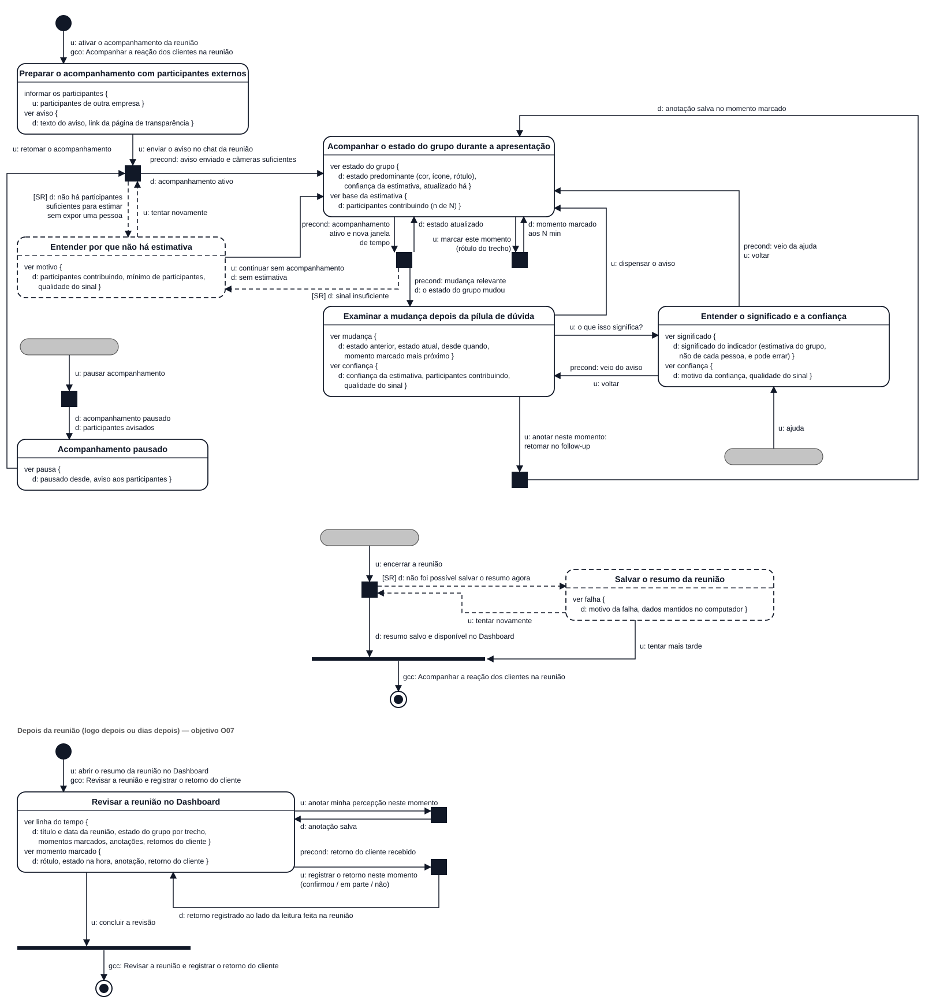

# Entrega 10 — MoLIC

**Data:** {{dd/mm/aaaa}}  
**Status:** 🟨 em andamento  
**Responsabilidade:** 1 solução completa por integrante

## Objetivo da atividade

Modelar a interação como uma **conversa entre usuário e preposto do designer**, oferecendo visão global dos caminhos que permitem ao usuário atingir seus objetivos — incluindo alternativas e rupturas relevantes. MoLIC não deve ser reduzida a um fluxograma de telas.

> Use a **notação MoLIC ensinada na disciplina**. Este template foca critérios de qualidade e não substitui a legenda/notação apresentada em aula.

## Atenção a TCCs sem interface original

O MoLIC não modela o algoritmo por dentro. Ele modela a **conversa de interação necessária para que uma pessoa use a contribuição**.

Exemplos de conversas:

- usuário escolhe dados/parâmetros → sistema valida → usuário inicia análise → sistema comunica processamento → usuário interpreta resultado;
- usuário consulta histórico → refina filtros → abre execução → compara com outra;
- administrador seleciona perfil → altera permissão → sistema comunica consequências → administrador confirma/cancela;
- analista recebe alerta → examina evidências → classifica ocorrência → registra decisão.

Modele também rupturas plausíveis: entrada inválida, falha de processamento, ausência de resultado, permissão insuficiente, filtro sem resultados, conflito de alteração, cancelamento ou necessidade de recuperação.

## M01 — Acompanhar a reação dos clientes na reunião comercial e revisar a reunião depois

**Autor(a):** Matheus Ferreira de Freitas — 22.125.085-5  
**Cenário de interação de origem:** CI01 — Manoel percebe a reação dos clientes durante a apresentação comercial e decide como prosseguir (Entrega 9), derivado do cenário de problema C01 — Dificuldade em interpretar a reação do cliente durante uma apresentação comercial on-line, relacionado à persona P04 — Manoel Gomes.  
**Objetivo(s):** O01 — Ativar o acompanhamento em uma reunião com clientes; O02 — Perceber o estado do grupo enquanto apresenta; O03 — Marcar o momento da pílula de dúvida; O04 — Verificar a reação depois da pílula de dúvida e quanto confiar nela; O05 — Anotar um ponto para o follow-up; O06 — Encerrar a reunião com o resumo salvo; O07 — Revisar a reunião e registrar o retorno do cliente (Entrega 9, CI01).  
**Tarefa(s) relacionada(s):** T05 — Conduzir a apresentação comercial percebendo a reação dos clientes e decidindo como prosseguir (Entrega 5).  
**Signos relevantes:** acompanhamento da reunião, aviso aos participantes, participantes contribuindo, mínimo de participantes, estado predominante, confiança da estimativa, atualizado há, mudança de estado, qualidade do sinal, significado do indicador, momento marcado, anotação, resumo da reunião, retorno do cliente

### Diagrama

**Fonte editável:** [`molic_m01.svg`](../assets/10_molic/molic_m01.svg) (SVG editável, abre no Inkscape e no draw.io) · versão em imagem: [`molic_m01.png`](../assets/10_molic/molic_m01.png)

Notação de Barbosa e Silva (2010), conforme o material da disciplina, na mesma representação usada no M05:

| Elemento | Representação no diagrama | No M01 |
|---|---|---|
| Ponto de abertura | círculo preto, com a fala do usuário e a abertura da conversa sobre a meta (`gco:`) | `u: ativar o acompanhamento da reunião` / `gco: Acompanhar a reação dos clientes na reunião`; segunda abertura, depois da reunião: `u: abrir o resumo da reunião no Dashboard` / `gco: Revisar a reunião e registrar o retorno do cliente` |
| Cena | retângulo de cantos arredondados; tópico em cima e diálogos embaixo, no formato `diálogo { d: signos }` (`u:` quando a informação é dada por Manoel) | seis cenas, como "Acompanhar o estado do grupo durante a apresentação" e "Revisar a reunião no Dashboard" |
| Cena de alerta ou captura de erro | cena com borda tracejada | "Entender por que não há estimativa" e "Salvar o resumo da reunião" |
| Processo do sistema | retângulo preto pequeno, sem texto; o sistema decide o rumo da conversa, e as falas ficam nas saídas | verificar o aviso e as câmeras, atualizar a estimativa, registrar o momento marcado, salvar a anotação, pausar, salvar o resumo, salvar a percepção e registrar o retorno do cliente |
| Fala de transição | seta com `u:` (usuário) ou `d:` (preposto do designer); `precond:` indica a condição | `u: marcar este momento (rótulo do trecho)`, `precond: mudança relevante`, `precond: retorno do cliente recebido` |
| Ruptura e recuperação | seta tracejada; `[SR]` marca a fala do preposto que leva à recuperação da ruptura | `[SR] d: não há participantes suficientes para estimar sem expor uma pessoa`, `[SR] d: sinal insuficiente`, `[SR] d: não foi possível salvar o resumo agora` |
| Acesso ubíquo | retângulo cinza sem texto, alcançável de qualquer cena; pode ser repetido no diagrama | `u: ajuda`, `u: pausar acompanhamento`, `u: encerrar a reunião` |
| Fechamento da conversa | barra preta com `gcc:` e ponto de encerramento (círculo com centro preenchido) | `gcc: Acompanhar a reação dos clientes na reunião` e `gcc: Revisar a reunião e registrar o retorno do cliente` |

### Leitura do diagrama

O M01 cobre os sete objetivos da CI01 em duas conversas. A primeira acontece **durante a reunião** (O01 a O06): Manoel ativa o acompanhamento depois de avisar os clientes, percebe o estado do grupo enquanto apresenta, marca o momento da pílula de dúvida, examina a mudança de estado que vem em seguida, anota o que vai retomar no follow-up e encerra a reunião com o resumo salvo. A segunda acontece **depois da reunião** (O07), em outro momento de uso: Manoel abre o resumo no Dashboard, anota as próprias percepções e, quando o e-mail do cliente chega, registra o retorno ao lado da leitura feita na reunião. A decisão de avançar, reforçar ou reexplicar um ponto fica fora da conversa: o preposto mostra o estado, a confiança e a explicação, e nenhuma fala `d:` diz a Manoel o que fazer (RC03), como prevê a CI01 e o mapa de objetivos da Entrega 9.

#### Caminho principal

1. **Abertura:** Manoel diz `u: ativar o acompanhamento da reunião`, o que abre a conversa sobre a meta (`gco: Acompanhar a reação dos clientes na reunião`), e chega à cena **Preparar o acompanhamento com participantes externos**. Nela, informa que os participantes são de outra empresa (`u: participantes de outra empresa`) e vê o aviso padrão, com o texto e o link da página de transparência.
2. Com `u: enviar o aviso no chat da reunião`, o sistema verifica o envio do aviso e as câmeras. Com `precond: aviso enviado e câmeras suficientes`, o preposto responde `d: acompanhamento ativo` e a conversa vai para a cena **Acompanhar o estado do grupo durante a apresentação**. Os diálogos "ver estado do grupo" (estado predominante com cor, ícone e rótulo, confiança da estimativa, atualizado há) e "ver base da estimativa" (participantes contribuindo, n de N) mostram só o grupo, nunca um cliente específico (O01 e O02).
3. A cada `precond: acompanhamento ativo e nova janela de tempo`, o sistema atualiza a estimativa e volta à cena com `d: estado atualizado`.
4. Ao soltar a pílula de dúvida, Manoel diz `u: marcar este momento (rótulo do trecho)`. O sistema registra o momento e responde `d: momento marcado aos N min`, sem tirar Manoel da apresentação (O03).
5. Com `precond: mudança relevante`, o preposto diz `d: o estado do grupo mudou` e a conversa vai para **Examinar a mudança depois da pílula de dúvida**: estado anterior, estado atual, desde quando, momento marcado mais próximo, confiança da estimativa, participantes contribuindo e qualidade do sinal (O04). A partir daí a decisão é de Manoel, fora do sistema.
6. Da cena de mudança, Manoel pode dizer `u: dispensar o aviso` e voltar ao acompanhamento, ou `u: anotar neste momento: retomar no follow-up`; o sistema salva a anotação no momento marcado e responde `d: anotação salva no momento marcado`, devolvendo a conversa ao acompanhamento (O05).
7. Pelo acesso ubíquo, `u: encerrar a reunião` leva ao processo que salva o resumo. O preposto responde `d: resumo salvo e disponível no Dashboard`, a conversa é fechada (`gcc: Acompanhar a reação dos clientes na reunião`) e chega ao ponto de encerramento (O06).
8. **Segunda conversa (O07):** logo depois ou dias depois, Manoel diz `u: abrir o resumo da reunião no Dashboard` (`gco: Revisar a reunião e registrar o retorno do cliente`) e chega à cena **Revisar a reunião no Dashboard**, com a linha do tempo (título e data da reunião, estado do grupo por trecho, momentos marcados, anotações e retornos do cliente) e o detalhe de cada momento marcado. Com `u: anotar minha percepção neste momento`, o sistema responde `d: anotação salva`. Quando o e-mail do cliente chega (`precond: retorno do cliente recebido`), `u: registrar o retorno neste momento (confirmou / em parte / não)` leva ao processo que responde `d: retorno registrado ao lado da leitura feita na reunião`. Com `u: concluir a revisão`, a conversa é fechada (`gcc: Revisar a reunião e registrar o retorno do cliente`).

Caminhos alternativos:

- Em **Examinar a mudança depois da pílula de dúvida**, `u: o que isso significa?` leva à cena **Entender o significado e a confiança**: o significado do indicador (estimativa do grupo, não de cada pessoa, e que pode errar) e o motivo da confiança, com a qualidade do sinal (H02 e H03). A mesma cena é alcançada pelo acesso ubíquo `u: ajuda`. A volta depende de onde Manoel veio: `precond: veio do aviso / u: voltar` retorna à mudança, e `precond: veio da ajuda / u: voltar` retorna ao acompanhamento.
- Pelo acesso ubíquo, `u: pausar acompanhamento` leva ao processo de pausa (RC07). O preposto responde `d: acompanhamento pausado` e `d: participantes avisados`, e a conversa vai para **Acompanhamento pausado** (pausado desde, aviso aos participantes). Dali, `u: retomar o acompanhamento` volta à verificação do aviso e das câmeras.

#### Alternativas e rupturas

| Situação | Onde ocorre | Como o usuário percebe | Caminho de recuperação/saída |
|---|---|---|---|
| Não há participantes suficientes ao ativar (grupo pequeno, só um cliente com câmera ligada) | Processo de verificação do aviso e das câmeras, depois do envio do aviso | `[SR] d: não há participantes suficientes para estimar sem expor uma pessoa` e a cena de alerta "Entender por que não há estimativa", com participantes contribuindo, mínimo de participantes e qualidade do sinal | `u: tentar novamente` (nova verificação, por exemplo depois de pedir que liguem as câmeras) ou `u: continuar sem acompanhamento`, com `d: sem estimativa`: a reunião segue como antes do MindFlow, e marcar momentos e anotar continuam disponíveis para o resumo (ruptura prevista na CI01; H05 e R04) |
| Sinal insuficiente no meio da reunião (câmeras desligadas, luz, conexão) | Processo de atualização da estimativa | `[SR] d: sinal insuficiente` e a mesma cena de alerta | As mesmas saídas: tentar novamente ou continuar sem acompanhamento |
| Estimativa que parece errada ou que Manoel não sabe interpretar | Cena "Examinar a mudança depois da pílula de dúvida" | Confiança da estimativa, participantes contribuindo e qualidade do sinal mostrados junto da mudança | `u: o que isso significa?` (cena "Entender o significado e a confiança" e `u: voltar`) ou `u: dispensar o aviso` |
| Pergunta inesperada ou objeção de um cliente enquanto o aviso de mudança está aberto | Cena "Examinar a mudança depois da pílula de dúvida" | O aviso não se acumula com outros e não bloqueia a reunião (RC06) | `u: dispensar o aviso`: a conversa volta ao acompanhamento e o indicador segue mostrando só o estado atual |
| Acompanhamento que atrapalha a reunião ou que um cliente pede para desligar | Qualquer cena da primeira conversa | — | Acesso ubíquo `u: pausar acompanhamento`, com `d: participantes avisados`; depois `u: retomar o acompanhamento` ou `u: encerrar a reunião` |
| Falha ao salvar o resumo da reunião | Processo de salvar o resumo, ao encerrar | `[SR] d: não foi possível salvar o resumo agora` e a cena de alerta "Salvar o resumo da reunião", com o motivo da falha e a informação de que os dados continuam no computador | `u: tentar novamente` (volta ao processo) ou `u: tentar mais tarde` (fecha a conversa sem perder os dados) |
| Retorno do cliente ainda não chegou | Cena "Revisar a reunião no Dashboard" | O registro do retorno só fica disponível com `precond: retorno do cliente recebido`; até lá o momento marcado mostra "sem retorno" (valor padrão do signo) | Manoel anota a própria percepção, conclui a revisão e abre a conversa de novo quando o e-mail do cliente chegar |

### Checklist específico de modelagem

- [x] Existe **ponto de abertura** coerente com o início do objetivo.
- [x] As **cenas de conversa** representam tópicos/assuntos, não nomes de páginas apenas.
- [x] As transições/falas deixam claro o que o usuário ou o sistema comunica.
- [x] Há **ponto(s) de encerramento** para objetivos concluídos/abandonados quando aplicável.
- [x] Processamentos do sistema estão representados conforme a notação adotada em aula, sem “inventar” fala do usuário.
- [x] Rupturas (breakdowns) relevantes têm feedback e caminho de recuperação, não becos sem saída.
- [x] Acessos ubíquos/atalhos só aparecem quando semanticamente justificáveis.
- [x] O diagrama cobre caminhos alternativos importantes, e não apenas o “happy path”.
- [x] Nomes de objetivos, tópicos e signos são coerentes com a Entrega 9.
- [x] O diagrama é legível em tamanho normal no GitHub.
- [x] O MoLIC representa a conversa usuário–sistema, não o fluxo interno do algoritmo.
- [x] Processamento, filtros, administração, relatórios e históricos incluem retornos/rupturas quando relevantes.

Notas sobre o checklist do M01: as duas aberturas correspondem ao início dos objetivos O01 e O07 da Entrega 9; os encerramentos são alcançados pelo resumo salvo, por `u: tentar mais tarde` depois da falha ao salvar e por `u: concluir a revisão`; a atualização periódica da estimativa entra no processo por `precond: acompanhamento ativo e nova janela de tempo`, sem fala inventada de Manoel; os acessos ubíquos são só ajuda, pausar e encerrar, que Manoel pode precisar em qualquer cena da reunião (RC07); a estimativa aparece como um único processamento, sem detalhar o modelo; e a revisão no Dashboard (histórico) inclui a condição do retorno do cliente e a falha ao salvar o resumo com recuperação.

> Repita M01, M02... para os demais integrantes.

## Consolidação da equipe

### Cobertura dos objetivos

| Objetivo | MoLIC que cobre | Lacunas/duplicidades | Decisão |
|---|---|---|---|
| O11 Ativar o acompanhamento da turma | M05 | Deve se repetir nos MoLICs de Karol, Nathanael e Manoel | Manter um único objetivo na consolidação |
| O12 Perceber o estado da turma | M05 | Mesmo objetivo do comunicador nos outros cenários durante a sessão | Manter um único objetivo na consolidação |
| O13 Examinar uma mudança no estado | M05 | — | Manter |
| O14 Entender o significado e a confiança | M05 | Pode se sobrepor à ajuda contextual do Dashboard (F07) | Usar o mesmo texto de explicação nos dois lugares |
| O15 Marcar um momento para revisar depois | M05 | Liga com a revisão de aula concluída (T01/T02) | Conferir no MoLIC do Dashboard se o momento marcado aparece |
| O16 Pausar ou retomar o acompanhamento | M05 | Liga com a interface do participante (T04): o aviso muda quando pausa | Conferir no MoLIC do participante |
| O17 Encerrar a aula com o resumo salvo | M05 | — | Manter |

### Preparação para o Figma

Estados necessários a partir do M05:

- extensão com o acompanhamento desligado e o botão para ativar;
- verificação de câmeras em andamento;
- aviso de "não há participantes suficientes", com motivo, número de participantes, mínimo e as opções tentar novamente / continuar sem acompanhamento;
- Semáforo Cognitivo compacto durante o compartilhamento de tela, nos estados acompanhando, possível tédio, possível confusão, possível frustração e sem estimativa (cor + ícone + rótulo), com confiança, participantes contribuindo e "atualizado há";
- aviso de mudança de estado, com estado anterior e atual, desde quando, e as ações "o que isso significa?", "marcar este momento" e "dispensar";
- explicação do significado e da confiança da estimativa;
- confirmação de "momento marcado";
- acompanhamento pausado, com retomar e encerrar;
- confirmação de resumo salvo e aviso de falha ao salvar, com tentar novamente / tentar mais tarde;
- aviso exibido aos alunos quando o acompanhamento é ativado ou pausado (ligação com o MoLIC do participante).

## Erros frequentes a evitar

- desenhar apenas caixas com nomes de telas e setas de navegação;
- não modelar falhas, cancelamento, volta ou recuperação;
- usar rótulos genéricos (“Tela 1”, “Processo 2”) sem tópico de conversa;
- criar no Figma fluxos que não existem no MoLIC;
- diagrama sem legenda/fonte editável e com texto ilegível.

## M04 — Acompanhar os estados do grupo durante o treinamento on-line

**Autor(a):** Rafael Dias — 22.222.039-4  
**Cenário de interação de origem:** CI04 (Entrega 9)  
**Persona:** P03 — Nathanael Lima  
**Objetivo(s):** O06 a O10 (mapa individual da CI04, pendente de consolidação)  
**Tarefa(s) relacionada(s):** acompanhar o estado do grupo durante o treinamento e consultar os resultados da sessão concluída  
**Signos relevantes:** acompanhamento da reunião, estado predominante, indicadores cognitivos, participantes contribuindo, disponibilidade de dados, confiança da estimativa, atualizado há, significado do indicador, período analisado, variação dos indicadores e resumo da reunião.

### Diagrama

```mermaid

flowchart TD
    A((" ")):::abertura

    S0("<b>Iniciar acompanhamento</b><br/>──────────────<br/>ver análise {<br/>d: acompanhamento desligado }"):::cena

    P1[" "]:::proc

    S1("<b>Acompanhar estado do grupo</b><br/>──────────────<br/>ver indicadores {<br/>d: maior estado e valor,<br/>menor estado e valor }<br/>ver disponibilidade {<br/>d: participantes contribuindo,<br/>atualizado há }"):::cena

    S2("<b>Examinar todos os estados</b><br/>──────────────<br/>ver evolução {<br/>d: gráfico de linhas com<br/>engajamento, tédio,<br/>confusão e frustração }"):::cena

    P2[" "]:::proc

    S3("<b>Entender ausência de resultados</b><br/>──────────────<br/>ver problema {<br/>d: dados insuficientes<br/>ou análise indisponível }"):::alerta

    BAR["gcc gcc gcc gcc gcc"]:::barra
    E(((" "))):::fim

    A -->|"gco: Acompanhar estado do grupo"| S0
    S0 -->|"u: iniciar análise"| P1

    P1 -->|"d: análise iniciada"| S1
    P1 -.->|"[SR] d: análise indisponível"| S3

    S1 -->|"u: expandir pop-up"| S2
    S2 -->|"u: recolher pop-up"| S1

    S1 -->|"precond: nova atualização"| P2
    S2 -->|"precond: nova atualização"| P2

    P2 -->|"d: indicadores atualizados"| S1
    P2 -.->|"[SR] d: dados insuficientes"| S3

    S3 -.->|"u: tentar novamente"| P1
    S3 -->|"u: continuar sem análise"| BAR

    S1 -->|"u: encerrar acompanhamento"| BAR
    S2 -->|"u: encerrar acompanhamento"| BAR

    BAR -->|"gcc: Acompanhar estado do grupo"| E

    classDef abertura fill:#111111,stroke:#111111
    classDef fim fill:#111111,stroke:#111111,stroke-width:3px
    classDef proc fill:#111111,stroke:#111111,color:#111111
    classDef cena fill:#ffffff,stroke:#111111,stroke-width:1.5px,color:#111111
    classDef alerta fill:#ffffff,stroke:#111111,stroke-width:1.5px,stroke-dasharray:6 4,color:#111111
    classDef barra fill:#111111,stroke:#111111,color:#111111,font-size:6px

```

> **Nota de modelagem:** os acessos ubíquos representam ações disponíveis durante o acompanhamento. O acesso ao resumo ocorre apenas quando o treinamento já foi concluído. A ajuda contextual e as mensagens de recuperação são propostas de interação que ainda precisam ser validadas no protótipo.

### Notação utilizada

| Elemento | Representação no diagrama | No M04 |
|---|---|---|
| Ponto de abertura | Círculo preenchido e abertura da conversa sobre o objetivo (`gco:`). | `gco: Acompanhar os estados do grupo` |
| Cena | Retângulo arredondado contendo tópico e diálogos com `u:` e `d:`. | Preparar acompanhamento, acompanhar indicadores, examinar evolução e consultar resumo. |
| Processo do sistema | Retângulo preto pequeno, sem texto. | Iniciar análise, atualizar resultados e acessar o registro da sessão. |
| Fala de transição | Seta identificada com uma fala ou precondição. | `u: iniciar análise`, `u: expandir pop-up` e `precond: nova atualização`. |
| Cena de alerta | Cena com borda tracejada. | Indisponibilidade da análise, ausência de dados e falha ao abrir o resumo. |
| Ruptura e recuperação | Transição tracejada identificada por `[SR]`. | Falha na obtenção de estimativa e indisponibilidade de resultados. |
| Acesso ubíquo | Elemento cinza representando comandos disponíveis em diferentes momentos. | Encerrar acompanhamento e consultar treinamento concluído. |
| Fechamento da conversa | Barra preta com `gcc:` e ponto de encerramento. | `gcc: Acompanhar os estados do grupo` |

**Convenções:**

- `u:` = fala do usuário.
- `d:` = fala do preposto do designer.
- `gco:` = abertura da conversa sobre objetivo.
- `gcc:` = fechamento da conversa sobre objetivo.
- `precond:` = condição necessária para uma transição.
- `[SR]` = situação de recuperação de ruptura.

### Leitura do diagrama

A meta do M04 é permitir que **Nathanael acompanhe os estados estimados do grupo durante um treinamento on-line**.

A extensão apresenta inicialmente um pop-up com um botão para iniciar a análise. Após o início, a visualização compacta destaca o indicador de maior valor e o indicador de menor valor.

Caso Nathanael deseje observar todos os indicadores simultaneamente, pode expandir o pop-up para visualizar um gráfico de linhas contendo engajamento, tédio, confusão e frustração.

As informações auxiliam na interpretação do estado do grupo, mas não confirmam a compreensão ou aprendizagem dos participantes.

A decisão de repetir, modificar o ritmo ou continuar a explicação permanece sob responsabilidade de Nathanael, fora da interação com o sistema.

#### Caminho principal

1. **Abertura:** Nathanael abre o pop-up da extensão, iniciando a conversa `gco: Acompanhar os estados do grupo`.

2. **Preparação:** o sistema informa que a análise ainda não foi iniciada e apresenta o botão para iniciar o acompanhamento.

3. **Iniciar análise:** Nathanael seleciona `u: iniciar análise`. O sistema verifica a disponibilidade dos dados necessários para produzir as estimativas.

4. **Acompanhamento ativo:** quando os dados estão disponíveis, o sistema comunica `d: análise iniciada` e apresenta a cena **Acompanhar indicadores do grupo**.

5. **Visualização compacta:** o pop-up apresenta o indicador com maior valor, o indicador com menor valor, a quantidade de participantes contribuindo e a última atualização.

6. **Expandir o pop-up:** Nathanael seleciona `u: expandir pop-up` para acessar a cena **Examinar a evolução dos estados**.

7. **Visualização expandida:** o sistema apresenta um gráfico de linhas com os quatro indicadores, permitindo observar suas variações ao longo do treinamento.

8. **Recolher o pop-up:** Nathanael pode selecionar `u: recolher pop-up`, retornando à visualização compacta sem interromper a análise.

9. **Atualização dos indicadores:** conforme novos resultados ficam disponíveis, o sistema atualiza os valores e mantém a visualização escolhida.

10. **Encerramento:** quando não deseja continuar o acompanhamento, Nathanael encerra a interação, chegando ao fechamento `gcc: Acompanhar os estados do grupo`.

#### Caminhos alternativos

- **Consultar o significado dos indicadores:** a partir das visualizações compacta ou expandida, Nathanael pode acessar uma explicação dos estados e das limitações das estimativas.

- **Voltar à visualização anterior:** depois de consultar a explicação, Nathanael pode retornar ao pop-up compacto ou ao gráfico, conforme sua origem.

- **Consultar resultados após o treinamento:** Nathanael pode acessar o resumo de uma sessão concluída para analisar os indicadores registrados ao longo da apresentação.

- **Examinar períodos específicos:** no resumo, Nathanael pode selecionar um intervalo para consultar os estados estimados naquele momento.

#### Alternativas e rupturas

| Situação | Onde ocorre | Como o usuário percebe | Caminho de recuperação/saída |
|---|---|---|---|
| Dados insuficientes para iniciar a análise | Processo de início da análise | `[SR] d: não foi possível obter uma estimativa`, com a disponibilidade de dados e participantes contribuindo. | `u: tentar novamente` ou `u: continuar treinamento sem análise`. |
| Sinal indisponível durante o acompanhamento | Processo de atualização dos indicadores | `[SR] d: estimativa indisponível`, com explicação do problema. | Tentar novamente ou retornar ao estado sem análise. |
| Dúvida sobre o significado de um indicador | Pop-up compacto ou expandido | O usuário pode consultar o significado dos estados, a confiança e os limites das estimativas. | Retornar à visualização anterior. |
| Ausência de resultados em determinado período | Consulta posterior ao treinamento | `[SR] d: período sem dados suficientes`. | Escolher outro período ou voltar ao resumo. |
| Falha ao abrir o resumo | Consulta do treinamento concluído | `[SR] d: não foi possível abrir o resumo`. | Tentar novamente ou retornar. |

### Checklist específico de modelagem

- [x] Existe **ponto de abertura** coerente com o início do objetivo (`u: ativar o acompanhamento` / `gco: Acompanhar o estado da turma`).
- [x] As **cenas de conversa** representam tópicos/assuntos, não nomes de páginas apenas.
- [x] As transições/falas deixam claro o que o usuário ou o sistema comunica.
- [x] Há **ponto(s) de encerramento** para objetivos concluídos/abandonados quando aplicável (barra `gcc:` alcançada pelo resumo salvo, por continuar sem acompanhamento ou por tentar mais tarde).
- [x] Processamentos do sistema estão representados conforme a notação adotada em aula, sem “inventar” fala do usuário (quadrados pretos; a atualização periódica entra no processo por `precond: nova janela de tempo`, sem fala de Camila).
- [x] Rupturas (breakdowns) relevantes têm feedback e caminho de recuperação, não becos sem saída (setas tracejadas com `[SR]` e cenas de alerta tracejadas).
- [x] Acessos ubíquos/atalhos só aparecem quando semanticamente justificáveis (ajuda, pausar e encerrar a aula, que Camila pode precisar em qualquer momento).
- [x] O diagrama cobre caminhos alternativos importantes, e não apenas o “happy path”.
- [x] Nomes de objetivos, tópicos e signos são coerentes com a Entrega 9.
- [x] O diagrama é legível em tamanho normal no GitHub.
- [x] O MoLIC representa a conversa usuário–sistema, não o fluxo interno do algoritmo (a estimativa aparece como um único processamento, sem detalhar o modelo).
- [x] Processamento, filtros, administração, relatórios e históricos incluem retornos/rupturas quando relevantes (falha ao salvar o resumo).

### Preparação para o Figma

Estados necessários para representar as interações do M04:

- **Pop-up inicial:** análise desligada, com botão para iniciar.
- **Início da análise:** estado de processamento.
- **Pop-up compacto:** maior e menor indicador, seus valores e informações de atualização.
- **Pop-up expandido:** gráfico de linhas contendo engajamento, tédio, confusão e frustração.
- **Retorno à visão compacta:** botão para recolher o pop-up.
- **Indisponibilidade:** aviso quando não existem dados suficientes para apresentar resultados.
- **Atualização:** novos resultados apresentados sem interromper a visualização atual.
- **Ajuda contextual (a validar):** explicações dos indicadores e da confiança.
- **Resumo posterior (a validar):** consulta aos resultados e aos períodos do treinamento.
- **Recuperação (a validar):** mensagens para falhas e ausência de dados.

### Relação com a Entrega 9

O M04 representa principalmente os objetivos:

- **O06:** interpretar os estados do grupo durante o treinamento.
- **O07:** decidir se deve manter ou adaptar sua condução.
- **O08:** analisar os resultados de um treinamento concluído.
- **O09:** identificar períodos com possíveis sinais de dificuldade.
- **O10:** avaliar melhorias para os próximos treinamentos.

Os objetivos O06 e O07 estão relacionados ao acompanhamento durante o treinamento. O08 e O09 estão associados à consulta posterior dos resultados.

O objetivo O10 corresponde à avaliação realizada por Nathanael a partir das informações apresentadas, não sendo uma decisão automatizada pelo sistema.

**Observação:** os identificadores O06 e O07 utilizados neste mapa individual precisam ser revisados na consolidação, pois também aparecem no mapa de Matheus com significados diferentes.

## M05 — Acompanhar o estado da turma durante a explicação

**Autor(a):** Isabella Vieira Silva Rosseto — 22.222.036-0  
**Cenário de interação de origem:** CI05 (Entrega 9)  
**Objetivo(s):** O11 a O17 (Entrega 9, CI05)  
**Tarefa(s) relacionada(s):** T03  
**Signos relevantes:** acompanhamento da turma, participantes contribuindo, mínimo de participantes, estado predominante, confiança da estimativa, atualizado há, mudança de estado, qualidade do sinal, momento marcado, resumo da aula, aviso aos participantes

### Diagrama

**Versão em imagem** (mesmo diagrama, com posicionamento fixo): [PNG](https://raw.githubusercontent.com/IsaRosseto/IHC_MindFlowAI/main/assets/10_molic/molic_m05.png) · [SVG editável](https://raw.githubusercontent.com/IsaRosseto/IHC_MindFlowAI/main/assets/10_molic/molic_m05.svg)

Notação de Barbosa e Silva (2010), conforme o material da disciplina:

| Elemento | Representação no diagrama | No M05 |
|---|---|---|
| Ponto de abertura | círculo preto, com a fala do usuário e a abertura da conversa sobre a meta (`gco:`) | `u: ativar o acompanhamento` / `gco: Acompanhar o estado da turma` |
| Cena | retângulo de cantos arredondados; tópico em cima e diálogos embaixo, no formato `diálogo { d: signos }` | cinco cenas, como "Acompanhar o estado da turma" |
| Cena de alerta ou captura de erro | cena com borda tracejada | "Entender por que não há estimativa" e "Salvar o registro da aula" |
| Processo do sistema | retângulo preto pequeno, sem texto; o sistema decide o rumo da conversa, e as falas ficam nas saídas | verificar câmeras, atualizar a estimativa, registrar o momento, pausar, salvar o resumo |
| Fala de transição | seta com `u:` (usuário) ou `d:` (preposto do designer); `precond:` indica a condição | `u: marcar este momento`, `precond: mudança relevante` |
| Ruptura e recuperação | seta tracejada; `[SR]` marca a fala do preposto que leva à recuperação da ruptura | `[SR] d: sinal insuficiente`, `u: tentar novamente` |
| Acesso ubíquo | retângulo cinza sem texto, alcançável de qualquer cena; pode ser repetido no diagrama | `u: ajuda`, `u: pausar acompanhamento`, `u: encerrar a aula` |
| Fechamento da conversa | barra preta com `gcc:` e ponto de encerramento (círculo com centro preenchido) | `gcc: Acompanhar o estado da turma` |

### Leitura do diagrama

A meta do M05 é **acompanhar o estado da turma** durante a explicação. A decisão de reforçar o conteúdo fica fora da conversa: o preposto mostra o estado e a confiança da estimativa, e Camila decide o que fazer na aula, como prevê a CI05.

#### Caminho principal

1. **Abertura:** Camila diz `u: ativar o acompanhamento`, o que abre a conversa sobre a meta (`gco: Acompanhar o estado da turma`). O sistema verifica as câmeras.
2. Com `precond: câmeras suficientes`, o preposto responde `d: acompanhamento ativo` e a conversa vai para a cena **Acompanhar o estado da turma**. Nela, os diálogos "ver estado da turma" (estado predominante, confiança, atualizado há) e "ver base da estimativa" (participantes contribuindo) mostram o estado do grupo.
3. A cada `precond: nova janela de tempo`, o sistema atualiza a estimativa e volta à cena com `d: estado atualizado`.
4. Com `precond: mudança relevante`, o preposto diz `d: o estado da turma mudou`, e a conversa vai para **Examinar a mudança no estado** (estado anterior, estado atual, desde quando, confiança e qualidade do sinal).
5. Camila pode dizer `u: marcar este momento`. O sistema registra o momento e responde `d: momento marcado`, voltando ao acompanhamento. Ou pode dizer `u: dispensar o aviso` e voltar direto.
6. Pelo acesso ubíquo, `u: encerrar a aula` leva ao processo que salva o resumo. O preposto responde `d: resumo salvo e disponível no Dashboard`, a conversa é fechada (`gcc: Acompanhar o estado da turma`) e chega ao ponto de encerramento.

Caminhos alternativos:

- Em **Examinar a mudança no estado**, `u: o que isso significa?` leva à cena **Entender o significado da estimativa**. Ela também é alcançada pelo acesso ubíquo `u: ajuda`. A volta depende de onde Camila veio: `precond: veio do aviso / u: voltar` retorna à mudança, e `precond: veio da ajuda / u: voltar` retorna ao acompanhamento.
- Pelo acesso ubíquo, `u: pausar acompanhamento` leva ao processo de pausa. O preposto responde `d: acompanhamento pausado` e `d: participantes avisados`, e a conversa vai para **Acompanhamento pausado**. Dali, `u: retomar o acompanhamento` volta à verificação de câmeras.

#### Alternativas e rupturas

| Situação | Onde ocorre | Como o usuário percebe | Caminho de recuperação/saída |
|---|---|---|---|
| Poucas câmeras ligadas para estimar | Processo de verificação de câmeras, ao ativar | `[SR] d: poucas câmeras ligadas para estimar` e a cena de alerta "Entender por que não há estimativa", com o motivo, os participantes contribuindo e o mínimo | `u: tentar novamente` (nova verificação) ou `u: continuar sem acompanhamento` (fecha a conversa; a aula segue sem o MindFlow) |
| Sinal insuficiente no meio da aula (câmeras desligadas, luz, conexão) | Processo de atualização da estimativa | `[SR] d: sinal insuficiente` e a mesma cena de alerta | As mesmas saídas: tentar novamente ou continuar sem acompanhamento |
| Estimativa que parece errada para a professora | Cena "Examinar a mudança no estado" | Confiança e qualidade do sinal mostradas junto da mudança | `u: o que isso significa?` ou `u: dispensar o aviso` |
| Acompanhamento que atrapalha a aula | Qualquer cena | — | Acesso ubíquo `u: pausar acompanhamento`; depois retomar ou encerrar |
| Falha ao salvar o resumo da aula | Processo de salvar o resumo | `[SR] d: falha ao salvar o resumo` e a cena de alerta "Salvar o registro da aula", informando que os dados continuam no computador | `u: tentar novamente` (volta ao processo) ou `u: tentar mais tarde` (fecha a conversa sem perder os dados) |

### Checklist específico de modelagem

- [x] Existe **ponto de abertura** coerente com o início do objetivo (`u: ativar o acompanhamento` / `gco: Acompanhar o estado da turma`).
- [x] As **cenas de conversa** representam tópicos/assuntos, não nomes de páginas apenas.
- [x] As transições/falas deixam claro o que o usuário ou o sistema comunica.
- [x] Há **ponto(s) de encerramento** para objetivos concluídos/abandonados quando aplicável (barra `gcc:` alcançada pelo resumo salvo, por continuar sem acompanhamento ou por tentar mais tarde).
- [x] Processamentos do sistema estão representados conforme a notação adotada em aula, sem “inventar” fala do usuário (quadrados pretos; a atualização periódica entra no processo por `precond: nova janela de tempo`, sem fala de Camila).
- [x] Rupturas (breakdowns) relevantes têm feedback e caminho de recuperação, não becos sem saída (setas tracejadas com `[SR]` e cenas de alerta tracejadas).
- [x] Acessos ubíquos/atalhos só aparecem quando semanticamente justificáveis (ajuda, pausar e encerrar a aula, que Camila pode precisar em qualquer momento).
- [x] O diagrama cobre caminhos alternativos importantes, e não apenas o “happy path”.
- [x] Nomes de objetivos, tópicos e signos são coerentes com a Entrega 9.
- [x] O diagrama é legível em tamanho normal no GitHub.
- [x] O MoLIC representa a conversa usuário–sistema, não o fluxo interno do algoritmo (a estimativa aparece como um único processamento, sem detalhar o modelo).
- [x] Processamento, filtros, administração, relatórios e históricos incluem retornos/rupturas quando relevantes (falha ao salvar o resumo).

