```mermaid
flowchart TB

    INICIO((" "))

    REUNIOES("`**Selecionar um resumo**
    Consultar reuniões disponíveis {
    d: títulos, datas e situações }

    Identificar a reunião desejada {
    d: acesso ao resumo }`")

    CONSULTAR("`**Consultar e avaliar o resumo**
    Identificar a reunião {
    d: título, data }

    Examinar a visualização atual {
    d: indicadores, gráficos,
    disponibilidade de dados }

    Compreender as informações {
    d: significado dos indicadores }`")

    PERSONALIZAR("`**Personalizar visualização**
    Escolher e organizar os elementos {
    d+u: seleção, ordem e tamanho dos blocos }

    Identificar a visualização {
    d+u: nome da visualização }`")

    SALVAR[" "]

    CONFERIR("`**Conferir resumo personalizado**
    Reconhecer o salvamento {
    d: nome da visualização,
    confirmação de salvamento }

    Avaliar o resultado {
    d: configuração aplicada,
    indicadores e disponibilidade de dados }`")

    CONFIRMAR("`**Confirmar exclusão da visualização**
    Identificar a visualização salva {
    d: nome da visualização }

    Confirmar a intenção {
    d: Excluir a visualização selecionada? }`")

    EXCLUIR[" "]

    FIM(((" ")))

    INICIO -->|"u: acessar Minhas Reuniões"| REUNIOES

    REUNIOES -->|"`u: selecionar Ver resumo
    gco: Analisar os resultados de uma aula concluída`"| CONSULTAR

    CONSULTAR -->|"`u: voltar a Minhas Reuniões
    gcc: Analisar os resultados de uma aula concluída`"| REUNIOES

    CONSULTAR -->|"`visualização atende à necessidade
    gcc: Analisar os resultados de uma aula concluída`"| FIM

    CONSULTAR -->|"`u: Organizar dashboard
    gco: Personalizar a visualização do resumo da reunião`"| PERSONALIZAR

    PERSONALIZAR -->|"u: Salvar visualização"| SALVAR

    SALVAR -.->|"`nome não informado
    [SR] d: Dê um nome para a visualização`"| PERSONALIZAR

    SALVAR -->|"`d: visualização salva na sua conta
    gcc: Personalizar a visualização do resumo da reunião
    gco: Avaliar a adequação da visualização personalizada`"| CONFERIR

    PERSONALIZAR -.->|"`u: Cancelar
    gcc: Personalizar a visualização do resumo da reunião — abandonado`"| CONSULTAR

    CONFERIR -->|"`visualização atende à necessidade
    gcc: Avaliar a adequação da visualização personalizada
    gcc: Analisar os resultados de uma aula concluída`"| FIM

    CONFERIR -->|"`u: voltar a Minhas Reuniões
    gcc: Avaliar a adequação da visualização personalizada
    gcc: Analisar os resultados de uma aula concluída`"| REUNIOES

    CONFERIR -->|"`u: Organizar dashboard
    gcc: Avaliar a adequação da visualização personalizada
    gco: Personalizar a visualização do resumo da reunião`"| PERSONALIZAR

    PERSONALIZAR -->|"`precond: visualização já salva
    u: Excluir`"| CONFIRMAR

    CONFIRMAR -.->|"u: Cancelar"| PERSONALIZAR

    CONFIRMAR -->|"u: OK"| EXCLUIR

    EXCLUIR -->|"`d: visualização excluída
    gcc: Personalizar a visualização do resumo da reunião — abandonado`"| CONSULTAR

    classDef cena fill:#ffffff,stroke:#333333,stroke-width:1.5px,color:#111111;
    classDef processo fill:#000000,stroke:#000000,color:#000000;
    classDef abertura fill:#000000,stroke:#000000;
    classDef encerramento fill:#ffffff,stroke:#000000,stroke-width:2px;

    class REUNIOES,CONSULTAR,PERSONALIZAR,CONFERIR,CONFIRMAR cena;
    class SALVAR,EXCLUIR processo;
    class INICIO abertura;
    class FIM encerramento;
```

# Entrega 10 — MoLIC

**Data:** 25/11/2026  
**Status:** 🟩 concluída  
**Responsabilidade:** 1 solução completa por integrante

## Objetivo da atividade

Modelar a interação como uma **conversa entre usuário e preposto do designer**, oferecendo visão global dos caminhos que permitem ao usuário atingir seus objetivos — incluindo alternativas e rupturas relevantes. MoLIC não deve ser reduzida a um fluxograma de telas.

> Use a **notação MoLIC ensinada na disciplina**. Este template foca critérios de qualidade e não substitui a legenda/notação apresentada em aula.

## Atenção a TCCs sem interface original

O MoLIC não modela o algoritmo por dentro. Ele modela a **conversa de interação necessária para que uma pessoa use a contribuição**.

Exemplos de conversas:

- usuário escolhe dados/parâmetros → sistema valida → usuário inicia análise → sistema comunica processamento → usuário interpreta resultado;
- usuário consulta histórico → refina filtros → abre execução → compara com outra;
- administrador seleciona perfil → altera permissão → sistema comunica consequências → administrador confirma/cancela;
- analista recebe alerta → examina evidências → classifica ocorrência → registra decisão.

Modele também rupturas plausíveis: entrada inválida, falha de processamento, ausência de resultado, permissão insuficiente, filtro sem resultados, conflito de alteração, cancelamento ou necessidade de recuperação.

## M01 — Acompanhar a reação dos clientes na reunião comercial e revisar a reunião depois

**Autor(a):** Matheus Ferreira de Freitas — 22.125.085-5  
**Cenário de interação de origem:** CI01 — Manoel percebe a reação dos clientes durante a apresentação comercial e decide como prosseguir (Entrega 9), derivado do cenário de problema C01 — Dificuldade em interpretar a reação do cliente durante uma apresentação comercial on-line, relacionado à persona P04 — Manoel Gomes.  
**Objetivo(s):** O01 — Ativar o acompanhamento em uma reunião com clientes; O02 — Perceber o estado do grupo enquanto apresenta; O03 — Marcar o momento da pílula de dúvida; O04 — Verificar a reação depois da pílula de dúvida e quanto confiar nela; O05 — Anotar um ponto para o follow-up; O06 — Encerrar a reunião com o resumo salvo; O07 — Revisar a reunião e registrar o retorno do cliente (Entrega 9, CI01).  
**Tarefa(s) relacionada(s):** T05 — Conduzir a apresentação comercial percebendo a reação dos clientes e decidindo como prosseguir (Entrega 5).  
**Signos relevantes:** acompanhamento da reunião, aviso aos participantes, participantes contribuindo, mínimo de participantes, estado predominante, confiança da estimativa, atualizado há, mudança de estado, qualidade do sinal, significado do indicador, momento marcado, anotação, resumo da reunião, retorno do cliente

### Diagrama

**Fonte editável:** [`molic_m01.svg`](../assets/10_molic/molic_m01.svg) (SVG editável, abre no Inkscape e no draw.io) · versão em imagem: [`molic_m01.png`](../assets/10_molic/molic_m01.png)

Notação de Barbosa e Silva (2010), conforme o material da disciplina, na mesma representação usada no M05:

| Elemento | Representação no diagrama | No M01 |
|---|---|---|
| Ponto de abertura | círculo preto, com a fala do usuário e a abertura da conversa sobre a meta (`gco:`) | `u: ativar o acompanhamento da reunião` / `gco: Acompanhar a reação dos clientes na reunião`; segunda abertura, depois da reunião: `u: abrir o resumo da reunião no Dashboard` / `gco: Revisar a reunião e registrar o retorno do cliente` |
| Cena | retângulo de cantos arredondados; tópico em cima e diálogos embaixo, no formato `diálogo { d: signos }` (`u:` quando a informação é dada por Manoel) | seis cenas, como "Acompanhar o estado do grupo durante a apresentação" e "Revisar a reunião no Dashboard" |
| Cena de alerta ou captura de erro | cena com borda tracejada | "Entender por que não há estimativa" e "Salvar o resumo da reunião" |
| Processo do sistema | retângulo preto pequeno, sem texto; o sistema decide o rumo da conversa, e as falas ficam nas saídas | verificar o aviso e as câmeras, atualizar a estimativa, registrar o momento marcado, salvar a anotação, pausar, salvar o resumo, salvar a percepção e registrar o retorno do cliente |
| Fala de transição | seta com `u:` (usuário) ou `d:` (preposto do designer); `precond:` indica a condição | `u: marcar este momento (rótulo do trecho)`, `precond: mudança relevante`, `precond: retorno do cliente recebido` |
| Ruptura e recuperação | seta tracejada; `[SR]` marca a fala do preposto que leva à recuperação da ruptura | `[SR] d: não há participantes suficientes para estimar sem expor uma pessoa`, `[SR] d: sinal insuficiente`, `[SR] d: não foi possível salvar o resumo agora` |
| Acesso ubíquo | retângulo cinza sem texto, alcançável de qualquer cena; pode ser repetido no diagrama | `u: ajuda`, `u: pausar acompanhamento`, `u: encerrar a reunião` |
| Fechamento da conversa | barra preta com `gcc:` e ponto de encerramento (círculo com centro preenchido) | `gcc: Acompanhar a reação dos clientes na reunião` e `gcc: Revisar a reunião e registrar o retorno do cliente` |

### Leitura do diagrama

O M01 cobre os sete objetivos da CI01 em duas conversas. A primeira acontece **durante a reunião** (O01 a O06): Manoel ativa o acompanhamento depois de avisar os clientes, percebe o estado do grupo enquanto apresenta, marca o momento da pílula de dúvida, examina a mudança de estado que vem em seguida, anota o que vai retomar no follow-up e encerra a reunião com o resumo salvo. A segunda acontece **depois da reunião** (O07), em outro momento de uso: Manoel abre o resumo no Dashboard, anota as próprias percepções e, quando o e-mail do cliente chega, registra o retorno ao lado da leitura feita na reunião. A decisão de avançar, reforçar ou reexplicar um ponto fica fora da conversa: o preposto mostra o estado, a confiança e a explicação, e nenhuma fala `d:` diz a Manoel o que fazer (RC03), como prevê a CI01 e o mapa de objetivos da Entrega 9.

#### Caminho principal

1. **Abertura:** Manoel diz `u: ativar o acompanhamento da reunião`, o que abre a conversa sobre a meta (`gco: Acompanhar a reação dos clientes na reunião`), e chega à cena **Preparar o acompanhamento com participantes externos**. Nela, informa que os participantes são de outra empresa (`u: participantes de outra empresa`) e vê o aviso padrão, com o texto e o link da página de transparência.
2. Com `u: enviar o aviso no chat da reunião`, o sistema verifica o envio do aviso e as câmeras. Com `precond: aviso enviado e câmeras suficientes`, o preposto responde `d: acompanhamento ativo` e a conversa vai para a cena **Acompanhar o estado do grupo durante a apresentação**. Os diálogos "ver estado do grupo" (estado predominante com cor, ícone e rótulo, confiança da estimativa, atualizado há) e "ver base da estimativa" (participantes contribuindo, n de N) mostram só o grupo, nunca um cliente específico (O01 e O02).
3. A cada `precond: acompanhamento ativo e nova janela de tempo`, o sistema atualiza a estimativa e volta à cena com `d: estado atualizado`.
4. Ao soltar a pílula de dúvida, Manoel diz `u: marcar este momento (rótulo do trecho)`. O sistema registra o momento e responde `d: momento marcado aos N min`, sem tirar Manoel da apresentação (O03).
5. Com `precond: mudança relevante`, o preposto diz `d: o estado do grupo mudou` e a conversa vai para **Examinar a mudança depois da pílula de dúvida**: estado anterior, estado atual, desde quando, momento marcado mais próximo, confiança da estimativa, participantes contribuindo e qualidade do sinal (O04). A partir daí a decisão é de Manoel, fora do sistema.
6. Da cena de mudança, Manoel pode dizer `u: dispensar o aviso` e voltar ao acompanhamento, ou `u: anotar neste momento: retomar no follow-up`; o sistema salva a anotação no momento marcado e responde `d: anotação salva no momento marcado`, devolvendo a conversa ao acompanhamento (O05).
7. Pelo acesso ubíquo, `u: encerrar a reunião` leva ao processo que salva o resumo. O preposto responde `d: resumo salvo e disponível no Dashboard`, a conversa é fechada (`gcc: Acompanhar a reação dos clientes na reunião`) e chega ao ponto de encerramento (O06).
8. **Segunda conversa (O07):** logo depois ou dias depois, Manoel diz `u: abrir o resumo da reunião no Dashboard` (`gco: Revisar a reunião e registrar o retorno do cliente`) e chega à cena **Revisar a reunião no Dashboard**, com a linha do tempo (título e data da reunião, estado do grupo por trecho, momentos marcados, anotações e retornos do cliente) e o detalhe de cada momento marcado. Com `u: anotar minha percepção neste momento`, o sistema responde `d: anotação salva`. Quando o e-mail do cliente chega (`precond: retorno do cliente recebido`), `u: registrar o retorno neste momento (confirmou / em parte / não)` leva ao processo que responde `d: retorno registrado ao lado da leitura feita na reunião`. Com `u: concluir a revisão`, a conversa é fechada (`gcc: Revisar a reunião e registrar o retorno do cliente`).

Caminhos alternativos:

- Em **Examinar a mudança depois da pílula de dúvida**, `u: o que isso significa?` leva à cena **Entender o significado e a confiança**: o significado do indicador (estimativa do grupo, não de cada pessoa, e que pode errar) e o motivo da confiança, com a qualidade do sinal (H02 e H03). A mesma cena é alcançada pelo acesso ubíquo `u: ajuda`. A volta depende de onde Manoel veio: `precond: veio do aviso / u: voltar` retorna à mudança, e `precond: veio da ajuda / u: voltar` retorna ao acompanhamento.
- Pelo acesso ubíquo, `u: pausar acompanhamento` leva ao processo de pausa (RC07). O preposto responde `d: acompanhamento pausado` e `d: participantes avisados`, e a conversa vai para **Acompanhamento pausado** (pausado desde, aviso aos participantes). Dali, `u: retomar o acompanhamento` volta à verificação do aviso e das câmeras.

#### Alternativas e rupturas

| Situação | Onde ocorre | Como o usuário percebe | Caminho de recuperação/saída |
|---|---|---|---|
| Não há participantes suficientes ao ativar (grupo pequeno, só um cliente com câmera ligada) | Processo de verificação do aviso e das câmeras, depois do envio do aviso | `[SR] d: não há participantes suficientes para estimar sem expor uma pessoa` e a cena de alerta "Entender por que não há estimativa", com participantes contribuindo, mínimo de participantes e qualidade do sinal | `u: tentar novamente` (nova verificação, por exemplo depois de pedir que liguem as câmeras) ou `u: continuar sem acompanhamento`, com `d: sem estimativa`: a reunião segue como antes do MindFlow, e marcar momentos e anotar continuam disponíveis para o resumo (ruptura prevista na CI01; H05 e R04) |
| Sinal insuficiente no meio da reunião (câmeras desligadas, luz, conexão) | Processo de atualização da estimativa | `[SR] d: sinal insuficiente` e a mesma cena de alerta | As mesmas saídas: tentar novamente ou continuar sem acompanhamento |
| Estimativa que parece errada ou que Manoel não sabe interpretar | Cena "Examinar a mudança depois da pílula de dúvida" | Confiança da estimativa, participantes contribuindo e qualidade do sinal mostrados junto da mudança | `u: o que isso significa?` (cena "Entender o significado e a confiança" e `u: voltar`) ou `u: dispensar o aviso` |
| Pergunta inesperada ou objeção de um cliente enquanto o aviso de mudança está aberto | Cena "Examinar a mudança depois da pílula de dúvida" | O aviso não se acumula com outros e não bloqueia a reunião (RC06) | `u: dispensar o aviso`: a conversa volta ao acompanhamento e o indicador segue mostrando só o estado atual |
| Acompanhamento que atrapalha a reunião ou que um cliente pede para desligar | Qualquer cena da primeira conversa | — | Acesso ubíquo `u: pausar acompanhamento`, com `d: participantes avisados`; depois `u: retomar o acompanhamento` ou `u: encerrar a reunião` |
| Falha ao salvar o resumo da reunião | Processo de salvar o resumo, ao encerrar | `[SR] d: não foi possível salvar o resumo agora` e a cena de alerta "Salvar o resumo da reunião", com o motivo da falha e a informação de que os dados continuam no computador | `u: tentar novamente` (volta ao processo) ou `u: tentar mais tarde` (fecha a conversa sem perder os dados) |
| Retorno do cliente ainda não chegou | Cena "Revisar a reunião no Dashboard" | O registro do retorno só fica disponível com `precond: retorno do cliente recebido`; até lá o momento marcado mostra "sem retorno" (valor padrão do signo) | Manoel anota a própria percepção, conclui a revisão e abre a conversa de novo quando o e-mail do cliente chegar |

### Checklist específico de modelagem

- [x] Existe **ponto de abertura** coerente com o início do objetivo.
- [x] As **cenas de conversa** representam tópicos/assuntos, não nomes de páginas apenas.
- [x] As transições/falas deixam claro o que o usuário ou o sistema comunica.
- [x] Há **ponto(s) de encerramento** para objetivos concluídos/abandonados quando aplicável.
- [x] Processamentos do sistema estão representados conforme a notação adotada em aula, sem “inventar” fala do usuário.
- [x] Rupturas (breakdowns) relevantes têm feedback e caminho de recuperação, não becos sem saída.
- [x] Acessos ubíquos/atalhos só aparecem quando semanticamente justificáveis.
- [x] O diagrama cobre caminhos alternativos importantes, e não apenas o “happy path”.
- [x] Nomes de objetivos, tópicos e signos são coerentes com a Entrega 9.
- [x] O diagrama é legível em tamanho normal no GitHub.
- [x] O MoLIC representa a conversa usuário–sistema, não o fluxo interno do algoritmo.
- [x] Processamento, filtros, administração, relatórios e históricos incluem retornos/rupturas quando relevantes.

Notas sobre o checklist do M01: as duas aberturas correspondem ao início dos objetivos O01 e O07 da Entrega 9; os encerramentos são alcançados pelo resumo salvo, por `u: tentar mais tarde` depois da falha ao salvar e por `u: concluir a revisão`; a atualização periódica da estimativa entra no processo por `precond: acompanhamento ativo e nova janela de tempo`, sem fala inventada de Manoel; os acessos ubíquos são só ajuda, pausar e encerrar, que Manoel pode precisar em qualquer cena da reunião (RC07); a estimativa aparece como um único processamento, sem detalhar o modelo; e a revisão no Dashboard (histórico) inclui a condição do retorno do cliente e a falha ao salvar o resumo com recuperação.

> Repita M01, M02... para os demais integrantes.

## M02 — Participar da aula sabendo o que acontece com a própria imagem e conferir depois o que foi processado

**Autor(a):** Gustavo Bertoluzzi Cardoso — 22.123.016-2  
**Cenário de interação de origem:** CI02 — Bruno entende o que acontece com a própria imagem e escolhe como participar da aula (Entrega 9), derivado do cenário de problema C03 — Aluno que não sabe como está sendo percebido numa aula online, relacionado à persona P05 — Bruno D. Roger.  
**Objetivo(s):** O18 — Entender o que acontece com a própria imagem nesta aula; O19 — Tirar uma dúvida específica sobre os dados; O20 — Escolher como participar da aula; O21 — Conferir se está contribuindo para a análise agora; O22 — Mudar a participação durante a aula; O23 — Conferir depois da aula o que foi processado (Entrega 9, CI02).  
**Tarefa(s) relacionada(s):** T04 — Participar de uma aula com o MindFlow ativo controlando a própria participação na análise (Entrega 5).  
**Signos relevantes:** aviso aos participantes, análise da turma, participação na análise, informações completas, contato para dúvidas, resumo de transparência

### Diagrama

```mermaid
flowchart TD
    A((" ")):::abertura
    P1[" "]:::proc
    S1("<b>Entender o aviso de análise ativa</b><br/>――――――――――――――――<br/>ver aviso {<br/>d: o que a webcam capta,<br/>o que a professora recebe,<br/>o que não é feito com os dados }"):::cena
    S2("<b>Consultar as informações completas</b><br/>――――――――――――――――<br/>ver perguntas {<br/>d: perguntas e respostas<br/>com as palavras do aluno }<br/>ver contato {<br/>d: contato para dúvidas }"):::cena
    S3("<b>Escolher como participar</b><br/>――――――――――――――――<br/>ver opções {<br/>d: participar com câmera,<br/>câmera ligada sem participar da análise [H],<br/>câmera desligada }<br/>ver o que a professora recebe {<br/>d: só a turma, em todas as opções }"):::cena
    P2[" "]:::proc
    S5("<b>Entender por que você não está participando</b><br/>――――――――――――――――<br/>ver motivo {<br/>d: aparelho sem processamento local;<br/>imagem não analisada,<br/>mesmo com a câmera ligada }"):::alerta
    S4("<b>Acompanhar a aula com a própria participação</b><br/>――――――――――――――――<br/>ver participação {<br/>d: participação na análise<br/>(participando / análise pausada / não participando) }<br/>ver análise da turma {<br/>d: ativa / pausada pela professora }"):::cena
    UA(["acesso ubíquo"]):::ubiquo
    P3[" "]:::proc
    P4[" "]:::proc
    UB(["acesso ubíquo"]):::ubiquo
    P5[" "]:::proc
    BAR["gcc gcc gcc gcc gcc gcc gcc gcc gcc gcc"]:::barra
    E(((" "))):::fim

    A2((" ")):::abertura
    P6[" "]:::proc
    S6("<b>Conferir o que foi processado na aula</b><br/>――――――――――――――――<br/>ver contribuição {<br/>d: tempo em que a imagem contribuiu<br/>para a estimativa da turma }<br/>ver o que não foi guardado {<br/>d: vídeo não guardado,<br/>nenhum resultado individual }"):::cena
    S7("<b>Entender por que não há o que conferir</b><br/>――――――――――――――――<br/>ver motivo {<br/>d: câmera desligada, participação pausada,<br/>aparelho sem análise ou<br/>acompanhamento não ativado }"):::alerta
    BAR2["gcc gcc gcc gcc gcc gcc gcc gcc gcc gcc"]:::barra
    E2(((" "))):::fim

    A -->|"u: entrar na aula<br/>gco: Participar da aula sabendo o que<br/>acontece com a própria imagem"| P1
    P1 -->|"precond: acompanhamento ativado pela professora<br/>d: a análise da turma está ativa"| S1
    S1 -->|"u: ler mais"| S2
    S2 -->|"precond: veio do aviso<br/>u: voltar"| S1
    S1 -->|"u: escolher como participar"| S3
    S1 -->|"u: fechar o aviso"| S4
    S3 -->|"u: participar com câmera<br/>ou u: câmera ligada, sem participar da análise [H]<br/>ou u: manter a câmera desligada"| P2
    P2 -->|"d: participação aplicada"| S4
    P2 -.->|"[SR] d: este aparelho não faz a análise"| S5
    S5 -.->|"u: seguir a aula"| S4
    UA -->|"u: o que é isso? (indicador)"| S1
    S4 -->|"u: mudar como participo"| S3
    S4 -->|"u: pausar ou retomar minha participação [H]"| P3
    S4 -->|"precond: câmera desligada ou<br/>religada na plataforma"| P3
    P3 -->|"d: participação atualizada<br/>(a câmera continua como estava /<br/>a análise segue a escolha anterior)"| S4
    S4 -->|"precond: professora pausou ou<br/>retomou o acompanhamento"| P4
    P4 -->|"d: análise da turma pausada<br/>pela professora / retomada"| S4
    S4 -->|"precond: professora encerrou a aula"| P5
    UB -->|"u: sair da aula"| P5
    P5 -->|"d: a análise terminou junto com a aula"| BAR
    BAR -->|"gcc: Participar da aula sabendo o que<br/>acontece com a própria imagem"| E

    A2 -->|"u: abrir o resumo de transparência da aula [H]<br/>gco: Conferir o que foi processado na aula"| P6
    P6 -->|"precond: imagem analisada em algum momento<br/>d: resumo pronto"| S6
    P6 -.->|"[SR] d: nesta aula sua imagem<br/>não foi analisada"| S7
    S6 -->|"u: ainda tenho dúvida"| S2
    S2 -->|"precond: veio do resumo<br/>u: voltar"| S6
    S6 -->|"u: concluir"| BAR2
    S7 -->|"u: concluir"| BAR2
    BAR2 -->|"gcc: Conferir o que foi processado na aula"| E2

    classDef abertura fill:#111111,stroke:#111111
    classDef fim fill:#111111,stroke:#111111,stroke-width:3px
    classDef proc fill:#111111,stroke:#111111,color:#111111
    classDef cena fill:#ffffff,stroke:#111111,stroke-width:1.5px,color:#111111
    classDef alerta fill:#ffffff,stroke:#111111,stroke-width:1.5px,stroke-dasharray:6 4,color:#111111
    classDef ubiquo fill:#c4c4c4,stroke:#555555,color:#c4c4c4
    classDef barra fill:#111111,stroke:#111111,color:#111111,font-size:6px
```

Notação de Barbosa e Silva (2010), conforme o material da disciplina, na mesma representação usada no M01 e no M05:

| Elemento | Representação no diagrama | No M02 |
|---|---|---|
| Ponto de abertura | círculo preto, com a fala do usuário e a abertura da conversa sobre a meta (`gco:`) | `u: entrar na aula` / `gco: Participar da aula sabendo o que acontece com a própria imagem`; segunda abertura, depois da aula: `u: abrir o resumo de transparência da aula` / `gco: Conferir o que foi processado na aula` |
| Cena | retângulo de cantos arredondados; tópico em cima e diálogos embaixo, no formato `diálogo { d: signos }` | cinco cenas, como "Entender o aviso de análise ativa" e "Escolher como participar" |
| Cena de alerta ou captura de erro | cena com borda tracejada | "Entender por que você não está participando" e "Entender por que não há o que conferir" |
| Processo do sistema | retângulo preto pequeno, sem texto; o sistema decide o rumo da conversa, e as falas ficam nas saídas | verificar se o acompanhamento está ativo, aplicar a participação, atualizar a participação, aplicar a pausa da professora, encerrar a análise e montar o resumo |
| Fala de transição | seta com `u:` (usuário) ou `d:` (preposto do designer); `precond:` indica a condição | `u: escolher como participar`, `precond: câmera desligada ou religada na plataforma`, `precond: professora encerrou a aula` |
| Ruptura e recuperação | seta tracejada; `[SR]` marca a fala do preposto que leva à recuperação da ruptura | `[SR] d: este aparelho não faz a análise`, `[SR] d: nesta aula sua imagem não foi analisada` |
| Acesso ubíquo | retângulo cinza sem texto, alcançável de qualquer cena; pode ser repetido no diagrama | `u: o que é isso? (indicador)` e `u: sair da aula` |
| Fechamento da conversa | barra preta com `gcc:` e ponto de encerramento (círculo com centro preenchido) | `gcc: Participar da aula sabendo o que acontece com a própria imagem` e `gcc: Conferir o que foi processado na aula` |

### Leitura do diagrama

O M02 é a conversa do **participante**, e não do comunicador. Bruno nunca vê o estado da turma nem o Semáforo (RC09): o preposto fala com ele só sobre o que acontece com a imagem dele e sobre a escolha de como participar. O M02 cobre os seis objetivos da CI02 em duas conversas. A primeira acontece **durante a aula** (O18 a O22): Bruno entende o aviso, tira dúvidas, escolhe como participar, confere o indicador e muda a participação quando a situação muda. A segunda acontece **depois da aula** (O23): Bruno abre o resumo de transparência. A decisão de ligar a câmera e de participar da análise fica fora da conversa: o preposto mostra o que acontece em cada opção, e nenhuma fala `d:` diz a Bruno qual escolher.

#### Caminho principal

1. **Abertura:** Bruno diz `u: entrar na aula`, o que abre a conversa sobre a meta (`gco: Participar da aula sabendo o que acontece com a própria imagem`). O sistema verifica se a professora ativou o acompanhamento.
2. Com `precond: acompanhamento ativado pela professora`, o preposto diz `d: a análise da turma está ativa` e a conversa vai para a cena **Entender o aviso de análise ativa**: o que a webcam capta, o que a professora recebe e o que não é feito com os dados (O18).
3. Com `u: escolher como participar`, a conversa vai para **Escolher como participar**, com as três opções e a informação de que, em todas elas, a professora recebe só a turma. Bruno escolhe uma opção (O20), o sistema aplica a escolha e responde `d: participação aplicada`.
4. A conversa chega a **Acompanhar a aula com a própria participação**, com o indicador da participação na análise e o estado da análise da turma (O21). Bruno acompanha a explicação, e o indicador fica sempre visível.
5. Com `precond: professora encerrou a aula`, o sistema encerra a análise e diz `d: a análise terminou junto com a aula`. A conversa é fechada (`gcc: Participar da aula sabendo o que acontece com a própria imagem`).
6. **Segunda conversa (O23):** depois da aula, Bruno diz `u: abrir o resumo de transparência da aula` (`gco: Conferir o que foi processado na aula`). Com `precond: imagem analisada em algum momento`, o preposto diz `d: resumo pronto` e a conversa vai para **Conferir o que foi processado na aula**: por quanto tempo a imagem contribuiu para a estimativa da turma e o que não foi guardado. Com `u: concluir`, a conversa é fechada (`gcc: Conferir o que foi processado na aula`).

Caminhos alternativos:

- Em **Entender o aviso de análise ativa**, `u: ler mais` leva a **Consultar as informações completas**, com as perguntas e respostas e o contato para dúvidas (O19). `precond: veio do aviso / u: voltar` retorna ao aviso. Na segunda conversa, `u: ainda tenho dúvida` leva à mesma cena, e `precond: veio do resumo / u: voltar` retorna ao resumo.
- Em **Entender o aviso de análise ativa**, `u: fechar o aviso` leva direto ao acompanhamento. Se Bruno ainda não escolheu, o indicador mostra "não participando", que é o valor padrão do signo, e a imagem dele não é analisada.
- O acesso ubíquo `u: o que é isso? (indicador)` reabre o aviso em qualquer momento da aula, para quem entrou atrasado ou fechou o aviso sem ler (T04, HTA 1.2).
- Em **Acompanhar a aula com a própria participação**, `u: mudar como participo` volta para a escolha. `u: pausar ou retomar minha participação [H]` muda só a análise, e o preposto confirma que a câmera continua como estava (O22).
- Quando Bruno desliga ou religa a câmera no Teams, a ação acontece fora do MindFlow. Por isso, ela entra no processo como `precond: câmera desligada ou religada na plataforma`, sem fala inventada. O preposto informa como ficou a participação (por exemplo, câmera religada com a análise ainda pausada, como ele deixou).
- Com `precond: professora pausou ou retomou o acompanhamento`, o preposto diz `d: análise da turma pausada pela professora` ou `d: retomada`, e a conversa volta ao acompanhamento sem Bruno fazer nada (ligação com O16 do M05).
- O acesso ubíquo `u: sair da aula` também encerra a análise e fecha a primeira conversa.

#### Alternativas e rupturas

| Situação | Onde ocorre | Como o usuário percebe | Caminho de recuperação/saída |
|---|---|---|---|
| Bruno entra atrasado ou fecha o aviso sem ler | Cena "Entender o aviso de análise ativa" | O indicador continua visível, mostrando "não participando" até ele escolher | Acesso ubíquo `u: o que é isso? (indicador)`, que reabre o aviso a qualquer momento |
| A dúvida não é respondida pelo aviso nem pelas perguntas | Cena "Consultar as informações completas" | O contato para dúvidas aparece na própria cena | Bruno usa o contato fora do sistema; `u: voltar` retorna ao aviso ou ao resumo |
| Aparelho sem processamento local (por exemplo, o celular) **[H]** | Processo que aplica a participação, depois da escolha | `[SR] d: este aparelho não faz a análise` e a cena de alerta "Entender por que você não está participando" | `u: seguir a aula`: Bruno continua a aula com a participação "não participando", e a professora vê só o número de participantes contribuindo, sem saber quem está fora (R04) |
| Bruno desliga ou religa a câmera na plataforma | Cena "Acompanhar a aula com a própria participação" | `d: participação atualizada`, dizendo se a análise acompanhou a câmera ou manteve a escolha anterior | Se não era o que queria, `u: mudar como participo` ou `u: pausar ou retomar minha participação` |
| A professora pausa o acompanhamento | Cena "Acompanhar a aula com a própria participação" | `d: análise da turma pausada pela professora` no indicador | Nenhuma ação é necessária; quando ela retoma, o indicador volta ao estado anterior da participação de Bruno |
| A aula termina com a análise ainda ativa | Processo de encerramento | `d: a análise terminou junto com a aula` | A análise não continua depois da aula (T04, CTT 3 `[>`); a conversa é fechada |
| Resumo de uma aula em que a imagem não foi analisada | Processo que monta o resumo | `[SR] d: nesta aula sua imagem não foi analisada` e a cena de alerta "Entender por que não há o que conferir", com o motivo | `u: concluir`; o resumo vazio é explicado, e não aparece como erro |
| A opção "câmera ligada sem participar da análise" não se confirmar no grupo focal I03 (H03) | Cena "Escolher como participar" e processo de atualização | — | Decisão de projeto, não de interação: sem essa opção, saem do diagrama a segunda escolha e a fala `u: pausar ou retomar minha participação`, e a única forma de não ser analisado volta a ser desligar a câmera |

### Checklist específico de modelagem

- [x] Existe **ponto de abertura** coerente com o início do objetivo.
- [x] As **cenas de conversa** representam tópicos/assuntos, não nomes de páginas apenas.
- [x] As transições/falas deixam claro o que o usuário ou o sistema comunica.
- [x] Há **ponto(s) de encerramento** para objetivos concluídos/abandonados quando aplicável.
- [x] Processamentos do sistema estão representados conforme a notação adotada em aula, sem “inventar” fala do usuário.
- [x] Rupturas (breakdowns) relevantes têm feedback e caminho de recuperação, não becos sem saída.
- [x] Acessos ubíquos/atalhos só aparecem quando semanticamente justificáveis.
- [x] O diagrama cobre caminhos alternativos importantes, e não apenas o “happy path”.
- [x] Nomes de objetivos, tópicos e signos são coerentes com a Entrega 9.
- [x] O diagrama é legível em tamanho normal no GitHub.
- [x] O MoLIC representa a conversa usuário–sistema, não o fluxo interno do algoritmo.
- [x] Processamento, filtros, administração, relatórios e históricos incluem retornos/rupturas quando relevantes.

Notas sobre o checklist do M02: as duas aberturas correspondem ao início de O18 (entrar na aula) e de O23 (abrir o resumo depois da aula); os encerramentos são alcançados pelo fim da aula, por `u: sair da aula` e por `u: concluir`; mudar a câmera na plataforma, pausar pela professora e encerrar a aula entram nos processos por `precond:`, porque são ações feitas fora da interface de Bruno; os acessos ubíquos são só reabrir o aviso pelo indicador e sair da aula, que Bruno pode precisar em qualquer momento; a análise da imagem aparece como um único processamento, sem detalhar o modelo; e o resumo de transparência (histórico do participante) tem ruptura própria para a aula em que a imagem não foi analisada. As falas marcadas com **[H]** dependem da H03 e seguem as tarefas [H] da T04.

---

## M03 — Consultar e personalizar o resumo de uma aula concluída

**Autor(a):** Kayky Pires — 22.222.040-2  
**Cenário de interação de origem:** CI01 — Acompanhar os estados da turma e revisar os resultados da aula, derivado do cenário de problema C02, relacionado à persona P01 — Karol.  
**Objetivo(s):** O01 — Personalizar a visualização do resumo da reunião; O05 — Avaliar a adequação da visualização personalizada; cobertura parcial de O03 — Analisar os resultados de uma aula concluída.  
**Tarefa(s) relacionada(s):** T01 — Personalizar a visualização dos resultados de uma aula concluída no MindFlow AI.  
**Signos relevantes:** título da reunião, data da reunião, indicador cognitivo, significado do indicador, valor do indicador, escala, disponibilidade de dados, seleção de indicadores e resultado do salvamento.

### Diagrama

### Leitura do diagrama

#### Caminho principal

1. O usuário acessa **Minhas Reuniões**, consulta os títulos, as datas e as situações das reuniões e identifica aquela que deseja analisar.
2. Ao selecionar **Ver resumo**, inicia a conversa sobre **Analisar os resultados de uma aula concluída**.
3. Na cena **Consultar e avaliar o resumo**, examina a identificação da reunião, os indicadores, os gráficos, suas explicações e a disponibilidade de dados.
4. Ao identificar a necessidade de modificar a apresentação, solicita **Organizar dashboard**, iniciando a conversa sobre **Personalizar a visualização do resumo da reunião**.
5. Na cena **Personalizar visualização**, escolhe os blocos, ajusta sua ordem e seu tamanho e informa o nome da visualização.
6. O usuário solicita **Salvar visualização**. O processo do sistema verifica o preenchimento do nome e realiza a tentativa de salvamento.
7. Quando o salvamento é concluído, o sistema comunica **“Visualização salva na sua conta”** e apresenta o resumo com a configuração aplicada. Encerra-se a conversa sobre a personalização e inicia-se a avaliação da visualização personalizada.
8. Na cena **Conferir resumo personalizado**, o usuário verifica o resultado. Quando considera a visualização adequada, conclui a tarefa. Esse encerramento não exige um botão adicional nem representa sair da aplicação.

#### Alternativas e rupturas

| Situação | Onde ocorre | Como o usuário percebe | Caminho de recuperação/saída |
|---|---|---|---|
| A visualização inicial já atende à necessidade | Na cena **Consultar e avaliar o resumo**. | O usuário reconhece que as informações já estão apresentadas de forma adequada. | Conclui a tarefa sem iniciar a personalização. |
| Retorno a Minhas Reuniões | Nas cenas **Consultar e avaliar o resumo** e **Conferir resumo personalizado**. | O usuário decide voltar à lista de reuniões. | Solicita o retorno a **Minhas Reuniões** e pode selecionar outro resumo. As conversas abertas sobre a análise e, quando aplicável, a avaliação da visualização são encerradas. |
| Cancelamento da personalização | Na cena **Personalizar visualização**. | O usuário decide interromper a edição e seleciona **Cancelar**. | Retorna diretamente à consulta do resumo, sem concluir um novo salvamento. Não há confirmação de descarte nesse caminho. |
| Tentativa de salvar sem nome | No processo do sistema iniciado por **Salvar visualização**. | O sistema comunica **“Dê um nome para a visualização.”** | O editor permanece aberto com os blocos selecionados. O usuário informa o nome e solicita novamente o salvamento. A conferência do resumo personalizado somente é alcançada após o sucesso. |
| Necessidade de novos ajustes | Na cena **Conferir resumo personalizado**. | O usuário identifica que a configuração aplicada ainda precisa de modificações. | Seleciona **Organizar dashboard**, retorna à personalização e pode ajustar os elementos e salvar novamente. |
| Exclusão de uma visualização salva | Após abrir novamente o editor de uma visualização já salva e selecionar **Excluir**. | O sistema apresenta o nome da visualização e solicita a confirmação da exclusão. | Ao selecionar **Cancelar**, retorna ao editor sem excluir. Ao selecionar **OK**, o sistema realiza a exclusão e retorna à consulta do resumo. Essa confirmação corresponde à exclusão de uma visualização salva. |
| Ausência de dados | Nas cenas de consulta e conferência do resumo. | A interface apresenta mensagens como **“Sem leituras para esta reunião”** e **“Sem reações neste intervalo”**. | O usuário pode reconhecer a indisponibilidade, personalizar a apresentação ou retornar às reuniões. Esse estado não representa um erro de salvamento. |

---
## M04 — Acompanhar os estados do grupo durante o treinamento on-line

**Autor(a):** Rafael Dias — 22.222.039-4  
**Cenário de interação de origem:** CI04 (Entrega 9)  
**Persona:** P03 — Nathanael Lima  
**Objetivo(s):** O06 a O10 (mapa individual da CI04, pendente de consolidação)  
**Tarefa(s) relacionada(s):** acompanhar o estado do grupo durante o treinamento e consultar os resultados da sessão concluída  
**Signos relevantes:** acompanhamento da reunião, estado predominante, indicadores cognitivos, participantes contribuindo, disponibilidade de dados, confiança da estimativa, atualizado há, significado do indicador, período analisado, variação dos indicadores e resumo da reunião.

### Diagrama

```mermaid

flowchart TD
    A((" ")):::abertura

    S0("<b>Iniciar acompanhamento</b><br/>──────────────<br/>ver análise {<br/>d: acompanhamento desligado }"):::cena

    P1[" "]:::proc

    S1("<b>Acompanhar estado do grupo</b><br/>──────────────<br/>ver indicadores {<br/>d: maior estado e valor,<br/>menor estado e valor }<br/>ver disponibilidade {<br/>d: participantes contribuindo,<br/>atualizado há }"):::cena

    S2("<b>Examinar todos os estados</b><br/>──────────────<br/>ver evolução {<br/>d: gráfico de linhas com<br/>engajamento, tédio,<br/>confusão e frustração }"):::cena

    P2[" "]:::proc

    S3("<b>Entender ausência de resultados</b><br/>──────────────<br/>ver problema {<br/>d: dados insuficientes<br/>ou análise indisponível }"):::alerta

    BAR["gcc gcc gcc gcc gcc"]:::barra
    E(((" "))):::fim

    A -->|"gco: Acompanhar estado do grupo"| S0
    S0 -->|"u: iniciar análise"| P1

    P1 -->|"d: análise iniciada"| S1
    P1 -.->|"[SR] d: análise indisponível"| S3

    S1 -->|"u: expandir pop-up"| S2
    S2 -->|"u: recolher pop-up"| S1

    S1 -->|"precond: nova atualização"| P2
    S2 -->|"precond: nova atualização"| P2

    P2 -->|"d: indicadores atualizados"| S1
    P2 -.->|"[SR] d: dados insuficientes"| S3

    S3 -.->|"u: tentar novamente"| P1
    S3 -->|"u: continuar sem análise"| BAR

    S1 -->|"u: encerrar acompanhamento"| BAR
    S2 -->|"u: encerrar acompanhamento"| BAR

    BAR -->|"gcc: Acompanhar estado do grupo"| E

    classDef abertura fill:#111111,stroke:#111111
    classDef fim fill:#111111,stroke:#111111,stroke-width:3px
    classDef proc fill:#111111,stroke:#111111,color:#111111
    classDef cena fill:#ffffff,stroke:#111111,stroke-width:1.5px,color:#111111
    classDef alerta fill:#ffffff,stroke:#111111,stroke-width:1.5px,stroke-dasharray:6 4,color:#111111
    classDef barra fill:#111111,stroke:#111111,color:#111111,font-size:6px

```

> **Nota de modelagem:** os acessos ubíquos representam ações disponíveis durante o acompanhamento. O acesso ao resumo ocorre apenas quando o treinamento já foi concluído. A ajuda contextual e as mensagens de recuperação são propostas de interação que ainda precisam ser validadas no protótipo.

### Notação utilizada

| Elemento | Representação no diagrama | No M04 |
|---|---|---|
| Ponto de abertura | Círculo preenchido e abertura da conversa sobre o objetivo (`gco:`). | `gco: Acompanhar os estados do grupo` |
| Cena | Retângulo arredondado contendo tópico e diálogos com `u:` e `d:`. | Preparar acompanhamento, acompanhar indicadores, examinar evolução e consultar resumo. |
| Processo do sistema | Retângulo preto pequeno, sem texto. | Iniciar análise, atualizar resultados e acessar o registro da sessão. |
| Fala de transição | Seta identificada com uma fala ou precondição. | `u: iniciar análise`, `u: expandir pop-up` e `precond: nova atualização`. |
| Cena de alerta | Cena com borda tracejada. | Indisponibilidade da análise, ausência de dados e falha ao abrir o resumo. |
| Ruptura e recuperação | Transição tracejada identificada por `[SR]`. | Falha na obtenção de estimativa e indisponibilidade de resultados. |
| Acesso ubíquo | Elemento cinza representando comandos disponíveis em diferentes momentos. | Encerrar acompanhamento e consultar treinamento concluído. |
| Fechamento da conversa | Barra preta com `gcc:` e ponto de encerramento. | `gcc: Acompanhar os estados do grupo` |

**Convenções:**

- `u:` = fala do usuário.
- `d:` = fala do preposto do designer.
- `gco:` = abertura da conversa sobre objetivo.
- `gcc:` = fechamento da conversa sobre objetivo.
- `precond:` = condição necessária para uma transição.
- `[SR]` = situação de recuperação de ruptura.

### Leitura do diagrama

A meta do M04 é permitir que **Nathanael acompanhe os estados estimados do grupo durante um treinamento on-line**.

A extensão apresenta inicialmente um pop-up com um botão para iniciar a análise. Após o início, a visualização compacta destaca o indicador de maior valor e o indicador de menor valor.

Caso Nathanael deseje observar todos os indicadores simultaneamente, pode expandir o pop-up para visualizar um gráfico de linhas contendo engajamento, tédio, confusão e frustração.

As informações auxiliam na interpretação do estado do grupo, mas não confirmam a compreensão ou aprendizagem dos participantes.

A decisão de repetir, modificar o ritmo ou continuar a explicação permanece sob responsabilidade de Nathanael, fora da interação com o sistema.

#### Caminho principal

1. **Abertura:** Nathanael abre o pop-up da extensão, iniciando a conversa `gco: Acompanhar os estados do grupo`.

2. **Preparação:** o sistema informa que a análise ainda não foi iniciada e apresenta o botão para iniciar o acompanhamento.

3. **Iniciar análise:** Nathanael seleciona `u: iniciar análise`. O sistema verifica a disponibilidade dos dados necessários para produzir as estimativas.

4. **Acompanhamento ativo:** quando os dados estão disponíveis, o sistema comunica `d: análise iniciada` e apresenta a cena **Acompanhar indicadores do grupo**.

5. **Visualização compacta:** o pop-up apresenta o indicador com maior valor, o indicador com menor valor, a quantidade de participantes contribuindo e a última atualização.

6. **Expandir o pop-up:** Nathanael seleciona `u: expandir pop-up` para acessar a cena **Examinar a evolução dos estados**.

7. **Visualização expandida:** o sistema apresenta um gráfico de linhas com os quatro indicadores, permitindo observar suas variações ao longo do treinamento.

8. **Recolher o pop-up:** Nathanael pode selecionar `u: recolher pop-up`, retornando à visualização compacta sem interromper a análise.

9. **Atualização dos indicadores:** conforme novos resultados ficam disponíveis, o sistema atualiza os valores e mantém a visualização escolhida.

10. **Encerramento:** quando não deseja continuar o acompanhamento, Nathanael encerra a interação, chegando ao fechamento `gcc: Acompanhar os estados do grupo`.

#### Caminhos alternativos

- **Consultar o significado dos indicadores:** a partir das visualizações compacta ou expandida, Nathanael pode acessar uma explicação dos estados e das limitações das estimativas.

- **Voltar à visualização anterior:** depois de consultar a explicação, Nathanael pode retornar ao pop-up compacto ou ao gráfico, conforme sua origem.

- **Consultar resultados após o treinamento:** Nathanael pode acessar o resumo de uma sessão concluída para analisar os indicadores registrados ao longo da apresentação.

- **Examinar períodos específicos:** no resumo, Nathanael pode selecionar um intervalo para consultar os estados estimados naquele momento.

#### Alternativas e rupturas

| Situação | Onde ocorre | Como o usuário percebe | Caminho de recuperação/saída |
|---|---|---|---|
| Dados insuficientes para iniciar a análise | Processo de início da análise | `[SR] d: não foi possível obter uma estimativa`, com a disponibilidade de dados e participantes contribuindo. | `u: tentar novamente` ou `u: continuar treinamento sem análise`. |
| Sinal indisponível durante o acompanhamento | Processo de atualização dos indicadores | `[SR] d: estimativa indisponível`, com explicação do problema. | Tentar novamente ou retornar ao estado sem análise. |
| Dúvida sobre o significado de um indicador | Pop-up compacto ou expandido | O usuário pode consultar o significado dos estados, a confiança e os limites das estimativas. | Retornar à visualização anterior. |
| Ausência de resultados em determinado período | Consulta posterior ao treinamento | `[SR] d: período sem dados suficientes`. | Escolher outro período ou voltar ao resumo. |
| Falha ao abrir o resumo | Consulta do treinamento concluído | `[SR] d: não foi possível abrir o resumo`. | Tentar novamente ou retornar. |

### Checklist específico de modelagem

- [x] Existe **ponto de abertura** coerente com o início do objetivo (`u: ativar o acompanhamento` / `gco: Acompanhar o estado da turma`).
- [x] As **cenas de conversa** representam tópicos/assuntos, não nomes de páginas apenas.
- [x] As transições/falas deixam claro o que o usuário ou o sistema comunica.
- [x] Há **ponto(s) de encerramento** para objetivos concluídos/abandonados quando aplicável (barra `gcc:` alcançada pelo resumo salvo, por continuar sem acompanhamento ou por tentar mais tarde).
- [x] Processamentos do sistema estão representados conforme a notação adotada em aula, sem “inventar” fala do usuário (quadrados pretos; a atualização periódica entra no processo por `precond: nova janela de tempo`, sem fala de Camila).
- [x] Rupturas (breakdowns) relevantes têm feedback e caminho de recuperação, não becos sem saída (setas tracejadas com `[SR]` e cenas de alerta tracejadas).
- [x] Acessos ubíquos/atalhos só aparecem quando semanticamente justificáveis (ajuda, pausar e encerrar a aula, que Camila pode precisar em qualquer momento).
- [x] O diagrama cobre caminhos alternativos importantes, e não apenas o “happy path”.
- [x] Nomes de objetivos, tópicos e signos são coerentes com a Entrega 9.
- [x] O diagrama é legível em tamanho normal no GitHub.
- [x] O MoLIC representa a conversa usuário–sistema, não o fluxo interno do algoritmo (a estimativa aparece como um único processamento, sem detalhar o modelo).
- [x] Processamento, filtros, administração, relatórios e históricos incluem retornos/rupturas quando relevantes (falha ao salvar o resumo).

### Preparação para o Figma

Estados necessários para representar as interações do M04:

- **Pop-up inicial:** análise desligada, com botão para iniciar.
- **Início da análise:** estado de processamento.
- **Pop-up compacto:** maior e menor indicador, seus valores e informações de atualização.
- **Pop-up expandido:** gráfico de linhas contendo engajamento, tédio, confusão e frustração.
- **Retorno à visão compacta:** botão para recolher o pop-up.
- **Indisponibilidade:** aviso quando não existem dados suficientes para apresentar resultados.
- **Atualização:** novos resultados apresentados sem interromper a visualização atual.
- **Ajuda contextual (a validar):** explicações dos indicadores e da confiança.
- **Resumo posterior (a validar):** consulta aos resultados e aos períodos do treinamento.
- **Recuperação (a validar):** mensagens para falhas e ausência de dados.

### Relação com a Entrega 9

O M04 representa principalmente os objetivos:

- **O06:** interpretar os estados do grupo durante o treinamento.
- **O07:** decidir se deve manter ou adaptar sua condução.
- **O08:** analisar os resultados de um treinamento concluído.
- **O09:** identificar períodos com possíveis sinais de dificuldade.
- **O10:** avaliar melhorias para os próximos treinamentos.

Os objetivos O06 e O07 estão relacionados ao acompanhamento durante o treinamento. O08 e O09 estão associados à consulta posterior dos resultados.

O objetivo O10 corresponde à avaliação realizada por Nathanael a partir das informações apresentadas, não sendo uma decisão automatizada pelo sistema.

**Observação:** os identificadores O06 e O07 utilizados neste mapa individual precisam ser revisados na consolidação, pois também aparecem no mapa de Matheus com significados diferentes.

---
## M05 — Acompanhar o estado da turma durante a explicação

**Autor(a):** Isabella Vieira Silva Rosseto — 22.222.036-0  
**Cenário de interação de origem:** CI05 (Entrega 9)  
**Objetivo(s):** O11 a O17 (Entrega 9, CI05)  
**Tarefa(s) relacionada(s):** T03  
**Signos relevantes:** acompanhamento da turma, participantes contribuindo, mínimo de participantes, estado predominante, confiança da estimativa, atualizado há, mudança de estado, qualidade do sinal, momento marcado, resumo da aula, aviso aos participantes

### Diagrama

```mermaid
flowchart TD
    A((" ")):::abertura
    P1[" "]:::proc
    S1("<b>Acompanhar o estado da turma</b><br/>――――――――――――――――<br/>ver estado da turma {<br/>d: estado predominante (cor, ícone, rótulo),<br/>confiança da estimativa, atualizado há }<br/>ver base da estimativa {<br/>d: participantes contribuindo (n de N) }"):::cena
    S4("<b>Entender por que não há estimativa</b><br/>――――――――――――――――<br/>ver motivo {<br/>d: motivo (câmeras, luz, conexão) }<br/>ver base da estimativa {<br/>d: participantes contribuindo, mínimo }"):::alerta
    P2[" "]:::proc
    S2("<b>Examinar a mudança no estado</b><br/>――――――――――――――――<br/>ver mudança {<br/>d: estado anterior, estado atual, desde quando }<br/>ver confiança {<br/>d: confiança, qualidade do sinal }"):::cena
    UA(["acesso ubíquo"]):::ubiquo
    S3("<b>Entender o significado da estimativa</b><br/>――――――――――――――――<br/>ver significado {<br/>d: o que o estado significa,<br/>o que a estimativa não indica }<br/>ver confiança { d: motivo da confiança }"):::cena
    P3[" "]:::proc
    UB(["acesso ubíquo"]):::ubiquo
    P4[" "]:::proc
    S5("<b>Acompanhamento pausado</b><br/>――――――――――――――――<br/>ver pausa {<br/>d: pausado desde, aviso aos participantes }"):::cena
    UC(["acesso ubíquo"]):::ubiquo
    P5[" "]:::proc
    S6("<b>Salvar o registro da aula</b><br/>――――――――――――――――<br/>ver falha {<br/>d: motivo da falha,<br/>dados mantidos no computador }"):::alerta
    BAR["gcc gcc gcc gcc gcc gcc gcc gcc gcc gcc"]:::barra
    E(((" "))):::fim

    A -->|"u: ativar o acompanhamento<br/>gco: Acompanhar o estado da turma"| P1
    P1 -->|"precond: câmeras suficientes<br/>d: acompanhamento ativo"| S1
    P1 -.->|"[SR] d: poucas câmeras ligadas para estimar"| S4
    S4 -.->|"u: tentar novamente"| P1
    S1 -->|"precond: nova janela de tempo"| P2
    P2 -->|"d: estado atualizado"| S1
    P2 -->|"precond: mudança relevante<br/>d: o estado da turma mudou"| S2
    P2 -.->|"[SR] d: sinal insuficiente"| S4
    S2 -->|"u: o que isso significa?"| S3
    S3 -->|"precond: veio do aviso<br/>u: voltar"| S2
    S3 -->|"precond: veio da ajuda<br/>u: voltar"| S1
    UA -->|"u: ajuda"| S3
    S2 -->|"u: marcar este momento"| P3
    P3 -->|"d: momento marcado"| S1
    S2 -->|"u: dispensar o aviso"| S1
    UB -->|"u: pausar acompanhamento"| P4
    P4 -->|"d: acompanhamento pausado<br/>d: participantes avisados"| S5
    S5 -->|"u: retomar o acompanhamento"| P1
    UC -->|"u: encerrar a aula"| P5
    P5 -->|"d: resumo salvo e disponível no Dashboard"| BAR
    P5 -.->|"[SR] d: falha ao salvar o resumo"| S6
    S6 -.->|"u: tentar novamente"| P5
    S6 -->|"u: tentar mais tarde"| BAR
    S4 -->|"u: continuar sem acompanhamento"| BAR
    BAR -->|"gcc: Acompanhar o estado da turma"| E

    classDef abertura fill:#111111,stroke:#111111
    classDef fim fill:#111111,stroke:#111111,stroke-width:3px
    classDef proc fill:#111111,stroke:#111111,color:#111111
    classDef cena fill:#ffffff,stroke:#111111,stroke-width:1.5px,color:#111111
    classDef alerta fill:#ffffff,stroke:#111111,stroke-width:1.5px,stroke-dasharray:6 4,color:#111111
    classDef ubiquo fill:#c4c4c4,stroke:#555555,color:#c4c4c4
    classDef barra fill:#111111,stroke:#111111,color:#111111,font-size:6px
```

**Versão em imagem** (mesmo diagrama, com posicionamento fixo): [PNG](https://raw.githubusercontent.com/IsaRosseto/IHC_MindFlowAI/main/assets/10_molic/molic_m05.png) · [SVG editável](https://raw.githubusercontent.com/IsaRosseto/IHC_MindFlowAI/main/assets/10_molic/molic_m05.svg)

Notação de Barbosa e Silva (2010), conforme o material da disciplina:

| Elemento | Representação no diagrama | No M05 |
|---|---|---|
| Ponto de abertura | círculo preto, com a fala do usuário e a abertura da conversa sobre a meta (`gco:`) | `u: ativar o acompanhamento` / `gco: Acompanhar o estado da turma` |
| Cena | retângulo de cantos arredondados; tópico em cima e diálogos embaixo, no formato `diálogo { d: signos }` | cinco cenas, como "Acompanhar o estado da turma" |
| Cena de alerta ou captura de erro | cena com borda tracejada | "Entender por que não há estimativa" e "Salvar o registro da aula" |
| Processo do sistema | retângulo preto pequeno, sem texto; o sistema decide o rumo da conversa, e as falas ficam nas saídas | verificar câmeras, atualizar a estimativa, registrar o momento, pausar, salvar o resumo |
| Fala de transição | seta com `u:` (usuário) ou `d:` (preposto do designer); `precond:` indica a condição | `u: marcar este momento`, `precond: mudança relevante` |
| Ruptura e recuperação | seta tracejada; `[SR]` marca a fala do preposto que leva à recuperação da ruptura | `[SR] d: sinal insuficiente`, `u: tentar novamente` |
| Acesso ubíquo | retângulo cinza sem texto, alcançável de qualquer cena; pode ser repetido no diagrama | `u: ajuda`, `u: pausar acompanhamento`, `u: encerrar a aula` |
| Fechamento da conversa | barra preta com `gcc:` e ponto de encerramento (círculo com centro preenchido) | `gcc: Acompanhar o estado da turma` |

### Leitura do diagrama

A meta do M05 é **acompanhar o estado da turma** durante a explicação. A decisão de reforçar o conteúdo fica fora da conversa: o preposto mostra o estado e a confiança da estimativa, e Camila decide o que fazer na aula, como prevê a CI05.

#### Caminho principal

1. **Abertura:** Camila diz `u: ativar o acompanhamento`, o que abre a conversa sobre a meta (`gco: Acompanhar o estado da turma`). O sistema verifica as câmeras.
2. Com `precond: câmeras suficientes`, o preposto responde `d: acompanhamento ativo` e a conversa vai para a cena **Acompanhar o estado da turma**. Nela, os diálogos "ver estado da turma" (estado predominante, confiança, atualizado há) e "ver base da estimativa" (participantes contribuindo) mostram o estado do grupo.
3. A cada `precond: nova janela de tempo`, o sistema atualiza a estimativa e volta à cena com `d: estado atualizado`.
4. Com `precond: mudança relevante`, o preposto diz `d: o estado da turma mudou`, e a conversa vai para **Examinar a mudança no estado** (estado anterior, estado atual, desde quando, confiança e qualidade do sinal).
5. Camila pode dizer `u: marcar este momento`. O sistema registra o momento e responde `d: momento marcado`, voltando ao acompanhamento. Ou pode dizer `u: dispensar o aviso` e voltar direto.
6. Pelo acesso ubíquo, `u: encerrar a aula` leva ao processo que salva o resumo. O preposto responde `d: resumo salvo e disponível no Dashboard`, a conversa é fechada (`gcc: Acompanhar o estado da turma`) e chega ao ponto de encerramento.

Caminhos alternativos:

- Em **Examinar a mudança no estado**, `u: o que isso significa?` leva à cena **Entender o significado da estimativa**. Ela também é alcançada pelo acesso ubíquo `u: ajuda`. A volta depende de onde Camila veio: `precond: veio do aviso / u: voltar` retorna à mudança, e `precond: veio da ajuda / u: voltar` retorna ao acompanhamento.
- Pelo acesso ubíquo, `u: pausar acompanhamento` leva ao processo de pausa. O preposto responde `d: acompanhamento pausado` e `d: participantes avisados`, e a conversa vai para **Acompanhamento pausado**. Dali, `u: retomar o acompanhamento` volta à verificação de câmeras.

#### Alternativas e rupturas

| Situação | Onde ocorre | Como o usuário percebe | Caminho de recuperação/saída |
|---|---|---|---|
| Poucas câmeras ligadas para estimar | Processo de verificação de câmeras, ao ativar | `[SR] d: poucas câmeras ligadas para estimar` e a cena de alerta "Entender por que não há estimativa", com o motivo, os participantes contribuindo e o mínimo | `u: tentar novamente` (nova verificação) ou `u: continuar sem acompanhamento` (fecha a conversa; a aula segue sem o MindFlow) |
| Sinal insuficiente no meio da aula (câmeras desligadas, luz, conexão) | Processo de atualização da estimativa | `[SR] d: sinal insuficiente` e a mesma cena de alerta | As mesmas saídas: tentar novamente ou continuar sem acompanhamento |
| Estimativa que parece errada para a professora | Cena "Examinar a mudança no estado" | Confiança e qualidade do sinal mostradas junto da mudança | `u: o que isso significa?` ou `u: dispensar o aviso` |
| Acompanhamento que atrapalha a aula | Qualquer cena | — | Acesso ubíquo `u: pausar acompanhamento`; depois retomar ou encerrar |
| Falha ao salvar o resumo da aula | Processo de salvar o resumo | `[SR] d: falha ao salvar o resumo` e a cena de alerta "Salvar o registro da aula", informando que os dados continuam no computador | `u: tentar novamente` (volta ao processo) ou `u: tentar mais tarde` (fecha a conversa sem perder os dados) |

### Checklist específico de modelagem

- [x] Existe **ponto de abertura** coerente com o início do objetivo (`u: ativar o acompanhamento` / `gco: Acompanhar o estado da turma`).
- [x] As **cenas de conversa** representam tópicos/assuntos, não nomes de páginas apenas.
- [x] As transições/falas deixam claro o que o usuário ou o sistema comunica.
- [x] Há **ponto(s) de encerramento** para objetivos concluídos/abandonados quando aplicável (barra `gcc:` alcançada pelo resumo salvo, por continuar sem acompanhamento ou por tentar mais tarde).
- [x] Processamentos do sistema estão representados conforme a notação adotada em aula, sem “inventar” fala do usuário (quadrados pretos; a atualização periódica entra no processo por `precond: nova janela de tempo`, sem fala de Camila).
- [x] Rupturas (breakdowns) relevantes têm feedback e caminho de recuperação, não becos sem saída (setas tracejadas com `[SR]` e cenas de alerta tracejadas).
- [x] Acessos ubíquos/atalhos só aparecem quando semanticamente justificáveis (ajuda, pausar e encerrar a aula, que Camila pode precisar em qualquer momento).
- [x] O diagrama cobre caminhos alternativos importantes, e não apenas o “happy path”.
- [x] Nomes de objetivos, tópicos e signos são coerentes com a Entrega 9.
- [x] O diagrama é legível em tamanho normal no GitHub.
- [x] O MoLIC representa a conversa usuário–sistema, não o fluxo interno do algoritmo (a estimativa aparece como um único processamento, sem detalhar o modelo).
- [x] Processamento, filtros, administração, relatórios e históricos incluem retornos/rupturas quando relevantes (falha ao salvar o resumo).

---

## Consolidação da equipe

### Cobertura dos objetivos consolidados

Os IDs OC01 a OC15 são os do mapa consolidado da Entrega 9; a coluna "IDs individuais" mostra de onde cada um veio.

| Objetivo consolidado | IDs individuais | MoLIC que cobre | Lacunas/duplicidades | Decisão |
|---|---|---|---|---|
| OC01 Ativar o acompanhamento, com aviso aos participantes | O01 (CI01), O11 (CI05) | M01, M05 (M04 cobre o início da análise) | O aviso ao ativar é o mesmo que o participante lê no M02 | Usar um único texto de aviso no M01, M02, M04 e M05 |
| OC02 Perceber o estado do grupo | O02 (CI01), O02 (CI03), O06 (CI04), O12 (CI05) | M01, M04, M05 | Mesmo objetivo em três contextos (comercial, treinamento, aula) | Uma única cena "Acompanhar o estado do grupo", com o rótulo ajustado ao contexto ("turma", "grupo", "clientes") |
| OC03 Examinar uma mudança no estado | O04 (CI01), O13 (CI05) | M01, M05 | No M04 a mudança aparece só como atualização do gráfico | Adotar no M04 o mesmo aviso de mudança do M01/M05 |
| OC04 Entender o significado e a confiança | O04 (CI01), O14 (CI05) | M01, M04, M05 | Sobrepõe-se à ajuda contextual do Dashboard (F07 da E6) | Usar o mesmo texto de explicação na extensão e no site |
| OC05 Decidir como conduzir | O04 (CI03), O07 (CI04) | — | Decisão fora do sistema em todos os cenários | Não modelar como cena; o sistema não sugere ação (RC03) |
| OC06 Marcar ou anotar um momento | O03, O05 (CI01), O15 (CI05) | M01, M05 | O M01 tem anotação com texto; o M05 só marca o minuto | Uma única cena "Marcar momento", com anotação opcional |
| OC07 Pausar ou retomar o acompanhamento | O16 (CI05) | M05 | Diferente da pausa individual do participante (OC14) | Manter as duas, com rótulos diferentes ("análise da turma pausada" × "sua participação pausada") |
| OC08 Encerrar a sessão com o resumo salvo | O06 (CI01), O17 (CI05) | M01, M05 | — | Manter a ruptura "falha ao salvar" com recuperação nos dois |
| OC09 Analisar os resultados de uma sessão concluída | O07 (CI01), O03 (CI03), O08 (CI04) | M01, M03, M04 | O M03 cobre de forma parcial (foco na personalização) | Manter o M03 como fluxo principal do resumo pós-aula |
| OC10 Identificar períodos que merecem atenção | O09 (CI04) | M04 | — | Manter |
| OC11 Personalizar a visualização do resumo | O01, O05 (CI03) | M03 | A exclusão de visualização salva não está no MoLIC | Incluir a conversa de exclusão na revisão do M03; necessidade ainda é hipótese (H06) |
| OC12 Avaliar o que mudar nas próximas sessões | O07 (CI01), O10 (CI04) | M01, M04 | — | Manter como decisão do comunicador apoiada pelo resumo |
| OC13 Entender o que acontece com a própria imagem | O18, O19 (CI02) | M02 | — | Manter |
| OC14 Escolher e mudar como participar | O20, O22 (CI02) | M02 | "Câmera ligada sem análise" depende de H03 | Manter como [H] até o resultado do I03 |
| OC15 Conferir a própria participação | O21, O23 (CI02) | M02 | O resumo de transparência não é o resumo da aula (OC08) | Manter separado; resumo de transparência como [H] |

### Observações por objetivo individual

| Objetivo | MoLIC que cobre | Lacunas/duplicidades | Decisão |
|---|---|---|---|
| Objetivo | MoLIC que cobre | Lacunas/duplicidades | Decisão |
| O11 Ativar o acompanhamento da turma | M05 | Deve se repetir nos MoLICs de Karol, Nathanael e Manoel | Manter um único objetivo na consolidação |
| O12 Perceber o estado da turma | M05 | Mesmo objetivo do comunicador nos outros cenários durante a sessão | Manter um único objetivo na consolidação |
| O13 Examinar uma mudança no estado | M05 | — | Manter |
| O14 Entender o significado e a confiança | M05 | Pode se sobrepor à ajuda contextual do Dashboard (F07) | Usar o mesmo texto de explicação nos dois lugares |
| O15 Marcar um momento para revisar depois | M05 | Liga com a revisão de aula concluída (T01/T02) | Conferir no MoLIC do Dashboard se o momento marcado aparece |
| O16 Pausar ou retomar o acompanhamento | M05 | Liga com a interface do participante (T04): o aviso muda quando pausa | Conferir no MoLIC do participante |
| O17 Encerrar a aula com o resumo salvo | M05 | — | Manter |
| O18 Entender o que acontece com a própria imagem nesta aula | M02 | O aviso é o mesmo gerado quando o comunicador ativa o acompanhamento (O01, O11) | Manter; usar o mesmo texto de aviso no M01, no M02 e no M05 |
| O19 Tirar uma dúvida específica sobre os dados | M02 | — | Manter |
| O20 Escolher como participar da aula | M02 | A opção de câmera ligada sem análise depende da H03 | Manter como [H] até o resultado do I03 |
| O21 Conferir se está contribuindo para a análise agora | M02 | A escolha individual só aparece para o comunicador como número em "participantes contribuindo" | Manter |
| O22 Mudar a participação durante a aula | M02 | Não é a mesma pausa de O16: O16 pausa a análise da turma inteira, e O22 pausa só a participação de quem pediu | Manter os dois, com rótulos diferentes ("pausada pela professora" × "sua participação pausada") |
| O23 Conferir depois da aula o que foi processado | M02 | Não se confunde com o resumo da aula do Dashboard (O17), que é só do comunicador | Manter como [H] até o resultado do I03 |

### Preparação para o Figma (consolidada)

Os estados do M01, do M03 e do M04 estão na seção de preparação de cada MoLIC. Abaixo ficam os do M05 e do M02. A lista unificada de telas, com os IDs F00 a F17, está na Entrega 11.

Estados necessários a partir do M05:

- extensão com o acompanhamento desligado e o botão para ativar;
- verificação de câmeras em andamento;
- aviso de "não há participantes suficientes", com motivo, número de participantes, mínimo e as opções tentar novamente / continuar sem acompanhamento;
- Semáforo Cognitivo compacto durante o compartilhamento de tela, nos estados acompanhando, possível tédio, possível confusão, possível frustração e sem estimativa (cor + ícone + rótulo), com confiança, participantes contribuindo e "atualizado há";
- aviso de mudança de estado, com estado anterior e atual, desde quando, e as ações "o que isso significa?", "marcar este momento" e "dispensar";
- explicação do significado e da confiança da estimativa;
- confirmação de "momento marcado";
- acompanhamento pausado, com retomar e encerrar;
- confirmação de resumo salvo e aviso de falha ao salvar, com tentar novamente / tentar mais tarde;
- aviso exibido aos alunos quando o acompanhamento é ativado ou pausado (ligação com o MoLIC do participante).

Estados necessários a partir do M02 (interface do participante):

- aviso de análise ativa ao entrar na aula, com os três blocos (o que a webcam capta, o que a professora recebe, o que não é feito com os dados) e as ações "ler mais", "escolher como participar" e "fechar";
- indicador pequeno e permanente ao lado dos controles da chamada, nos estados "participando", "câmera ligada · análise pausada", "não participando", "análise da turma pausada pela professora" e "análise encerrada", que reabre o aviso com um clique;
- informações completas em perguntas e respostas, com o contato para dúvidas;
- escolha da participação com as três opções, sem nenhuma pré-selecionada, e a frase de que a professora vê só a turma em todas elas;
- confirmação depois de mudar a câmera na plataforma, dizendo se a análise acompanhou ou manteve a escolha anterior;
- aviso de aparelho sem processamento local, com "seguir a aula";
- resumo de transparência da aula e o estado "nesta aula sua imagem não foi analisada", com o motivo.

## Erros frequentes a evitar

- desenhar apenas caixas com nomes de telas e setas de navegação;
- não modelar falhas, cancelamento, volta ou recuperação;
- usar rótulos genéricos (“Tela 1”, “Processo 2”) sem tópico de conversa;
- criar no Figma fluxos que não existem no MoLIC;
- diagrama sem legenda/fonte editável e com texto ilegível.
