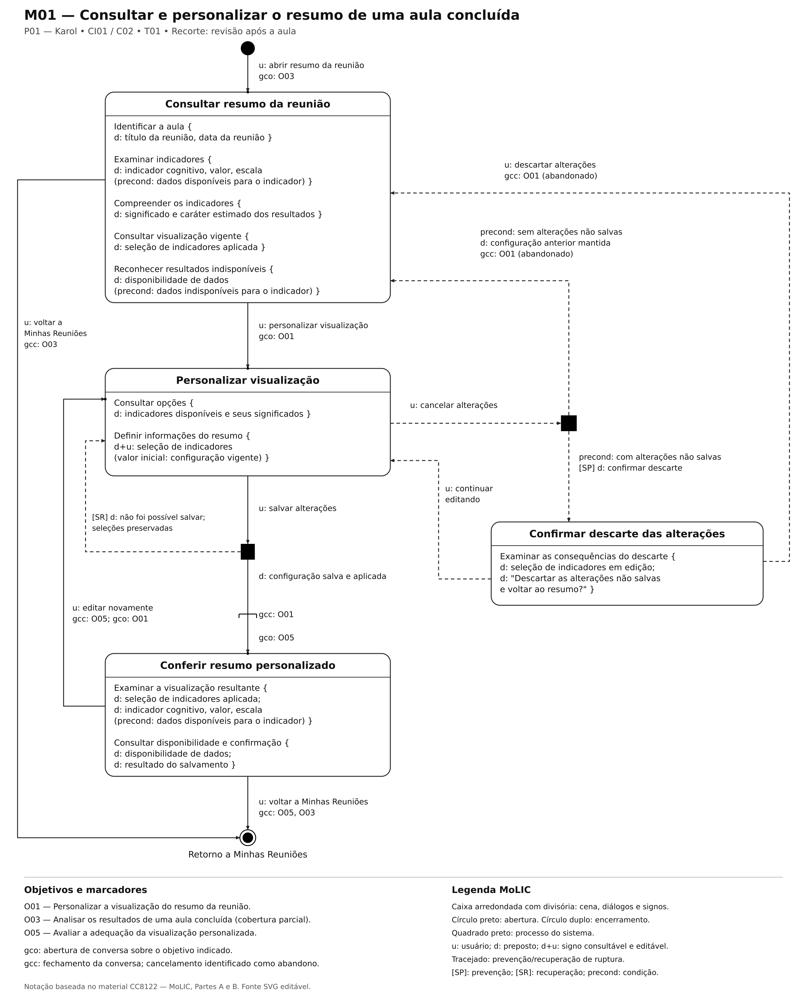

# Entrega 10 — MoLIC

**Data:** {{dd/mm/aaaa}}  
**Status:** ⬜ não iniciada  
**Responsabilidade:** 1 solução completa por integrante

## Objetivo da atividade

Modelar a interação como uma **conversa entre usuário e preposto do designer**, oferecendo visão global dos caminhos que permitem ao usuário atingir seus objetivos — incluindo alternativas e rupturas relevantes. MoLIC não deve ser reduzida a um fluxograma de telas.

> Use a **notação MoLIC ensinada na disciplina**. Este template foca critérios de qualidade e não substitui a legenda/notação apresentada em aula.

## Atenção a TCCs sem interface original

O MoLIC não modela o algoritmo por dentro. Ele modela a **conversa de interação necessária para que uma pessoa use a contribuição**.

Exemplos de conversas:

- usuário escolhe dados/parâmetros → sistema valida → usuário inicia análise → sistema comunica processamento → usuário interpreta resultado;
- usuário consulta histórico → refina filtros → abre execução → compara com outra;
- administrador seleciona perfil → altera permissão → sistema comunica consequências → administrador confirma/cancela;
- analista recebe alerta → examina evidências → classifica ocorrência → registra decisão.

Modele também rupturas plausíveis: entrada inválida, falha de processamento, ausência de resultado, permissão insuficiente, filtro sem resultados, conflito de alteração, cancelamento ou necessidade de recuperação.

## M01 — Consultar e personalizar o resumo de uma aula concluída

**Autor(a):** Kayky Pires — 22.222.040-2  
**Cenário de interação de origem:** CI01 — Acompanhar os estados da turma e revisar os resultados da aula, derivado do cenário de problema C02, relacionado à persona P01 — Karol.  
**Objetivo(s):** O01 — Personalizar a visualização do resumo da reunião; O05 — Avaliar a adequação da visualização personalizada; cobertura parcial de O03 — Analisar os resultados de uma aula concluída.  
**Tarefa(s) relacionada(s):** T01 — Personalizar a visualização dos resultados de uma aula concluída no MindFlow AI.  
**Signos relevantes:** título da reunião, data da reunião, indicador cognitivo, significado do indicador, valor do indicador, escala, disponibilidade de dados, seleção de indicadores e resultado do salvamento.

### Diagrama

### Leitura do diagrama

### Leitura do diagrama

#### Caminho principal

1. Karol solicita `u: abrir resumo da reunião`, iniciando a conversa sobre a análise dos resultados da aula (`gco: O03`).
2. Na cena **Consultar resumo da reunião**, examina o título, a data, os indicadores e a visualização vigente. O sistema comunica o significado dos indicadores, o caráter estimado dos resultados e a disponibilidade de dados.
3. Ao identificar a necessidade de personalização, solicita `u: personalizar visualização`, abrindo a conversa sobre esse objetivo (`gco: O01`).
4. Na cena **Personalizar visualização**, consulta as opções disponíveis e modifica a seleção de indicadores (`d+u: seleção de indicadores`). A configuração vigente é utilizada como valor inicial.
5. Karol solicita `u: salvar alterações`. O sistema realiza o salvamento e, em caso de sucesso, comunica `d: configuração salva e aplicada`. Essa confirmação encerra a conversa sobre a personalização (`gcc: O01`).
6. Na cena **Conferir resumo personalizado**, inicia a avaliação da visualização (`gco: O05`). Karol confere os indicadores apresentados, a seleção aplicada e o resultado do salvamento.
7. Quando considera a visualização adequada, solicita `u: voltar a Minhas Reuniões`, encerrando as conversas sobre a avaliação e a análise dos resultados (`gcc: O05, O03`). Esse retorno não representa a saída da aplicação.

#### Alternativas e rupturas

| Situação | Onde ocorre | Como o usuário percebe | Caminho de recuperação/saída |
|---|---|---|---|
| Consultar sem personalizar | Na cena **Consultar resumo da reunião**. | Karol identifica que a visualização vigente já atende às suas necessidades. | Solicita `u: voltar a Minhas Reuniões`, encerrando a conversa sobre O03 sem iniciar a personalização. |
| Cancelar sem alterações não salvas | Após solicitar o cancelamento na cena **Personalizar visualização**. | O sistema verifica que não existem alterações pendentes e comunica que a configuração anterior foi mantida. | Retorna diretamente à consulta do resumo e encerra a conversa sobre O01 como abandonada. |
| Cancelar com alterações não salvas | No processo de verificação do cancelamento e na cena **Confirmar descarte das alterações**. | O sistema comunica `[SP] d: confirmar descarte` e apresenta as consequências de descartar a seleção em edição. | Karol pode solicitar `u: continuar editando`, preservando as alterações, ou `u: descartar alterações`, retornando ao resumo com a configuração anterior e encerrando a conversa sobre O01 como abandonada. |
| Falha no salvamento | No processo do sistema iniciado por `u: salvar alterações`. | O sistema comunica `[SR] d: não foi possível salvar; seleções preservadas`, sem confirmar a aplicação das alterações. | Retorna à personalização com a seleção preservada. Karol pode tentar salvar novamente, modificar a seleção ou cancelar. |
| Necessidade de novos ajustes | Na cena **Conferir resumo personalizado**. | Ao examinar o resultado, Karol identifica que a visualização ainda precisa de ajustes. | Solicita `u: editar novamente`, encerrando a avaliação atual (`gcc: O05`) e reabrindo a personalização (`gco: O01`). |
| Dados indisponíveis | Nas cenas **Consultar resumo da reunião** e **Conferir resumo personalizado**. | O sistema informa a indisponibilidade do resultado, diferenciando ausência de dados de um valor zero. | Karol pode consultar os demais resultados disponíveis e seguir pelos caminhos de personalização ou retorno. A indisponibilidade de um indicador não é apresentada como falha no salvamento. |

### Checklist específico de modelagem

- [ ] Existe **ponto de abertura** coerente com o início do objetivo.
- [ ] As **cenas de conversa** representam tópicos/assuntos, não nomes de páginas apenas.
- [ ] As transições/falas deixam claro o que o usuário ou o sistema comunica.
- [ ] Há **ponto(s) de encerramento** para objetivos concluídos/abandonados quando aplicável.
- [ ] Processamentos do sistema estão representados conforme a notação adotada em aula, sem “inventar” fala do usuário.
- [ ] Rupturas (breakdowns) relevantes têm feedback e caminho de recuperação, não becos sem saída.
- [ ] Acessos ubíquos/atalhos só aparecem quando semanticamente justificáveis.
- [ ] O diagrama cobre caminhos alternativos importantes, e não apenas o “happy path”.
- [ ] Nomes de objetivos, tópicos e signos são coerentes com a Entrega 9.
- [ ] O diagrama é legível em tamanho normal no GitHub.
- [ ] O MoLIC representa a conversa usuário–sistema, não o fluxo interno do algoritmo.
- [ ] Processamento, filtros, administração, relatórios e históricos incluem retornos/rupturas quando relevantes.

> Repita M02, M03... para todos os integrantes.

## Consolidação da equipe

### Cobertura dos objetivos

| Objetivo | MoLIC que cobre | Lacunas/duplicidades | Decisão |
|---|---|---|---|
| O01 | M01 | O diagrama contempla consulta, seleção de indicadores, salvamento, conferência e recuperação de falha. Não há duplicidades identificadas neste recorte. Falta um encerramento explícito para quem decide sair sem salvar. | Manter o M01 para a personalização do resumo, com cancelamento direto e preservação das seleções em caso de falha. Registrar a saída sem salvar como lacuna desta versão. |

### Preparação para o Figma

Liste os estados/telas que serão necessários **a partir das conversas modeladas**, incluindo feedback, confirmação, erro e recuperação.

## Erros frequentes a evitar

- desenhar apenas caixas com nomes de telas e setas de navegação;
- não modelar falhas, cancelamento, volta ou recuperação;
- usar rótulos genéricos (“Tela 1”, “Processo 2”) sem tópico de conversa;
- criar no Figma fluxos que não existem no MoLIC;
- diagrama sem legenda/fonte editável e com texto ilegível.
