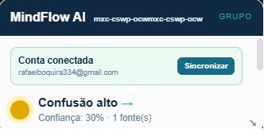
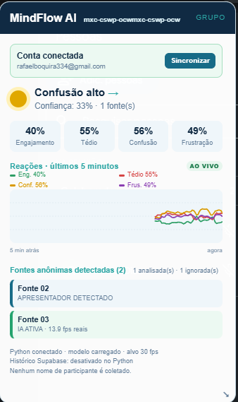

# Entrega 11 — Protótipo no Figma

**Data:** 25/11/2026  
**Status:** 🟩 concluída  
**Responsabilidade:** 1 protótipo integrado por equipe, com identificação dos responsáveis por fluxo.

## Objetivo da atividade

Materializar o modelo de interação em um protótipo navegável, preservando a lógica dos objetivos, tópicos, signos, feedbacks, alternativas e recuperações definidos nas entregas anteriores.

O protótipo do MindFlow AI representa a interação do instrutor corporativo com a extensão durante um treinamento on-line, permitindo acompanhar os estados estimados do grupo por meio de um pop-up compacto ou expandido.

A interface apresenta os indicadores de engajamento, tédio, confusão e frustração. O instrutor pode visualizar os resultados resumidos ou expandir o pop-up para acompanhar a evolução dos indicadores em um gráfico de linhas.

## Link do protótipo

**Protótipo:** conforme combinado com o professor, a entrega usa o **protótipo já implementado** no lugar de telas desenhadas no Figma. Ele está publicado em [mindflowiaa.netlify.app](https://mindflowiaa.netlify.app/) (versão 2.0: site e extensão) e documentado abaixo por prints.  
**Última verificação de acesso:** 25/11/2026 — a página pública abre sem login; as telas internas exigem conta.

## Cobertura MoLIC → protótipo

As telas abaixo são as do protótipo implementado (sistema publicado, versão 2.0). Os fluxos estão na ordem dos MoLICs, de M01 a M05.

### Fluxos M01 (Matheus) e M02 (Gustavo) — consolidação da equipe

Os fluxos M01 e M02 foram mapeados na consolidação da equipe, a partir dos estados listados nos próprios MoLICs (Entrega 10). O M01 reaproveita as telas da extensão e do resumo; o M02 precisa das telas do participante, previstas como F13 a F17.

| MoLIC | Objetivo consolidado | Fluxo/telas | Estados de erro/recuperação | Autor do MoLIC |
|---|---|---|---|---|
| M01 | OC01 — Ativar o acompanhamento com aviso a participantes de outra empresa | `F00 → F03 → F01`; os participantes recebem `F13` | `F04` (poucas câmeras) | Matheus Ferreira de Freitas |
| M01 | OC02 — Perceber o estado do grupo enquanto apresenta | `F01`, com `F02` para detalhes | `F04` (sinal insuficiente) | Matheus Ferreira de Freitas |
| M01 | OC03/OC04 — Verificar a reação depois da pílula de dúvida e quanto confiar nela | `F01 → F05 → F06` | Dispensar o aviso e voltar para `F01` | Matheus Ferreira de Freitas |
| M01 | OC06 — Marcar o momento e anotar um ponto para o follow-up | `F05 → F12 → F01` | — | Matheus Ferreira de Freitas |
| M01 | OC08 — Encerrar a reunião com o resumo salvo | `F01/F02 → F08` | `F08`, falha ao salvar | Matheus Ferreira de Freitas |
| M01 | OC09/OC12 — Revisar a reunião e registrar o retorno do cliente | `F09 → F10`, com os momentos marcados na linha do tempo | `F10V` (sem leituras) | Matheus Ferreira de Freitas |
| M02 | OC13 — Entender o que acontece com a própria imagem | `F13 → F15` | — | Gustavo Bertoluzzi Cardoso |
| M02 | OC14 — Escolher e mudar como participar | `F13 → F16 → F14` | `F14`, estado "aparelho sem processamento local" | Gustavo Bertoluzzi Cardoso |
| M02 | OC15 — Conferir a própria participação, durante e depois | `F14` durante a aula; `F17` depois | `F17`, estado "nesta aula sua imagem não foi analisada" | Gustavo Bertoluzzi Cardoso |

---

### Fluxo M03 — Kayky Pires

O fluxo M03 corresponde à consulta e à personalização do resumo de uma aula concluída, relacionado à persona P01 — Karol Schrödinger. Ele usa as telas do site (F09 a F11).

**Responsável:** Kayky Pires — 22.222.040-2
**Cenário de origem:** CI03 (Entrega 9)
**MoLIC:** M03 — Consultar e personalizar o resumo de uma aula concluída (Entrega 10).

| MoLIC | Objetivo | Fluxo/telas no protótipo | Estados de erro/recuperação | Responsável |
|---|---|---|---|---|
| M03 — Selecionar, consultar e avaliar o resumo | O03 — Analisar os resultados de uma aula concluída. | F09 — Minhas Reuniões → Ver resumo → F10 — Resumo da Reunião. | F10V documenta o resumo sem leituras e as explicações dos cards. O usuário pode retornar a Minhas Reuniões. | Kayky Pires — 22.222.040-2 |
| M03 — Personalizar visualização | O01 — Personalizar a visualização do resumo da reunião. | F10 → Organizar dashboard → F11 — Editor de personalização → Salvar visualização. | F11E apresenta a validação do nome não preenchido. O cancelamento retorna diretamente ao resumo. F11C registra a confirmação de exclusão de uma visualização já salva. | Kayky Pires — 22.222.040-2 |
| M03 — Conferir resumo personalizado | O05 — Avaliar a adequação da visualização personalizada. | Após o salvamento, F10S apresenta a visualização selecionada e a confirmação de sucesso. Organizar dashboard permite acessar novamente o editor F11. | F10S documenta o retorno de sucesso. A reunião utilizada no print permanece sem leituras, independentemente do salvamento da configuração. | Kayky Pires — 22.222.040-2 |

---

### Fluxo M04 — Rafael Dias

O fluxo M04 corresponde ao acompanhamento dos estados do grupo durante um treinamento on-line, relacionado à persona P03 — Nathanael Lima.

**Responsável:** Rafael Dias — 22.222.039-4  
**Cenário de origem:** CI04 (Entrega 9)  
**MoLIC:** M04 — Acompanhar os estados do grupo durante o treinamento on-line.

| MoLIC | Objetivo | Fluxo/telas no protótipo | Estados de erro/recuperação | Responsável |
|---|---|---|---|---|
| M04 | Iniciar a análise do estado do grupo | `F00 → F03 → F01` | `F04` | Rafael Dias |
| M04 | Acompanhar os indicadores do grupo durante o treinamento | `F01` | `F04` | Rafael Dias |
| M04 | Expandir o pop-up para visualizar todos os indicadores | `F01 → F02` | Retornar para `F01` | Rafael Dias |
| M04 | Recolher o pop-up expandido | `F02 → F01` | — | Rafael Dias |
| M04 | Consultar a evolução dos estados do grupo | `F02` | `F04` quando não houver dados disponíveis | Rafael Dias |
| M04 | Recuperar o acompanhamento após indisponibilidade | `F04 → F03 → F01` | Tentar novamente ou continuar sem análise | Rafael Dias |

**Observação:** F01 e F02 correspondem às interfaces apresentadas nas imagens do sistema. F00, F03 e F04 são estados previstos no MoLIC para completar o fluxo e ainda precisam ser implementados no sistema.

---

### Fluxo M05 — Isabella Rosseto

O fluxo M05 corresponde ao acompanhamento da turma durante a explicação de um conteúdo novo, relacionado à persona P02 — Camila Duarte. Ele usa as mesmas telas da extensão do fluxo M04 (F00 a F04) e acrescenta os estados F05 a F08, que o M05 exige.

**Responsável:** Isabella Vieira Silva Rosseto — 22.222.036-0  
**Cenário de origem:** CI05 (Entrega 9)  
**MoLIC:** M05 — Acompanhar o estado da turma durante a explicação (Entrega 10).

| MoLIC | Objetivo | Fluxo/telas no protótipo | Estados de erro/recuperação | Responsável |
|---|---|---|---|---|
| M05 | O11 — Ativar o acompanhamento da turma | `F00 → F03 → F01` | `F04` (poucas câmeras ligadas) | Isabella Rosseto |
| M05 | O12 — Perceber o estado da turma | `F01`, com `F02` para detalhes | `F04` (sinal insuficiente no meio da aula) | Isabella Rosseto |
| M05 | O13 — Examinar uma mudança no estado | `F01 → F05` | Dispensar o aviso e voltar para `F01` | Isabella Rosseto |
| M05 | O14 — Entender o significado e a confiança | `F05 → F06` (ou `F06` pela ajuda, de qualquer tela) | Voltar para `F05` ou `F01`, conforme a origem | Isabella Rosseto |
| M05 | O15 — Marcar o momento para revisar depois | `F05 → F01`, com a confirmação "momento marcado" | — | Isabella Rosseto |
| M05 | O16 — Pausar ou retomar o acompanhamento | `F01/F02 → F07 → F03 → F01` | — | Isabella Rosseto |
| M05 | O17 — Encerrar a aula com o resumo salvo | `F01/F02/F07 → F08` | `F08`, estado de falha: tentar novamente ou tentar mais tarde | Isabella Rosseto |

**Observação:** F01 e F02 existem nas imagens do sistema. F05 a F08 são estados previstos no M05 e ainda não implementados no sistema; ficam como melhoria da próxima versão. As decisões de F01, F04 e F07 também respondem a problemas da minha avaliação heurística (Entrega 13): V10 (estado da turma em primeiro plano no modo compacto), V11 (mínimo de participantes) e V16 (pausar pelo pop-up).

---

### Resumo da cobertura

| MoLIC | Autor | Telas usadas | Situação |
|---|---|---|---|
| M01 | Matheus | F00–F06, F08–F10, F12, F13 | mapeado na consolidação |
| M02 | Gustavo | F13–F17 | mapeado na consolidação; telas previstas, ainda não implementadas |
| M03 | Kayky | F09–F11 (com variantes F10V, F10S, F11E, F11C) | mapeado pelo autor; telas existentes no sistema |
| M04 | Rafael | F00–F04 | mapeado pelo autor |
| M05 | Isabella | F00–F08 | mapeado pela autora |

---

## Catálogo de telas/estados

### F00 — Acompanhamento não iniciado

**Objetivo do usuário:** iniciar a análise dos estados do grupo durante o treinamento on-line.

**Descrição:** estado inicial proposto para a extensão, antes do início da análise. O usuário encontra o botão para iniciar o acompanhamento.

**Signos principais:**
- Acompanhamento da reunião;
- Estado da análise;
- Iniciar análise.

**Origem no MoLIC:** M04 — cena "Iniciar acompanhamento".

**Interações:**
- `u: iniciar análise` → F03.

**Estado:** previsto no MoLIC M04; a implementar no sistema.

### F01 — Pop-up compacto de acompanhamento

**Objetivo do usuário:** acompanhar rapidamente o estado predominante do grupo sem interromper o treinamento.

**Descrição:** o pop-up apresenta uma visualização reduzida dos resultados, permitindo identificar o estado predominante e acessar informações mais detalhadas.

Na imagem fornecida, a interface apresenta:
- Identificação do MindFlow AI;
- Conta conectada e opção de sincronização;
- Estado predominante: "Confusão alto";
- Indicador visual circular amarelo;
- Confiança da estimativa: 30%;
- Quantidade de fontes: 1 fonte;
- Controle para expandir o pop-up.

**Signos principais:**
- Estado predominante;
- Confiança da estimativa;
- Participantes ou fontes contribuindo;
- Acompanhamento da reunião;
- Expandir pop-up.

**Origem no MoLIC:** M04 — cena "Acompanhar estado do grupo".

**Interações:**
- `u: expandir pop-up` → F02;
- `u: recolher/manter visualização compacta` → permanece em F01;
- O sistema atualiza os indicadores conforme novos resultados ficam disponíveis.

**Feedback:** o estado predominante, a confiança e a quantidade de fontes informam ao usuário o resultado atual da análise e sua base.

### F02 — Pop-up expandido com gráfico de indicadores

**Objetivo do usuário:** visualizar os indicadores completos e acompanhar suas variações durante o treinamento.

**Descrição:** ao expandir o pop-up, o instrutor tem acesso a informações detalhadas sobre os estados do grupo.

Na imagem fornecida, a interface apresenta:
- Estado predominante "Confusão alto";
- Confiança da estimativa: 33%;
- Quantidade de fontes: 1 fonte;
- Engajamento: 40%;
- Tédio: 55%;
- Confusão: 56%;
- Frustração: 49%;
- Gráfico de linhas com os quatro indicadores;
- Referência temporal dos últimos cinco minutos;
- Identificação "AO VIVO";
- Informações sobre fontes anônimas detectadas;
- Informações técnicas sobre o processamento e a conexão.

O indicador de confusão apresenta o maior valor (56%), enquanto o engajamento apresenta o menor (40%).

O gráfico permite observar a evolução dos quatro estados ao longo do período exibido.

**Signos principais:**
- Estado predominante;
- Valor dos indicadores;
- Engajamento;
- Tédio;
- Confusão;
- Frustração;
- Variação dos indicadores;
- Período analisado;
- Confiança da estimativa;
- Fontes contribuindo;
- Estado de atualização.

**Origem no MoLIC:** M04 — cena "Examinar todos os estados".

**Interações:**
- `u: recolher pop-up` → F01;
- O sistema atualiza os valores e o gráfico durante o acompanhamento.

**Feedback:** os cartões numéricos permitem comparar os indicadores, enquanto o gráfico apresenta sua evolução no tempo.

### F03 — Iniciando análise

**Objetivo do usuário:** compreender que o sistema está processando o início do acompanhamento.

**Descrição:** estado de carregamento proposto para o período entre o acionamento da análise e a apresentação dos primeiros resultados.

**Signos principais:**
- Estado da análise;
- Processamento;
- Disponibilidade de dados.

**Origem no MoLIC:** M04 — processo de início da análise.

**Interações:**
- `d: análise iniciada` → F01;
- `d: análise indisponível` → F04.

**Feedback:** mensagem indicando que o sistema está iniciando a análise.

**Estado:** previsto no MoLIC M04; a implementar no sistema.

### F04 — Análise indisponível ou dados insuficientes

**Objetivo do usuário:** compreender por que não existem resultados e conseguir continuar a atividade.

**Descrição:** estado de erro ou indisponibilidade apresentado quando o sistema não consegue obter dados suficientes para realizar a análise.

**Signos principais:**
- Disponibilidade de dados;
- Estado da análise;
- Motivo da indisponibilidade;
- Fontes contribuindo.

**Origem no MoLIC:** M04 — cena de ruptura "Entender ausência de resultados".

**Interações:**
- `u: tentar novamente` → F03;
- `u: continuar sem análise` → encerra o acompanhamento, permitindo continuar o treinamento.

**Feedback:** mensagem informando que não foi possível apresentar os indicadores.

**Recuperação:** possibilidade de tentar iniciar novamente ou continuar o treinamento sem os resultados do MindFlow AI.

**Estado:** previsto no MoLIC M04 para cobrir a ruptura; a implementar no sistema.

---

### F05 — Aviso de mudança no estado da turma

**Responsável:** Isabella Rosseto (M05)

**Objetivo do usuário:** perceber que o estado da turma mudou sem tirar a atenção da explicação.

**Descrição:** aviso discreto dentro do pop-up compacto, que aparece quando o estado predominante muda por tempo suficiente. Mostra o estado anterior, o atual, desde quando e a confiança. Não sugere o que a professora deve fazer (RC03), e aparece um aviso por vez, sem acumular avisos antigos (RC06).

**Signos principais:** mudança de estado; estado predominante; confiança da estimativa; participantes contribuindo.

**Origem no MoLIC:** M05 — cena "Examinar a mudança no estado".

**Interações:**
- `u: o que isso significa?` → F06;
- `u: marcar este momento` → confirmação "Momento marcado aos 23 min" → F01;
- `u: dispensar o aviso` → F01.

**Estado:** previsto no MoLIC, ainda não implementado no sistema.

### F06 — Significado e confiança da estimativa

**Responsável:** Isabella Rosseto (M05)

**Objetivo do usuário:** entender o que o estado significa e quanto confiar nele.

**Descrição:** painel curto, aberto a partir do aviso ou pela ajuda, que explica o estado em linguagem simples ("parte da turma mostra sinais associados a dificuldade"), o que a estimativa não indica (não avalia alunos individualmente) e por que a confiança está alta, média ou baixa.

**Signos principais:** significado do indicador; confiança da estimativa; qualidade do sinal.

**Origem no MoLIC:** M05 — cena "Entender o significado da estimativa"; acesso ubíquo `u: ajuda`.

**Interações:**
- `u: voltar` → F05 (quando veio do aviso) ou F01 (quando veio da ajuda).

**Estado:** previsto no MoLIC, ainda não implementado no sistema.

### F07 — Acompanhamento pausado

**Responsável:** Isabella Rosseto (M05)

**Objetivo do usuário:** interromper o acompanhamento rapidamente, sem sair da videochamada.

**Descrição:** o pop-up mostra que o acompanhamento está pausado desde determinado horário e que os participantes foram avisados. O botão "Pausar acompanhamento" fica visível em F01 e F02.

**Signos principais:** acompanhamento (ativo, pausado ou desligado); aviso aos participantes.

**Origem no MoLIC:** M05 — acesso ubíquo `u: pausar acompanhamento` e cena "Acompanhamento pausado".

**Interações:**
- `u: retomar o acompanhamento` → F03;
- `u: encerrar a aula` → F08.

**Estado:** previsto no MoLIC, ainda não implementado no sistema.

### F08 — Encerramento da aula: resumo salvo ou falha ao salvar

**Responsável:** Isabella Rosseto (M05)

**Objetivo do usuário:** saber que a aula ficou registrada para revisar depois.

**Descrição:** ao encerrar, o pop-up confirma "Resumo salvo — disponível no Dashboard". Se o salvamento falhar, mostra o motivo, informa que os dados continuam no computador e oferece duas saídas.

**Signos principais:** resumo da aula; momento marcado.

**Origem no MoLIC:** M05 — processo de encerramento, fechamento da conversa (`gcc`) e cena de alerta "Salvar o registro da aula".

**Interações:**
- `d: resumo salvo` → fim do acompanhamento;
- `d: falha ao salvar` → `u: tentar novamente` (novo salvamento) ou `u: tentar mais tarde` (encerra sem perder os dados).

**Estado:** previsto no MoLIC, ainda não implementado no sistema.

---

### F09: M03 — Minhas Reuniões

**Objetivo do usuário:** localizar uma reunião concluída e acessar seus resultados pelo botão **Ver resumo**.  
**Signos principais:** título, data, duração, quantidade de participantes, situação da reunião e indicador de engajamento.  
**Origem no MoLIC:** contexto de acesso anterior ao ponto de abertura do M03, correspondente à solicitação `u: abrir resumo da reunião`.

### F10: M03 — Resumo da Reunião: estado sem dados (F10V)

**Objetivo do usuário:** consultar os resultados da reunião, compreender os indicadores e identificar a possibilidade de personalizar sua apresentação.  
**Signos principais:** título e data da reunião, participantes, indicadores, explicações dos cards, disponibilidade de dados e visualização selecionada.  
**Origem no MoLIC:** M03 — cena **Consultar resumo da reunião**, relacionada a O03.

O registro apresenta as mensagens **“Sem reações neste intervalo”** e **“Sem leituras para esta reunião”**, além da explicação aberta do card de participantes. O botão **Organizar dashboard** permite iniciar a personalização.

### F11: M03 — Personalizar visualização

**Objetivo do usuário:** escolher os blocos apresentados no resumo, definir sua organização e atribuir um nome à visualização.  
**Signos principais:** nome da visualização, blocos disponíveis, seleção de blocos e ordem de apresentação.  
**Origem no MoLIC:** M03 — cena **Personalizar visualização**, relacionada a O01.

O editor apresenta caixas de seleção, controles de ordenação e orientações para arrastar e redimensionar os blocos. As ações disponíveis incluem **Cancelar** e **Salvar visualização**.

### F11E: M03 — Validação: tentativa de salvar sem nome

**Objetivo do usuário:** identificar o dado necessário para concluir o salvamento e corrigir a entrada.  
**Signos principais:** nome da visualização, seleção de blocos e mensagem **“Dê um nome para a visualização.”**  
**Origem no MoLIC:** detalhamento da validação associada à cena **Personalizar visualização** e à solicitação `u: salvar alterações`, a incorporar na revisão do M03.

Após a tentativa de salvamento sem nome, o editor permanece aberto com a seleção visível. A recuperação consiste em preencher o nome e solicitar novamente **Salvar visualização**. Esse estado representa um erro de entrada, distinto de uma falha técnica no salvamento.

### F10S: M03 — Visualização salva e aplicada

**Objetivo do usuário:** reconhecer que a visualização foi salva e conferir a configuração apresentada no resumo.  
**Signos principais:** nome da visualização selecionada, blocos apresentados e mensagem **“Visualização ‘dsa’ salva na sua conta.”**  
**Origem no MoLIC:** M03 — retorno de sucesso do processo de salvamento e cena **Conferir resumo personalizado**, relacionada a O01 e O05.

O editor está fechado, a visualização nomeada aparece selecionada e a mensagem confirma o salvamento. O usuário pode solicitar novos ajustes pelo botão **Organizar dashboard**. A reunião utilizada neste registro permanece sem leituras; salvar a configuração não altera a disponibilidade dos dados.

### F11C: M03 — Confirmação de exclusão de uma visualização salva

**Objetivo do usuário:** confirmar ou cancelar a exclusão de uma visualização salva.  
**Signos principais:** nome da visualização, mensagem **“Excluir a visualização ‘dsa’?”** e opções **OK** e **Cancelar**.  
**Origem no MoLIC:** ação adicional de gerenciamento de visualizações, cuja conversa de exclusão ainda precisa ser incorporada ao modelo de interação.

A confirmação é apresentada antes da exclusão. O registro evidencia a solicitação de confirmação, mas não apresenta o resultado após sua aceitação.

---

### F12 — Anotar um momento marcado

**Origem:** M01 (consolidação da equipe)

**Objetivo do usuário:** registrar, sem sair da apresentação, um ponto para retomar depois (por exemplo, no follow-up com o cliente).

**Descrição:** campo curto que se abre depois de "marcar este momento" (F05), com o minuto da sessão já preenchido e um texto opcional.

**Signos principais:** momento marcado; anotação.

**Interações:** `u: salvar anotação` → confirmação "Anotação salva no momento marcado" → F01; `u: pular` → F01.

**Estado:** previsto no MoLIC, ainda não implementado no sistema.

### F13 — Aviso de análise ativa para o participante

**Origem:** M02 (consolidação da equipe)

**Objetivo do usuário:** saber, ao entrar na aula, que a análise está ativa e o que ela faz.

**Descrição:** aviso com três blocos — o que a webcam capta, o que o comunicador recebe e o que não é feito com os dados — e as ações "ler mais", "escolher como participar" e "fechar". O texto é o mesmo enviado quando o comunicador ativa o acompanhamento (OC01).

**Signos principais:** aviso aos participantes; análise da turma.

**Interações:** `u: ler mais` → F15; `u: escolher como participar` → F16; `u: fechar` → F14.

**Estado:** previsto no MoLIC, ainda não implementado no sistema.

### F14 — Indicador de participação

**Origem:** M02 (consolidação da equipe)

**Objetivo do usuário:** conferir, a qualquer momento, se está contribuindo para a análise.

**Descrição:** indicador pequeno e permanente ao lado dos controles da chamada, nos estados "participando", "câmera ligada · análise pausada", "não participando", "análise da turma pausada pela professora", "análise encerrada" e "aparelho sem processamento local".

**Signos principais:** participação na análise; análise da turma.

**Interações:** `u: abrir` → F13 (reabre o aviso) ou F16 (mudar a participação).

**Estado:** previsto no MoLIC, ainda não implementado no sistema.

### F15 — Informações completas sobre os dados

**Origem:** M02 (consolidação da equipe)

**Objetivo do usuário:** tirar uma dúvida específica sobre os dados.

**Descrição:** perguntas e respostas curtas e o contato para dúvidas que não forem respondidas.

**Signos principais:** informações completas; contato para dúvidas.

**Interações:** `u: voltar` → F13 ou F14.

**Estado:** previsto no MoLIC, ainda não implementado no sistema.

### F16 — Escolha da participação

**Origem:** M02 (consolidação da equipe)

**Objetivo do usuário:** escolher como participar da análise.

**Descrição:** três opções sem nenhuma pré-selecionada — participar com câmera, câmera ligada sem participar da análise [H] e câmera desligada — com a frase de que o comunicador vê só o resultado da turma em todas elas.

**Signos principais:** participação na análise.

**Interações:** `u: confirmar` → F14 com o novo estado e a confirmação do que mudou.

**Estado:** previsto no MoLIC M02, ainda não implementado no sistema; a segunda opção depende de H03.

### F17 — Resumo de transparência da aula

**Origem:** M02 (consolidação da equipe)

**Objetivo do usuário:** conferir depois da aula o que foi processado e que nada foi registrado sobre ele.

**Descrição:** resumo do que foi e do que não foi processado na aula. Quando a imagem não foi analisada, mostra o estado "nesta aula sua imagem não foi analisada" e o motivo.

**Signos principais:** resumo de transparência.

**Estado:** previsto no MoLIC M02, ainda não implementado no sistema; depende de H03.

---

> Documente também estados que muitas equipes esquecem: carregamento, vazio, confirmação, sucesso, erro, permissão negada, cancelamento, desfazer/voltar quando aplicável.

## Sistema visual e consistência

O sistema visual segue a identidade apresentada nas interfaces da extensão MindFlow AI, priorizando uma visualização compacta e objetiva para utilização durante videoconferências.

| Elemento | Regra adotada | Justificativa |
|---|---|---|
| Tipografia | Fonte sem serifa, com títulos em destaque e textos auxiliares menores. | Facilitar a leitura e organizar as informações em uma interface compacta. |
| Cores | Cabeçalho azul-escuro, fundo claro, cartões em tons suaves e cores distintas para os indicadores. | Criar hierarquia visual e permitir diferenciar os estados do grupo. |
| Componentes | Pop-up compacto, cartões de indicadores, botões, gráfico de linhas e mensagens de status. | Manter consistência entre a visualização resumida e a expandida. |
| Feedback | Estado predominante, confiança, fontes contribuindo e indicação de atualização ao vivo. | Comunicar o resultado e o contexto da estimativa durante o acompanhamento. |
| Navegação | Controle de expansão e recolhimento do pop-up. | Permitir alternar entre uma consulta rápida e uma visualização detalhada sem interromper o treinamento. |
| Gráficos | Linhas distintas para engajamento, tédio, confusão e frustração, acompanhadas de legenda. | Permitir acompanhar a evolução dos estados e comparar seus valores. |
| Mensagens de erro | Mensagem textual acompanhada de opção de recuperação. | Evitar que o usuário fique sem orientação quando a análise estiver indisponível. |

### Consistência entre os estados

- A visualização compacta e a expandida apresentam informações referentes à mesma análise.
- O estado predominante deve corresponder aos indicadores disponíveis no momento.
- Os nomes dos indicadores devem permanecer consistentes entre os cartões e o gráfico.
- O usuário pode expandir ou recolher o pop-up sem reiniciar a análise.
- As atualizações não devem alterar automaticamente o modo de visualização selecionado.
- A ausência de dados não deve ser apresentada como um indicador com valor zero.
- Os indicadores são estimativas do estado do grupo, não avaliações individuais de aprendizagem.

### Sistema visual do site (resumo e dashboard) — M03

| Elemento | Regra adotada | Justificativa |
|---|---|---|
| Tipografia | Uso de fonte sem serifa, títulos destacados e hierarquia entre nomes das telas, seções, rótulos e textos explicativos. | Facilitar a identificação das informações e a leitura dos resultados e das opções de personalização. |
| Cores | Tons de roxo destacam ações principais, como Organizar dashboard e Salvar visualização. A exclusão utiliza vermelho. Os indicadores e gráficos combinam cores com nomes, valores e legendas. | Diferenciar ações e informações, oferecendo identificação textual além da cor. A adequação do contraste ainda precisa ser verificada. |
| Componentes | Reutilização de menu lateral, cards, botões, campos de texto, seletores e caixas de seleção. O editor mantém os controles Cancelar e Salvar visualização próximos entre si e oferece botões de ordenação além da interação por arraste. | Preservar padrões reconhecíveis durante a navegação e facilitar a localização das ações de personalização. |
| Feedback | Mensagens textuais comunicam nome não preenchido, salvamento concluído e ausência de leituras. A exclusão de uma visualização salva apresenta uma confirmação. O cancelamento da edição retorna diretamente ao resumo. | Informar o resultado das ações, orientar a correção de entradas e permitir que o usuário confirme uma exclusão antes de realizá-la. |

---

## Verificação de acessibilidade básica

**Como foi verificado (25/11/2026):** nas telas públicas do sistema publicado (página inicial e tela de entrada), rodamos o **axe-core 4.10**, ferramenta automática que testa os critérios WCAG 2.0/2.1 níveis A e AA, e percorremos a tela com a tecla **Tab** para conferir ordem e foco visível. As telas internas (resumo, dashboard, extensão) exigem login e foram avaliadas pelos prints, sem teste automático.

| Critério | Aplicação no protótipo | Verificação |
|---|---|---|
| Contraste (WCAG 1.4.3) | Contraste adequado entre textos, cartões e fundo | **Atende nas telas públicas:** o axe-core não encontrou nenhuma falha de contraste na página inicial nem na tela de entrada. Telas internas: não verificado automaticamente. |
| Uso de cores (WCAG 1.4.1) | Não depender só da cor para diferenciar os indicadores | **Atende parcialmente:** os indicadores têm nome e valor junto da cor, mas as cores mudam entre o pop-up e o gráfico do resumo (HC08 da Entrega 13). |
| Legibilidade | Textos legíveis no tamanho reduzido do pop-up | **Atende parcialmente:** os rótulos principais são legíveis; os textos técnicos do rodapé do pop-up são pequenos e disputam espaço (HC03). |
| Navegação por teclado (WCAG 2.1.1) | Acessar os controles por teclado | **Atende nas telas públicas:** com Tab, o foco passa por todos os links e botões na ordem visual (menu, "Entrar", "Criar conta", campos de e-mail e senha, "Mostrar senha", "Esqueci minha senha", "Entrar", "Ajuda"). |
| Foco visível (WCAG 2.4.7) | Destacar o controle selecionado | **Atende:** os campos e o botão de ajuda têm destaque próprio (borda de 3 px com sombra); os demais botões usam o contorno padrão do navegador, visível, mas fino. Recomendação: usar o mesmo destaque dos campos em todos os botões. |
| Identificação dos controles (WCAG 4.1.2) | Nomes compreensíveis para botões e ações | **Falha encontrada:** na página inicial, os três botões de navegação do carrossel ("pontos") usam atributos ARIA não permitidos, e o grupo que os contém tem papel ARIA com filhos inválidos (regras `aria-allowed-attr` e `aria-required-children`, impacto crítico no axe). Um leitor de tela pode anunciar esses controles de forma errada. Os demais controles têm nome. |
| Compreensão dos resultados | Nomes, valores e contexto das estimativas | **Atende parcialmente:** o gráfico explica o que as linhas representam, mas as porcentagens têm significados diferentes sem rótulo (HC05). |

**Correções recomendadas:** ajustar os atributos ARIA dos pontos do carrossel da página inicial; aplicar o mesmo destaque de foco dos campos a todos os botões; e repetir o teste automático nas telas internas com uma conta de teste.

## Checklist

- [x] O protótipo está acessível — o professor aceitou o protótipo implementado no lugar do Figma; o sistema está publicado em mindflowiaa.netlify.app.
- [x] Há screenshots representativos no repositório (`assets/11_figma`).
- [x] As duas interfaces principais do acompanhamento foram identificadas (pop-up compacto e expandido).
- [x] O fluxo principal de cada MoLIC (M01 a M05) foi mapeado para as telas.
- [x] Os estados de carregamento, erro e recuperação foram considerados — os que existem no sistema estão documentados (F10V, F11E, F11C); os previstos no MoLIC e ainda não implementados estão identificados no catálogo.
- [x] A terminologia dos indicadores está relacionada à Entrega 9.
- [x] A navegação entre pop-up compacto e expandido foi definida.
- [x] Os fluxos críticos estão navegáveis do início ao fim no sistema publicado.
- [x] O protótipo está pronto para inspeção e testes sem links mortos (sistema publicado, inspecionado na Entrega 13).
- [x] Os indicadores e o gráfico possuem justificativa relacionada ao objetivo do usuário.
- [x] Os estados de processamento, indisponibilidade e recuperação foram considerados.
- [x] Os resultados técnicos são apresentados por conceitos compreensíveis ao instrutor.
- [x] Os estados previstos foram diferenciados das interfaces já implementadas.
- [x] A acessibilidade básica foi verificada no protótipo navegável (axe-core e teclado nas telas públicas; telas internas pelos prints).
- [x] A cobertura dos diagramas MoLIC da equipe foi consolidada (seção "Resumo da cobertura").

**Observação final:** o catálogo reúne as telas de todos os fluxos com numeração única (F00 a F17). F01, F02 e F09 a F11 existem no sistema publicado. F00 e F03 a F08 (extensão) e F12 a F17 (anotação e interface do participante) são estados previstos nos MoLICs que ainda não foram implementados e ficam como melhorias, ligadas aos problemas HC02, HC03, HC04 e HC11 da avaliação heurística (Entrega 13).
